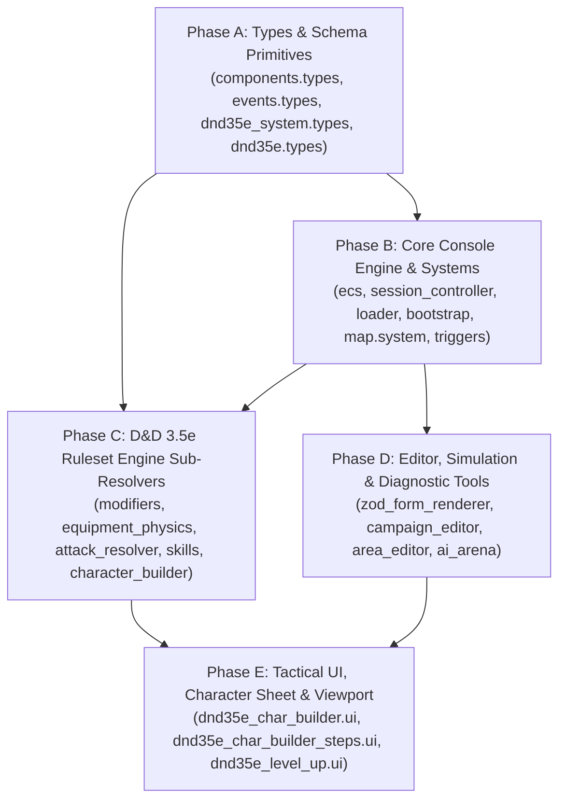

# Research Notes: Comprehensive Codebase Modularity & File Decomposition

## 1. Reiteration of Architectural Rules & Standards (Step 1)

Per `AGENTS.md` and `docs/ARCHITECTURE.md`:
1. **Modularity & File Boundaries (`AGENTS.md` Rule 8):**
   - "One concern per file. Split files if they handle multiple responsibilities or exceed ~250 lines."
   - "Barrel files (`index.ts`) are BANNED. Use direct imports."
   - "No circular imports. The dependency graph flows DOWN: `main → core → systems → map/rendering → types/constants/utils`."
2. **Type Strictness (`AGENTS.md` Rule 11):**
   - "NEVER use `any`. There are zero acceptable uses of `any`. Use `unknown` + type narrowing, generics, or branded types."
   - All function signatures must have explicit return types.
3. **No Magic Literals (`AGENTS.md` Rule 12):**
   - Every literal affecting gameplay, limits, or configurations must be a named constant or enum member.
4. **Three-Tier Placement Heuristic (`AGENTS.md` Rule 16):**
   - **Tier 1 — Core Console Engine (`src/core/`, `src/systems/`, `src/types/`):** Generic ECS primitives, turn scheduling, item persistence, spatial index, narrative triggers. Reusable across any ruleset.
   - **Tier 2 — Ruleset Cartridge (`src/rulesets/<id>/`):** Pure baseline mathematical and mechanical laws of the tabletop system (D&D 3.5e 4-stage DAG, 18-bonus stacking, attack routines, skill verbs).
   - **Tier 3 — System Content (`public/data/rulesets/<id>/*.json`):** Modular JSON data (races, classes, feats, spells, items).
5. **Cascading Effects in All Three Directions (`AGENTS.md` Rule 15):**
   - Every decomposition must explicitly track:
     - **Upstream:** Call sites, intent producers, event emitters.
     - **Downstream:** Validators, serializers, renderers, test suites.
     - **Lateral:** Sibling campaign JSONs, editor forms, SSOT registries.
6. **Backward-Compatible Facade Pattern:**
   - In each decomposed file, retain the primary public API entry points with re-exports from the new single-concern sub-modules during transition, guaranteeing 0 regression test breakage while enabling incremental call-site migration.

---

## 2. Global Dependency Order & 5-Phase Execution Architecture (Step 2)

To maintain a pristine downward dependency graph and prevent split-brain imports or compilation circularity, the decomposition must proceed in strict dependency order:

---

## 3. Phase-by-Phase File Inventory & Decomposition Blueprint

### Phase A: Foundational Types & Schemas (4 files)

#### A.1 `src/types/components.types.ts` (764 lines)
- **Domain:** Tier 1 Console (`Core Console: Types`)
- **Current Responsibilities:** Defines 35+ ECS component interfaces, component payloads, and the central `ComponentType` enum.
- **Decomposition Target:**
  - `src/types/components/actor_components.types.ts` (~250 lines): `FighterComponent`, `PlayerComponent`, `IdentityComponent`, `FactionComponent`, `MemoryComponent`, `AttitudeComponent`.
  - `src/types/components/world_components.types.ts` (~250 lines): `PositionComponent`, `AreaComponent`, `DoorComponent`, `LockComponent`, `TrapComponent`, `HazardComponent`, `SpatialFieldComponent`.
  - `src/types/components/item_components.types.ts` (~200 lines): `ItemComponent`, `InventoryComponent`, `EquipmentComponent`, `PropertyOverlayComponent`.
  - `src/types/components.types.ts` (< 150 lines): `ComponentType` enum and re-exports of all component interfaces.

#### A.2 `src/types/events.types.ts` (397 lines)
- **Domain:** Tier 1 Console (`Core Console: Types`)
- **Current Responsibilities:** Discriminated union of all 40+ `GameEvent` interfaces and `GameEventType` enum.
- **Decomposition Target:**
  - `src/types/events/combat_events.types.ts` (~180 lines): Attack, damage, death, maneuver, combat doctrine events.
  - `src/types/events/interaction_events.types.ts` (~180 lines): Dialogue, trade, loot, inspect, social, narrative events.
  - `src/types/events.types.ts` (< 150 lines): `GameEventType` enum, `BaseGameEvent`, and the `GameEvent` discriminated union.

#### A.3 `src/rulesets/dnd35e/types/dnd35e_system.types.ts` (962 lines)
- **Domain:** Tier 1 Types (`D&D 3.5e: Ruleset Types & Schemas`)
- **Current Responsibilities:** Zod schemas and TypeScript interfaces for system content records (races, classes, feats, spells, creature types, templates, domains).
- **Decomposition Target:**
  - `src/rulesets/dnd35e/types/system/race_class.types.ts` (~250 lines): Race, class, progression track, save curves, BAB curves.
  - `src/rulesets/dnd35e/types/system/feat_spell.types.ts` (~260 lines): Feat grant descriptors, spell definitions, metamagic descriptors, domain schemas.
  - `src/rulesets/dnd35e/types/system/creature_template.types.ts` (~240 lines): Creature type engines, monster templates, dragon families, elemental steps.
  - `src/rulesets/dnd35e/types/dnd35e_system.types.ts` (< 220 lines): `DnD35EffectBundle` schema, `DnD35SystemContentSchema`, container types.

#### A.4 `src/rulesets/dnd35e/types/dnd35e.types.ts` (472 lines)
- **Domain:** Tier 1 Types (`D&D 3.5e: Ruleset Types & Schemas`)
- **Current Responsibilities:** 6 ability score types, conditions, damage types, resolved stat DTOs, modifier condition interfaces.
- **Decomposition Target:**
  - `src/rulesets/dnd35e/types/stats.types.ts` (~200 lines): `AbilityScoresRecord`, `StatModifier`, `StatModifierCondition`, `StatQueryContext`.
  - `src/rulesets/dnd35e/types/dnd35e.types.ts` (< 270 lines): `DnD35EntityData`, `DnD35ConditionId`, `DnD35DamageType`, `DnD35ResolvedActorStats`.

---

### Phase B: Core Console Systems & Engine Primitives (15 files)

#### B.1 `src/core/ecs.ts` (825 lines)
- **Domain:** Tier 1 Console (`Core Console: Entity Component System`)
- **Current Responsibilities:** Entity creation/destruction, component storage, indexing, querying, cold storage packing, orphan pruning, serialization.
- **Decomposition Target:**
  - `src/core/ecs/entity_manager.ts` (~240 lines): Entity ID counter, creation, deletion, existence checks.
  - `src/core/ecs/component_store.ts` (~280 lines): `addComponent`, `removeComponent`, `getComponent`, `hasComponent`, component indexing.
  - `src/core/ecs/query.ts` (~200 lines): `queryEntities`, single/multi-component filter matching.
  - `src/core/ecs/serialization.ts` (~200 lines): `packComponentsForColdStorage`, `unpackComponentsFromColdStorage`, `pruneOrphanEntities`.
  - `src/core/ecs.ts` (< 150 lines): Re-export facade preserving 100% backward compatibility for all callers.

#### B.2 `src/core/session_controller.ts` (687 lines)
- **Domain:** Tier 1 Console (`Core Console: Session & State`)
- **Current Responsibilities:** Game loop turn queue scheduling, RTwP tick accumulator, pause state, auto-pause condition checks.
- **Decomposition Target:**
  - `src/core/session/session_clock.ts` (~250 lines): Turn queue scheduling, delta-time accumulation, RTwP tick pacing.
  - `src/core/session/session_pause.ts` (~200 lines): Auto-pause condition evaluation (enemy spotted, low HP, trap discovered, combat start).
  - `src/core/session_controller.ts` (< 280 lines): Central session controller facade.

#### B.3 `src/systems/map.system.ts` (589 lines)
- **Domain:** Tier 1 Console (`Core Console: Map & Exploration`)
- **Current Responsibilities:** Map tile exploration, FOV invalidation, shadowcasting, stairs & multi-level traversal.
- **Decomposition Target:**
  - `src/systems/map/map_traversal.ts` (~260 lines): Stairs, portals, multi-level map transitions, entity migration.
  - `src/systems/map/map_fov.ts` (~200 lines): FOV invalidation, shadowcasting delegation, exploration tile memory.
  - `src/systems/map.system.ts` (< 200 lines): Map system dispatcher.

#### B.4 `src/systems/trigger/systemic.ts` (621 lines) & `src/systems/trigger/social.ts` (520 lines)
- **Domain:** Tier 1 Console (`Core Console: Narrative & Triggers`)
- **Current Responsibilities:** Environmental physics interactions (fire spread, water conductivity, pressure plates) and social dialogue option triggers.
- **Decomposition Target:**
  - `src/systems/trigger/environmental_hazard.ts` (~280 lines): Fire, water, freezing, hazard interactions.
  - `src/systems/trigger/mechanical_pressure.ts` (~250 lines): Pressure plates, tripwires, traps.
  - `src/systems/trigger/social_dialogue.ts` (~260 lines): Dialogue option condition triggers, attitude shifts.
  - `src/systems/trigger/systemic.ts` (< 150 lines) & `social.ts` (< 200 lines): Pure event listener wiring.

#### B.5 Remaining Core Console Files:
- `src/core/loader.ts` (466 lines) $\to$ extract `src/core/loader/loader_system_content.ts`.
- `src/core/bootstrap.ts` (446 lines) $\to$ extract `src/core/bootstrap/dom_mount.ts`.
- `src/core/game-loop.ts` (381 lines) $\to$ extract `src/core/loop/scheduler_bridge.ts`.
- `src/actions/action.registry.ts` (371 lines) $\to$ extract `src/actions/action_handlers_core.ts`.
- `src/systems/inventory.system.ts` (423 lines) $\to$ extract `src/systems/inventory/equipment_slots.ts`.
- `src/systems/effects.system.ts` (460 lines) $\to$ extract `src/systems/effects/floating_text.ts`.
- `src/systems/rivalry.system.ts` (514 lines) $\to$ extract `src/systems/rivalry/rivalry_nemesis_generator.ts`.
- `src/systems/scheme.system.ts` (401 lines) $\to$ extract `src/systems/scheme/scheme_progression.ts`.
- `src/map/encounter_director.ts` (512 lines) $\to$ extract `src/map/director/encounter_budget.ts`.
- `src/map/generator_stages.ts` (426 lines) $\to$ extract `src/map/generator/generator_room_features.ts`.

---

### Phase C: D&D 3.5e Ruleset Engine Sub-Resolvers (14 files)

#### C.1 `src/rulesets/dnd35e/modifiers.ts` (1,187 lines)
- **Domain:** Tier 2 Ruleset Cartridge (`D&D 3.5e: Layer 2 — Modifiers & Stacking Math`)
- **Current Responsibilities:** 4-Stage Topological Sub-Stat DAG evaluator, 18-bonus-type stacking rules, AC triplet calculation.
- **Decomposition Target:**
  - `src/rulesets/dnd35e/modifiers/stacking_engine.ts` (~260 lines): Bonus type stacking rules (dodge/untyped stack; enhancement, morale, sacred, luck take highest).
  - `src/rulesets/dnd35e/modifiers/stat_dag_stages.ts` (~280 lines): Stage 1 (Base/Racial), Stage 2 (Abilities), Stage 3 (Armor/Shield), Stage 4 (Derived).
  - `src/rulesets/dnd35e/modifiers/ac_evaluator.ts` (~220 lines): Full AC, Touch AC, Flat-Footed AC triplet calculation.
  - `src/rulesets/dnd35e/modifiers.ts` (< 200 lines): DAG entry point facade (`evaluateDnD35ActorStatDAG`).

#### C.2 `src/rulesets/dnd35e/combat/attack_resolver.ts` (995 lines)
- **Domain:** Tier 2 Ruleset Cartridge (`D&D 3.5e: Layer 5 — Combat, Maneuvers & Damage`)
- **Current Responsibilities:** Iterative BAB sequencing, TWF penalties, natural weapon demotion, Power Attack scaling, attack rolls.
- **Decomposition Target:**
  - `src/rulesets/dnd35e/combat/attack_roll.ts` (~250 lines): d20 attack roll, critical threat range check, critical confirmation roll.
  - `src/rulesets/dnd35e/combat/attack_routine_builder.ts` (~280 lines): Stage 4 DAG iterative manufactured + natural weapon strike routine synthesis.
  - `src/rulesets/dnd35e/combat/doctrine_calculator.ts` (~220 lines): Power Attack scaling (1x/2x/0x) and Combat Expertise allocation.
  - `src/rulesets/dnd35e/combat/attack_resolver.ts` (< 250 lines): Facade coordinating attack intents.

#### C.3 `src/rulesets/dnd35e/equipment_physics.ts` (952 lines)
- **Domain:** Tier 2 Ruleset Cartridge (`D&D 3.5e: Layer 5 — Combat, Maneuvers & Damage`)
- **Current Responsibilities:** Weapon effort ladder, handedness/grip mode toggles, size mismatch penalties, special materials, magic item activation.
- **Decomposition Target:**
  - `src/rulesets/dnd35e/equipment/weapon_effort_ladder.ts` (~260 lines): 3-step effort ladder, wielder vs weapon size mismatch penalties.
  - `src/rulesets/dnd35e/equipment/special_materials.ts` (~240 lines): Special materials physics and bypass tags.
  - `src/rulesets/dnd35e/equipment/magic_item_activation.ts` (~220 lines): Command word, spell completion, spell trigger resolution.
  - `src/rulesets/dnd35e/equipment_physics.ts` (< 240 lines): Equipped profile resolver facade.

#### C.4 `src/rulesets/dnd35e/character_builder.ts` (1,538 lines)
- **Domain:** Tier 2 Ruleset Cartridge (`D&D 3.5e: Core Cartridge & Progression`)
- **Current Responsibilities:** 1st-level character creation draft state, Point-Buy budget evaluation, Level-Up advancement commit, multiclass XP penalties, and negative level / permanent drain mutations.
- **Decomposition Target:**
  - `src/rulesets/dnd35e/builder/char_builder_creation.ts` (~280 lines): Point-Buy cost calculator, Level 1 starting equipment physical materialization, baseline character creation draft commit.
  - `src/rulesets/dnd35e/builder/char_builder_level_up.ts` (~260 lines): Incremental level advancement, every-4th-HD ability score increases, spell slot advancement.
  - `src/rulesets/dnd35e/builder/char_builder_penalties.ts` (~180 lines): Multiclass XP penalties, negative level drain (`applyNegativeLevelsToActor`), permanent drain.
  - `src/rulesets/dnd35e/builder/char_builder_validation.ts` (~250 lines): Validation functions for character creation steps and level up steps.
  - `src/rulesets/dnd35e/character_builder.ts` (< 200 lines): Slim coordinator facade.

#### C.5 Remaining Ruleset Files:
- `src/rulesets/dnd35e/skill_verbs.ts` (938 lines) $\to$ extract `skill_verbs_dungeon.ts`, `skill_verbs_combat.ts`, `skill_verbs_lore.ts`.
- `src/rulesets/dnd35e/skills.ts` (690 lines) $\to$ extract `skill_resolvers_social.ts`, `skill_resolvers_thievery.ts`.
- `src/rulesets/dnd35e/level_ledger.ts` (720 lines) $\to$ extract `level_ledger_rebuild.ts`, `level_ledger_drain.ts`.
- `src/rulesets/dnd35e/family_synthesizer.ts` (644 lines) $\to$ extract `dragon_synthesizer.ts`, `elemental_synthesizer.ts`.
- `src/rulesets/dnd35e/magic/spellcasting.ts` (501 lines) $\to$ extract `spell_slot_math.ts`.
- `src/rulesets/dnd35e/progression.ts` (539 lines) $\to$ extract `progression_curves.ts`, `progression_tables.ts`.
- `src/rulesets/dnd35e/templates.ts` (443 lines) $\to$ extract `undead_templates.ts`.
- `src/rulesets/dnd35e/dnd35e_validator.ts` (412 lines) $\to$ extract `prerequisite_validator.ts`.
- `src/rulesets/dnd35e/archetype_resolver.ts` (451 lines) $\to$ extract `race_hydrator.ts`.
- `src/rulesets/dnd35e/dnd35e_ruleset.ts` (688 lines) $\to$ extract `dnd35e_combat_dispatch.ts`.

---

### Phase D: Editor, Simulation & Diagnostic Tools (10 files)
- `src/rendering/ui/zod_form_renderer.ts` (581 lines) $\to$ extract `form_primitives.ts`, `form_composites.ts`.
- `src/rendering/ui/knowledge_simulator.ui.ts` (574 lines) $\to$ extract `knowledge_sim_graph.ui.ts`.
- `src/editor/campaign_editor.ts` (550 lines) $\to$ extract `editor_persistence.ts`.
- `src/rendering/ui/area_editor.ts` (534 lines) $\to$ extract `area_editor_tools.ts`.
- `src/rendering/editor/editor_toolbar.ts` (504 lines) $\to$ extract `toolbar_buttons.ts`.
- `src/editor/workspace_file_service.ts` (424 lines) $\to$ extract `workspace_zip.ts`.
- `src/rendering/ui/dialogue_editor.ts` (410 lines) $\to$ extract `dialogue_node_editor.ts`.
- `src/rendering/render_debug.ts` (410 lines) $\to$ extract `render_debug_spatial.ts`.
- `src/editor/simulation/ai_arena.ts` (406 lines) $\to$ extract `arena_runner.ts`.
- `src/rendering/editor/editor_workspace.ts` (398 lines) $\to$ extract `editor_tabs.ts`.

---

### Phase E: Tactical UI, Character Sheet & Viewport (7 files)
- `src/rendering/ui/dnd35e_char_builder.ui.ts` (887 lines) $\to$ extract `char_builder_nav.ui.ts`, `char_builder_summary.ui.ts`.
- `src/rendering/ui/dnd35e_char_builder_steps.ui.ts` (846 lines) $\to$ extract `skills_step.ui.ts`, `feats_step.ui.ts`, `spells_step.ui.ts`, `equipment_step.ui.ts`.
- `src/rendering/ui/dnd35e_level_up.ui.ts` (591 lines) $\to$ extract `level_up_tabs.ui.ts`.
- `src/rendering/viewport_snapshot.ts` (488 lines) $\to$ extract `snapshot_entities.ts`.
- `src/rendering/ui/world_graph.ts` (453 lines) $\to$ extract `world_graph_renderer.ts`.
- `src/rendering/ui/dnd35e_inspector.ui.ts` (381 lines) $\to$ extract `inspector_skill_feat.ui.ts`.
- `src/rendering/display.ts` (379 lines) $\to$ extract `display_resize.ts`.

---

## 4. Cascading Effects Matrix (Rule 15)

| Phase | Upstream Callers & Producers | Downstream Consumers | Lateral Registries |
| :--- | :--- | :--- | :--- |
| **Phase A: Types** | All `.ts` files importing types; `package.json` build. Re-export hubs ensure zero call-site breakage. | Zod validators, serializers, tests. Shapes are 100% preserved. | `docs/ssot/ssot_dnd35e.json`, `docs/ssot/ssot_console.json`. |
| **Phase B: Console Engine** | Action dispatchers, event listeners, input handlers, dev server. | Game loop, rendering pipeline, map loader. | SSOT docs, `verify.sh` linters. |
| **Phase C: Rules Engine** | Actions, combat intent processors, skill verbs, Character Creation modal. | DAG evaluators, damage mitigators, combat log, tests. | `system_content_files.ts`, bestiary tests. |
| **Phase D: Editors** | Toolbar buttons, workspace tabs, authoring canvas. | Campaign JSON files, disk IO, JSZip exporter. | Editor UI forms and schema bindings. |
| **Phase E: Tactical UI** | Keybinds, mouse clicks, modal triggers, Level-Up notifications. | DOM canvas, inspector cards, character sheets. | CSS stylesheets, layout splitters. |

---

## 5. Verification Gate & Pipeline Strategy

After each phase (or individual sub-phase batch):
1. **TypeScript strict check:** `bun x tsc --noEmit` must pass with 0 errors.
2. **Architecture check:** `bun run lint:arch` must confirm strict downward dependency flow (no circular dependencies).
3. **File length warning check:** `bun run lint:filelength` must show immediate reduction in long files.
4. **Dead-code check:** `bun run lint:deadcode` must confirm 0 unused exports.
5. **Full regression test suite:** `bun test` must pass 100% of tests.
6. **Campaign & SSOT validation:** `bun run scripts/run-validator.ts` must pass with 0 errors.
