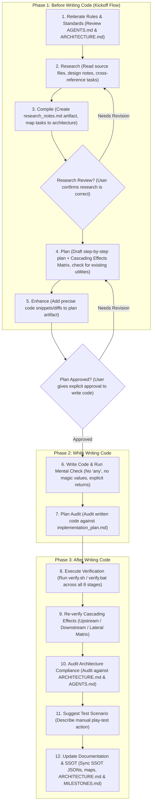

# AGENTS.md — Roguelike Project (TypeScript + ROT.js + Vite)

*This document is the source of truth for Code Standards, General Rules, and Workflows.*

## 0. Golden Rules

### Tool & Workflow Rules
1. **Prioritize built-in tools** over console commands (e.g., use file viewer tools rather than `cat` in bash).
2. **Never commit or push** to a git repository, unless the User explicitly requests it. If the User asks for a git commit or push, first you summarize what will get commited and asks for a review of the commit message, then ask for a confirmation of the commit and/or push opperation.
3. **Always keep tracking up to date.** Update task checklists and milestones immediately after completing a step, not just at the very end of the task.
4. **Consult artifacts first.** Always review existing artifacts (like research reports or design docs) when building a new plan.
5. **Wait for authorization.** Never move on to executing a plan or writing code before the User gives explicit approval.

### Communication Rules
6. **Prioritize communication over code.** Brainstorm extensively before committing to an architecture.
7. **NEVER assume. ASK.** If a task is ambiguous or under-specified, stop and ask clarifying questions. List any assumptions explicitly and ask the user to confirm them.
8. **Analyze bugs first.** When dealing with a bug, show the analysis and a fix plan, then ask the user for feedback before implementing it.
9. **Push back on bad design.** Do not blindly agree with the user. If a requested architecture is flawed, over-engineered, or wrong, point it out and propose alternatives with arguments. If instructions are perfect, execute them.

### Coding Rules
10. **NEVER hallucinate APIs.** If you are unsure if a function exists in ROT.js, Vite, or a dependency, refer to the docs or ask. Do not invent plausible API calls.
11. **NEVER use `any`.** There are zero acceptable uses of `any`. Use `unknown` + type narrowing, generics, or branded types.
12. **NEVER use magic values.** Every literal value affecting gameplay must be a named constant or enum member. No exceptions.
13. **Prefer SMALL changes.** Each response should address one logical change. Do not refactor unrelated code while implementing a feature.
14. **Avoid unnecessary nesting.** Keep code flat where possible. Use early returns to avoid deeply nested if/else blocks.
15. **Map cascading effects in all three directions.** Before proposing an architecture — and again before writing code — enumerate the impact of every change across three axes:
    - **Upstream:** who calls, imports, emits, produces, or constructs this (call sites, event emitters, data authors, mocks/fixtures, tests).
    - **Downstream:** what consumes or derives from this (renderers, validators, serializers, ledger/telemetry consumers, save schemas).
    - **Lateral:** what mirrors or shares the same data or registry (sibling campaign JSONs, editor forms, generator kits, docs, parallel records).
    Trigger on **any** change to behaviour, ordering, or data shape — not only on interface or enum changes. Record the result as a Cascading Effects Matrix (`Change | Upstream | Downstream | Lateral`) in the research artifact and the implementation plan.
16. **Leverage Generic Console Systems over Cartridge Silos (Three-Tier Placement Heuristic):** Always evaluate where a concept belongs across three tiers—leaning toward the Console whenever reusable:
    - **Tier 1 — Core Console Engine (`src/core/`, `src/systems/`, `src/types/`):** Structural and simulation primitives reusable by any RPG ruleset (anatomical `EquipmentSlotInstance[]` body graphs, layered stat/property overlays, tag-conditional modifier evaluation, persistent spatial fields/auras, minion/companion lifecycles, Attitude/Faction state). Note: An existing Console primitive (such as `EquipmentSlotInstance`) is not frozen—use it as-is when it already fits, or evolve it at the Console level / extend it at the Cartridge level when new domain needs arise (e.g., limb-group linking, slot melding/suppression).
    - **Tier 2 — Ruleset Cartridge (`src/rulesets/<id>/`):** Pure baseline mathematical laws of that tabletop system (e.g., D&D 3.5e 18-type bonus stacking, iterative BAB + manufactured/natural weapon combination math, d20 opposed maneuver resolution). Thin Cartridge-level components (e.g., `WildShapeOverlayComponent`) or stateless service/repository facades that wrap and coordinate Console and Cartridge functions are welcome, provided they preserve strict ECS data purity.
    - **Tier 3 — System Content (`public/data/rulesets/<id>/*.json`):** Feats, races, racial HD progressions, classes, templates, spells, and items expressed as data that parameterize, modify, or override Tier 2 baselines.
17. **Baseline Rules + Declarative Overrides & Modifiers (No Feat/Content Spaghetti):** Baseline ruleset resolvers (e.g., Trip, Grapple, Full-Attack, Two-Weapon Fighting, Secondary Natural Attacks) must never hardcode `if (hasFeat('multiattack'))` or `if (hasFeat('improved_trip'))` branches. Instead, baseline mechanics must accept **Modifiers** (shifting numerical parameters like `secondary_natural_penalty` from `-5` to `-2`, or `twf_primary_penalty`) and **Rule Overrides / Hooks** (changing behavioral flags like `provokesAoO: false` or granting `onSuccessFollowupAttack: true`) supplied declaratively by feats, items, templates, or status effects.
18. **Universal Actor Symmetry & Composable Diffs:** Do not create separate "Monster Statblock" vs. "Player Character" schemas or pipelines. Every actor (PC, NPC, animal, 6-armed Marilith, or dragon) is an **Actor** composed of the exact same building blocks: Racial Hit Dice / Base Race, Class tracks, Anatomical Equipment Slots, Natural & Manufactured Weapons, Skills, Feats, Abilities, and Faction/Attitude/AI. Variants and creature families (*Fiendish Dire Rat*, *Zombie Ogre*, *Wild Shape*, the 15 Creature Type Racial HD engines, Monster Size/HD advancement, Dragon 12-Age-Category ladders, Elemental size ladders) are built via composable templates, parametric progression tracks, and non-destructive stat/property overlay layers rather than monolithic copy-pasted statblocks.
19. **Unified Effect Providers & Hierarchical Provenance (`sourcePath`):** Anything on an actor that emits mechanical effects—including `Size`, `CreatureType`, `Subtype`, `Race`, `Template`, `Class`, `Feat`, `Condition`, `Load/Armor`, `TacticalStance`, and `SpatialField`—must be modeled as a declarative **Effect Provider** that projects semantic self-tags (`size:large`, `type:construct`, `subtype:incorporeal`, `trait:unencumbered_speed`) and emits `StatModifier`s / `RuleOverride`s evaluated via `selfTags*`, `targetTags*`, and `effectTags*` conditions, rather than scattering `if (creatureType === 'construct')` checks across stat calculators. Furthermore, because effect bundles can be temporary or nested (one Effect Provider granting another), every emitted modifier/grant must carry a slash-delimited **`sourcePath`** (e.g., `"spell:shapechange/form:iron_golem/type:construct/trait:construct_bonus_hp"` or `"template:ghost/subtype:incorporeal/deflection_ac"`) indexed by `buildEffectProvenanceIndex` and revocable via `revokeModifiersByPathPrefix`.
20. **Three-Horizon Computation Boundaries:** When evaluating actor progression and stats, maintain strict boundaries across three computation horizons:
    - **Horizon 1 (Level History Ledger):** Permanent, immutable level-by-level choices (`levelHistory`: HD gains, class selections, INT-based skill point budgets at time of gain).
    - **Horizon 2 (Aggregated Progression Layers):** Rebuilds accumulated structural totals (`tracks`, `feats`, `skillRanks`, `scalingPools`, `spellbooksByClass`) while preserving conditional stat modifiers (`condition: 'self:armor:heavy'`) in component state.
    - **Horizon 3 (Live Equipment & Tag Projection):** Projects active situational tags (`armor:heavy`, `load:heavy`, `trait:literate`) dynamically from current inventory/environment without re-evaluating or invalidating `levelHistory`.

---

## 1. Agent Workflow & Process

### Workflow Visual Map

### Before Writing Code (The 6-Step Kickoff Flow)
When starting a new milestone or major feature, you MUST execute the following flow strictly in order:
1. **Reiterate rules and standards:** Acknowledge the core constraints (e.g., ECS purity, Data-Driven JSON, TypeScript strictness, no deep nesting, etc). Review `AGENTS.md` and `docs/ARCHITECTURE.md` first.
2. **Research:** Read the relevant source files, reference documents (architecture, past and future milestones, specific spec or ideas docs, etc), and design notes. Cross-reference the milestone tasks with the existing codebase to discover exactly where and how changes must happen. Explicitly map **upstream, downstream, and lateral** effects per Rule 15 — including call-site ordering and data-shape changes, not just type changes.
3. **Compile Research Document:** Summarize your findings into a `research_notes.md` artifact. Explicitly map each task to the specific architectural rules and design documents that govern it, calling out where existing code and systems interact with the new systems or functionality. **STOP HERE and present the research document to the User. Do not proceed to Step 4 until the User explicitly confirms the research is correct and complete.**
4. **Implementation Plan Draft:** Draft an initial step-by-step implementation plan based strictly on the confirmed research. State open questions and request user feedback. Always check for existing utilities in `utils/`, `constants/`, and `types/` before proposing new ones to avoid duplication. Consult `docs/SSOT_CONSOLE.md` (for shared engine systems) and/or `docs/SSOT_DND35E.md` (for D&D 3.5e systems) to verify canonical entry points and ownership boundaries, preventing duplicate implementations or split-brain responsibilities; if refactoring or replacing legacy code, include an SSOT Ownership & Old-Brain Eviction Table mapping each responsibility to its canonical owner. The plan MUST contain a **Cascading Effects Matrix** (`Change | Upstream | Downstream | Lateral`) covering every task.
5. **Enhance Implementation Plan:** Once the high-level initial plan is formed, do a second pass to enhance the plan artifact with precise code snippets (or diffs) demonstrating exactly how the logic will be integrated, *without* removing any of the underlying rules or justifications.

**STOP HERE and wait for the User's explicit approval of the Implementation Plan before writing or modifying any actual codebase files.**

### While Writing Code
6. **Run the check script mentally.** Before presenting code, verify:
   - No `any` types.
   - No magic literals.
   - All functions have explicit return types.
   - All switch statements are exhaustive.
   - No unused imports or variables.
7. **Review against Plan:** Explicitly audit the newly written code against the approved `implementation_plan.md` to ensure no steps were missed or partially implemented before invoking the verification scripts.

### After Writing Code
8. **Execute Verification Pipeline (`verify.sh` / `verify.bat`):** Run `./verify.sh` (or `.\verify.bat` on Windows) to execute the complete 8-stage verification pipeline:
   - `[1/8]` Format check (`bun run format`)
   - `[2/8]` Lint check (`bun run lint --fix`)
   - `[3/8]` Strict TypeScript check (`bun x tsc --noEmit`)
   - `[4/8]` Campaign, ruleset, & SSOT parity validation (`bun run scripts/run-validator.ts`)
   - `[5/8]` Production build check (`bun run build`)
   - `[6/8]` Architectural dependency check (`bun run lint:arch`)
   - `[7/8]` Dead-code & unused export check (`bun run lint:deadcode`)
   - `[8/8]` Regression test suite (`bun test`)
   Ensure all 8 stages pass with 0 errors before proceeding.
9. **Re-verify cascading effects.** Update the plan's Cascading Effects Matrix with anything discovered while implementing. Confirm no upstream caller (call sites, emitters, data authors, mocks), downstream consumer (renderers, validators, serializers, ledger/telemetry, save schemas), or lateral mirror (sibling campaign JSONs, editor forms, kits, docs) was missed, and present those changes too.
10. **Audit Architecture Compliance.** Audit changes against `ARCHITECTURE.md` and `AGENTS.md` and provide a report on compliance.
11. **Suggest a test scenario.** Describe a manual play-test action the user can take to verify the change works.
12. **Update Documentation & SSOT Registries.** If the change added or modified a system, update `docs/ARCHITECTURE.md`, `docs/DECISIONS.md`, and any other relevant document. If new `.ts` source files were created, moved, or deleted, or if subsystem responsibilities shifted, update `docs/ssot/ssot_console.json` and/or `docs/ssot/ssot_dnd35e.json`, run `bun scripts/map-codebase.ts` to regenerate `docs/SSOT_CONSOLE.md` and `docs/SSOT_DND35E.md`, and ensure `bun run scripts/run-validator.ts` passes with 0 SSOT parity errors. If a milestone was completed, summarize it and update `docs/MILESTONES.md`.

---

## 2. Project Overview

| Key              | Value                                           |
| ---------------- | ----------------------------------------------- |
| Genre            | Dual-mode traditional roguelike (Turn-based and RTwP, grid, ASCII)  |
| Language          | TypeScript (strict mode)                        |
| Roguelike Toolkit | ROT.js (rot-js on npm)                         |
| Package Manager  | bun                                             |
| Bundler          | Vite                                            |
| Target           | Modern browsers (ES2022+), deployed to itch.io  |
| Architecture     | Entity-Component-System (ECS-lite, no framework)|
| State Management | Immutable game state passed through turns        |

---

## 3. TypeScript Strictness & Style Guide

### Compiler Settings
The project uses the strictest possible TS config (`tsconfig.json`).
- `exactOptionalPropertyTypes: true`: You **cannot** explicitly assign `undefined` to an optional property (e.g., `foo: undefined` throws if the type is `foo?: string`). Omit it entirely or update the type.

### Type Discipline
- **Explicit Returns:** All function signatures must have explicit return types. Do not rely on inference.
- **Typed Parameters:** All parameters must be typed. No implicit `any`.
- **Shapes vs Unions:** Prefer `interface` for object shapes. Use `type` for unions/intersections.
- **Branded IDs:** Use branded types for IDs (e.g. `EntityId = number & { __brand: symbol }`) to prevent passing a MonsterID where an ItemID is expected.
- **Readonly Default:** Use `readonly` aggressively on properties and `ReadonlyArray<T>` on parameters.
- **`satisfies` over `as`:** Use `satisfies` to validate shapes without losing strict inference.
- **Exhaustive Switch:** Every `switch` on a union/enum must include a `default: return assertNever(x)` to force a compile error when adding new variants.
- **Intents & Discriminated Unions:** Missing a member in a discriminator enum (like `IntentType`) causes TS to fail type narrowing for the entire union. Check your enums if you see massive cascading `Argument of type X is not assignable to type Y` errors.
- **GameState Refactoring Cascades:** Changing the global `GameState` breaks almost every subsystem. Rely heavily on `.\verify.bat` to hunt down and fix these cascading breaks systematically.

### Style Guide
- **Add a JSDoc comment** to every exported function, type, and constant (`@param`, `@returns`, and description).
- **Name things precisely.** `processEntities` is bad. `applyMeleeDamage` is good.
- **Flat is Better than Nested.** In complex systems (parsing intents, applying consequences), use guard clauses (early returns or `break`s) and flat `switch` statements. Avoid deeply nested `if/else` chains.

---

## 4. ECS & Data Structure Constraints

- **Pure Components:** Components are plain data interfaces with no methods.
- **No Maps/Sets in ECS:** We must avoid using `Map` or `Set` objects inside ECS Components because the `GameState` (and therefore all components) must be fully serializable to JSON via `JSON.stringify`. Use plain objects (`Record<string, T>`) and arrays (`ReadonlyArray<T>`) inside components instead.
- **Strict Type Alignment:** JSON templates describe *classes* of things (like `string[]` for grudges), while components represent *instances*. Do not try to enforce `EntityId` inside a template. Match the JSON type (e.g. `string[]`) in the component.
- **ECS State Boundaries (Sleep/Wake):** When packing components for "cold storage", you must iterate over the components individually. Do not store references to the live `GameState.components` map; copy the component arrays to prevent memory leaks or reference contamination.
- **Entity Ownership & Foreign Keys:** Entities do not "contain" other entities; they only store `EntityId`s. When moving entities between floors/states, you must traverse and package all foreign keys (like inventory items) or risk leaving them orphaned.

---

## 5. Data-Driven & JSON Rules

- **The Default Campaign as the Feature Showcase:** The `default` campaign must represent ALL of the game's engine features. Whenever a new system is added (like Encounter Director, Schemes, Dialogues), the default campaign JSON files MUST be updated to actively use and showcase those features.
- **No Magic Values:** Every literal value affecting gameplay must be in a JSON registry.
- **Zod Validation:** All JSON data must conform to Zod schemas defined in `src/types/campaign.types.ts`.
- **Zod Inferred Types:** You must explicitly export the inferred TypeScript type (e.g., `export type AreaConnection = z.infer<typeof AreaConnectionSchema>;`) if other modules need to reference the shape.
- **Enums vs. Strings:** Prefer literal string IDs over TypeScript `enum`s for data definitions (e.g., `"stone_wall"`) for seamless JSON moddability.
- **Internal Constants:** Engine-internal constants that can't be data-driven go in `src/constants/`.
- **The Data Pipeline is Explicit:** Creating a new JSON registry requires explicitly updating `src/core/loader.ts` to `fetch()` it.
- **Zod Schemas Must Mirror Runtime Switches:** If the runtime `switch`es on a `type` string, the Zod schema **must** use `z.discriminatedUnion('type', [...])` with explicit param shapes. Do not use `z.record(z.string(), z.unknown())`.
- **Editor Dropdowns Must Derive from Canonical Sources:** Never hardcode dropdown options. Derive them from Enums, Zod, or CampaignData keys programmatically.
- **Never Duplicate Reference-Resolution Logic:** If two UIs need to resolve a reference (like populating an entity dropdown), extract it into a single utility.
- **Tag-Based Interactions:** Operating on `tags` rather than specific `itemId`s scales combinatorially. Always use tags for data-driven rules (reactions, triggers).

---

## 6. ROT.js & Determinism

- **Encapsulate ROT.js:** Do not use `ROT.FOV.*` or `ROT.Map.*` directly outside their project wrappers (`fov.ts`, `generator.ts`).
- **Strict Seed Determinism:** Never call `Math.random()` or `Date.now()`. You must use the shared `rng` instance exported from `src/core/rng.ts` and deterministic global counters (`nextEntityId`).
- **ROT.js TS Definitions:** In v2+, certain interfaces (like `DisplayOptions`) are not explicitly exported from `index.d.ts`. Use workarounds where necessary.

---

## 7. UI & View Layer Rules

- **UI Controller vs View Separation:** Split UI into DOM manipulation/state reading (Views) and DOM Event generation/Intents routing (Controllers). `main.ts` is for wiring, `input_handler.ts` for mapping, and `rendering/ui/` for Views.
- **DOM Injection & Security:** Avoid using `.innerHTML` for rich text parsing. Parse text into semantic segments and construct DOM nodes natively with `document.createElement()`.
- **Export Clashes in UI Barrel Files:** Be extremely careful not to double-export or accidentally overwrite exports in UI hubs like `src/rendering/ui.ts`, which can break routing silently.

---

## 8. Project Structure & Codebase Mapping

### Rules for File Organization
- **One concern per file.** Split files if they handle multiple responsibilities or exceed ~250 lines.
- **No circular imports.** The dependency graph flows DOWN: `main → core → systems → map/rendering → types/constants/utils`.
- **Extract Static Definitions:** Do not colocate static definitions (Enums, Types, Zod Schemas) inside logic files (like systems). Extract them into their own domain files under `src/types/` or `src/constants/` to prevent lateral dependencies and enforce the downward dependency graph.
- **Barrel files (`index.ts`) are BANNED.** Use direct imports.
- **No Inline Imports in State Definitions:** Avoid `import('./file.ts').Type` inside core state interfaces. Explicitly import at the top of the file.

### Codebase Map Script
`scripts/map-codebase.ts` scans `src/` and prints exports. Use it as a reference for existing utilities.

---

## 9. Common Pitfalls — Do NOT

| ❌ Don't                                      | ✅ Do Instead                                     |
| --------------------------------------------- | ------------------------------------------------ |
| Use `any`                                     | Use `unknown`, generics, or proper types          |
| Use raw string keys for components            | Use the `ComponentType` enum                      |
| Call `Math.random()`                          | Use the shared `rng` instance from `rng.ts`   |
| Import from ROT.js directly in gameplay code | Use the project's wrapper modules      |
| Put rendering logic in a system               | Systems return state; renderer reads state        |
| Store derived state (e.g., visible tile cache)| Recompute in the render pass from FOV             |
| Mutate arrays/objects you don't own            | Clone or use immutable update patterns            |
| Skip the plan step for multi-file changes     | Always state the plan and get confirmation first  |
| Leak subsystem knowledge into the game loop   | Subsystems expose query helpers (e.g., `shouldSkipTurn()`) |
| Hardcode editor dropdown values               | Derive dropdown options programmatically           |

---

## 10. Reference Docs

### Internal
- **Architecture:** `docs/ARCHITECTURE.md` — subsystem descriptions and how the engine fits together.
- **Decision Log:** `docs/DECISIONS.md` — non-obvious architectural tradeoffs and their rationale.
- **Milestones:** `docs/MILESTONES.md` — roadmap, completed features, and upcoming work.

### External
- **ROT.js:** https://ondras.github.io/rot.js/hp/ and the GitHub wiki
- **TypeScript Handbook:** https://www.typescriptlang.org/docs/handbook/
- **Vite:** https://vitejs.dev/guide/
