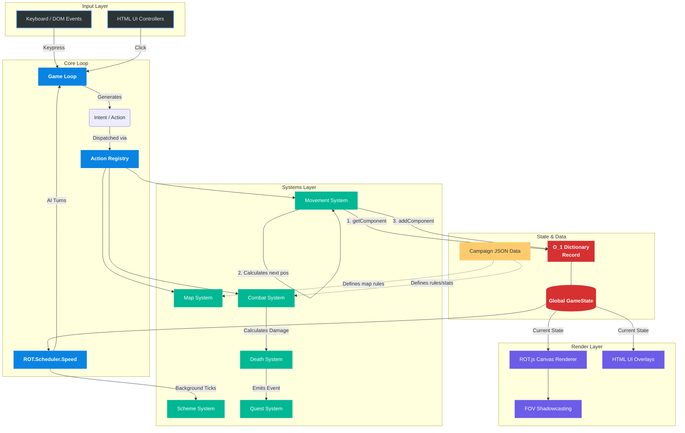
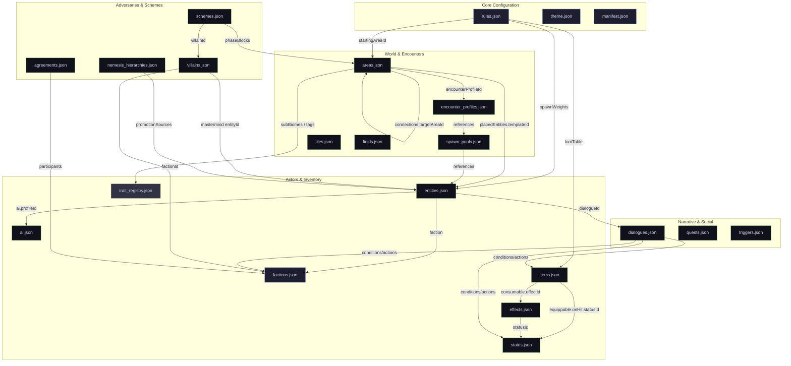

# Architecture — Roguelike Project

A traditional turn-based ASCII/grid roguelike game built for modern browsers.

---

## 1. Project Summary

This project is a grid-based traditional roguelike game featuring dual **Turn-Based** and **Real-Time with Pause (RTwP)** engine modes, built using TypeScript, ROT.js, and Vite. It runs natively in web browsers and is structured to compile efficiently and run deterministically. It uses an Entity-Component-System (ECS) architecture for managing game entities and state.

## 2. Core Design Philosophy

Beyond the technical ECS constraints, the development of systemic mechanics (like factions, quests, and background schemes) adheres to two primary philosophies:

- **Prioritize Observability**: Background simulations are notoriously difficult to debug because they fail silently. Never build an invisible system without a window into it. Complex simulation logic (like scheme advancement) must always be paired with explicit UI surfaces (investigation boards, dialogue logs) or dedicated `/debug` cheat commands so its state can be verified.
- **Defensive Simulation (Fail Gracefully)**: In systemic games, unpredictable edge cases _will_ happen. If an intermediary NPC vital to a quest dies or is trapped, the simulation must not crash or soft-lock the campaign. Systems must handle broken chains gracefully—either by generating a new NPC to fill the role, or by explicitly failing the quest and rendering the failure in the UI.

---

## 3. Module Dependency Graph

The dependency graph flows strictly downward. Circular imports are banned. Modules at lower layers (e.g., `types`, `constants`, `utils`) may never import from upper layers.

Since the Campaign Editor is a top-level creator tool rather than a part of the active gameplay loops, the `editor/` controller folder sits at the top tier of the graph alongside the game bootstrap, permitting it to import from any engine layer while keeping the `rendering/` view layer completely isolated.

**Top-Level Tooling Orchestration:** To respect downward dependency constraints, developer tools and builders that coordinate multiple systems (like the map generator, AI behaviors, and dialogue trees) must reside in a dedicated `src/editor/` namespace at the top tier of the graph rather than in lower view layers like `src/rendering/`. The UI view layer remains a dumb component tree that only communicates upward via event dispatching.



---

## 4. Engine Architecture

### 4.1 ECS-lite

We use a low-overhead, framework-free ECS:

- **Entities** are simple numeric IDs (`EntityId` branded type), not class instances.
- **Components** are pure data objects (TS interfaces) with no methods, stored in a `ReadonlyMap<EntityId, Readonly<Record<string, Component>>>` within the global `GameState` for `O(1)` access. The `GameState` is strictly immutable; systems clone the outer map when adding/removing entities, but only clone and replace the specific dictionary for the modified entity during updates.
- **Component Heuristic**: When deciding if data warrants a new component, evaluate **Reusability** (does it apply to multiple entity types like Actors, Areas, Factions?), **System Querying** (does a system need to iterate over all entities with this specific property?), and **Lifecycle** (is the data conceptually distinct, e.g. a temporary status effect vs intrinsic tags).
- **Systems** are pure functions that query components using `getComponent`, process game state changes, and return new state via `addComponent` / `removeComponent`.
- **Entity Ownership**: Components (like `InventoryComponent`) do not "contain" other entities; they store `EntityId`s as foreign keys. When migrating entities between state boundaries, the engine must traverse and package these owned "child" entities to prevent orphaned references.

### 4.2 Game Loop & Scheduler

Turn management uses `ROT.Scheduler.Speed` (wrapped in `src/core/scheduler.ts`), chosen over `ROT.Scheduler.Simple` to support varied entity speeds (haste, slow, weapon weight) without future refactoring. Input is decoupled from the engine: keyboard and DOM listeners push `Intents` into a bounded FIFO player intent queue (`src/core/input_queue.ts`). When an entity's turn arrives via `act()`, it pops from the queue or calls `engine.lock()` to await input — enabling seamless RTwP and future multiplayer without restructuring the engine loop. Immediate non-turn intents (e.g. camera zoom, toggle pause) execute immediately without consuming an actor turn step.

- **Cooperative Frame-Budgeted Scheduler (`src/core/scheduler.ts`)**: Slices turn execution against a 4ms budget (`FRAME_BUDGET_MS = 4` measured with `performance.now()`). If a turn storm or multi-actor AI turn exceeds 4ms, the scheduler yields control back to the browser event loop via `setTimeout(..., 0)` while holding `isTurnProcessing = true` and `engine.lock()`. This guarantees the browser can present frames at 60Hz without input interleaving or re-entrant state corruption.
- **Bounded RTwP Frame Drain**: In Real-Time with Pause mode, `rtwpLoop()` accumulates delta time between animation frames and drains turns in bounded sub-steps. To eliminate "spiral-of-death" frame freezes (e.g., when a browser tab is backgrounded or when physics/AI lags behind real time), the drain loop enforces hard caps: `MAX_RTWP_DRAIN_ITERATIONS = 10` sub-steps per frame, `FRAME_BUDGET_MS = 4` execution cutoff, and clamps accumulated time to `MAX_ACCUMULATED_RTWP_TIME = 1000ms`.
- **Tiered World Simulation Cadence (`src/core/simulation_cadence.ts`)**: Rather than ticking heavy narrative and macro systems on every actor turn sub-step, world simulation is partitioned across three hierarchical cadences:
  - **Tier 1 (Micro / Immediate)**: Runs every actor turn in the active area: FOV calculation, movement, combat resolution, reactions, and immediate triggers.
  - **Tier 2 (Local Narrative)**: Ticks every 10 turns (`LOCAL_NARRATIVE_TICK_INTERVAL = 10`): updates local NPC thought bubbles, decrements dramatic delay counters, decays recent rumors, and cleans expired temporary memories.
  - **Tier 3 (Macro / Global)**: Executes on coarse intervals: Nemesis & Rivalry hierarchy power struggles (`RIVALRY_TICK_INTERVAL = 25`), Villain Schemes and Phase Block progression (`SCHEME_TICK_INTERVAL = 50`), and Global World Events & Faction Schisms (`WORLD_EVENT_TICK_INTERVAL = 100`).

### 4.3 Intent → Action → Event Pipeline

All interactions flow through pure data `Intents` pushed into command queues, resolved by a stateless `ActionRegistry` mapping `IntentType` → `ActionHandler`. This replaces OOP Command objects (which would put method closures into the serializable `GameState`) while providing the same architectural decoupling without a massive `switch` router.

All entity interactions funnel through a single `ApplyIntent` carrying a `verb` (e.g., `apply`, `kick`, `zap`), optional `toolEntityId`, and a polymorphic target — replacing bespoke intents like `InteractIntent` and `UseItemIntent`.

### 4.4 Determinism & RNG

A single seeded `ROT.RNG` instance is exported from `src/core/rng.ts`. All gameplay randomness (map generation, combat rolls, AI choices) must use this instance to guarantee that any two players with the same seed and input sequence experience the exact same game state.

### 4.5 Save & Persistence

- **State Serialization & Persistence Service**: The immutable `GameState` contains all active data, making serialization to JSON for `localStorage` via `src/core/save.ts` trivial. Persistence is decoupled from inner turn loops via `src/core/persistence_service.ts`: continuous gameplay updates debounce saves (500ms) to avoid stalling frame rates, while transactional checkpoints trigger synchronously on turn completion, game over, RTwP pause/mode switches, area transitions, and `window.beforeunload` flush. Transient visual effect expirations bypass autosaves entirely to prevent redundant I/O churn.
- **Inactive Areas**: Non-active areas are stored in a compressed/serialized format within `GameState` and swapped into active ECS arrays upon transitions, keeping active queries lightweight.
- **Campaign Data**: Stored as JSON files loaded via `fetch()`. A global `campaigns.json` registry lists all available campaigns. `zod` schemas validate all data, giving precise human-readable errors for malformed mods. The TypeScript schemas defining these structures are strictly modularized into domain-specific files (`meta.ts`, `world.ts`, `item.ts`, `social.ts`, `entity.ts`) under `src/types/campaign/` and aggregated through a central facade to prevent monolithic file bottlenecks.
- **Authoring Continuum (Static, Blueprint, Dynamic Primitives)**: Campaign data structures are categorized into three levels: **Static** data (directly painted tiles, hand-authored dialogues, factions), **Parameterized Blueprints** (spawn pools, quest templates, procedurally generated areas), and **Dynamic Primitives** (trigger templates, reactions, traits). The Campaign Editor provides visual headers, reference suffixes, and a **Bake** controller to resolve procedural blueprints (like generated maps and tokens) into hand-editable static data. The Campaign Validator mock-compiles dynamic templates using context-aware variable bindings (mapping names to type-appropriate dummy variables or existing entity/item IDs) to run strict schema and integrity checks.
- **JSON Patch Caveat**: JSON Patches (RFC 6902) work for editor change tracking, but gameplay turn-rewinding requires checkpointing `src/core/rng.ts` state alongside delta patches, otherwise future random results desync.

### 4.6 Campaign Data Dependency Tree

To guide campaign authors and prevent reference errors, the Campaign Editor UI follows a strict left-to-right/top-to-bottom layout order derived from data dependencies. A campaign record must exist in the database (downstream node) before other records (upstream nodes) can select or reference its string ID.

The following graph maps these structural dependencies:



#### Core Data Ordering Constraints:

1. **Low-level Building Blocks (Factions, Status Effects, AI, Dialogues)**: Must be created first. They are the target of references for items and entities.
2. **Game Objects (Entities, Items)**: Require valid faction IDs, dialogue IDs, AI profiles, and effect IDs. These must exist before they can be placed on maps.
3. **World Generators (Spawn Pools, Encounter Profiles, Areas)**: Spend "CR budgets" by referencing entity templates and placed items.
4. **Adversary Layer (Villains, Schemes, Agreements)**: Masterminds are bound to entities, which are mapped to factions. Phase blocks transition between areas. Thus, adversaries sit at the top tier of campaign dependencies.

This tree is directly mapped in `editor_config.ts`'s `VIEW_GROUPS` layout, guiding the designer from left to right along the Activity Bar.

### 4.7 Web Worker Offload & Background Simulation (`src/worker/`)

Computationally intensive operations that risk blocking main thread 60Hz rendering (e.g., deep campaign narrative fuzzing, heavy multi-room procedural dungeon generation) are offloaded to dedicated Web Workers:

- **Worker Bridge (`src/worker/worker_bridge.ts`)**: Manages the lifecycle of background worker threads (`fuzzer.worker.ts`, `map.worker.ts`). It performs feature detection via `isWorkerAvailable()`, transparently falling back to main-thread asynchronous generator execution if Web Workers are not supported in the host environment.
- **Serializable JSON DTO Boundary (`src/types/worker.types.ts`)**: All worker requests and responses use pure JSON-serializable DTOs (e.g., transforming `Set<string>` in `DirectorContext` into plain arrays).
- **Non-Blocking Progress Streaming**: Workers emit `WorkerProgressPayload` messages during execution, updating DOM loading overlays (`#loading-overlay`) and UI progress bars at native browser frame rates without freezing UI animation.

---

## 5. World & Map Systems

### 5.1 Map Generation & FOV

- **Generators**: Supports structured dungeons (`ROT.Map.Digger`), organic cave networks (`ROT.Map.Cellular`), and Diffusion-Limited Aggregation (`dla`) wrapped in `src/map/generator.ts`. The tile grid is stored as a flat array (`Tile[]`) with index math (`y * width + x`) for faster JS engine performance and trivial serialization. Tiles reference string IDs (e.g., `"stone_wall"`) resolved from a shared `TILE_REGISTRY`, decoupling rendering and mechanical properties from map structure. The generator also supports Voronoi partitioning (`voronoiSubBiomes`) to overlay organic sub-biome zones onto generated maps, which are converted to RoomBounds with exact coordinate sets (`exactTiles`) for the Encounter Director.
- **Modular Pipeline & Async Generation (`src/map/generator_stages.ts`, `src/map/generator_async.ts`)**: Procedural map generation is decomposed into discrete, testable pipeline stages (`resolvePalette`, `carveBaseGeometry`, `carveRoomsAndPortals`, `applyBiomesAndCull`, `computeHotPathDijkstra`). Synchronous `generateArea()` runs these stages sequentially. Asynchronous `generateAreaAsync()` executes as a generator yielding `GenerationProgress` payloads between stages, allowing the UI loading bar to stream progress smoothly while protecting seed determinism via `ROT.RNG.getState()` / `setState()` snapshots across yields.
- **Entity & Portal Placement**: The generator guarantees topologically safe spawn logic by picking open floor tiles instead of hardcoded room centers, enabling seamless entity and portal placement even in wall-less cellular/DLA cave systems.
- **FOV**: Shadowcasting is computed via `computeFOV` in `map.system.ts` only when `GameState.fovNeedsUpdate` is set (e.g., player moves, door opens). Results are cached in `GameState.cachedFov`.
- **Spatial Rendering**: The renderer uses an `O(1)` spatial index (`GameState.spatialIndex`) combined with `cachedFov` to draw only entities within camera bounds and line-of-sight.

### 5.2 Areas, Transitions & Sleep/Wake

The game world is divided into distinct "Areas" — procedural dungeons or static hand-crafted hubs. Areas themselves are modeled as standard ECS Global Entities with a `TagsComponent` and `ChronicleComponent` to record world events. `GameState` tracks `currentAreaId`; inactive areas are serialized into an `areas` map. Transitions use generic `PortalComponent`s and a `ChangeAreaIntent`, packing the current ECS into cold storage and unpacking (or generating) the target area.

**Persistent Entities & Limbo (Sleep/Wake):** Entities with a `PersistentComponent` are saved into a global `persistentEntities` pool (rather than area-local storage) when unloading. To prevent orphaned references (e.g., leaving a sword on the floor when its owner teleports out), the `moveToLimbo` utility recursively packages the entity and all of its foreign key children (inventory, equipped items) together into Limbo. They are then re-injected into the active ECS when their target area loads. This ensures named NPCs maintain state and belongings across transitions and off-screen scheme missions.

**Area Respawn Timers & Delta Catch-Up:** Areas define a `respawnTimerTurns` threshold and track `lastVisitedTurn` on `AreaData`. When transitioning into a sleeping area:

1. **Delta Calculation**: The map system evaluates `deltaTurns = Math.max(0, (state.globalTurn || 0) - lastVisited)`.
2. **Entity Respawning**: If `deltaTurns` exceeds `respawnTimerTurns`, the `EncounterDirector` re-runs, repopulating the area's active rooms with new non-persistent entities and emitting an `AreaRespawned` event.
3. **Simulation Catch-Up**: Off-screen spawn timers advance, minion contracts and agreements decay or mature, and dormant timers progress proportionally to `deltaTurns` without incurring the computational cost of running full tile-level pathfinding or FOV for dormant areas.

### 5.3 Encounter Director

- **Algorithmic Population**: Hooks into map generation to spend "CR budgets" deterministically across tactical axes: objectives (proteins), advantages (appetizers), hazards (sides), and chaos (desserts).
- **Dynamic Content**: Enemy templates and features are scaled using trait costs and sub-biome tags, making procedural rooms feel authored.
- **Scheme Mutability**: Villain schemes can mutate Director parameters (adding encounters, shifting budgets) before generation, providing macro-level world consequences.
- **Hot Path Dijkstra Mapping**: Computes the shortest path from the player's starting coordinate to all exits/portals in the area using `ROT.Path.Dijkstra`. This path is expanded by a configurable/heuristic radius thickness (the "hot path") where major monsters (`protein`) and hazards/traps (`side`) are preferentially spawned to ensure pacing and danger along critical paths, while fodder (`appetizer`) and loot (`dessert`) scatter uniformly to encourage exploration.

---

## 6. Combat & Entity Systems

### 6.1 Unified Damage Pipeline

All damage sources (melee, traps, spells, environment) inject a `DamageComponent` onto the target containing `DamageInstance`s with `amount`, `sourceEntityId`, and semantic `tags` (e.g., `["spell", "lightning"]`). `damage.system.ts` aggregates damage, reduces HP, processes on-hit effects, and generates floating combat text. If HP reaches 0, a `DeathComponent` is attached; `death.system.ts` handles messages, XP, drops, and cleanup. This fully decouples the _cause_ of damage from its _resolution_.

### 6.2 Status Effects Engine

A declarative `StatusEffectDefinition` registry describes effects (duration, stat modifiers, per-turn damage/heal, behavior flags). `status-effect.system.ts` ticks every turn, removing expired effects and modifying stats via `getEffectiveStats()`. Behavioral flags describe _mechanics_ (`skipTurn`, `confused`), not _flavor_ (`stunned`, `frozen`) — so any number of thematic variants reuse `skipTurn: true` without code changes. The game loop queries generic helpers like `shouldSkipTurn()` and never inspects specific effect names.

### 6.3 Items, Equipment & Stat Model

- **Registries**: Items and Effects are defined declaratively in JSON as pure data objects keyed by string ID, enabling trivial serialization and future modding.
- **Inventory**: The player's `InventoryComponent` holds item `EntityId`s. Pickup removes `PositionComponent`; drop restores it.
- **"Bonus at Query Time"**: Equipment bonuses are _never_ baked into `FighterComponent`. `getEffectiveStats()` dynamically sums base stats with equipment and status effect bonuses on demand, preventing desyncs from forced item removal and composing cleanly with future modifiers (level-ups, curses).

### 6.4 Reactions & Triggers

- **Reaction System**: `reaction.system.ts` evaluates `reactions.json` against source/target entities, matching on `tags` and `verbs` rather than entity IDs — enabling designers to author new mechanics entirely in data. Matched reactions delegate to the Trigger System for consequence execution (e.g., `change_area`, `apply_item_effect`, `emit_event`).
- **Trigger System**: `trigger.system.ts` acts as an orchestrator that executes data-driven `TriggerDefinition`s (`WHEN [event] IF [conditions] THEN [consequences]`). To maintain clean architecture, specific event routing and execution are delegated to domain-specific modules (`player.ts`, `quest.ts`, `social.ts`, `systemic.ts`) within `src/systems/trigger/`.
- **Trigger Composer**: `trigger-composer.system.ts` handles runtime trigger generation, compiling reusable templates (`TriggerTemplate`) loaded from `trigger_templates.json` into valid `TriggerDefinition`s using global variable bindings (e.g., `$NEMESIS_NAME`) with support for numeric/boolean auto-unquoting, and injecting/removing them dynamically at runtime while safely rebuilding optimization routing buckets. Pair with an interactive editor panel in `editor_ui.ts` for previewing and baking.
- **Pacing Governor & Drama Director**: The Trigger System leverages a global `DramaTracker` (stored in the immutable `GameState`) to enforce pacing limits on emergent narrative events. Triggers can specify a `dramaCost` and cooldown periods. The pacing governor ensures events don't overwhelm the player, and executing a trigger checks these limits first. If blocked, the system can execute optional `fallbackConsequences`.
- **Interactive Terrain**: Doors, traps, shallow water, and other terrain features define interactions and movement costs directly in JSON definitions.

---

## 7. AI & Social Layer

### 7.1 Composable AI Pipeline & Factions

AI logic is split into discrete modules (`hunt`, `flee`, `ranged`, `wander`) composed into data-driven AI Profiles. During an entity's turn, behaviors are evaluated in priority order until one returns an executable `Intent` — replacing monolithic `if/else` blocks and allowing complex types (e.g., cowardly mage) to be built by mixing behaviors in data.

**Factions as Global Entities:** Factions are modeled as standard ECS Global Entities rather than hardcoded lookup tables. This allows them to naturally possess a `ChronicleComponent` (tracking their historical world events like schisms and alliances), `TagsComponent`, and `MemoryComponent`. Hostility is resolved via a `HOSTILITY_MATRIX` lookup between `FactionId`s, replacing hardcoded "player vs monster" logic and enabling infighting, neutral NPCs, and allied summons. AI modules utilize FOV for line-of-sight checks, and `AIComponent` tracks ability cooldowns.

**Memory Separation of Concerns**: AI combat tracking data (like `grudges`) is kept strictly separated from narrative state tracking (like boolean `facts` for dialogues). Mixing them creates brittle code that can falsely trigger AI hostility.

### 7.2 Identity, Personality & Chronicle

- **Chronicle & Memory**: Important NPCs have a `ChronicleComponent` tracking player interactions, scars, relationships, and history. `MemoryComponent` stores `knowledge` (rumors, locations), `interaction counters`, `personality facets`, and `relationshipAxes` (loyalty, fear, resentment, respect, debt, ideologicalAlignment).
- **Identity Generation**: Promoted NPCs receive `IdentityComponent` via data-driven tables keyed by `{templateId}_identity` convention (e.g., `"orc"` → `"orc_identity"` in `identity_generation.json`).
- **Personality**: NPCs possess values, goals, and facets (cowardice, generosity). Extreme memories mutate facets permanently as "core memories". Personality weights AI behavior selection and gates dialogue options.

### 7.3 Dialogue, Quests & Knowledge Brokering

- **Dialogues**: JSON trees (`DialogueTreeSchema`) with conditional gating against `MemoryComponent` (faction standing, grudges, personality, and relationship axes). Options dispatch configurable effects via the trigger system.
- **Quests**: Data-driven structures with observable objectives tracked via `QuestLogComponent`. Subsystems emit generic events that `quest.system.ts` listens to, decoupling combat from quest logic. Supports `AND`/`OR` logical operators for branching resolutions.
- **Knowledge**: NPCs learn about world events through delayed propagation in the social graph. The player uses dialogue verbs (`ask_about`, `gossip`) to acquire knowledge dynamically. Rumors spread organically and decay over time. Knowledge sharing is gated dynamically: NPCs with high loyalty or fear are more willing to share rumors (evaluated via `getWillingnessToShare()` which considers relationship axes), while high resentment blocks it.

### 7.4 Trade & Barter Economy

Entities with a `ShopComponent` act as merchants. `getEffectivePrice` dynamically evaluates NPC markup, faction standing, personality facets, social states (`annoyed`/`grateful`), and relationship axes (`loyalty`, `fear`, `debt` reduce markups, while `resentment` increases markups). Social verbs (`intimidate`, `persuade`) use personality-weighted contests (boosted by active relationship values like fear and respect) to temporarily modify pricing. Depleted inventories generate procedural fetch quests via the existing quest template system.

### 7.5 Scheme Simulator & Investigation

`scheme.system.ts` ticks independently within the `ROT.Scheduler.Speed` loop. Villains pursue JSON-defined `SchemeRecipe`s that are dynamically assembled at runtime by the Scheme Compiler using `PhaseBlock`s. As the player defeats minions, combat drops randomized clues; `investigation.system.ts` updates the `MemoryComponent.knowledge` on the player entity. The Investigation Board UI acts as a filtered view of the player's knowledge (specifically targeting the `clue` type and `scheme` tags), allowing the player to naturally review discovered evidence and expose active schemes without duplicating state. Schemes feature dynamic resilience: recruitment utilizes MICE-based profiling mapped to NPC personality facets, node disruption triggers local repair and confession logic based on `compromiseScore`, and escalating countermeasures trigger via `conspiracyAwareness`. Schemes survive mastermind deaths by transferring ownership and continuing in a leaderless momentum state.

### 7.6 Rivalry & Power Struggles

`rivalry.system.ts` provides autonomous background conflicts for persistent entities and handles the core simulation loop (`processRivalries`, `generateEventDrivenRivalry`). The system delegates heavy lifting to strict domain modules: `query.ts` handles searching across active/inactive states for nemesis entities, and `resolve.ts` applies structural mutations (like promotion and scarring). Outcomes of rivalries (such as death, promotion, or status effect changes) deterministically resolve off-screen and propagate as `RivalryResolved` events.
This connects to the knowledge and gossip systems: major power shifts result in rumor propagation (`gossip.system.ts`) and add verifiable knowledge (`knowledge.system.ts`) to NPCs. Trade mechanics (`trade.ts`) also reflect rivalry impacts by imposing markup penalties on merchants whose suppliers suffer vacancies in the top-tier hierarchy.

### 7.7 Nemesis Surfacing & Narrative UX

The Nemesis Surfacing system makes hierarchy events, rivalries, and combat encounters legibly dramatic and narratively sticky:

- **Combinatorial Bark Pools**: Instead of hardcoding dialogue, barks (encounter, cheat death, victory taunt) are resolved dynamically from the entity's active semantic tags and traits, creating highly varied, emergent dialogues.
- **Narrative Throttling & Throttled Encounters**: Nemesis entities track player encounters via `lastEncounterTurn` to prevent spamming introduction callouts.
- **Player Dossier & Timelines**: The Dossier UI provides a dedicated Player Timeline Section presenting the player's personal chronicle chronologically alongside active faction hierarchies and notable NPC records.
- **Dramatic Pacing & Accessibility**: Resurrection events trigger a controllable visual pause (`DRAMATIC_PAUSE_DURATION_MS`) to give events dramatic weight, which can be bypassed via the `reduceDramaticDelays` accessibility setting.

---

## 8. Rendering & UI

- **Decoupled 60Hz Presentation Loop & Presenter**: Simulation step loops do not invoke DOM panel updates or canvas draws directly. Instead, `startGlobalPresenterLoop()` in `src/core/session_controller.ts` runs on `requestAnimationFrame` at 60Hz, consuming dirty domains flagged in `src/core/presentation_queue.ts` via `markDirtyFromStateDiff()`. Frame updates dispatch selectively to affected UI panels and canvas passes through `renderPresenterFrame()` in `src/rendering/presenter.ts`. Transient visual effects (VFX) expire at 60Hz in the presentation loop and tag `PresentationDomain.VFX` without triggering state persistence cascades.
- **Presentational Viewport Projector (`src/rendering/viewport_snapshot.ts`)**: Projects the simulation state into an immutable `ViewportSnapshot` DTO (`buildViewportSnapshot(state, viewportW, viewportH)`). Isolates all reads of `GameState`, `spatialIndex`, `cachedFov`, entity component queries, z-ordering, crosshairs, tooltips, and fog metrics, keeping the rendering layer purely presentational.
- **Pure Dumb Canvas Renderer (`src/rendering/renderer.ts`)**: Translates presentational `ViewportSnapshot` cells into characters/colors on `ROT.Display`. Features zero imports from `src/core/ecs.ts`, `src/types/components.types.ts`, or `src/types/game-state.types.ts`. Implements cell-level dirty diffing against the previous frame snapshot (`prevSnapshot`), redrawing only modified cells via `drawCell()` to avoid wasteful full-screen `display.clear()` sweeps. Full redraws are triggered via `invalidateViewportSnapshot()` only during area transitions, campaign switches, and zoom changes.
- **Decomposed DOM View Layers (`src/rendering/ui/`)**: Specialized presentational views consume pre-computed DTOs from `ViewportSnapshot`:
  - `src/rendering/ui/inspect_view.ui.ts`: Manages `#inspect-tooltip` and `#inspect-panel` positioning and DOM updates.
  - `src/rendering/ui/vfx_overlay.ui.ts`: Manages `#effects-overlay` floating combat text and `#fog-overlay` 2D canvas fog.
- **Fog of War**: Uses a transparent overlay `<canvas>` in sprite mode to dim out-of-sight tiles, while in ASCII mode it falls back to native foreground color dimming.
- **Camera**: Handles viewport offsets, keeping the player centered on maps larger than the screen.
- **UI & HUD**: HTML overlays (health, logs, status) in modularized `src/rendering/ui/`, acting as a pure "dumb" View layer decoupled from ECS logic.
- **Styling**: CSS modularized by domain in `src/styles/`, aggregated via `@import` in `index.css`.
- **View Controls**: CSS 3D transforms (Rotate 45°, 3D Tilt) on the canvas wrapper for 2.5D visuals without complicating the 2D renderer.
- **Aspect Ratio & Zoom**: Controlled programmatically by syncing `ROT.Display` grid dimensions and font size. Aspect ratio constants are injected as a CSS custom property `--game-aspect-ratio`. Resizing expands the display grid to fit viewport constraints, avoiding letterboxing.

### 8.1 RTwP Auto-Pause Pipeline (`src/core/auto_pause.ts`)

- **Purpose**: Stop real-time simulation automatically on player-relevant developments, without polling.
- **Seam**: `evaluateAutoPause(before, after, actorEntityId)` is invoked by `applyIntentWithCost()` in `src/core/game-loop.ts` **after** all stabilisation and cadence systems have run, but **before** the event drain. This guarantees perception events are ledgered, presented, and acted upon in the same turn they occur.
- **Guards**: Only player-initiated intents can pause; turn-based mode never pauses; an already-paused simulation short-circuits.
- **Signals** (evaluated in priority order by `detectAutoPauseSignals()` in `src/core/auto_pause_signals.ts`):
  1. **Sighting** — `getVisibleHostileEntityIds()` (pure query in `src/systems/map.system.ts`) is diffed against a transient `Set<EntityId>` of currently sighted hostiles. Newcomers emit `GameEventType.EntitySpotted` (importance `high` for nemeses, `low` otherwise). The set is rebuilt from the live visible set every evaluation so dead or reused ids cannot suppress future pauses.
  2. **Low health** — player `FighterComponent` ratio compared against `lowHealthThresholdPercent`.
  3. **Detrimental status** — set-difference of the player's `StatusEffectsComponent.activeEffects` against the pre-intent state, filtered by the campaign registry's `detrimental` flag.
  4. **Narrative** — scans the tick's events for clue, dialogue, world-event, investigation-stall, nemesis-promotion, and scheme-escalation types.
- **Configuration**: `AutoPauseSettings` lives in `PlayerSettings` (`localStorage`), never in `GameState`. Defaults and thresholds are in `src/constants/autopause.constants.ts`.
- **Ownership**: The systems layer stays event-free — `map.system.ts` exposes only a pure query; event construction and transient dedupe live in `core`.

### 8.2 Transient Modal Stack (`src/core/modal_manager.ts`)

- **Purpose**: Centralize LIFO modal nesting and RTwP pause synchronization across all overlays.
- **State**: An in-memory `ModalFrame[]` plus a `baselinePaused` snapshot. Never serialized into `GameState`, so no save migration is involved; `GameState.uiMode` remains the authoritative rendered mode.
- **API**: `openModal()` / `closeTopModal()` / `toggleModal()` mutate `uiMode` and RTwP pause state together; `pushModal()` / `popModal()` / `getCurrentModal()` / `hasModalsOpen()` / `clearModals()` expose the stack.
- **Pause invariant**: The pause state in force when the outermost modal opened is restored when the stack empties. A manual pause therefore survives opening and closing any overlay. When no baseline exists (a save loaded with a modal `uiMode`), the pause flag is left untouched rather than force-resumed.
- **Lifecycle**: `clearModals()` runs on new game and save load (`src/core/bootstrap.ts`) so persisted `uiMode` can never desync from an empty stack.
- **Input**: `src/core/input/modal_input.ts` replaces per-mode Escape handlers with a declarative `MODAL_BINDINGS` table. Modal overlays consume all input; another modal's shortcut opens it on top, enabling nesting (e.g. Dossier over Investigation).

### 8.3 Contextual Verb Illumination

- `getVerbOptionsForTarget()` in `src/systems/apply.system.ts` returns every engine `Verb` flagged `valid`, delegating validity to `getValidVerbsForTarget()` so interaction resolution has a single source of truth.
- `GameState.verbMenu.verbOptions` carries that DTO to `renderVerbMenu()`, which lists all verbs: applicable ones are illuminated and numerically numbered, inapplicable ones are dimmed and unselectable. Numbering stays aligned with `availableVerbs`, so keyboard selection logic is unchanged.
- `verbMenu` is not part of `SerializedGameState` and load forces `VerbMenu → Game`, so the richer DTO is migration-free.

### 8.4 Investigation Board Filtering

- Chips are declared data-first in `src/constants/investigation_filter.constants.ts` (`INVESTIGATION_FILTERS`) with tag, knowledge-type, and suspect-component predicates — no magic strings in the view.
- `src/rendering/ui/investigation_filters.ui.ts` renders a fixed-height, non-wrapping `#investigation-filters` toolbar so filtering never reflows the panes.
- The active chip lives in module-scope view state in `src/rendering/ui/investigation.ui.ts`, because the board is fully re-rendered on every `PresentationDomain.Modals` dirty frame; a persisted preference would require a `PlayerSettings` field.
- Empty states distinguish "nothing discovered yet" from "nothing matches this filter".

---

### 8.5 Campaign Editor Developer Tooling (Milestone 76 — M76 Subsystems)

- **Path Normalization (`src/editor/validation_path.ts`)** — `toFormPath()` unifies dot, bracket, and slash dialects from sub-validators into canonical `/section/index` paths. `isPathPrefix()` and `splitPath()` provide ancestor/descendant queries. No validator assertions were modified; the normalization is applied at ingestion time so existing test assertions remain intact.
- **Accordion Persistence (`src/editor/validation_navigator.ts` + `zod_form_renderer.ts`)** — A module-level `expandedPaths: Set<string>` survives `renderWorkspace()` DOM replacements. `expandAncestors()` opens all parent sections programmatically for jump-to-error navigation. Each `<details>` wrapper tags its path with `.dataset.fieldPath` for DOM selection by `revealField()`.
- **Reverse-Reference Index (`src/editor/reference_index.ts` + `src/rendering/ui/where_used.ui.ts`)** — `ReferenceIndex` caches over `CampaignData` identity via `WeakMap<CampaignData, ReferenceIndex>` so the index rebuilds only when the controller swaps the active document. `queryUsages()` returns `ReferenceUsage[]` keyed by canonical target ID. `getReferenceOptions()` (forward lookup) and `ReferenceIndex` (reverse lookup) share registry awareness without duplicating resolution logic.
- **Persistent Validation Dock (`src/rendering/ui/validation_panel.ui.ts`)** — Replaces the previous `.innerHTML` hover popup in `editor_toolbar.ts`. The dock uses native `createElement()` / `textContent`; clicking an error row triggers `revealField('', path)` via `onNavigate`. Module-level persistence of errors feeds both `updateToolbarState()` and the workspace sub-editors.
- **Static-Only Playtest Spawn (`src/rendering/ui/area_playtest_menu.ui.ts` + `sessionStorage`)** — Right-click on a static tile resolves coordinates via `display.eventToPosition()`; the menu verifies `tileDef.walkable` before writing `editor_playtest_spawn` JSON to `sessionStorage`. `startNewGame()` accepts an optional `spawnOverride?: { areaId; x; y }` (`SpawnOverride` interface exported from `src/core/bootstrap.ts`) without polluting persistent saves.
- **Strict Touch Scope (D6)** — All six new M76 files contain zero `.innerHTML`; modified files (`editor_toolbar.ts`, `zod_form_renderer.ts`, `dialogue_editor.ts`, `area_editor.ts`) converted their M76-touched components. Pre-existing `.innerHTML` in untouched legacy blocks preserved.
- **Ruleset Cartridge Parity & System Content Hydration** — The Campaign Editor respects the 2-tier (`Ruleset -> Campaign`) and 3-tier (`Engine -> System Content -> Campaign Content`) hierarchy:
  - **Ruleset-Aware Creation**: `#btn-editor-new` opens a modal allowing authors to pick the ruleset (`🐉 D&D 3.5e` or `⚔️ Classic`) and starting template (Blank Slate with appropriate archetypes or cloning an existing campaign).
  - **Dynamic ViewGroup Resolution**: Activity Bar, Sidebar, and Workspace panes resolve view tabs through `ruleset.getEditorViewGroups(VIEW_GROUPS)` rather than static tables.
  - **Bundled Campaign Browser**: The Welcome/Splash screen lists disk campaigns alongside IndexedDB workspaces, grouped by ruleset.
  - **Foreign-Key Dropdowns**: `getReferenceOptions()` resolves system-level `archetypeId` choices from `doc.systemContent.archetypes` with `[ARCHETYPE]` badges.
  - **Automated Re-Hydration**: Switching `manifest.rulesetId` or creating blank campaigns triggers dynamic fetching of Tier 2 system content files (`archetypes`, `classes`, `skills`, `feats`, `spells`) via `loadRulesetSystemContent()`.

### 8.6 Tactical Viewport Overlay, Floating Side HUD & Pointer UX (Milestone 77)

- **Tactical Viewport Projector (`src/rendering/tactical_snapshot.ts`) & View (`src/rendering/ui/tactical_overlay.ui.ts`)** — Computes `TacticalViewportDTO` during `buildViewportSnapshot()` (player screen-space torchlight origin, visible unit HP ratios, `getFactionRelation` hostility attitudes, active status effect color pips, and Bresenham path preview steps). Rendered onto `<canvas id="tactical-overlay">` inside `#effects-overlay` so `renderer.ts` stays 100% ECS-free and `mountDisplayWithFogOverlay` invariants remain untouched.
- **Transient Pointer State (`src/core/hover_state.ts`) & Mouse Controller (`src/core/input/mouse_input.ts`)** — Stores hovered world tile coordinates and right-click popover anchors outside `GameState`. Moving the pointer across tiles marks `PresentationDomain.Map` and `PresentationDomain.HUD` dirty only on tile coordinate transitions; left-click dispatches standard `MoveIntent`/`WaitIntent`/`PickUpIntent`/`FireAimedIntent` actions via `queuePlayerIntent()`; right-click opens `UIMode.VerbMenu` anchored near the pointer.
- **Runtime 2D Sprite Mode & Procedural Atlas (`src/rendering/procedural_sprites.ts`)** — Evaluates `isEffectiveSpriteMode(campaign)` from `getSettings().visualFeedback.renderMode` (`'auto' | 'sprites' | 'ascii'`). Synthesizes a 32×32 pixel-art fallback sprite atlas in memory when 2D Tiles mode is toggled on campaigns without PNG sprite sheets.
- **Decomposed Side HUD Modules (`src/rendering/ui/hud_paperdoll.ui.ts`, `hud_alerts.ui.ts`, `hud_dock.ui.ts`)** — Provide an always-visible mini paper-doll and `[1]–[5]` quick-use belt, RimWorld-style right-edge alert ribbons, a clickable command dock with live keybind badges, and categorized message log filter tabs (`All | Combat | Speech | World`) inside foldable side-stack cards.

---

## 9. Pluggable Ruleset Cartridge Architecture (`src/rulesets/`)

To support multiple tabletop RPG rulesets (starting with the original lightweight roguelike ruleset as `classic` and D&D 3.5e as `dnd35e`, with future support for `pf2e`, `brp_d100`, `gurps`, etc.) without polluting ECS components or inventing a brittle JSON meta-language, the engine separates **The Shared Console Substrate** from **Pluggable Ruleset Cartridges**:

```
src/
├── core/          <-- Shared Console: ECS storage, RNG, Event Bus, Save/Load, Scheduler
├── map/           <-- Shared Console: Generators, FOV, SpatialIndex (N×N footprints), Cover/LOS
├── systems/       <-- Shared World Simulation: Fluids, Weather, Factions, Schemes, Dialogue, Director
├── rendering/     <-- Shared Viewport/ASCII/Sprites/VFX + Ruleset UI Slot Providers
└── rulesets/      <-- Pluggable Ruleset Cartridges (Domain-Driven Contracts)
    ├── ruleset.types.ts  <-- RulesetContract interface & port definitions
    ├── registry.ts       <-- Runtime Ruleset Cartridge Registry & DI resolver
    ├── classic/          <-- Original lightweight roguelike ruleset (Milestones 1–81)
    └── dnd35e/           <-- D&D 3.5e ruleset cartridge (6-Layer Pyramid)
```

### 9.1 Core Principles & Boundaries

- **Domain-Driven `RulesetContract` Injection**: Rather than scattering `if (state.rulesetId === 'dnd35e')` across core loops, `src/core/` and `src/systems/` delegate ruleset-specific resolution (attack/damage/save math, skill/ability checks, turn/action economy budgets, reactive interrupts/AoOs, entity template hydration, and character sheet/HUD/editor views) to the active `RulesetContract` resolved from `state.campaign.rulesetId`.
- **Isolated Ruleset Schemas & Components**: Each cartridge under `src/rulesets/<rulesetId>/` defines its own strict TypeScript interfaces, ECS component payloads, and Zod campaign schemas—avoiding "Uber-Component" optional-property bloat and obeying the **Rule of Three** (only promoting concepts to the shared `RulesetContract` when multiple cartridges share a concrete port).
- **Shared Core Spatial Upgrades**: Tactical grid capabilities discovered during ruleset engineering (such as $N\times N$ creature footprints, multi-entity tile occupancy for `Tiny` creatures, reach rings, and Bresenham corner-to-corner cover raycasting) are implemented in `src/map/` and `src/core/` with backward-compatible defaults (`1×1` footprint for `classic`) so every ruleset benefits from spatial engine enhancements.
- **End-User & Campaign Hierarchy (`New Game -> Ruleset Selection -> Campaign Selection`)**: Every campaign manifest (`campaign.json`) declares a `rulesetId` (`"classic"`, `"dnd35e"`, etc.). Players first select a Ruleset and then choose among campaigns bound to that ruleset; the Campaign Editor similarly scopes its forms and validators to the active campaign's `rulesetId`.
- **Git Branching & Merge Policy**:
  - **Core Engine & Multi-Ruleset Infrastructure (Phase 13, `Milestones 82–84`)** is developed directly on `master`.
  - **Individual Ruleset Cartridges (e.g., Phases 14–20, `Milestones 85–100` for `dnd35e`)** are developed on dedicated ruleset branches (such as `DND35`) inside `src/rulesets/<rulesetId>/` and merged back into `master` upon completion.

### 9.2 Three-Tier Separation: Rules Engine vs. System Content vs. Campaign Content (Milestone 100)

Every ruleset follows a strict **3-Tier Separation** between mechanical laws, ruleset-wide "Core Rulebook" definitions, and adventure-specific "Campaign Module" content:

1. **Tier 1 — Rules Engine (`src/core/`, `src/map/`, `src/systems/`, `src/rulesets/<rulesetId>/`)**:
   - Pure TypeScript mathematical and mechanical building blocks: progression curve formulas (`full`, `three_quarters`, `half` BAB; `good`, `poor` saves), 18-type bonus stacking rules, `d20` roll bounds, `1-2-1-2` diagonal distance & corner blocking, 5-tier round action budgets, LIFO Attack of Opportunity interrupt stack, typed damage mitigation (`DR`, Energy Resistance, Hardness), and Vancian/spontaneous slot state machines.
   - Contains **zero** hardcoded classes, creature statblocks, feat tables, skill lists, or spell definitions in `.ts` files.
2. **Tier 2 — System Content ("Core Rulebooks" — `public/data/rulesets/<rulesetId>/`)**:
   - Declarative JSON registries shared across all campaigns that use `<rulesetId>`:
     - For `dnd35e`: `archetypes.json` (SRD statblocks), `classes.json` + modular per-class `classes/<classId>.json` files (progression curves, HD, class features, ACFs, and Prestige Classes shallow-merged under `key: 'classes'`), `domains.json` (22 SRD Cleric Domains), `skills.json` (key abilities and ACP), `feats.json` (AST prerequisite trees), and `spells.json` (Vancian spell definitions).
     - For other cartridges (e.g. `classic`): Cartridge-specific registries declared via `RulesetContract.getSystemContentFiles()` without fabricating dummy files for foreign concepts like feats or spells (`classic` returns `[]`).
     - Optional base `items.json`, `entities.json`, `status.json`, and `effects.json` shared across all campaigns of that ruleset.
3. **Tier 3 — Campaign Content ("Adventure Modules" — `public/data/campaigns/<campaignId>/`)**:
   - Adventure-specific maps (`areas.json`, `tiles.json`), creature & loot placement (`spawn_pools.json`, `encounter_profiles.json`, `rules.json`), factions, villains, schemes, quests, dialogues, triggers, and campaign-specific entity/item overrides.
   - During campaign loading (`src/core/loader.ts`, `tests/helpers.ts`, `scripts/run-validator.ts`), the loader reads `manifest.rulesetId`, delegates to `RulesetContract.getSystemContentFiles()` to fetch the cartridge's system files into `campaign.systemContent` (shallow-merging multiple file descriptors that share the same `key`), calls `RulesetContract.parseSystemContent()` to validate them with the cartridge's schemas, and merges any base system records beneath the campaign's records (`{ ...systemRecord, ...campaignRecord }`).

### 9.3 Cartridge Isolation for System Content Schemas

To prevent schema contamination across rulesets, System Content schemas are **strictly owned by their respective cartridges**:

- **Shared Campaign Boundary (`src/types/campaign/system_content.ts`, `src/types/campaign.types.ts`)**: The shared `CampaignDataSchema.systemContent` is typed as an opaque record (`GenericSystemContent = Record<string, unknown>`), keeping the shared console completely agnostic of system concepts like BAB curves, spell schools, or feat trees.
- **Cartridge Domain Schemas (`src/rulesets/<rulesetId>/types/`)**: Each ruleset cartridge defines and exports its own typed Zod schemas (e.g., `DnD35ArchetypeSchema`, `DnD35ClassSchema`, `DnD35FeatSchema`, `DnD35SpellSchema` in `src/rulesets/dnd35e/types/dnd35e_system.types.ts`).
- **Contract Seam (`RulesetContract`)**: Each cartridge declares its system file manifest via `getSystemContentFiles(): ReadonlyArray<RulesetSystemFileDescriptor>` and optionally validates them via `parseSystemContent(raw)` and `validateCampaignRuleset(campaign)`.

### 9.4 Shared Console Primitives & Symmetrical Actor Architecture (Phase 21, Milestones 102–105)

In strict accordance with **AGENTS.md Rule 16** (Three-Tier Placement Heuristic), **Rule 17** (Baseline Rules + Declarative Overrides), and **Rule 18** (Universal Actor Symmetry), Phase 21 elevated reusable simulation primitives to the Core Console while keeping tabletop-specific mathematical laws in the Cartridge:

1. **Shared Console Primitives (Tier 1 — `src/types/components.types.ts`, `src/systems/`)**:
   - **`matchesEntityTagCondition` (`src/systems/reaction.system.ts`)**: Pure zero-allocation entity and effect tag matcher (`targetTagsAll`, `targetTagsAny`, `effectTagsAny`) empowering conditional combat bonuses, bane weapons, and saving throw modifiers across all rulesets.
   - **`PropertyOverlayComponent` (`src/types/components.types.ts`)**: Serializable, non-destructive overlay stack for priority-ordered temporary form modifications (*Wild Shape*, *Polymorph*, *Enlarge Person*, templates) with turn-based durations and reversion semantics.
   - **`ControllerLinkComponent` (`src/types/components.types.ts`, `src/core/ecs.ts`)**: Links minions, familiars, summoned allies, and spiritual weapons to their controller entity, handling automatic turn-counter expiration and foreign-key floor transitions.
   - **`ResourcePoolComponent` (`src/types/components.types.ts`)**: Modular charge pools (`rage`, `turn_undead`, `smite_evil`, `wild_shape`, `ki`) with configurable refresh cycles (`round`, `encounter`, `short_rest`, `rest_8h`).
   - **`TacticalDoctrineComponent` (`src/types/components.types.ts`)**: Stores dynamic tactical stance sliders (*Power Attack*, *Combat Expertise*) and reaction toggles (*Deflect Arrows*, *Cast Defensively*) to preserve fluid RTwP and turn-based flow without mid-combat modal interruptions.
   - **Mobile Spatial Emanations (`src/systems/field.system.ts`)**: `FieldComponent` supports `anchorEntityId` tracking mobile auras (*Silence*, *Magic Circle*), LoS/LoE blocking, and tag suppression (`verbal_casting`, `magical`).
   - **Multi-Mode Movement & 5-Tier Attitude (`src/types/`, `src/utils/faction.ts`)**: Added `MovementModes` (`land`, `fly`, `swim`, `burrow`, `climb`) with flight maneuverability and expanded `AttitudeTier` (`hostile`, `unfriendly`, `indifferent`, `friendly`, `helpful`, `neutral`).
   - **Anatomical Equipment Topologies (`src/systems/inventory.system.ts`, `src/types/campaign/item.ts`)**: Expanded `EquipmentSlotEnum` and added `buildAnatomyEquipmentSlots()` supporting arbitrary anatomies (`humanoid_biped`, `quadruped`, `marilith_6arm`, `avian`, `serpentine`) with `limbGroupId`, `occupiedBySlotId`, and `suppressed` slot melding.

2. **Cartridge Baseline Mechanics & Declarative Overrides (Tier 2 — `src/rulesets/dnd35e/`)**:
   - **Universal Actor Chassis (`DnD35EntityData`, `DnD35ArchetypeSchema`)**: Symmetrical entity data modeling PCs, NPCs, and creatures identically through `creatureType`, `subtypes`, `tracks`, `anatomySlots`, `naturalWeapons`, and `movementModes`.
   - **Manufactured + Natural Weapon Routine (`src/rulesets/dnd35e/combat/attack_resolver.ts`)**: Implements SRD full attacks where primary manufactured weapons take full iterative BAB + offhand attacks without TWF penalty on natural weapons, and unheld natural weapons are demoted to secondary attacks (`-5` baseline, `-2` with *Multiattack* modifier) with `0.5x STR`.
   - **Declarative Maneuver Overrides (`src/rulesets/dnd35e/combat/maneuvers_conditions.ts`)**: Maneuvers (`trip`, `grapple`, `disarm`, `sunder`, `bull_rush`, `overrun`, `feint`) accept `ManeuverRuleOverrides` (`provokesAoO`, `grantedFreeFollowupAttack`, `canBeCounterTripped`), eliminating hardcoded feat checks.
   - **Rider Suppression on Damage Reduction (`shouldTriggerOnHitRider`)**: Automatically suppresses contact and injury riders (poison, disease) when DR absorbs all physical damage.
   - **5-Tier Diplomacy Progression (`resolveDiplomacyCheck`)**: Implements standard SRD DC tables based on initial attitude and target Cha modifier.
   - **Inherited & Acquired Templates (`src/rulesets/dnd35e/templates.ts`)**: Composable template transformers (`applyCreatureTemplate`) for *Celestial*, *Fiendish*, *Skeleton*, *Zombie*, and *Lich*.
   - **Wild Shape & Form Facade (`src/rulesets/dnd35e/wild_shape.ts`)**: Cartridge facade applying non-destructive overlays and equipment slot melding over Console primitives.
   - **Tactical Doctrine Evaluators & Reactions (`src/rulesets/dnd35e/action_economy.ts`, `attack_resolver.ts`)**: Evaluates Power Attack (1:1 one-handed, 1:2 two-handed, 0:1 light) and Combat Expertise; processes immediate defense reactions (*Deflect Arrows*, *Feather Fall*, *Defensive Roll*) with action economy debt.
   - **Metamagic, Concentration & Dispel Mechanics (`src/rulesets/dnd35e/magic/spellcasting.ts`)**: Runtime metamagic damage calculation (`evaluateMetamagicDamage`), spontaneous casting action adjustments, Concentration maintenance, Dispel Magic d20 checks, and readied Counterspell reactions.
   - **Special Material Physics & Sizing (`src/rulesets/dnd35e/equipment_physics.ts`)**: Applies material adjustments (Mithral category shift, Adamantine DR, Silver damage penalty, Cold Iron, Darkwood) and 9-size weapon damage dice scaling (`scaleWeaponDamageDice`).

### 9.5 System Content Pillar 1, Unified Effect Providers & Hierarchical Provenance (Phase 22, Milestones 106–109)

Phase 22 implemented the first foundational content pillar of the D&D 3.5e ruleset alongside the **Unified Effect Provider** and **Hierarchical Provenance (`sourcePath`)** architecture:

1. **Unified Effect Provider Architecture & Self-Tag Conditions (`src/systems/reaction.system.ts`, `src/rulesets/dnd35e/srd_registry.ts`, `src/rulesets/dnd35e/modifiers.ts`)**:
   - Every actor building block (`Size`, `CreatureType`, `Subtype`, `Race`, `Template`, `Class`, `Feat`, `Condition`, `Load/Armor`, `TacticalStance`) operates as a declarative **Effect Provider**:
     - Projects semantic self-tags (`size:<category>`, `type:<creatureType>`, `subtype:<subtype>`, `trait:unencumbered_speed`) via `projectDnD35ActorSemanticTags`.
     - Emits declarative `StatModifier`s conditioned on `selfTagsAll` / `selfTagsAny` / `selfTagsNone`, `targetTagsAll` / `targetTagsAny` / `targetTagsNone`, and `effectTagsAny` (evaluated by `matchesEntityTagCondition` in `src/systems/reaction.system.ts`).
   - For example, the `construct` Creature Type Provider (`buildCreatureTypeAndSubtypeModifiers`) emits `max_hp` modifiers conditioned on `selfTagsAll: ['type:construct', 'size:<size>']` (`+10` Small through `+80` Colossal), and the `incorporeal` Subtype Provider emits a `deflection` AC modifier (`Math.max(1, chaMod)`) conditioned on `selfTagsAll: ['subtype:incorporeal']`.

2. **Hierarchical Effect Provenance (`sourcePath`) & Fast Runtime Index (`src/rulesets/dnd35e/modifiers.ts`)**:
   - Because an Effect Bundle can be temporary or nested (granted by a parent Effect Bundle), every `StatModifier` carries an optional slash-delimited `sourcePath` recording its full causal chain (e.g., `"archetype:iron_golem/type:construct/trait:construct_bonus_hp"`, `"template:ghost/subtype:incorporeal/deflection_ac"`, `"race:dwarf/trait:dodge_vs_giants"`).
   - `appendSourcePath(parentPath, segment)` chains child provider paths onto parent bundle paths.
   - `revokeModifiersByPathPrefix(modifiers, pathPrefix)` removes an entire causal subtree in one pass when a parent spell, template, or item expires or is dispelled.
   - `buildEffectProvenanceIndex(modifiers)` builds an `EffectProvenanceIndex` (`{ byPathPrefix, byNode, byTargetStat }`) for $O(1)$ prefix queries, node inspection, and UI tooltip breadcrumbs.

3. **SRD Playable & Monstrous Races (`public/data/rulesets/dnd35e/races/*.json`, `src/rulesets/dnd35e/races.ts`)**:
   - Authored all 17 SRD races (`human`, `dwarf`, `elf`, `gnome`, `half_elf`, `half_orc`, `halfling`, `drow`, `duergar`, `svirfneblin`, `tiefling`, `aasimar`, `goblin`, `kobold`, `orc`, `hobgoblin`, `bugbear`) in modular per-race files under `public/data/rulesets/dnd35e/races/`.
   - `applyRaceToActorChassis` applies base ability score adjustments (enforcing minimum INT 3 for sentient humanoids), size, land speed, `trait:unencumbered_speed` for Dwarves, vision modes (Darkvision, Low-Light Vision), racial HD tracks, spell resistance formulas (`11 + HD`), energy resistances, and persisted `statModifiers` with `race:<id>/...` provenance paths evaluated in live combat (`computeDnD35eEffectiveStats` and `resolveDnD35eMeleeAttack`).

4. **Expanded Inherited & Acquired Templates (`public/data/rulesets/dnd35e/templates/*.json`, `src/rulesets/dnd35e/templates.ts`)**:
   - Extended `applyCreatureTemplate` to support 13 SRD templates (`celestial`, `fiendish`, `half_dragon_red`, `half_dragon_black`, `half_dragon_gold`, `half_dragon_silver`, `half_fiend`, `half_celestial`, `skeleton`, `zombie`, `lich`, `vampire`, `ghost`) in modular files under `public/data/rulesets/dnd35e/templates/`.
   - Supports declarative size-tiered natural armor, HD-tiered scaling for damage reduction and energy resistances, spell resistance formulas (`min(25, HD + 5)`), Ghost/Incorporeal deflection AC (`max(1, CHA_mod)`), Undead hit dice conversion (stripping class HD tracks and converting racial HD to `d12` for Skeletons, doubling racial HD for Zombies), and ability score overrides/nullification (`CON: null`, `INT: null`).

5. **15 SRD Creature Type Engines, Parametric Advancement & Family Synthesis (`public/data/rulesets/dnd35e/creature_types.json`, `dragon_families.json`, `src/rulesets/dnd35e/creature_advancement.ts`, `family_synthesizer.ts`)**:
   - **`creature_types.json`**: Decomposed all 15 SRD creature types into data-driven progression tracks (`d6` to `d12`, BAB curves, good/poor save maps, skill multipliers, Construct bonus HP by size, and immunities).
   - **`advanceMonsterByHitDice`**: Applies canonical SRD *Changes to Statistics by Size* (`Fine` through `Colossal`), natural weapon die scaling, every-4th-HD ability score increases to the highest ability score, and CR scaling.
   - **True Dragon 12-Age-Category Engine (`synthesizeTrueDragonArchetype`)**: Synthesizes all 10 Chromatic and Metallic dragon varieties across 12 age categories (`Wyrmling` to `Great Wyrm`), unlocking size-gated natural weapons (`wings` $\ge \text{Medium}$, `tail_slap` $\ge \text{Large}$, `crush` $\ge \text{Huge}$, `tail_sweep` $\ge \text{Gargantuan}$) and populating senses (`darkvision 120 ft`, `blindsense 60 ft`) and fly speeds.
   - **Elemental & Golem Engines (`synthesizeElementalArchetype`, `evaluateGolemMagicInteraction`)**: Scales Air, Earth, Fire, and Water Elementals across all 6 steps (`Small` to `Elder`) with element-specific stat growth, natural armor, slam counts, DR (`5/-` at Large, `10/-` at Greater/Elder), and Good Save curves (Ref for Air/Fire, Fort for Earth/Water), plus Golem magic immunity/elemental interaction rules.

6. **SRD Bestiary Expansion (`public/data/rulesets/dnd35e/archetypes/*.json`, `src/rulesets/dnd35e/srd_registry.ts`)**:
   - Comprehensive 50+ archetype bestiary in modular files under `public/data/rulesets/dnd35e/archetypes/` across Low-CR (Kobold, Goblin, Orc, Hobgoblin, Gnoll, Bugbear, Dire Rat, Giant Fire Beetle, Wolf, Black Bear, Dire Wolf, Giant Spider, Giant Centipede, Stirge, Skeleton, Zombie, Ghoul, Ghast, Wight, Shadow, Gelatinous Cube), Mid-CR (Owlbear, Rust Monster, Gargoyle, Displacer Beast, Basilisk, Medusa, Manticore, Ogre, Minotaur, Troll, Ettin, Hill Giant, Wraith, Mummy, Flesh Golem, Mind Flayer), and High-CR (Stone/Frost/Fire Giants, Clay/Stone/Iron Golems, Beholder, 6-Armed Marilith with `anatomyBodyPlan: 'marilith_6arm'`, Balor, Pit Fiend).
   - `getDnD35EntityData` and `getDnD35Archetype` seamlessly resolve both modular `archetypes/*.json` entries and dynamically synthesized `dragon_<variety>_<age>` / `elemental_<element>_<step>` archetypes at runtime.

---

### 9.6 4-Stage Topological Sub-Stat DAG, Size Effect Provider & Provenance Breakdown

To eliminate compound bonus folding bugs and passive size/ability score gaps, stat evaluation in `src/rulesets/dnd35e/modifiers.ts`, `src/rulesets/dnd35e/wild_shape.ts`, and `src/rulesets/dnd35e/dnd35e_ruleset.ts` executes as a **4-Stage Topological Sub-Stat DAG** with single-pass $O(N)$ `targetStat` bucket partitioning:

1. **Stage 1 (`'size'`)**:
   - `resolveEffectiveSizeCategory` resolves size from `baseSize` (from race), `form_override` (emitted by `resolveEffectiveEntityDataWithOverlays` in `wild_shape.ts` with `'form'` `OriginLayer` provenance), and non-stacking `size_step` deltas (`[-4..+4]`).
   - Dynamically mutates `stageContext.selfTags` (`size:<baseSize>` $\to$ `size:<effectiveSize>`) so downstream Stage 4 conditional modifiers (such as Construct Bonus HP scaled by size) evaluate against the actor's true post-Stage-1 size.
   - `buildSizeEffectProviderModifiers` emits declarative `'size'` modifiers to `'ac'`, `'attack'`, `'grapple'`, and `'hide'` with hierarchical `sourcePath`s.
2. **Stage 2 (`'str'..'cha'`)**:
   - Evaluates typed ability modifiers targeting `'str'`, `'dex'`, `'con'`, `'int'`, `'wis'`, and `'cha'`, feeding `typedBonusNet` into `computeEffectiveAbilityScore`, synchronizing `effectiveAbilities[abId].base = effScore`, and updating ability modifiers before downstream consumption (cascading into CON HP, DEX AC capped by `maxDexBonus`, CHA Incorporeal Deflection, and STR attack/damage).
3. **Stage 3 (Compound Defenses)**:
   - Evaluates intermediate sub-stats: `'natural_armor'` (`base + form_override + untyped deltas + max(enhancement)`), `'worn_armor_bonus'` (`base + max(enhancement)`), and `'worn_shield_bonus'` (`base + max(enhancement)`).
   - `buildStage3CompoundEmittedModifier` propagates surviving `effectTags` (such as `'magical'` or `'force'`) into Stage 4, while `refineStage4AcBreakdownOriginLayers` decomposes multi-layer compound totals (e.g. `'racial'` base + `'progression'` feat + `'temporary'` spell enhancement) into accurate per-layer contributions in `acResolution.byOriginLayer`.
4. **Stage 4 (Terminal Combat Stats & Target-Conditional Evaluation)**:
   - Synchronizes dynamic CHA Incorporeal Deflection (`Math.max(1, chaMod)` replacing static hydration values on `subtype:incorporeal:deflection_ac`), resolves the AC triplet (`fullAC`, `touchAC`, `flatFootedAC`) with armor/load `maxDexBonus` capping and single-pass breakdown deduplication, and computes `attackBonus`, `damageBonus`, saves, and `maxHp`.
   - `resolveTypedModifiersWithBreakdown` returns `{ total, activeModifiers, shadowedModifiers, suppressedModifiers, byOriginLayer }`, classifying modifiers into orthogonal `OriginLayer`s (`'base'`, `'racial'`, `'progression'`, `'form'`, `'equipment'`, `'temporary'`, `'environment'`) and preserving `[Force]` armor effects against incorporeal touch attacks.
   - `evaluateDnD35eEntityDAG(state, entityId, contextOverride)` powers both `computeDnD35eEffectiveStats` and `resolveDnD35eMeleeAttack` (passing mutual `targetTags` for attacker and defender so conditional modifiers like Dwarf `+1` attack vs. Orcs, `+4` Dodge AC vs. Giants, and Ranger Favored Enemy damage resolve through the full 4-Stage DAG).

---

### 9.7 System Content Pillar 2: Core 11 Classes, Prestige Classes, ACFs, Domains & Character Builder (Phase 23, Milestones 110–112)

Phase 23 expanded the D&D 3.5e class architecture into a modular, per-class JSON layout and built the interactive Character Creation Wizard and Level-Up Advancement flow:

1. **Multi-File Shallow Merge for System Content (`src/core/loader.ts`, `tests/helpers.ts`, `scripts/run-validator.ts`)**:
   - Multiple `RulesetSystemFileDescriptor` entries sharing the same `key` (such as `key: 'classes'` across `classes.json` and `classes/<classId>.json`) are shallow-merged in declaration order into `systemContent.classes` before Zod validation (`parseDnD35SystemContent`).
2. **11 Base Classes, 10 Prestige Classes & 22 Cleric Domains (`public/data/rulesets/dnd35e/classes/*.json`, `domains.json`)**:
   - Authored full 20-level progressions (`featuresByLevel`, `featureDetails`, `spellsPerDayTable`, `spellsKnownTable`, `bonusFeatLevels`, `proficiencies`, `allowedAlignments`) and 11 Alternate Class Features (`acfSwaps` evaluated via `collectClassFeaturesUpToLevel` and `resolveActiveClassFeatures`) across `barbarian`, `bard`, `cleric`, `druid`, `fighter`, `monk`, `paladin`, `ranger`, `rogue`, `sorcerer`, and `wizard`.
   - Authored 10 Prestige Classes (`arcane_archer`, `assassin`, `blackguard`, `dragon_disciple`, `duelist`, `dwarven_defender`, `eldritch_knight`, `loremaster`, `mystic_theurge`, `shadowdancer`) gated by recursive `PrerequisiteNode` ASTs (`alignment_in`, `min_spell_level`, `race_in`, `min_bab`, `min_skill_ranks`, `has_feat`).
   - Authored all 22 SRD Cleric Domains (`domains.json`) with level 1–9 domain spell lists, resource pools, and Unified Effect Provider `StatModifier`s (`sourcePath: "class:cleric/domain:<id>/<modId>"`).
3. **Multiclass XP Penalty & Prestige Exemption (`src/rulesets/dnd35e/progression.ts`)**:
   - `calculateMulticlassXpMultiplier` ignores Racial HD (`racial_*`), all Prestige Classes (`isPrestige === true`), and the race's `favoredClass` (or highest-level base class when `favoredClass === 'any'`), applying `-20%` per remaining base class more than 1 level below the highest remaining base class (floored at `0.2`), gated by `enforceMulticlassXpPenalty`.
4. **Pure Character Builder & UI Modals (`src/rulesets/dnd35e/character_builder.ts`, `src/rendering/ui/dnd35e_char_builder.ui.ts`, `dnd35e_char_builder_steps.ui.ts`, `dnd35e_level_up.ui.ts`)**:
   - `character_builder.ts` provides pure headless helpers for 25/28/32 Point-Buy, Elite Array, deterministic `4d6kh3` rolling, skill rank caps/costs, Wizard specialist school validation, `applyCharacterCreationToPlayer`, and `applyLevelUpToActor`, re-exported via `src/rulesets/registry.ts` to preserve strict `.dependency-cruiser.cjs` cartridge isolation.

---

## 10. Key Design Decisions

> **📋 Key design decisions and their detailed rationale are documented in [DECISIONS.md](./DECISIONS.md).**


