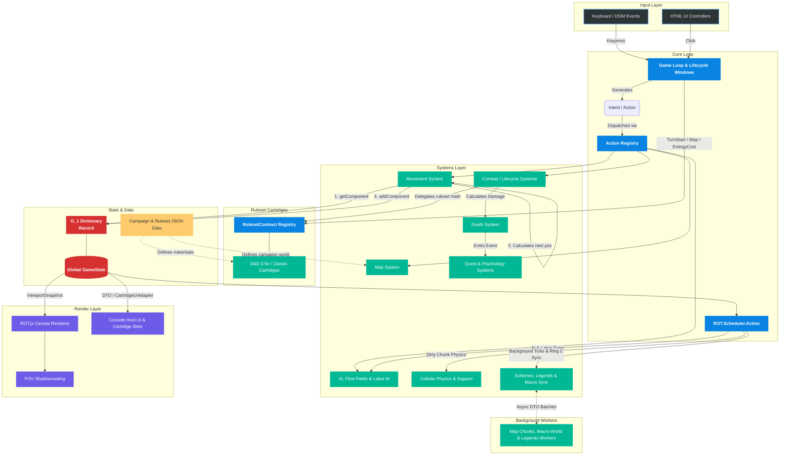
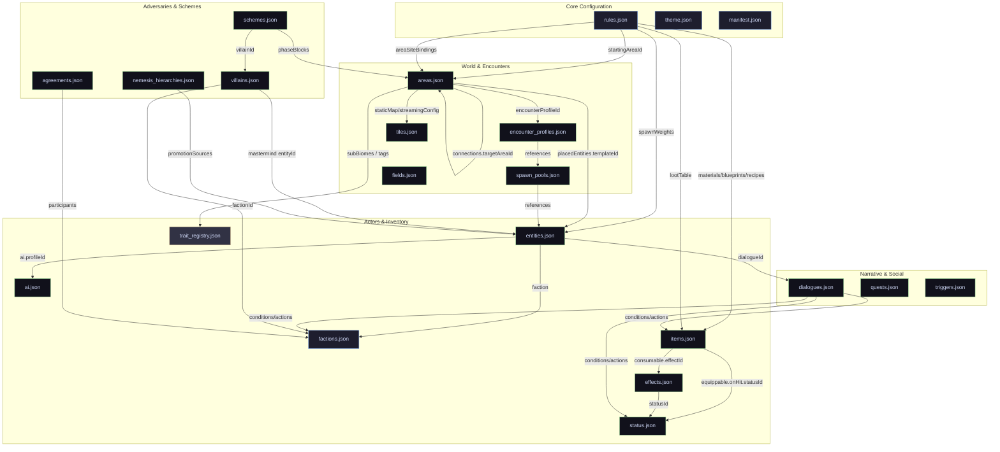

# Architecture — Roguelike Project

A traditional turn-based ASCII/grid roguelike game built for modern browsers.

---

## 1. Project Summary

This project is a grid-based traditional roguelike game featuring dual **Turn-Based** and **Real-Time with Pause (RTwP)** engine modes, built using TypeScript, ROT.js, and Vite. It runs natively in web browsers and is structured to compile efficiently and run deterministically. It uses an Entity-Component-System (ECS) architecture for managing game entities and state.

## 2. Core Design Philosophy

Beyond the technical ECS constraints, the development of systemic mechanics (like factions, quests, and background schemes) adheres to two primary philosophies:

- **Prioritize Observability**: Background simulations are notoriously difficult to debug because they fail silently. Never build an invisible system without a window into it. Complex simulation logic (like scheme advancement) must always be paired with explicit UI surfaces (investigation boards, dialogue logs) or dedicated `/debug` cheat commands so its state can be verified.
- **Defensive Simulation (Fail Gracefully)**: In systemic games, unpredictable edge cases _will_ happen. If an intermediary NPC vital to a quest dies or is trapped, the simulation must not crash or soft-lock the campaign. Systems must handle broken chains gracefully—either by generating a new NPC to fill the role, or by explicitly failing the quest and rendering the failure in the UI.

---

## 3. Module Dependency Graph

The dependency graph flows strictly downward. Circular imports are banned. Modules at lower layers (e.g., `types`, `constants`, `utils`) may never import from upper layers.

Since the Campaign Editor is a top-level creator tool rather than a part of the active gameplay loops, the `editor/` controller folder sits at the top tier of the graph alongside the game bootstrap, permitting it to import from any engine layer while keeping the `rendering/` view layer completely isolated.

**Top-Level Tooling Orchestration:** To respect downward dependency constraints, developer tools and builders that coordinate multiple systems (like the map generator, AI behaviors, and dialogue trees) must reside in a dedicated `src/editor/` namespace at the top tier of the graph rather than in lower view layers like `src/rendering/`. The UI view layer remains a dumb component tree that only communicates upward via event dispatching.



---

## 4. Engine Architecture

### 4.1 ECS-lite

We use a low-overhead, framework-free ECS:

- **Entities** are simple numeric IDs (`EntityId` branded type), not class instances.
- **Components** are pure data objects (TS interfaces) with no methods, stored in a `ReadonlyMap<EntityId, Readonly<Record<string, Component>>>` within the global `GameState` for `O(1)` access. The `GameState` is strictly immutable; systems clone the outer map when adding/removing entities, but only clone and replace the specific dictionary for the modified entity during updates.
- **Component Heuristic**: When deciding if data warrants a new component, evaluate **Reusability** (does it apply to multiple entity types like Actors, Areas, Factions?), **System Querying** (does a system need to iterate over all entities with this specific property?), and **Lifecycle** (is the data conceptually distinct, e.g. a temporary status effect vs intrinsic tags).
- **Systems** are pure functions that query components using `getComponent`, process game state changes, and return new state via `addComponent` / `removeComponent`.
- **Entity Ownership**: Components (like `InventoryComponent`) do not "contain" other entities; they store `EntityId`s as foreign keys. When migrating entities between state boundaries, the engine must traverse and package these owned "child" entities to prevent orphaned references.

### 4.2 Game Loop, Lifecycle Windows & Scheduler

Turn management uses `ROT.Scheduler.Action` (wrapped in `src/core/scheduler.ts`), chosen over `ROT.Scheduler.Simple` to support variable action durations (haste, slow, movement speeds, multi-step round budgets) cleanly across Turn-Based and RTwP modes. Input is decoupled from the engine: keyboard and DOM listeners push `Intents` into a bounded FIFO player intent queue (`src/core/input_queue.ts`). When an entity's turn arrives via `act()`, it pops from the queue or calls `engine.lock()` to await input — enabling seamless RTwP and future multiplayer without restructuring the engine loop. Immediate non-turn intents (e.g. camera zoom, toggle pause, UI modals) bypass world stabilization in `src/core/loop/intent_cost_resolver.ts` and execute immediately with `energyCost = 0`. Mid-session spawned `Actor` entities (such as companions and summons) are idempotently auto-enrolled in `ROT.Scheduler.Action` via `addActor(id)` inside `game-loop.ts`'s `updateState()`.

- **Cooperative Frame-Budgeted Scheduler (`src/core/scheduler.ts`)**: Slices turn execution against a 4ms budget (`FRAME_BUDGET_MS = 4` measured with `performance.now()`). If a turn storm or multi-actor AI turn exceeds 4ms, the scheduler yields control back to the browser event loop via `setTimeout(..., 0)` while holding `isTurnProcessing = true` and `engine.lock()`. This guarantees the browser can present frames at 60Hz without input interleaving or re-entrant state corruption.
- **Bounded RTwP Frame Drain & Area-Transition Integrity**: In Real-Time with Pause mode, `rtwpLoop()` accumulates delta time between animation frames and drains turns in bounded sub-steps (`MAX_RTWP_DRAIN_ITERATIONS = 10`, `FRAME_BUDGET_MS = 4`, `MAX_ACCUMULATED_RTWP_TIME = 1000ms`). When changing floors/areas in RTwP mode (`src/systems/map.system.ts`), the engine invokes `resetSchedulerActors()` rather than `clearScheduler()` so stale floor actors are flushed without locking the engine or cancelling the active `requestAnimationFrame` ticker.
- **Unified Actor Lifecycle Windows (`src/systems/lifecycle.system.ts`)**: Player and AI turns share canonical Console lifecycle hooks (`runActorTurnStart`, `runActorMovementStep`, `resolveActorActionEnergyCost`), resetting per-round Console triggered reaction quotas and delegating optional ruleset turn/step/action-budget hooks through `RulesetContract` (`onActorTurnStart`, `onActorMovementStep`, `resolveActionEnergyCost`).
- **Event-Cursor State Stabilization (`src/core/state_stabilizer.ts`)**: Iterative stabilization loops advance a strict `processedEventIndex` cursor into `processGlobalTriggers(nextState, processedEventIndex)` so every emitted event is evaluated at most once across cascading reaction/trigger chains without runaway trigger recursion.
- **Tiered World Simulation Cadence (`src/core/simulation_cadence.ts`)**: Rather than ticking heavy narrative and macro systems on every actor turn sub-step, world simulation is partitioned across three hierarchical cadences:
  - **Tier 1 (Micro / Immediate)**: Runs every actor turn in the active area: FOV calculation, movement, combat resolution, reactions, anchored spatial fields (`processFieldsTick`), and immediate triggers.
  - **Tier 2 (Local Narrative)**: Ticks every 10 turns (`LOCAL_NARRATIVE_TICK_INTERVAL = 10`): updates local NPC thought bubbles, decrements dramatic delay counters, decays recent rumors, and cleans expired temporary memories.
  - **Tier 3 (Macro / Global)**: Executes on coarse intervals: Nemesis & Rivalry hierarchy power struggles (`RIVALRY_TICK_INTERVAL = 25`), Villain Schemes and Phase Block progression (`SCHEME_TICK_INTERVAL = 50`), and Global World Events & Faction Schisms (`WORLD_EVENT_TICK_INTERVAL = 100`).

### 4.3 Intent → Action → Event Pipeline

All interactions flow through pure data `Intents` pushed into command queues, resolved by a stateless `ActionRegistry` mapping `IntentType` → `ActionHandler`. This replaces OOP Command objects (which would put method closures into the serializable `GameState`) while providing the same architectural decoupling without a massive `switch` router.

Entity interactions funnel through a unified `ApplyIntent` carrying a `verb` (covering world verbs like `apply`, `throw`, `kick`, `open`, `close`, `lock`, `unlock`, `zap`, ruleset skill verbs like `search`, `disarm`, `heal`, `persuade`, `intimidate`, `feint`, and companion command verbs like `command`, `order_attack`, `order_defend`, `order_follow`, `order_hold`, `order_target`), optional `toolEntityId`, and a polymorphic target.

### 4.4 Determinism & RNG

A single seeded `ROT.RNG` instance is exported from `src/core/rng.ts`. All Ring 0/1 gameplay randomness (map generation, combat rolls, AI choices, physics) must use this instance to guarantee deterministic replay given the same seed and input sequence. Off-thread Ring 2 macro-world ticks and multi-century Legends synthesis (`src/map/worldgen_continent.ts`, `src/systems/macro/`, `src/worker/world_sim.worker.ts`) use an isolated Mulberry32 PRNG (`createMacroRng(seed, salt)`) so asynchronous macro ticks never perturb `src/core/rng.ts` state.

### 4.5 Save & Persistence

- **State Serialization & Persistence Service**: The immutable `GameState` contains all active data, making serialization to JSON for `localStorage` via `src/core/save.ts` trivial. Persistence is decoupled from inner turn loops via `src/core/persistence_service.ts`: continuous gameplay updates debounce saves (500ms) to avoid stalling frame rates, while transactional checkpoints trigger synchronously on turn completion, game over, RTwP pause/mode switches, area transitions, and `window.beforeunload` flush. Transient visual effect expirations bypass autosaves entirely to prevent redundant I/O churn.
- **Inactive Areas**: Non-active areas are stored in a compressed/serialized format within `GameState` and swapped into active ECS arrays upon transitions, keeping active queries lightweight.
- **Campaign Data**: Stored as JSON files loaded via `fetch()`. A global `campaigns.json` registry lists all available campaigns. `zod` schemas validate all data, giving precise human-readable errors for malformed mods. The TypeScript schemas defining these structures are strictly modularized into domain-specific files (`meta.ts`, `world.ts`, `item.ts`, `social.ts`, `entity.ts`) under `src/types/campaign/` and aggregated through a central facade to prevent monolithic file bottlenecks.
- **Authoring Continuum (Static, Blueprint, Dynamic Primitives)**: Campaign data structures are categorized into three levels: **Static** data (directly painted tiles, hand-authored dialogues, factions), **Parameterized Blueprints** (spawn pools, quest templates, procedurally generated areas), and **Dynamic Primitives** (trigger templates, reactions, traits). The Campaign Editor provides visual headers, reference suffixes, and a **Bake** controller to resolve procedural blueprints (like generated maps and tokens) into hand-editable static data. The Campaign Validator mock-compiles dynamic templates using context-aware variable bindings (mapping names to type-appropriate dummy variables or existing entity/item IDs) to run strict schema and integrity checks.
- **JSON Patch Caveat**: JSON Patches (RFC 6902) work for editor change tracking, but gameplay turn-rewinding requires checkpointing `src/core/rng.ts` state alongside delta patches, otherwise future random results desync.

### 4.6 Campaign Data Dependency Tree

To guide campaign authors and prevent reference errors, the Campaign Editor UI follows a strict left-to-right/top-to-bottom layout order derived from data dependencies. A campaign record must exist in the database (downstream node) before other records (upstream nodes) can select or reference its string ID.

The following graph maps these structural dependencies:



#### Core Data Ordering Constraints:

1. **Low-level Building Blocks (Factions, Status Effects, AI, Dialogues)**: Must be created first. They are the target of references for items and entities.
2. **Game Objects (Entities, Items)**: Require valid faction IDs, dialogue IDs, AI profiles, and effect IDs. These must exist before they can be placed on maps.
3. **World Generators (Spawn Pools, Encounter Profiles, Areas)**: Spend "CR budgets" by referencing entity templates and placed items.
4. **Adversary Layer (Villains, Schemes, Agreements)**: Masterminds are bound to entities, which are mapped to factions. Phase blocks transition between areas. Thus, adversaries sit at the top tier of campaign dependencies.

This tree is directly mapped in `editor_config.ts`'s `VIEW_GROUPS` layout, guiding the designer from left to right along the Activity Bar.

### 4.7 Web Worker Offload & Background Simulation (`src/worker/`)

Computationally intensive operations and persistent Ring 2 background worlds are offloaded to dedicated Web Workers:

- **Worker Bridge (`src/worker/worker_bridge.ts`)**: Manages worker lifecycles (`fuzzer.worker.ts`, `map.worker.ts`, `world_sim.worker.ts`, and `legends_worldgen.worker.ts`). Performs `isWorkerAvailable()` feature detection and falls back deterministically inline on headless or non-Worker runtimes.
- **Batched Chunk Prefetch & Legends Generation**: `map.worker.ts` handles both whole-dungeon async builds and batched `generate_chunk_batch` `streaming_overworld` Ring 1 prefetches via transferable `ArrayBuffer` slices; `legends_worldgen.worker.ts` runs pre-play continental synthesis and multi-century history simulation (`simulateWorldLegendsAsync`); `world_sim.worker.ts` stays persistent across turns to advance Ring 2 caravans, raids, economies, rumors, and weather fronts (`advanceMacroWorldTicks`).
- **Serializable JSON DTO Boundary (`src/worker/worker.types.ts`)**: All worker requests and responses use pure JSON-serializable DTOs or zero-copy transferable `ArrayBuffer` payloads (with `Set<string>` fields flattened to arrays).
- **Non-Blocking Progress Streaming**: Workers emit `WorkerProgressPayload` messages during execution, updating the Preact `LoadingOverlay` (`LoadingOverlay.tsx`) at native frame rates.

### 4.8 Performance Telemetry & Hot-Path Memoization Invariants (`src/core/performance.ts`)

To prevent frame budget overruns ($>16.6\text{ms}$ render or $>4\text{ms}$ turn slice) and diagnose systemic bottlenecks across 750+ JSON definitions and multi-actor turn cascades:

- **Sub-System & Sub-Domain Performance Telemetry (`perfTracker`)**:
  - **Turn Breakdown (`TurnSubsystemsSample`)**: Instruments `applyIntentWithCost` across 6 sub-stages (`dispatchActionMs`, `stabilizationMs`, `fieldsAndInvestigationMs`, `cadenceAndLedgerMs`, `fovAndExploreMs`, `autoPauseMs`) with a 60-sample rolling window (`computeTurnRollingStats`), peak tracking (`maxTurnTimeMs`), and slow-turn counters ($\ge 8\text{ms}$).
  - **Render Domain Breakdown (`RenderSubsystemsSample`)**: Instruments `renderPresenterFrame` across `snapshotBuildMs`, `canvasDrawMs` (with `drawCalls` and `fullRedraw`), `overlaysMs`, `hudDomainMs`, `logDomainMs`, `inventoryDomainMs`, `modalsDomainMs`, and `debugDomainMs` with a 120-frame rolling window (`computeRenderRollingStats`).
  - **One-Click Diagnostic Export (`triggerTelemetryDownload`)**: The Settings menu exposes a **Download Telemetry** button that exports `buildTelemetryExportPayload(state, getRenderDebugMetrics())` as a structured JSON file combining session state, entity/spatial bucket counts, rolling/peak timings, render debug metrics (`missingSprites`, early returns), and recent turn/render/AI sample histories.
- **Hot-Path Schema Memoization, Cross-State Structural DAG Caching & Loop Optimizations**:
  - **Zero Uncached Zod Parsing in Turn/Render Loops**: Validating large ruleset registries (**768+** modular D&D 3.5e SRD definitions in `campaign.systemContent`) with Zod `.safeParse()` takes ~34ms per call. `getDnD35SystemContent(campaign)` and `parseDnD35SystemContent(raw)` memoize the validated `DnD35SystemContent` in a `WeakMap<object, DnD35SystemContent | null>` keyed on the `campaign.systemContent` reference, reducing hot-path lookups to $O(1)$ ($<0.001\text{ms}$) while automatically re-validating whenever the Campaign Editor (`applyPatch` deep-clone) or a test replaces the object reference.
  - **Cross-State, Budget-Resilient Entity DAG Memoization (`src/rulesets/dnd35e/cartridge/dnd35e_dag_adapter.ts`)**: `evaluateDnD35eEntityDAG` uses `campaignEntityDagCache` (`WeakMap<object, Map<EntityId, CachedEntityDAGEntry>>`) keyed by `state.campaign` to reuse immutable 4-stage DAG results across unrelated actor movements and action-budget ticks. Entries invalidate strictly on structural component reference changes, equipped item reference diffs, active `Field` snapshots (including `sourceFactionId`), or area environment shifts, while `mergeTransientDndData` overlays fresh `actionBudget` and `flankingRelations` on every hit so stats can never go stale.
  - **Spatial Flanking Fast-Skip & Direct Turn Settlement (`flanking_graph.ts`, `game-loop.ts`)**: `syncSpatialFlankingGraph` defers semantic tag projection to a lazy cache evaluated only for hostile pairs within `maxReachFt`, and `onDnD35eActorMovementStep` skips full graph scans when no neighbor lies within 12 tiles (`60 ft`) and no active flanking edge exists. AI actors ending an intra-turn action with `null` intent settle directly via `settleRemainingActorTurn` without dispatching a duplicate `Wait` cycle, and per-step synchronous `saveCheckpoint` calls are omitted in favor of `updateState` debounced persistence.
  - **Viewport/Player-Scoped Dirty Domains & Menu Guard (`presentation_queue.ts`, `presenter.ts`)**: `markDirtyFromStateDiff` (`classifyPresentationComponentDiff`) ignores off-screen NPC mutations outside `cachedFov` when flagging `Entities`, `HUD`, and `Inventory` dirty domains, and `renderMenus` in `presenter.ts` runs only when `state.uiMode !== UIMode.Game`.

---

## 5. World & Map Systems

*For detailed Phase 45–48 deep-dive architecture covering SoA `WorldChunk` buffers, Multi-Z voxel traversal, dirty-bitset cellular physics, and Ring 2 macro-world sync, see Sections **9.32**, **9.33**, **9.34**, and **9.35**.*

### 5.1 Map Generation, SoA Chunk Substrate & 3D FOV

- **Generators & Unified `MapAccessor` (`src/map/map_accessor.ts`)**: Supports structured dungeons (`ROT.Map.Digger`), organic cave networks (`ROT.Map.Cellular`), Diffusion-Limited Aggregation (`dla`), stacked static multi-Z layouts (`staticMap.zLevels`), and unbounded Ring 0/1 `streaming_overworld` chunk streaming (`src/map/chunk_generator.ts`, `src/systems/map/chunk_streaming.ts`). All read/write terrain, bounds, exploration, cellular physics (`fluid`, `temperature`, `materialId`), and dirty-flag queries route through `MapAccessor`, transparently bridging finite `GameMap.tiles` (with `FinitePhysicsOverlay`) and multi-Z `WorldChunk` `TypedArray` SoA planes indexed via signed coordinate packing (`packWorldCoord` / `packWorldCoord3D`). Tiles resolve from `tiles.json` and `TilePaletteRegistry` without hardcoding terrain IDs.
- **Modular Pipeline & Async Generation (`src/map/generator_stages.ts`, `src/map/generator_async.ts`)**: Finite procedural dungeon generation is decomposed into discrete stages (`resolvePalette`, `carveBaseGeometry`, `carveRoomsAndPortals`, `applyBiomesAndCull`, `computeHotPathDijkstra`), streaming `GenerationProgress` payloads between yields while snapshotting `ROT.RNG` state.
- **Entity & Portal Placement**: Picks topologically open navigable cells rather than hardcoded room centers, and validates stacked multi-Z stairwell alignment across `zLevels`.
- **3D Shadowcasting FOV & HPA\* Routing (`src/map/fov_3d.ts`, `src/map/region_graph.ts`, `src/ai/pathfinding_hpa.ts`)**: Shadowcasting (`computeFOV` / `computeFOV3D`) runs when `GameState.fovNeedsUpdate` is set, tracing horizontal slices fast and vertical openings (`open_air`, `blocksVerticalLoS: false`) across up to `MAX_FOV_Z_RANGE`. Navigable chunks flood-fill into `Uint16Array` `regionId` components connected across boundary and vertical ramp/stair portals (`RegionGrid`) for $O(1)$ reachability detection and shared LRU 3D Dijkstra flow fields (`src/ai/flow_field.ts`).
- **Spatial Rendering**: The renderer queries the incremental $O(k)$ `spatialIndex` (`"x,y,z"` buckets) and `cachedFov` across visible depth strata (`MAX_RENDER_DEPTH_LAYERS = 3`).

### 5.2 Areas, Streaming Chunks, Transitions & Sleep/Wake

The game world spans both discrete "Areas" (dungeons, static hubs, multi-Z towers) and continuous `streaming_overworld` worlds, alongside an optional Ring 2 continental macro-world (`state.macroWorld`) synced via `site_materializer.ts`. Areas are ECS Global Entities carrying `TagsComponent` and `ChronicleComponent`; inactive finite areas pack into `state.areas`, while evicted `streaming_overworld` chunks pack local entities into `evictedChunkEntities` and save mutated (`CHUNK_DIRTY_PERSIST`) SoA chunks as compact binary buffers in IndexedDB (`WORLD_CHUNKS_STORE`, `src/core/chunk_store.ts`).

**Persistent Entities & Limbo (Sleep/Wake):** Entities with a `PersistentComponent` (including Turn-1 seeded Legends figures) live in `persistentEntities`; `moveToLimbo` recursively packages owned foreign-key children (inventory, equipped items, mounts/links) so named NPCs retain equipment and history across area transitions.

**Area Respawn Timers, Analytical Physics Catch-Up & Macro Materialization:**

1. **Delta Calculation**: On transition or chunk wake, the engine compares elapsed world turns against `lastVisitedTurn` / `lastSimulatedTurn`.
2. **Entity Respawning**: If `deltaTurns` exceeds `respawnTimerTurns`, the `EncounterDirector` re-populates non-persistent entities and emits `AreaRespawned` (`map_wake_respawn.ts`).
3. **Analytical Catch-Up & Macro Site Sync**: `catchUpChunkPhysics` (`src/systems/physics/chunk_catchup.ts`) computes closed-form thermal/fluid/burnout settlement over elapsed dormant turns, while `materializeMacroSitesForChunk` and `materializeMacroSitesForArea` (`src/systems/map/site_materializer.ts`) idempotently stamp pending Ring 2 settlement raids, burnt tiles/smoke, tombs/relics, and passing caravans.

### 5.3 Encounter Director

- **Algorithmic Population**: Hooks into map generation to spend "CR budgets" deterministically across tactical axes: objectives (proteins), advantages (appetizers), hazards (sides), and chaos (desserts).
- **Dynamic Content**: Enemy templates and features are scaled using trait costs and sub-biome tags, making procedural rooms feel authored.
- **Scheme Mutability**: Villain schemes can mutate Director parameters (adding encounters, shifting budgets) before generation, providing macro-level world consequences.
- **Hot Path Dijkstra Mapping**: Computes the shortest path from the player's starting coordinate to all exits/portals in the area using `ROT.Path.Dijkstra`. This path is expanded by a configurable/heuristic radius thickness (the "hot path") where major monsters (`protein`) and hazards/traps (`side`) are preferentially spawned to ensure pacing and danger along critical paths, while fodder (`appetizer`) and loot (`dessert`) scatter uniformly to encourage exploration.

---

## 6. Combat & Entity Systems

### 6.1 Unified Damage Pipeline

All damage sources (melee, traps, spells, environment) inject a `DamageComponent` onto the target containing `DamageInstance`s with `amount`, `sourceEntityId`, and semantic `tags` (e.g., `["spell", "lightning"]`). `damage.system.ts` aggregates damage, reduces HP, processes on-hit effects, and generates floating combat text. If HP reaches 0, a `DeathComponent` is attached; `death.system.ts` handles messages, XP, drops, and cleanup. This fully decouples the _cause_ of damage from its _resolution_.

### 6.2 Status Effects Engine

A declarative `StatusEffectDefinition` registry describes effects (duration, stat modifiers, per-turn damage/heal, behavior flags). `status-effect.system.ts` ticks every turn, removing expired effects and modifying stats via `getEffectiveStats()`. Behavioral flags describe _mechanics_ (`skipTurn`, `confused`), not _flavor_ (`stunned`, `frozen`) — so any number of thematic variants reuse `skipTurn: true` without code changes. The game loop queries generic helpers like `shouldSkipTurn()` and never inspects specific effect names.

### 6.3 Items, Equipment & Stat Model

- **Registries**: Items and Effects are defined declaratively in JSON as pure data objects keyed by string ID, enabling trivial serialization and future modding.
- **Inventory**: The player's `InventoryComponent` holds item `EntityId`s. Pickup removes `PositionComponent`; drop restores it.
- **"Bonus at Query Time"**: Equipment bonuses are _never_ baked into `FighterComponent`. `getEffectiveStats()` dynamically sums base stats with equipment and status effect bonuses on demand, preventing desyncs from forced item removal and composing cleanly with future modifiers (level-ups, curses).

- **Console Stances, Quotas & Ruleset Combat Delegation (`src/systems/stance.system.ts`, `src/systems/combat.system.ts`)**: `stance.system.ts` manages Tier 1 Console stance groups (`activeStanceGroups`), self-tag projections, and per-round triggered reaction quotas (`triggeredUsesThisRound`), reset automatically on each actor's `TurnStart` window (`lifecycle.system.ts`). Ruleset-specific melee exchanges, damage mitigation, and XP awards delegate cleanly through `RulesetContract`.

### 6.4 Reactions, Anchored Spatial Fields & Triggers

- **Reaction System**: `reaction.system.ts` evaluates `reactions.json` against source/target entities, matching on `tags` and `verbs` rather than entity IDs — enabling designers to author new mechanics entirely in data. Matched reactions delegate to the Trigger System for consequence execution (e.g., `change_area`, `apply_item_effect`, `emit_event`, `set_companion_stance`, `order_companion_target`).
- **Anchored Spatial Fields (`src/systems/field.system.ts`)**: `FieldComponent` supports stationary zones and `anchorEntityId`-bound mobile emanations synchronized on every `MovementStep` (`syncAnchoredFieldsForEntity`), handling illumination overrides, duration expiry, and ruleset aura entry hooks.
- **Trigger System**: `trigger.system.ts` acts as an orchestrator that executes data-driven `TriggerDefinition`s (`WHEN [event] IF [conditions] THEN [consequences]`). To maintain clean architecture, specific event routing and execution are delegated to domain-specific modules (`player.ts`, `quest.ts`, `social.ts`, `social_consequences.ts`, `systemic.ts`) within `src/systems/trigger/`.
- **Trigger Composer**: `trigger-composer.system.ts` handles runtime trigger generation, compiling reusable templates (`TriggerTemplate`) loaded from `trigger_templates.json` into valid `TriggerDefinition`s using global variable bindings (e.g., `$NEMESIS_NAME`) with support for numeric/boolean auto-unquoting, and injecting/removing them dynamically at runtime while safely rebuilding optimization routing buckets. Pair with an interactive editor panel in `editor_ui.ts` for previewing and baking.
- **Pacing Governor & Drama Director**: The Trigger System leverages a global `DramaTracker` (stored in the immutable `GameState`) to enforce pacing limits on emergent narrative events. Triggers can specify a `dramaCost` and cooldown periods. The pacing governor ensures events don't overwhelm the player, and executing a trigger checks these limits first. If blocked, the system can execute optional `fallbackConsequences`.
- **Interactive Terrain**: Doors, traps, shallow water, and other terrain features define interactions and movement costs directly in JSON definitions.

---

## 7. AI & Social Layer

### 7.1 Composable AI Pipeline, Companion Tactics & Factions

AI logic is split into discrete modules in `src/ai/` (`hunt`, `ranged`, `spell`, `follow`, `flee`, `wander`) composed into data-driven AI Profiles (`BEHAVIOR_REGISTRY` in `src/systems/ai.system.ts`). During an entity's turn, behaviors are evaluated in priority order until one returns an executable `Intent` — replacing monolithic `if/else` blocks and allowing complex archetypes (e.g., cowardly mage, tactical animal companion) to be built by mixing behaviors in data.

**Companion Stances, Follow Routing & Focus Orders (`src/ai/companion_targeting.ts`, `src/ai/follow.behavior.ts`, `src/systems/companion_commands.system.ts`)**: Allied entities linked via `ControllerLinkComponent` evaluate tactical directives (`stance: 'aggressive' | 'defensive' | 'passive' | 'hold'`, `commandTargetId`, `followDistance`, `leashRadius`) uniformly through `resolveAITarget` across `hunt`, `ranged`, and `spell`, while `followBehavior` routes toward the controller via `ROT.Path.AStar` and `canTraverseTile`. Players issue orders via right-click verbs (`command`, `order_attack`, `order_defend`, `order_follow`, `order_hold`, `order_target`), targeting mode, or the synthetic `__companion_orders__` dialogue tree, and swap positions cleanly when bumping into controlled allies in corridors.

**Factions as Global Entities & Attitude Resolution (`src/utils/faction.ts`)**: Factions are modeled as standard ECS Global Entities rather than hardcoded lookup tables. This allows them to naturally possess a `ChronicleComponent` (tracking their historical world events like schisms and alliances), `TagsComponent`, and `MemoryComponent`. Hostility and allied behavior resolve via `getFactionRelation` / `isHostile` combining `FactionComponent`, `HOSTILITY_MATRIX`, and 5-tier `AttitudeComponent`, enabling infighting, neutral NPCs, and allied summons/companions. AI modules utilize FOV for line-of-sight checks, and `AIComponent` tracks ability cooldowns.

**Memory Separation of Concerns**: AI combat tracking data (like `grudges`) is kept strictly separated from narrative state tracking (like boolean `facts` for dialogues). Mixing them creates brittle code that can falsely trigger AI hostility.

### 7.2 Identity, Personality & Chronicle

- **Chronicle & Memory**: Important NPCs have a `ChronicleComponent` tracking player interactions, scars, relationships, and history. `MemoryComponent` stores `knowledge` (rumors, locations), `interaction counters`, `personality facets`, and `relationshipAxes` (loyalty, fear, resentment, respect, debt, ideologicalAlignment).
- **Identity Generation**: Promoted NPCs receive `IdentityComponent` via data-driven tables keyed by `{templateId}_identity` convention (e.g., `"orc"` → `"orc_identity"` in `identity_generation.json`).
- **Personality**: NPCs possess values, goals, and facets (cowardice, generosity). Extreme memories mutate facets permanently as "core memories". Personality weights AI behavior selection and gates dialogue options.

### 7.3 Dialogue, Quests & Knowledge Brokering

*For full deep-dive architectural specifications, end-to-end dataflow diagrams, and identified gaps, see [`docs/QUEST_AND_NARRATIVE_ARCHITECTURE.md`](./QUEST_AND_NARRATIVE_ARCHITECTURE.md).*

- **Dialogues**: JSON trees (`DialogueTreeSchema`) with conditional gating against `MemoryComponent` (faction standing, grudges, personality, and relationship axes). Options dispatch configurable effects via the trigger system.
- **Quests**: Data-driven structures with observable objectives tracked via `QuestLogComponent`. Subsystems emit generic events that `quest.system.ts` listens to, decoupling combat from quest logic. Supports `AND`/`OR` logical operators for branching resolutions.
- **Knowledge**: NPCs learn about world events through delayed propagation in the social graph. The player uses dialogue verbs (`ask_about`, `gossip`) to acquire knowledge dynamically. Rumors spread organically and decay over time. Knowledge sharing is gated dynamically: NPCs with high loyalty or fear are more willing to share rumors (evaluated via `getWillingnessToShare()` which considers relationship axes), while high resentment blocks it.

### 7.4 Trade & Barter Economy

Entities with a `ShopComponent` act as merchants. `getEffectivePrice` dynamically evaluates NPC markup, faction standing, personality facets, social states (`annoyed`/`grateful`), and relationship axes (`loyalty`, `fear`, `debt` reduce markups, while `resentment` increases markups). Social verbs (`intimidate`, `persuade`) use personality-weighted contests (boosted by active relationship values like fear and respect) to temporarily modify pricing. Depleted inventories generate procedural fetch quests via the existing quest template system.

### 7.5 Scheme Simulator & Investigation

`scheme.system.ts` ticks independently within the `ROT.Scheduler.Action` loop. Villains pursue JSON-defined `SchemeRecipe`s that are dynamically assembled at runtime by the Scheme Compiler using `PhaseBlock`s. As the player defeats minions, combat drops randomized clues; `investigation.system.ts` updates the `MemoryComponent.knowledge` on the player entity. The Investigation Board UI acts as a filtered view of the player's knowledge (specifically targeting the `clue` type and `scheme` tags), allowing the player to naturally review discovered evidence and expose active schemes without duplicating state. Schemes feature dynamic resilience: recruitment utilizes MICE-based profiling mapped to NPC personality facets, node disruption triggers local repair and confession logic based on `compromiseScore`, and escalating countermeasures trigger via `conspiracyAwareness`. Schemes survive mastermind deaths by transferring ownership and continuing in a leaderless momentum state.

### 7.6 Rivalry & Power Struggles

`rivalry.system.ts` provides autonomous background conflicts for persistent entities and handles the core simulation loop (`processRivalries`, `generateEventDrivenRivalry`). The system delegates heavy lifting to strict domain modules: `query.ts` handles searching across active/inactive states for nemesis entities, and `resolve.ts` applies structural mutations (like promotion and scarring). Outcomes of rivalries (such as death, promotion, or status effect changes) deterministically resolve off-screen and propagate as `RivalryResolved` events.
This connects to the knowledge and gossip systems: major power shifts result in rumor propagation (`gossip.system.ts`) and add verifiable knowledge (`knowledge.system.ts`) to NPCs. Trade mechanics (`trade.ts`) also reflect rivalry impacts by imposing markup penalties on merchants whose suppliers suffer vacancies in the top-tier hierarchy.

### 7.7 Nemesis Surfacing & Narrative UX

The Nemesis Surfacing system makes hierarchy events, rivalries, and combat encounters legibly dramatic and narratively sticky:

- **Combinatorial Bark Pools**: Instead of hardcoding dialogue, barks (encounter, cheat death, victory taunt) are resolved dynamically from the entity's active semantic tags and traits, creating highly varied, emergent dialogues.
- **Narrative Throttling & Throttled Encounters**: Nemesis entities track player encounters via `lastEncounterTurn` to prevent spamming introduction callouts.
- **Player Dossier & Timelines**: The Dossier UI provides a dedicated Player Timeline Section presenting the player's personal chronicle chronologically alongside active faction hierarchies and notable NPC records.
- **Dramatic Pacing & Accessibility**: Resurrection events trigger a controllable visual pause (`DRAMATIC_PAUSE_DURATION_MS`) to give events dramatic weight, which can be bypassed via the `reduceDramaticDelays` accessibility setting.

---

## 8. Rendering & UI

*For UI standards, dark-fantasy theme architecture, and `ICartridgeUIAdapter` contracts, see [`docs/UI_UX_STANDARDS.md`](./UI_UX_STANDARDS.md).*

- **Decoupled 60Hz Presentation Loop & Presenter**: Simulation step loops do not invoke DOM panel updates or canvas draws directly. Instead, `startGlobalPresenterLoop()` in `src/core/session_controller.ts` runs on `requestAnimationFrame` at 60Hz, consuming dirty domains flagged in `src/core/presentation_queue.ts` via `markDirtyFromStateDiff()`. Frame updates dispatch selectively to affected UI panels and canvas passes through `renderPresenterFrame()` in `src/rendering/presenter.ts`. Transient visual effects (VFX) expire at 60Hz in the presentation loop and tag `PresentationDomain.VFX` without triggering state persistence cascades.
- **Presentational Viewport Projector (`src/rendering/viewport_snapshot.ts`)**: Projects the simulation state into an immutable `ViewportSnapshot` DTO (`buildViewportSnapshot(state, viewportW, viewportH)`). Isolates all reads of `GameState`, `spatialIndex`, `cachedFov`, entity component queries, z-ordering, crosshairs, tooltips, and fog metrics, keeping the rendering layer purely presentational.
- **Pure Dumb Canvas Renderer (`src/rendering/renderer.ts`)**: Translates presentational `ViewportSnapshot` cells (including up to `MAX_RENDER_DEPTH_LAYERS = 3` depth-dimmed lower Z strata beneath `open_air` tiles and non-moving `cameraZOffset` peeking) into characters/sprites on `ROT.Display`. Features zero imports from `src/core/ecs.ts`, `src/types/components.types.ts`, or `src/types/game-state.types.ts`, and implements cell-level dirty diffing (`drawCell()`) with full invalidation on area switches, theme shifts, or zoom changes.
- **Unified Preact Gameplay UI Host (`src/rendering/ui/`, see Section 9.30)**: All gameplay HUD cards, menus, and modals mount inside `#ui-root` (`<AppUiRoot />`) driven by per-domain `uiStore` selectors and shared semantic primitives (`src/rendering/ui/primitives/*`) across `--ui-*` tokens (`obsidian-brass`, `parchment`, `retro-crt`):
  - **HUD Landmarks (`src/rendering/ui/hud/`)**: `ChronosStrip.tsx` (TB/RTwP, zoom, camera Z-peek, Settings), `VitalsCard.tsx`, `CommandDockCard.tsx` (live `<Keycap>` badges & `🗺️ Legends`), `TacticalScannerCard.tsx`, `ChronicleLogCard.tsx`, `BottomActionDock.tsx` (10 banks, stance dials, action budget pips, End Turn), `AlertsStack.tsx`, and `VerbMenuPopover.tsx`.
  - **Console & Cartridge Modals (`src/rendering/ui/modals/`, `cartridges/`)**: `ConsoleModalHost.tsx`, `ConsoleDossierView.tsx` (4 tabs + `PaperDollWidget` + `CompactStashWidget`), `TradeModal.tsx`, `DialogueModal.tsx`, `QuestsModal.tsx`, `InvestigationModal.tsx`, `FactionsModal.tsx`, `NemesisDossierModal.tsx`, `LedgerModal.tsx`, `LegendsModal.tsx` (`Shift+H`, 5-tab Ring 2/Legends browser), `HelpModal.tsx` (`F1`), plus Cartridge adapters (`DnD35eCharBuilderModal`, `DnD35eLevelUpModal`, `DnD35eSheetModal`, `DnD35eSpellbookModal`, `DnD35eQuickcastOverlay`).
  - **Canvas Overlays (`vfx_overlay.ui.ts`, `tactical_overlay.ui.ts`)**: Pure Canvas/DOM overlays inside `#game-canvas-wrapper` for floating combat text, fog dimming, and tactical reach/AoE highlights. *(Legacy imperative DOM Campaign Editor views in `src/rendering/editor_ui.ts` remain scoped to `#editor-layout` pending Phase 44.)*
- **Fog of War**: Uses a transparent overlay `<canvas>` in sprite mode to dim out-of-sight tiles, while in ASCII mode it falls back to native foreground color dimming.
- **Camera**: Handles viewport offsets, keeping the player centered on maps larger than the screen.
- **Styling**: CSS modularized by domain in `src/styles/`, aggregated via `@import` in `index.css`.
- **View Controls**: CSS 3D transforms (Rotate 45°, 3D Tilt) on the canvas wrapper for 2.5D visuals without complicating the 2D renderer.
- **Aspect Ratio & Viewport-Proportional Zoom (`src/constants/display.constants.ts`, `src/rendering/display.ts`)**: Controlled programmatically by syncing `ROT.Display` grid dimensions and tile pixel/font span (`DEFAULT_VIEWPORT_TILE_HEIGHT_PERCENT = 0.04` scaled by `state.zoomLevel` in `[MIN_ZOOM_LEVEL = 0.5, MAX_ZOOM_LEVEL = 3.0]` with `ZOOM_STEP_DELTA = 0.2`) so tile scale stays proportional across resolutions. Aspect ratio constants are injected via `--game-aspect-ratio`.

### 8.1 RTwP Auto-Pause Pipeline (`src/core/auto_pause.ts`)

- **Purpose**: Stop real-time simulation automatically on player-relevant developments, without polling.
- **Seam**: `evaluateAutoPause(before, after, actorEntityId)` is invoked by `applyIntentWithCost()` in `src/core/game-loop.ts` **after** all stabilisation and cadence systems have run, but **before** the event drain. This guarantees perception events are ledgered, presented, and acted upon in the same turn they occur.
- **Guards**: Only player-initiated intents can pause; turn-based mode never pauses; an already-paused simulation short-circuits.
- **Signals** (evaluated in priority order by `detectAutoPauseSignals()` in `src/core/auto_pause_signals.ts`):
  1. **Sighting** — `getVisibleHostileEntityIds()` (pure query in `src/systems/map.system.ts`) is diffed against a transient `Set<EntityId>` of currently sighted hostiles. Newcomers emit `GameEventType.EntitySpotted` (importance `high` for nemeses, `low` otherwise). The set is rebuilt from the live visible set every evaluation so dead or reused ids cannot suppress future pauses.
  2. **Low health** — player `FighterComponent` ratio compared against `lowHealthThresholdPercent`.
  3. **Detrimental status** — set-difference of the player's `StatusEffectsComponent.activeEffects` against the pre-intent state, filtered by the campaign registry's `detrimental` flag.
  4. **Narrative** — scans the tick's events for clue, dialogue, world-event, investigation-stall, nemesis-promotion, and scheme-escalation types.
- **Configuration**: `AutoPauseSettings` lives in `PlayerSettings` (`localStorage`), never in `GameState`. Defaults and thresholds are in `src/constants/autopause.constants.ts`.
- **Ownership**: The systems layer stays event-free — `map.system.ts` exposes only a pure query; event construction and transient dedupe live in `core`.

### 8.2 Transient Modal Stack (`src/core/modal_manager.ts`)

- **Purpose**: Centralize LIFO modal nesting and RTwP pause synchronization across all overlays.
- **State**: An in-memory `ModalFrame[]` plus a `baselinePaused` snapshot. Never serialized into `GameState`, so no save migration is involved; `GameState.uiMode` remains the authoritative rendered mode.
- **API**: `openModal()` / `closeTopModal()` / `toggleModal()` mutate `uiMode` and RTwP pause state together; `pushModal()` / `popModal()` / `getCurrentModal()` / `hasModalsOpen()` / `clearModals()` expose the stack.
- **Pause invariant**: The pause state in force when the outermost modal opened is restored when the stack empties. A manual pause therefore survives opening and closing any overlay. When no baseline exists (a save loaded with a modal `uiMode`), the pause flag is left untouched rather than force-resumed.
- **Lifecycle**: `clearModals()` runs on new game and save load (`src/core/bootstrap.ts`) so persisted `uiMode` can never desync from an empty stack.
- **Input (`src/core/input/modal_input.ts`)**: `MODAL_BINDINGS` handles stackable panels (`Debug`, `Settings`, `Factions`, `Quests`, `Investigation`, `Dossier`, `Ledger`), while dedicated modal handlers process `UIMode.CartridgeModal` (delegating dock shortcuts & Escape policy to `CartridgeModalDescriptor`), `UIMode.Dialogue` (`Escape` closes, digit keys `1`–`9` select visible options including synthetic companion orders), `UIMode.Trade` / `UIMode.Services` (`Escape` returns to `Game`), `UIMode.Inventory`, and `UIMode.VerbMenu` (`1`–`N`, `Enter`, `Escape`). Modal overlays consume all input; another modal's shortcut opens it on top, enabling nesting (e.g. Dossier over Investigation).

### 8.3 Shared Sprite Packs, Per-`spriteId` Fallback & User Tileset Selection

- **Central Repositories & Catalog (`public/data/sprite_packs/`)**: Shared `32×32` atlas bundles live under `public/data/sprite_packs/<packId>/pack.json` and are indexed declaratively in `public/data/sprite_packs/catalog.json` (`SpritePackCatalogSchema`, including `attribution` and `fallbackPackIds`).
  - `dcss` (`CC0 1.0`, generated via `scripts/pack-dcss-sprites.ts` from `Dungeon Crawl Stone Soup Full` + `Oct-5-2010/spells`): **6,185** unique `32×32` sprites across 9 sheets (`dungeon`, `monsters`, `items`, `actors`, `effects`, `spells`, `misc`, `gui`, `player_layers`) plus **118** canonical aliases matching legacy campaign keys (`tile_*`, `actor_*`, `monster_*`, `item_*`).
  - `32rogues` (`Copyright 2024 Seth Boyles`, non-redistributable free-use terms, synced via `scripts/generate_sprite_mappings.ts`): **8** sheets (`tiles`, `rogues`, `monsters`, `items`, `animals`, `animated_tiles`, `autotiles`, `items_palette_swaps`).
- **Priority-Ordered Per-`spriteId` Fallback (`src/utils/sprite_pack.ts`)**: `resolveThemeSpriteSheets(theme)` orders `theme.spritePacks` from lowest-priority fallback (`length - 1`) to highest-priority primary (`0`), scoping shadowed duplicate `sheetId`s (`<packId>__<sheetId>`) while letting the highest-priority owner keep the bare `sheetId` and applying campaign-local `theme.spriteSheets` overrides last. Because `compositeAtlas` (`src/rendering/sprite_atlas.ts`) populates `mergedTileMap[spriteId]` in sheet iteration order, primary packs override per `spriteId` cleanly while unmapped IDs fall back seamlessly to lower-priority packs.
- **Runtime Pack Switching & Attributions (`src/core/loader/sprite_pack_loader.ts`, `src/rendering/procedural_sprites.ts`, `src/rendering/ui/settings_attributions.ts`)**: `resolveEffectiveThemeWithPreference` applies `settings.visualFeedback.preferredSpritePack` on top of sprite campaigns (leaving ASCII campaigns ASCII by default), `hydrateCampaignSpritePacksForTheme` loads needed packs on demand when `configureDisplayForCampaign` switches atlases live, and Settings renders both the dynamic pack selector and `Credits & Attributions` cards directly from catalog/pack metadata (`CREDITS.md` mirrors all notices at repo root).
- **Disk & Coordinate Integrity Validation (`scripts/run-validator.ts`)**: Validates every pack manifest, `catalog.json` cross-reference, PNG existence on disk, and checks that every `[x, y]` coordinate in every sheet stays strictly within the PNG dimensions.

### 8.3 Contextual Verb Illumination

- `getVerbOptionsForTarget()` in `src/systems/apply.system.ts` returns every engine `Verb` flagged `valid`, delegating validity to `getValidVerbsForTarget()` (including dungeon skill verbs and companion tactical orders `command` / `order_attack` / `order_defend` / `order_follow` / `order_hold` / `order_target`) so interaction resolution has a single source of truth.
- `GameState.verbMenu.verbOptions` carries that DTO to `renderVerbMenu()`, which lists all verbs: applicable ones are illuminated and numerically numbered, inapplicable ones are dimmed and unselectable. Numbering stays aligned with `availableVerbs`, so keyboard selection logic (`1`–`N` / `Enter`) is unchanged.
- `verbMenu` is not part of `SerializedGameState` and load forces `VerbMenu → Game`, so the richer DTO is migration-free.

### 8.4 Investigation Board Filtering

- Chips are declared data-first in `src/constants/investigation_filter.constants.ts` (`INVESTIGATION_FILTERS`) with tag, knowledge-type, and suspect-component predicates — no magic strings in the view.
- `src/rendering/ui/investigation_filters.ui.ts` renders a fixed-height, non-wrapping `#investigation-filters` toolbar so filtering never reflows the panes.
- The active chip lives in module-scope view state in `src/rendering/ui/investigation.ui.ts`, because the board is fully re-rendered on every `PresentationDomain.Modals` dirty frame; a persisted preference would require a `PlayerSettings` field.
- Empty states distinguish "nothing discovered yet" from "nothing matches this filter".

---

### 8.5 Campaign Editor Developer Tooling (Milestone 76 — M76 Subsystems)

- **Path Normalization (`src/editor/validation_path.ts`)** — `toFormPath()` unifies dot, bracket, and slash dialects from sub-validators into canonical `/section/index` paths. `isPathPrefix()` and `splitPath()` provide ancestor/descendant queries. No validator assertions were modified; the normalization is applied at ingestion time so existing test assertions remain intact.
- **Accordion Persistence (`src/editor/validation_navigator.ts` + `zod_form_renderer.ts`)** — A module-level `expandedPaths: Set<string>` survives `renderWorkspace()` DOM replacements. `expandAncestors()` opens all parent sections programmatically for jump-to-error navigation. Each `<details>` wrapper tags its path with `.dataset.fieldPath` for DOM selection by `revealField()`.
- **Reverse-Reference Index (`src/editor/reference_index.ts` + `src/rendering/ui/where_used.ui.ts`)** — `ReferenceIndex` caches over `CampaignData` identity via `WeakMap<CampaignData, ReferenceIndex>` so the index rebuilds only when the controller swaps the active document. `queryUsages()` returns `ReferenceUsage[]` keyed by canonical target ID. `getReferenceOptions()` (forward lookup) and `ReferenceIndex` (reverse lookup) share registry awareness without duplicating resolution logic.
- **Persistent Validation Dock (`src/rendering/ui/validation_panel.ui.ts`)** — Replaces the previous `.innerHTML` hover popup in `editor_toolbar.ts`. The dock uses native `createElement()` / `textContent`; clicking an error row triggers `revealField('', path)` via `onNavigate`. Module-level persistence of errors feeds both `updateToolbarState()` and the workspace sub-editors.
- **Static-Only Playtest Spawn (`src/rendering/ui/area_playtest_menu.ui.ts` + `sessionStorage`)** — Right-click on a static tile resolves coordinates via `display.eventToPosition()`; the menu verifies `tileDef.walkable` before writing `editor_playtest_spawn` JSON to `sessionStorage`. `startNewGame()` accepts an optional `spawnOverride?: { areaId; x; y }` (`SpawnOverride` interface exported from `src/core/bootstrap.ts`) without polluting persistent saves.
- **Strict Touch Scope (D6)** — All six new M76 files contain zero `.innerHTML`; modified files (`editor_toolbar.ts`, `zod_form_renderer.ts`, `dialogue_editor.ts`, `area_editor.ts`) converted their M76-touched components. Pre-existing `.innerHTML` in untouched legacy blocks preserved.
- **Ruleset Cartridge Parity & System Content Hydration** — The Campaign Editor respects the 2-tier (`Ruleset -> Campaign`) and 3-tier (`Engine -> System Content -> Campaign Content`) hierarchy:
  - **Ruleset-Aware Creation**: `#btn-editor-new` opens a modal allowing authors to pick the ruleset (`🐉 D&D 3.5e` or `⚔️ Classic`) and starting template (Blank Slate with appropriate archetypes or cloning an existing campaign).
  - **Dynamic ViewGroup Resolution**: Activity Bar, Sidebar, and Workspace panes resolve view tabs through `ruleset.getEditorViewGroups(VIEW_GROUPS)` rather than static tables.
  - **Bundled Campaign Browser**: The Welcome/Splash screen lists disk campaigns alongside IndexedDB workspaces, grouped by ruleset.
  - **Foreign-Key Dropdowns**: `getReferenceOptions()` resolves system-level `archetypeId` choices from `doc.systemContent.archetypes` with `[ARCHETYPE]` badges.
  - **Automated Re-Hydration**: Switching `manifest.rulesetId` or creating blank campaigns triggers dynamic fetching of Tier 2 system content files (`archetypes`, `classes`, `skills`, `feats`, `spells`) via `loadRulesetSystemContent()`.

### 8.6 Tactical Viewport Overlay, Floating Side HUD & Pointer UX (Milestone 77)

- **Tactical Viewport Projector (`src/rendering/tactical_snapshot.ts`) & View (`src/rendering/ui/tactical_overlay.ui.ts`)** — Computes `TacticalViewportDTO` during `buildViewportSnapshot()` (player screen-space torchlight origin, visible unit HP ratios, `getFactionRelation` hostility attitudes, active status effect color pips, and Bresenham path preview steps). Rendered onto `<canvas id="tactical-overlay">` inside `#effects-overlay` so `renderer.ts` stays 100% ECS-free and `mountDisplayWithFogOverlay` invariants remain untouched.
- **Transient Pointer State (`src/core/hover_state.ts`) & Mouse Controller (`src/core/input/mouse_input.ts`)** — Stores hovered world tile coordinates and right-click popover anchors outside `GameState`. Moving the pointer across tiles marks `PresentationDomain.Map` and `PresentationDomain.HUD` dirty only on tile coordinate transitions; left-click dispatches standard `MoveIntent`/`WaitIntent`/`PickUpIntent`/`FireAimedIntent` actions via `queuePlayerIntent()`; right-click opens `UIMode.VerbMenu` anchored near the pointer.
- **Runtime 2D Sprite Mode & Procedural Atlas (`src/rendering/procedural_sprites.ts`)** — Evaluates `isEffectiveSpriteMode(campaign)` from `getSettings().visualFeedback.renderMode` (`'auto' | 'sprites' | 'ascii'`). Synthesizes a 32×32 pixel-art fallback sprite atlas in memory when 2D Tiles mode is toggled on campaigns without PNG sprite sheets.
- **Decomposed Side HUD Modules (`src/rendering/ui/hud_paperdoll.ui.ts`, `hud_alerts.ui.ts`, `hud_dock.ui.ts`)** — Provide an always-visible mini paper-doll and `[1]–[5]` quick-use belt, RimWorld-style right-edge alert ribbons, a clickable command dock with live keybind badges, and categorized message log filter tabs (`All | Combat | Speech | World`) inside foldable side-stack cards.

---

## 9. Pluggable Ruleset Cartridge Architecture (`src/rulesets/`)

To support multiple tabletop RPG rulesets (starting with the original lightweight roguelike ruleset as `classic` and D&D 3.5e as `dnd35e`, with future support for `pf2e`, `brp_d100`, `gurps`, etc.) without polluting ECS components or inventing a brittle JSON meta-language, the engine separates **The Shared Console Substrate** from **Pluggable Ruleset Cartridges**:

```
src/
├── core/          <-- Shared Console: ECS storage, RNG, Event Bus, Save/Load, Scheduler
├── map/           <-- Shared Console: Generators, FOV, SpatialIndex (N×N footprints), Cover/LOS
├── systems/       <-- Shared World Simulation: Fluids, Weather, Factions, Schemes, Dialogue, Director
├── rendering/     <-- Shared Viewport/ASCII/Sprites/VFX + Ruleset UI Slot Providers
└── rulesets/      <-- Pluggable Ruleset Cartridges (Domain-Driven Contracts)
    ├── ruleset.types.ts  <-- RulesetContract interface & port definitions
    ├── registry.ts       <-- Runtime Ruleset Cartridge Registry & DI resolver
    ├── classic/          <-- Original lightweight roguelike ruleset (Milestones 1–81)
    └── dnd35e/           <-- D&D 3.5e ruleset cartridge (6-Layer Pyramid)
```

### 9.1 Core Principles & Boundaries

- **Domain-Driven `RulesetContract` Injection**: Rather than scattering `if (state.rulesetId === 'dnd35e')` across core loops, `src/core/` and `src/systems/` delegate ruleset-specific resolution (attack/damage/save math, skill/ability checks, turn/action economy budgets, reactive interrupts/AoOs, entity template hydration, and character sheet/HUD/editor views) to the active `RulesetContract` resolved from `state.campaign.rulesetId`.
- **Isolated Ruleset Schemas & Components**: Each cartridge under `src/rulesets/<rulesetId>/` defines its own strict TypeScript interfaces, ECS component payloads, and Zod campaign schemas—avoiding "Uber-Component" optional-property bloat and obeying the **Rule of Three** (only promoting concepts to the shared `RulesetContract` when multiple cartridges share a concrete port).
- **Shared Core Spatial Upgrades**: Tactical grid capabilities discovered during ruleset engineering (such as $N\times N$ creature footprints, multi-entity tile occupancy for `Tiny` creatures, reach rings, and Bresenham corner-to-corner cover raycasting) are implemented in `src/map/` and `src/core/` with backward-compatible defaults (`1×1` footprint for `classic`) so every ruleset benefits from spatial engine enhancements.
- **End-User & Campaign Hierarchy (`New Game -> Ruleset Selection -> Campaign Selection`)**: Every campaign manifest (`campaign.json`) declares a `rulesetId` (`"classic"`, `"dnd35e"`, etc.). Players first select a Ruleset and then choose among campaigns bound to that ruleset; the Campaign Editor similarly scopes its forms and validators to the active campaign's `rulesetId`.
- **Git Integration Trunk**:
  - Multi-ruleset infrastructure (`Phase 13`) and the D&D 3.5e cartridge (`Phases 14–31`, originally developed on the `DND35` branch) are integrated onto `main` behind the strict `RulesetContract` boundary.

### 9.2 Three-Tier Separation: Rules Engine vs. System Content vs. Campaign Content (Milestone 100)

Every ruleset follows a strict **3-Tier Separation** between mechanical laws, ruleset-wide "Core Rulebook" definitions, and adventure-specific "Campaign Module" content:

1. **Tier 1 — Rules Engine (`src/core/`, `src/map/`, `src/systems/`, `src/rulesets/<rulesetId>/`)**:
   - Pure TypeScript mathematical and mechanical building blocks: progression curve formulas (`full`, `three_quarters`, `half` BAB; `good`, `poor` saves), 18-type bonus stacking rules, `d20` roll bounds, `1-2-1-2` diagonal distance & corner blocking, 5-tier round action budgets, LIFO Attack of Opportunity interrupt stack, typed damage mitigation (`DR`, Energy Resistance, Hardness), and Vancian/spontaneous slot state machines.
   - Contains **zero** hardcoded classes, creature statblocks, feat tables, skill lists, or spell definitions in `.ts` files.
2. **Tier 2 — System Content ("Core Rulebooks" — `public/data/rulesets/<rulesetId>/`)**:
   - Declarative JSON registries shared across all campaigns that use `<rulesetId>`:
     - For `dnd35e`: **888** modular JSON files shallow-merged into `campaign.systemContent` across `classes/` (26 core, NPC, and prestige classes), `races/` (87 playable races, monster chassis, True Dragon & Elemental ladders), `domains/` (22 Cleric domains), `skills/` (50 SRD skills), `feats/` (125 feats), `spells/` (257 modular spells across levels 0–9), `items/` (242 mundane/magic items), `conditions/` (31 declarative SRD conditions), `templates/` (13 templates), `creature_types/` (15 creature type engines), and `subtypes/` (20 subtypes), plus root registries (`effects.json`, `status.json`, and `item_enhancements.json` with 16 first-class enhancements) = **891** total JSON files.
     - For other cartridges (e.g. `classic`): Cartridge-specific registries declared via `RulesetContract.getSystemContentFiles()` without fabricating dummy files for foreign concepts like feats or spells (`classic` returns `[]`).
     - Optional base `items.json`, `entities.json`, `status.json`, and `effects.json` shared across all campaigns of that ruleset.
3. **Tier 3 — Campaign Content ("Adventure Modules" — `public/data/campaigns/<campaignId>/`)**:
   - Adventure-specific maps (`areas.json`, `tiles.json`), creature & loot placement (`spawn_pools.json`, `encounter_profiles.json`, `rules.json`), factions, villains, schemes, quests, dialogues, triggers, and campaign-specific entity/item overrides.
   - During campaign loading (`src/core/loader.ts`, `tests/helpers.ts`, `scripts/run-validator.ts`), the loader reads `manifest.rulesetId`, delegates to `RulesetContract.getSystemContentFiles()` to fetch the cartridge's system files into `campaign.systemContent` (shallow-merging multiple file descriptors that share the same `key`), calls `RulesetContract.parseSystemContent()` to validate them with the cartridge's schemas, and merges any base system records beneath the campaign's records (`{ ...systemRecord, ...campaignRecord }`).

### 9.3 Cartridge Isolation for System Content Schemas

To prevent schema contamination across rulesets, System Content schemas are **strictly owned by their respective cartridges**:

- **Shared Campaign Boundary (`src/types/campaign/system_content.ts`, `src/types/campaign.types.ts`)**: The shared `CampaignDataSchema.systemContent` is typed as an opaque record (`GenericSystemContent = Record<string, unknown>`), keeping the shared console completely agnostic of system concepts like BAB curves, spell schools, or feat trees.
- **Cartridge Domain Schemas (`src/rulesets/<rulesetId>/types/`)**: Each ruleset cartridge defines and exports its own typed Zod schemas (e.g., `DnD35ArchetypeSchema`, `DnD35ClassSchema`, `DnD35FeatSchema`, `DnD35SpellSchema` in `src/rulesets/dnd35e/types/dnd35e_system.types.ts`).
- **Contract Seam (`RulesetContract`)**: Each cartridge declares its system file manifest via `getSystemContentFiles(): ReadonlyArray<RulesetSystemFileDescriptor>` and optionally validates them via `parseSystemContent(raw)` and `validateCampaignRuleset(campaign)`.

### 9.4 Shared Console Primitives & Symmetrical Actor Architecture (Phase 21, Milestones 102–105)

In strict accordance with **AGENTS.md Rule 16** (Three-Tier Placement Heuristic), **Rule 17** (Baseline Rules + Declarative Overrides), and **Rule 18** (Universal Actor Symmetry), Phase 21 elevated reusable simulation primitives to the Core Console while keeping tabletop-specific mathematical laws in the Cartridge:

1. **Shared Console Primitives (Tier 1 — `src/types/components.types.ts`, `src/systems/`)**:
   - **`matchesEntityTagCondition` (`src/systems/reaction.system.ts`)**: Pure zero-allocation entity and effect tag matcher (`targetTagsAll`, `targetTagsAny`, `effectTagsAny`) empowering conditional combat bonuses, bane weapons, and saving throw modifiers across all rulesets.
   - **`PropertyOverlayComponent` (`src/types/components.types.ts`)**: Serializable, non-destructive overlay stack for priority-ordered temporary form modifications (*Wild Shape*, *Polymorph*, *Enlarge Person*, templates) with turn-based durations and reversion semantics.
   - **`ControllerLinkComponent` (`src/types/components.types.ts`, `src/core/ecs.ts`)**: Links minions, familiars, summoned allies, and spiritual weapons to their controller entity, handling automatic turn-counter expiration and foreign-key floor transitions.
   - **`ResourcePoolComponent` (`src/types/components.types.ts`)**: Modular charge pools (`rage`, `turn_undead`, `smite_evil`, `wild_shape`, `ki`) with configurable refresh cycles (`round`, `encounter`, `short_rest`, `rest_8h`).
   - **`TacticalDoctrineComponent` (`src/types/components.types.ts`)**: Stores dynamic tactical stance sliders (*Power Attack*, *Combat Expertise*) and reaction toggles (*Deflect Arrows*, *Cast Defensively*) to preserve fluid RTwP and turn-based flow without mid-combat modal interruptions.
   - **Mobile Spatial Emanations (`src/systems/field.system.ts`)**: `FieldComponent` supports `anchorEntityId` tracking mobile auras (*Silence*, *Magic Circle*), LoS/LoE blocking, and tag suppression (`verbal_casting`, `magical`).
   - **Multi-Mode Movement & 5-Tier Attitude (`src/types/`, `src/utils/faction.ts`)**: Added `MovementModes` (`land`, `fly`, `swim`, `burrow`, `climb`) with flight maneuverability and expanded `AttitudeTier` (`hostile`, `unfriendly`, `indifferent`, `friendly`, `helpful`, `neutral`).
   - **Anatomical Equipment Topologies (`src/systems/inventory.system.ts`, `src/types/campaign/item.ts`)**: Expanded `EquipmentSlotEnum` and added `buildAnatomyEquipmentSlots()` supporting arbitrary anatomies (`humanoid_biped`, `quadruped`, `marilith_6arm`, `avian`, `serpentine`) with `limbGroupId`, `occupiedBySlotId`, and `suppressed` slot melding.

2. **Cartridge Baseline Mechanics & Declarative Overrides (Tier 2 — `src/rulesets/dnd35e/`)**:
   - **Universal Actor Chassis (`DnD35EntityData`, `DnD35ArchetypeSchema`)**: Symmetrical entity data modeling PCs, NPCs, and creatures identically through `creatureType`, `subtypes`, `tracks`, `anatomySlots`, `naturalWeapons`, and `movementModes`.
   - **Manufactured + Natural Weapon Routine (`src/rulesets/dnd35e/combat/attack_resolver.ts`)**: Implements SRD full attacks where primary manufactured weapons take full iterative BAB + offhand attacks without TWF penalty on natural weapons, and unheld natural weapons are demoted to secondary attacks (`-5` baseline, `-2` with *Multiattack* modifier) with `0.5x STR`.
   - **Declarative Maneuver Overrides (`src/rulesets/dnd35e/combat/maneuvers_conditions.ts`)**: Maneuvers (`trip`, `grapple`, `disarm`, `sunder`, `bull_rush`, `overrun`, `feint`) accept `ManeuverRuleOverrides` (`provokesAoO`, `grantedFreeFollowupAttack`, `canBeCounterTripped`), eliminating hardcoded feat checks.
   - **Rider Suppression on Damage Reduction (`shouldTriggerOnHitRider`)**: Automatically suppresses contact and injury riders (poison, disease) when DR absorbs all physical damage.
   - **5-Tier Diplomacy Progression (`resolveDiplomacyCheck`)**: Implements standard SRD DC tables based on initial attitude and target Cha modifier.
   - **Inherited & Acquired Templates (`src/rulesets/dnd35e/templates.ts`)**: Composable template transformers (`applyCreatureTemplate`) for *Celestial*, *Fiendish*, *Skeleton*, *Zombie*, and *Lich*.
   - **Wild Shape & Form Facade (`src/rulesets/dnd35e/wild_shape.ts`)**: Cartridge facade applying non-destructive overlays and equipment slot melding over Console primitives.
   - **Tactical Doctrine Evaluators & Reactions (`src/rulesets/dnd35e/action_economy.ts`, `attack_resolver.ts`)**: Evaluates Power Attack (1:1 one-handed, 1:2 two-handed, 0:1 light) and Combat Expertise; processes immediate defense reactions (*Deflect Arrows*, *Feather Fall*, *Defensive Roll*) with action economy debt.
   - **Metamagic, Concentration & Dispel Mechanics (`src/rulesets/dnd35e/magic/spellcasting.ts`)**: Runtime metamagic damage calculation (`evaluateMetamagicDamage`), spontaneous casting action adjustments, Concentration maintenance, Dispel Magic d20 checks, and readied Counterspell reactions.
   - **Special Material Physics & Sizing (`src/rulesets/dnd35e/equipment_physics.ts`)**: Applies material adjustments (Mithral category shift, Adamantine DR, Silver damage penalty, Cold Iron, Darkwood) and 9-size weapon damage dice scaling (`scaleWeaponDamageDice`).

### 9.5 System Content Pillar 1, Unified Effect Providers & Hierarchical Provenance (Phase 22, Milestones 106–109)

Phase 22 implemented the first foundational content pillar of the D&D 3.5e ruleset alongside the **Unified Effect Provider** and **Hierarchical Provenance (`sourcePath`)** architecture:

1. **Unified Effect Provider Architecture & Self-Tag Conditions (`src/systems/reaction.system.ts`, `src/rulesets/dnd35e/srd_registry.ts`, `src/rulesets/dnd35e/modifiers.ts`)**:
   - Every actor building block (`Size`, `CreatureType`, `Subtype`, `Race`, `Template`, `Class`, `Feat`, `Condition`, `Load/Armor`, `TacticalStance`) operates as a declarative **Effect Provider**:
     - Projects semantic self-tags (`size:<category>`, `type:<creatureType>`, `subtype:<subtype>`, `trait:unencumbered_speed`) via `projectDnD35ActorSemanticTags`.
     - Emits declarative `StatModifier`s conditioned on `selfTagsAll` / `selfTagsAny` / `selfTagsNone`, `targetTagsAll` / `targetTagsAny` / `targetTagsNone`, and `effectTagsAny` (evaluated by `matchesEntityTagCondition` in `src/systems/reaction.system.ts`).
   - For example, the `construct` Creature Type Provider (`buildCreatureTypeAndSubtypeModifiers`) emits `max_hp` modifiers conditioned on `selfTagsAll: ['type:construct', 'size:<size>']` (`+10` Small through `+80` Colossal), and the `incorporeal` Subtype Provider emits a `deflection` AC modifier (`Math.max(1, chaMod)`) conditioned on `selfTagsAll: ['subtype:incorporeal']`.

2. **Hierarchical Effect Provenance (`sourcePath`) & Fast Runtime Index (`src/rulesets/dnd35e/modifiers.ts`)**:
   - Because an Effect Bundle can be temporary or nested (granted by a parent Effect Bundle), every `StatModifier` carries an optional slash-delimited `sourcePath` recording its full causal chain (e.g., `"archetype:iron_golem/type:construct/trait:construct_bonus_hp"`, `"template:ghost/subtype:incorporeal/deflection_ac"`, `"race:dwarf/trait:dodge_vs_giants"`).
   - `appendSourcePath(parentPath, segment)` chains child provider paths onto parent bundle paths.
   - `revokeModifiersByPathPrefix(modifiers, pathPrefix)` removes an entire causal subtree in one pass when a parent spell, template, or item expires or is dispelled.
   - `buildEffectProvenanceIndex(modifiers)` builds an `EffectProvenanceIndex` (`{ byPathPrefix, byNode, byTargetStat }`) for $O(1)$ prefix queries, node inspection, and UI tooltip breadcrumbs.

3. **SRD Playable & Monstrous Races (`public/data/rulesets/dnd35e/races/*.json`, `src/rulesets/dnd35e/races.ts`)**:
   - Authored all 17 SRD races (`human`, `dwarf`, `elf`, `gnome`, `half_elf`, `half_orc`, `halfling`, `drow`, `duergar`, `svirfneblin`, `tiefling`, `aasimar`, `goblin`, `kobold`, `orc`, `hobgoblin`, `bugbear`) in modular per-race files under `public/data/rulesets/dnd35e/races/`.
   - `applyRaceToActorChassis` applies base ability score adjustments (enforcing minimum INT 3 for sentient humanoids), size, land speed, `trait:unencumbered_speed` for Dwarves, vision modes (Darkvision, Low-Light Vision), racial HD tracks, spell resistance formulas (`11 + HD`), energy resistances, and persisted `statModifiers` with `race:<id>/...` provenance paths evaluated in live combat (`computeDnD35eEffectiveStats` and `resolveDnD35eMeleeAttack`).

4. **Expanded Inherited & Acquired Templates (`public/data/rulesets/dnd35e/templates/*.json`, `src/rulesets/dnd35e/templates.ts`)**:
   - Extended `applyCreatureTemplate` to support 13 SRD templates (`celestial`, `fiendish`, `half_dragon_red`, `half_dragon_black`, `half_dragon_gold`, `half_dragon_silver`, `half_fiend`, `half_celestial`, `skeleton`, `zombie`, `lich`, `vampire`, `ghost`) in modular files under `public/data/rulesets/dnd35e/templates/`.
   - Supports declarative size-tiered natural armor, HD-tiered scaling for damage reduction and energy resistances, spell resistance formulas (`min(25, HD + 5)`), Ghost/Incorporeal deflection AC (`max(1, CHA_mod)`), Undead hit dice conversion (stripping class HD tracks and converting racial HD to `d12` for Skeletons, doubling racial HD for Zombies), and ability score overrides/nullification (`CON: null`, `INT: null`).

5. **15 SRD Creature Type Engines, Parametric Advancement & Family Synthesis (`public/data/rulesets/dnd35e/creature_types.json`, `dragon_families.json`, `src/rulesets/dnd35e/creature_advancement.ts`, `family_synthesizer.ts`)**:
   - **`creature_types.json`**: Decomposed all 15 SRD creature types into data-driven progression tracks (`d6` to `d12`, BAB curves, good/poor save maps, skill multipliers, Construct bonus HP by size, and immunities).
   - **`advanceMonsterByHitDice`**: Applies canonical SRD *Changes to Statistics by Size* (`Fine` through `Colossal`), natural weapon die scaling, every-4th-HD ability score increases to the highest ability score, and CR scaling.
   - **True Dragon 12-Age-Category Engine (`synthesizeTrueDragonArchetype`)**: Synthesizes all 10 Chromatic and Metallic dragon varieties across 12 age categories (`Wyrmling` to `Great Wyrm`), unlocking size-gated natural weapons (`wings` $\ge \text{Medium}$, `tail_slap` $\ge \text{Large}$, `crush` $\ge \text{Huge}$, `tail_sweep` $\ge \text{Gargantuan}$) and populating senses (`darkvision 120 ft`, `blindsense 60 ft`) and fly speeds.
   - **Elemental & Golem Engines (`synthesizeElementalArchetype`, `evaluateGolemMagicInteraction`)**: Scales Air, Earth, Fire, and Water Elementals across all 6 steps (`Small` to `Elder`) with element-specific stat growth, natural armor, slam counts, DR (`5/-` at Large, `10/-` at Greater/Elder), and Good Save curves (Ref for Air/Fire, Fort for Earth/Water), plus Golem magic immunity/elemental interaction rules.

6. **SRD Bestiary Expansion (`public/data/rulesets/dnd35e/archetypes/*.json`, `src/rulesets/dnd35e/srd_registry.ts`)**:
   - Comprehensive 50+ archetype bestiary in modular files under `public/data/rulesets/dnd35e/archetypes/` across Low-CR (Kobold, Goblin, Orc, Hobgoblin, Gnoll, Bugbear, Dire Rat, Giant Fire Beetle, Wolf, Black Bear, Dire Wolf, Giant Spider, Giant Centipede, Stirge, Skeleton, Zombie, Ghoul, Ghast, Wight, Shadow, Gelatinous Cube), Mid-CR (Owlbear, Rust Monster, Gargoyle, Displacer Beast, Basilisk, Medusa, Manticore, Ogre, Minotaur, Troll, Ettin, Hill Giant, Wraith, Mummy, Flesh Golem, Mind Flayer), and High-CR (Stone/Frost/Fire Giants, Clay/Stone/Iron Golems, Beholder, 6-Armed Marilith with `anatomyBodyPlan: 'marilith_6arm'`, Balor, Pit Fiend).
   - `getDnD35EntityData` and `getDnD35Archetype` seamlessly resolve both modular `archetypes/*.json` entries and dynamically synthesized `dragon_<variety>_<age>` / `elemental_<element>_<step>` archetypes at runtime.

---

### 9.6 4-Stage Topological Sub-Stat DAG, Size Effect Provider & Provenance Breakdown

To eliminate compound bonus folding bugs and passive size/ability score gaps, stat evaluation in `src/rulesets/dnd35e/modifiers.ts`, `src/rulesets/dnd35e/wild_shape.ts`, and `src/rulesets/dnd35e/dnd35e_ruleset.ts` executes as a **4-Stage Topological Sub-Stat DAG** with single-pass $O(N)$ `targetStat` bucket partitioning:

1. **Stage 1 (`'size'`)**:
   - `resolveEffectiveSizeCategory` resolves size from `baseSize` (from race), `form_override` (emitted by `resolveEffectiveEntityDataWithOverlays` in `wild_shape.ts` with `'form'` `OriginLayer` provenance), and non-stacking `size_step` deltas (`[-4..+4]`).
   - Dynamically mutates `stageContext.selfTags` (`size:<baseSize>` $\to$ `size:<effectiveSize>`) so downstream Stage 4 conditional modifiers (such as Construct Bonus HP scaled by size) evaluate against the actor's true post-Stage-1 size.
   - `buildSizeEffectProviderModifiers` emits declarative `'size'` modifiers to `'ac'`, `'attack'`, `'grapple'`, and `'hide'` with hierarchical `sourcePath`s.
2. **Stage 2 (`'str'..'cha'`)**:
   - Evaluates typed ability modifiers targeting `'str'`, `'dex'`, `'con'`, `'int'`, `'wis'`, and `'cha'`, feeding `typedBonusNet` into `computeEffectiveAbilityScore`, synchronizing `effectiveAbilities[abId].base = effScore`, and updating ability modifiers before downstream consumption (cascading into CON HP, DEX AC capped by `maxDexBonus`, CHA Incorporeal Deflection, and STR attack/damage).
3. **Stage 3 (Compound Defenses)**:
   - Evaluates intermediate sub-stats: `'natural_armor'` (`base + form_override + untyped deltas + max(enhancement)`), `'worn_armor_bonus'` (`base + max(enhancement)`), and `'worn_shield_bonus'` (`base + max(enhancement)`).
   - `buildStage3CompoundEmittedModifier` propagates surviving `effectTags` (such as `'magical'` or `'force'`) into Stage 4, while `refineStage4AcBreakdownOriginLayers` decomposes multi-layer compound totals (e.g. `'racial'` base + `'progression'` feat + `'temporary'` spell enhancement) into accurate per-layer contributions in `acResolution.byOriginLayer`.
4. **Stage 4 (Terminal Combat Stats & Target-Conditional Evaluation)**:
   - Synchronizes dynamic CHA Incorporeal Deflection (`Math.max(1, chaMod)` replacing static hydration values on `subtype:incorporeal:deflection_ac`), resolves the AC triplet (`fullAC`, `touchAC`, `flatFootedAC`) with armor/load `maxDexBonus` capping and single-pass breakdown deduplication, and computes `attackBonus`, `damageBonus`, saves, and `maxHp`.
   - `resolveTypedModifiersWithBreakdown` returns `{ total, activeModifiers, shadowedModifiers, suppressedModifiers, byOriginLayer }`, classifying modifiers into orthogonal `OriginLayer`s (`'base'`, `'racial'`, `'progression'`, `'form'`, `'equipment'`, `'temporary'`, `'environment'`) and preserving `[Force]` armor effects against incorporeal touch attacks.
   - `evaluateDnD35eEntityDAG(state, entityId, contextOverride)` powers both `computeDnD35eEffectiveStats` and `resolveDnD35eMeleeAttack` (passing mutual `targetTags` for attacker and defender so conditional modifiers like Dwarf `+1` attack vs. Orcs, `+4` Dodge AC vs. Giants, and Ranger Favored Enemy damage resolve through the full 4-Stage DAG).

---

### 9.7 System Content Pillar 2: Core 11 Classes, Prestige Classes, ACFs, Domains & Character Builder (Phase 23, Milestones 110–112)

Phase 23 expanded the D&D 3.5e class architecture into a modular, per-class JSON layout and built the interactive Character Creation Wizard and Level-Up Advancement flow:

1. **Multi-File Shallow Merge for System Content (`src/core/loader.ts`, `tests/helpers.ts`, `scripts/run-validator.ts`)**:
   - Multiple `RulesetSystemFileDescriptor` entries sharing the same `key` (such as `key: 'classes'` across `classes.json` and `classes/<classId>.json`) are shallow-merged in declaration order into `systemContent.classes` before Zod validation (`parseDnD35SystemContent`).
2. **11 Base Classes, 10 Prestige Classes & 22 Cleric Domains (`public/data/rulesets/dnd35e/classes/*.json`, `domains.json`)**:
   - Authored full 20-level progressions (`featuresByLevel`, `featureDetails`, `spellsPerDayTable`, `spellsKnownTable`, `bonusFeatLevels`, `proficiencies`, `allowedAlignments`) and 11 Alternate Class Features (`acfSwaps` evaluated via `collectClassFeaturesUpToLevel` and `resolveActiveClassFeatures`) across `barbarian`, `bard`, `cleric`, `druid`, `fighter`, `monk`, `paladin`, `ranger`, `rogue`, `sorcerer`, and `wizard`.
   - Authored 10 Prestige Classes (`arcane_archer`, `assassin`, `blackguard`, `dragon_disciple`, `duelist`, `dwarven_defender`, `eldritch_knight`, `loremaster`, `mystic_theurge`, `shadowdancer`) gated by recursive `PrerequisiteNode` ASTs (`alignment_in`, `min_spell_level`, `race_in`, `min_bab`, `min_skill_ranks`, `has_feat`).
   - Authored all 22 SRD Cleric Domains (`domains.json`) with level 1–9 domain spell lists, resource pools, and Unified Effect Provider `StatModifier`s (`sourcePath: "class:cleric/domain:<id>/<modId>"`).
3. **Multiclass XP Penalty & Prestige Exemption (`src/rulesets/dnd35e/progression.ts`)**:
   - `calculateMulticlassXpMultiplier` ignores Racial HD (`racial_*`), all Prestige Classes (`isPrestige === true`), and the race's `favoredClass` (or highest-level base class when `favoredClass === 'any'`), applying `-20%` per remaining base class more than 1 level below the highest remaining base class (floored at `0.2`), gated by `enforceMulticlassXpPenalty`.
4. **Pure Character Builder, Shared 2-Pane Inspector & UI Modals (`src/rulesets/dnd35e/character_builder.ts`, `src/rendering/ui/dnd35e_char_builder.ui.ts`, `dnd35e_char_builder_steps.ui.ts`, `dnd35e_inspector.ui.ts`, `dnd35e_level_up.ui.ts`)**:
   - `character_builder.ts` provides pure headless helpers for 25/28/32 Point-Buy, Elite Array, Nonelite Array, deterministic `4d6kh3` rolling, skill rank caps/costs (delegated to `skills.ts`), feat slot budgeting (`computeFirstLevelFeatSlotBudget`), class/domain spell eligibility (`getSpellLevelForClass`, `isSpellSelectableForDraft`), effective class skill resolution (`getEffectiveClassSkillIds`), draft sanitization (`sanitizeDraftOnRaceOrClassChange`), Wizard specialist/prohibited school validation, `applyCharacterCreationToPlayer`, and `applyLevelUpToActor`, re-exported via `src/rulesets/registry.ts` to preserve strict `.dependency-cruiser.cjs` cartridge isolation.
   - `dnd35e_inspector.ui.ts` provides reusable right-pane detail inspectors (`renderRaceInspector`, `renderSkillInspector`, `renderFeatInspector`, `renderSpellInspector`) and scroll-preservation utilities (`captureScrollPositions`, `restoreScrollPositions`) shared between the full-screen 2-pane Character Creation Wizard and Level-Up Modal.

### 9.8 Universal Effect Bundles (`DnD35EffectBundleSchema`), Unified Races (`races/<id>.json`), Modular Subtypes/Skills/Domains/Spells & 5 SRD NPC Classes

To complete Universal Actor Symmetry (**AGENTS.md Rule 18**) and Unified Effect Providers (**Rule 19**), the D&D 3.5e System Content registries and evaluators were unified around a single composable mechanical bundle and a single unified Race + RHD progression architecture:

1. **Universal `DnD35EffectBundleSchema` (`src/rulesets/dnd35e/types/dnd35e_system.types.ts`, `srd_registry.ts`, `level_ledger.ts`)**:
   - Reused across Feats (`effectBundle`), Class Features & ACFs (`effectBundle` / `virtualFeatGrants` / `activationCondition`), Cleric Domains (`grantedPowerBundle`), Racial Traits (`traitBundles`), Creature Types (`traitBundle`), Subtypes (`traitBundle`), and Templates (`specialQualityBundles`).
   - Supports 6 usage modes (`'passive' | 'activated' | 'toggle' | 'variable_dial' | 'spell_like' | 'triggered'`), passive/conditional `modifiers`, `ruleOverrides`, `grantedFeats` (`ignorePrerequisites: boolean` for virtual feats like Ranger *Two-Weapon Fighting*), `grantedClassSkills`, `senseGrants`, `immunities`, `vulnerabilities`, `energyResistances`, `activatedAbilities` (including `variableDial` for *Power Attack* / *Combat Expertise* and `spellLikeSpellId` for SLA bundles), and `activationCondition` self-tag gating (e.g., `selfTagsNone: ['armor:medium', 'armor:heavy']` disabling Ranger Combat Style in medium/heavy armor).
   - **Atomic Bundle Identity & Suppression (`suppressedBundleIds`)**: Every bundle has a named `bundleId` (e.g., `"domain_power_war"`) emitted in its provenance path (`"<provider>:<id>/bundle:<bundleId>/<effectId>"`). Class features or prestige classes (such as *Ordained Champion* trading a Domain's granted power for a Fighter bonus feat) can suppress an entire bundle atomically by adding its `bundleId` to `DnD35EntityData.suppressedBundleIds`.

2. **Unified `races/<id>.json` with Explicit Race Chassis vs. `rhdProgression` Separation (`public/data/rulesets/dnd35e/races/*.json`)**:
   - Merged playable races, monster archetypes, True Dragon families, and Elemental ladders into 75 modular files under `public/data/rulesets/dnd35e/races/<id>.json` (eliminating the separate `archetypes/` folder and `dragon_families.json`), tagging the 14 playable races/subraces with `isPlayableRace: true` for default character creation filtering.
   - Each race definition cleanly separates intrinsic **Race Chassis** properties (`size`, `creatureType`, `subtypes`, `abilityAdjustments`, `defaultAbilityScores`, `landSpeed`, `movementModes`, `naturalArmorBonus`, `senses`, `naturalWeapons`, `traitBundles`, `favoredClass`, `levelAdjustment`, `defaultClassLevels`, `defaultFeats`, `defaultSkillRanks`) from its **Racial Hit Dice Progression (`rhdProgression`)**:
     - `baseHdCount`: `0` for 1-HD humanoids whose racial HD is replaced by their first class level (`human`, `dwarf`, `elf`, `orc`, `goblin`, `kobold`, `hobgoblin`), or $\ge 1$ for creatures with intrinsic Racial Hit Dice (`ogre`, `minotaur`, `bugbear`, `skeleton`, `dragon_red`, etc.).
     - `saveCurveOverrides`: Optional per-race overrides to the Creature Type's default good/poor saves (e.g., Air/Fire Elementals overriding Elemental saves to `ref: 'good'`; Earth/Water Elementals overriding to `fort: 'good'`).
     - `advancementRanges`: Standard Monster Manual HD-to-Size advancement brackets.
     - `tiers`: Multi-tier RHD progression tables (`DnD35ProgressionTierSchema`) powering True Dragon 12-Age-Category synthesis (`wyrmling` through `great_wyrm` with creature-specific `unlockedNaturalWeapons` on each tier) and Elemental 6-Step size synthesis (`small` through `elder`).

3. **5 SRD NPC Classes (`warrior`, `expert`, `adept`, `aristocrat`, `commoner`)**:
   - Authored all 5 SRD NPC Classes (`isNpcClass: true`, levels 1–20) under `public/data/rulesets/dnd35e/classes/`.
   - Encodes the 5 mechanical ruleset distinctions between NPC classes and PC classes:
     1. `HitDieTrack.trackCategory`: Distinguishes `'racial_hd' | 'pc' | 'npc' | 'prestige'`.
     2. **CR Scaling (`computeNpcClassCrContribution`)**: $+0.5\text{ CR}$ at NPC level 1 ($\text{Level} - 1$ at $\ge 2$) for creatures with no Racial HD, and $+0.5\text{ CR}$ per nonassociated NPC level for monsters with Racial HD.
     3. **Default Ability Arrays**: `NONELITE_ABILITY_ARRAY` (`[13, 12, 11, 10, 9, 8]`) vs. `ELITE_ABILITY_ARRAY` (`[15, 14, 13, 12, 10, 8]`).
     4. **1-HD Humanoid Replacement**: Races with `rhdProgression.baseHdCount === 0` replace their racial HD with their 1st class level (defaulting to `warrior` 1 for standard monster manual Orc/Goblin/Kobold/Hobgoblin statblocks).
     5. **Template Class-Level Stripping (`stripClassLevels: true`)**: *Skeleton* and *Zombie* templates strip all `'pc' | 'npc' | 'prestige'` tracks while retaining `'racial_hd'` tracks (dropping 0-RHD creatures to 1 base racial HD before Undead conversion/doubling).

4. **Modularized `creature_types/`, `subtypes/`, `domains/`, `skills/` (50 SRD Skills), and `spells/` (254 Spells) Registries**:
   - `creature_types/<id>.json` (15 files), `subtypes/<id>.json` (20 files with `traitBundle`), `domains/<id>.json` (22 files with `grantedPowerBundle`), `skills/<id>.json` (expanded to all 50 SRD skills in Milestone 113 with `actions`, `synergyFromSkills`, `synergyNotes`, `retryAllowed` / `take10Allowed` / `take20Allowed` flags, and `effectBundle` / `rankThresholdModifiers` evaluated via `buildSkillRankThresholdModifiers` and wired to active dungeon/combat verbs in `skill_verbs.ts`), and `spells/<id>.json` (expanded across Milestones 116–117 to 254 modular 0th–9th level spells with `levelByClass`, `levelByDomain`, `levelByAccessTag`, and 100% 22-domain spell list coverage validated in `dnd35e_validator.ts`).

### 9.9 Combat Sequence & Inventory Wiring, Declarative Doctrine Descriptors, Level-Up Decoupling & Multi-Mode Floor Traversal (Milestone 112.6)

Milestone 112.6 bridged the foundational integration gaps between Phase 21/22/23 ruleset primitives and the live gameplay loops:

1. **Equipped Weapon Profile Resolution (`src/rulesets/dnd35e/equipment_physics.ts`)**:
   - `resolveEquippedWeaponProfile(state, entityId, slotType)` inspects `EquipmentComponent.slots` to resolve the equipped item entity, material physics, base weapon dice, size scaling (`scaleWeaponDamageDice`), damage type, threat range, crit multiplier, handedness, and DR bypass tags (`bypass:*`, `material:*`).
   - If unarmed, it computes canonical SRD Unarmed Strike parameters scaled by size (`1d3` Medium, `1d2` Small, `1d4` Large, bludgeoning, 20/x2, light).

2. **Full-Round Attack Sequencing & 5-Foot Step Invariants (`src/rulesets/dnd35e/dnd35e_ruleset.ts`)**:
   - `resolveDnD35eMeleeAttack` queries `distanceMovedThisRoundFt`: if the actor has not moved or took at most a 5-foot step (`<= 5` ft), a Full Attack is executed using `buildFullAttackSequence`, combining primary manufactured iteratives, off-hand weapons, and secondary natural weapons.
   - If the actor has moved $> 5$ ft, the attack downgrades to a single Standard Attack.
   - Each swing rolls attack and damage independently, confirms critical threats, checks DR / energy resistance / incorporeal miss chance, and emits structured combat log messages.

3. **Starting Equipment Physical Materialization (`src/rulesets/dnd35e/character_builder.ts`)**:
   - `applyCharacterCreationToPlayer` instantiates physical item entities into the player's `InventoryComponent` based on `StartingEquipmentPackage` data and equips primary weapons, shields, and armor into `EquipmentComponent.slots`.

4. **Decoupled Interactive Level-Up Progression (`src/rulesets/dnd35e/dnd35e_ruleset.ts`, `src/rendering/ui/dnd35e_level_up.ui.ts`)**:
   - `grantDnD35eXp` strictly increments experience points and emits level-up notifications without mutating `tracks` or HP in the background.
   - `applyLevelUpToActor` remains the sole authority on level advancement, guaranteeing 100% integrity across `levelHistory`, skill points, feat allocations, and HP calculations.

5. **Declarative Tactical Doctrine Descriptors (`src/rulesets/dnd35e/combat/attack_resolver.ts`)**:
   - `evaluateTacticalDoctrineModifiers` evaluates `TacticalDialDescriptor`s on active `DnD35EffectBundle`s rather than hardcoded feat string checks. Feats like *Power Attack* and *Combat Expertise* declaratively specify their penalty formulas, handedness scaling (1:1 one-handed, 1:2 two-handed, 1:0 light), and granted bonus types (`untyped` damage vs `dodge` AC).

6. **Multi-Mode Floor Traversal (`src/systems/movement.system.ts`, `src/types/campaign/world.ts`)**:
   - Added `traversableBy?: ReadonlyArray<string>` to `TileDefinitionSchema`.
   - `canTraverseTile(tileDef, movementModes)` enables actors with `fly > 0` or `swim > 0` to traverse chasms, pits, and liquid hazards without collision blocking.

### 9.10 Stage 4 DAG Attack Routine, Inappropriately Sized Weapon Effort Ladder, Grip Mode Toggles & Multi-Limb Sequencing (Milestone 112.7)

To ensure that weapon handedness, size penalties, limb occupation, and per-strike Power Attack / Strength multipliers react automatically whenever an actor changes size (*Enlarge Person*, *Polymorph*), changes strength (*Bull's Strength*, *Rage*), grows extra limbs, or toggles grip stances, the actor's complete **`attackRoutine: DnD35ResolvedAttackRoutine`** is evaluated as **Stage 4 of `evaluateDnD35eEntityDAG`**:

1. **Stage 1 $\to$ Stage 4 Weapon Size vs. Wielder Size Effort Ladder (`evaluateWeaponWieldingProfile`)**:
   - Consumes post-Stage-1 `dagResult.effectiveSize` (`wielderSize`) and compares it against the weapon's `weaponSize` along the 3-step effort ladder `['light', 'one_handed', 'two_handed']`:
     $$\text{Index}_{\text{eff}} = \text{Index}_{\text{base}} + (\text{Rank}(\text{WeaponSize}) - \text{Rank}(\text{WielderSize}))$$
   - Wieldable if and only if $0 \le \text{Index}_{\text{eff}} \le 2$, applying a $-2 \times |\Delta\text{Size}|$ attack roll penalty per size step difference while scaling weapon damage dice from `weaponSize`.

2. **Two-Stage Effort $\to$ Grip Handedness Pipeline (`TacticalDoctrineComponent.gripMode`)**:
   - Supports `gripMode: 'one_handed' | 'two_handed' | 'double_weapon_twf'`.
   - **Effective `'one_handed'` Weapon + Free Hand**: Toggling `gripMode: 'two_handed'` occupies the free hand's `limbGroupId` and upgrades effective `handedness` to `'two_handed'` ($1.5\times \text{STR}$, $1:2$ Power Attack), while enforcing the SRD **Rapier exception** (`cannot_two_hand_str`: stays $1.0\times \text{STR}$ and $1:1$ Power Attack) and **Bastard Sword / Dwarven Waraxe** (`1H Exotic` vs. `2H Martial`).
   - **Effective `'light'` Weapon**: Always remains `'light'` ($1.0\times \text{STR}$, $0\times$ Power Attack) even if gripped with two hands.
   - **Double Weapons (*Quarterstaff*, *Orc Double Axe*, etc.)**: Toggleable between single-end `'two_handed'` mode ($1.5\times \text{STR}$, $0$ TWF penalty) and `'double_weapon_twf'` mode (`one_handed` primary head + `light` off-hand head).

3. **Multi-Limb Occupation, Armed Natural Weapon Demotion & Per-Strike Power Attack (`resolveActorAttackRoutine`)**:
   - Inspects all `held` / `hand` slots across $1..N$ limbs, collecting `occupiedLimbGroupIds` for hands holding weapons, shields, or the second hand of a two-handed grip.
   - Suppresses natural weapons (`Claws`, `Slams`) on occupied `limbGroupId`s and automatically demotes all remaining unblocked natural weapons (including normally primary ones like `Bite` or `Gore`) to `natural_secondary` (`-5` penalty, or `-2` with *Multiattack*, and $0.5\times \text{STR}$ damage) when armed with a manufactured weapon.
   - Computes Power Attack damage **per strike** (`computeStrikeDoctrineDamageBonus`): $2\times$ for `'two_handed'` strikes, $1\times$ for `'one_handed'`, `'primary_natural_sole'`, unarmed, and natural strikes, and $0\times$ for manufactured `'light'` or manufactured `'off_hand'` weapons.

### 9.11 Single Source of Truth (SSOT) Architecture & Continuous Parity Engine (Milestone 112.8)

To eliminate "split-brain" architecture risks, duplicate implementations, and architectural drift across the TypeScript codebase (**432** source files at Milestone 112.8 introduction; **480** source files currently), the codebase is governed by machine-readable Single Source of Truth (SSOT) registries and automated parity enforcement:

1. **Three-Way Disjoint SSOT Registries (`docs/ssot/`)**:
   - `docs/ssot/ssot_console.json`: Maps **309** Core Console files (`tier1_console`, `tier1_types`) across actions, AI behavior trees, app wiring, editor, constants, ECS systems (including generic `rest.system.ts` & `stance.system.ts`), engine types, map generation, rendering/UI views, workers, and utility helpers.
   - `docs/ssot/ssot_classic.json`: Maps **6** Classic Sci-Fi Cartridge files (`tier2_cartridge`, `tier2_ui`) across ruleset mechanics and UI adapter registration.
   - `docs/ssot/ssot_dnd35e.json`: Maps **165** D&D 3.5e Cartridge files (`tier2_cartridge`, `tier2_types`, `tier2_ui`) across cartridge adapters, core progression, character builder/ledger, math/multipliers, 4-stage stat DAG, spatial geometry, combat maneuvers, Vancian magic (`rest_recovery.ts`, `spellbook_actions.ts`), races/bestiary, and tactical UI.
   - Every file entry defines its domain, tier (`tier1_console`, `tier1_types`, `tier2_cartridge`, `tier2_types`, `tier2_ui`), primary responsibility, canonical entry points, explicit ownership boundary (`includes` / `excludes`), and forbidden anti-patterns.

2. **Automated Markdown Projection (`scripts/map-codebase.ts`)**:
   - `docs/SSOT_CONSOLE.md`, `docs/SSOT_CLASSIC.md`, and `docs/SSOT_DND35E.md` are 100% generated from the JSON registries (`bun run map:ssot`), providing human-readable navigation tables without manual documentation drift.

3. **Continuous Parity Enforcement (`scripts/ssot_parity.ts`, `scripts/run-validator.ts`, `tests/ssot_registry_parity.test.ts`)**:
   - Validates that every TypeScript source file on disk is registered in exactly one registry (3-way disjoint partition, zero orphans) with matching tier tags (`tier1_*` in Console vs. `tier2_*` in Cartridges).
   - Verifies that every declared `canonicalEntryPoint` is actively exported by the underlying TypeScript file **and is claimed by strictly one defining file** (preventing barrel/facade split ownership and duplicate declarations).
   - Verifies that `docs/SSOT_CONSOLE.md`, `docs/SSOT_CLASSIC.md`, and `docs/SSOT_DND35E.md` are in sync with the JSON registries.
   - Enforced automatically in `scripts/run-validator.ts` and automated test suites.

### 9.12 Console UI Slot & Modal Host API, Unified Master Dossier & D&D 3.5e Tactical UI (Phase 26, Milestones 118–120)

To allow ruleset cartridges (`dnd35e`, `classic`, and future systems) to inject custom modals, side-stack HUD panels, command dock items, and RimWorld-style alert ribbons without leaking ruleset-specific `UIMode` enum members or cartridge imports into Tier 1 Console modules (`AGENTS.md` Rule 16), the rendering layer exposes a generic **Console UI Slot & Modal Host API**:

1. **Console UI Slot & Modal Host API (`src/rendering/ui/cartridge_ui_registry.ts`, `src/core/modal_manager.ts`)**:
   - Replaces hardcoded cartridge `UIMode` values with a single generic `UIMode.CartridgeModal = 'cartridge_modal'` paired with `GameState.activeCartridgeModalId?: string | undefined` and `IntentType.ToggleCartridgeModal`.
   - `registerCartridgeUIAdapter` registers each cartridge's `ICartridgeUIAdapter` (`src/rendering/ui/dnd35e_ui_registration.ts` & `src/rulesets/dnd35e/ui/dnd35e_ui_adapter.ts`; `src/rendering/ui/classic_ui_registration.ts` & `src/rulesets/classic/ui/classic_ui_adapter.ts`), supplying `modals`, `dockCommands`, `projectAlerts`, `projectHotbarData`, `projectMasterDossierData`, and `projectInspectCardData`.
   - `presenter.ts`, `session_dom.ts`, `session_controller.ts`, `modal_input.ts`, `shortcut_input.ts`, `hud_alerts.ui.ts`, and `hud_bottom_dock.ui.ts` query the registry dynamically by `state.campaign.manifest.rulesetId` with zero direct cartridge imports.

2. **Unified Console Host Views & D&D 3.5e Projections**:
   - **Tactical HUD Hotbar & Bottom Dock (`console_hotbar.ui.ts`, `hud_bottom_dock.ui.ts`, `dnd35e_doctrine_actions.ts`)**: Renders compact steppers for `variable_dial` abilities (*Power Attack*, *Combat Expertise*), stance group toggles (*Fighting Defensively*, *Total Defense*, `1H/2H` grip, and active spell stances like *Battle Cadence*), quickslots, `[END TURN]` control, and 5-tier action budget pips (`STD`, `MOV`, `SWF`, `AoO`) directly from live `ICartridgeUIAdapter` projections.
   - **Unified 4-Tab Master Character Dossier & Symmetrical Paper Doll (`console_dossier.ui.ts`, `console_inventory.ui.ts`, `equipment.ui.ts`)**: Projects live 4-Stage Topological Stat DAG breakdowns (`Full / Touch / Flat-Footed AC`, active/shadowed modifiers, `sourcePath` provenance), Saving Throws, Full-Attack Routine strike cards, chronological `levelHistory`, dual-column symmetrical Paper Doll with 12-slot stash & ground loot grids, and a 50-skill interactive table, alongside the ruleset's detailed `dnd35e_sheet.ui.ts` inspector tabs.
   - **Class-Tabbed Vancian Spellbook (`dnd35e_spellbook.ui.ts`, `dnd35e_spellbook_actions.ts`)**: Renders per-class spellbook tabs from `spellbooksByClass`, daily Level 0–9 slot preparation/unpreparation, and 8-hour rest (`executeEightHourRest`).

3. **Resizable Layout Panels (`src/rendering/ui/resizable_panels.ui.ts`, `src/styles/layout.css`, `src/core/settings.ts`)**:
   - Provides pointer-driven drag splitters (`#splitter-left-hud`, `#splitter-right-hud`) with clamped min/max bounds, `localStorage` persistence via `updatePanelLayout`, and automatic `syncDisplayLayout` canvas reflow.

### 9.13 Character Creation, Level-Up Conditionals & The 4-Layer Decision Matrix (Milestone 112.9)

To ensure ruleset mechanics remain cleanly composable without spaghetti code, all character advancement and active mechanical effects adhere strictly to the **4-Layer Decision Matrix**:

1. **The 4-Layer Mechanic Placement Pipeline**:
   - **Layer A — Semantic Tags**: Situational, physical, or categorical state predicates with zero numerical logic (`size:large`, `type:undead`, `armor:heavy`, `trait:flanked`). Used exclusively by conditions (`selfTags*`, `targetTags*`, `effectTags*`).
   - **Layer B — Effect Bundles (`DnD35EffectBundle`)**: Declarative packages of `StatModifier`s, `RuleOverride`s, and `virtualFeatGrants` carrying hierarchical `sourcePath` provenance. Feats parameterized by weapon, school, or skill (e.g. `weapon_focus:longsword`) dynamically transform into effect bundles targeting `effectTagsAll: ['weapon:<id>']`.
   - **Layer C — Scaling Pools (`ResourcePoolComponent` / `scalingPools`)**: Numeric progression capacities that scale with class levels or ability scores (e.g. `animal_companion_effective_level`, `turn_undead_level`, `wild_shape_uses`, `ki_pool`), evaluated via `scalingPoolContribution`.
   - **Layer D — Domain Resolvers**: Pure baseline mathematical and simulation resolvers (Attack Resolver, Opposed Maneuvers, Spellcasting Slots, Companion Synchronization). They read Layers A–C as inputs and never hardcode `if (hasFeat(...))` or `if (classId === ...)`.

2. **Typed Feat Slot Descriptors & Pool Restrictions (`src/rulesets/dnd35e/builder/builder_feats.ts`)**:
   - Feat slots in Character Creation and Level-Up are typed via `FeatSlotDescriptor` (`general`, `human_bonus`, `fighter_bonus`, `wizard_bonus`, `monk_bonus`).
   - Restricts slot selection to valid pools (e.g. Fighter Bonus Feats restricted to `isFighterBonusFeat: true`, Wizard Bonus Feats restricted to metamagic and item creation feats, Monk Bonus Feats granting specific choices with `ignorePrerequisites: true`).

3. **Post-Level-Up Prerequisite Context & Same-Level Chaining (`buildPostLevelUpPrerequisiteContext`)**:
   - Level-up feat validation projects the actor's forward state (new ability score increases, advanced BAB, new skill ranks, and class-granted feats like Monk Lv 1 *Improved Unarmed Strike*) so same-level prerequisite chaining succeeds deterministically.

4. **Feature-Driven Class Choices & ACF Reactivity (`ledger_choices.ts`, `builder_validation.ts`, `builder_levelup_validation.ts`)**:
   - All class choice mechanics (Cleric `cleric_domains`, Wizard `arcane_school_specialization`, Ranger `combat_style` / `improved_combat_style` / `combat_style_mastery` and `favored_enemy_*`, Rogue `rogue_special_ability_*` reading from `bonusFeatPool`, and `scalingPoolContribution` pools `animal_companion_effective_level` and `familiar_master_effective_level`) are gated strictly by active features (`collectClassFeaturesUpToLevel`), with zero hardcoded `classId` or level constants.
   - Toggling an Alternate Class Feature (e.g. `wizard_abrupt_jaunt_1` replacing `summon_familiar`) automatically suppresses replaced UI pickers, validation checks, and virtual feat grants.

5. **Tagged Companions & 4-Stage Stat DAG Synchronization (`src/rulesets/dnd35e/companions.ts`, `src/systems/map.system.ts`)**:
   - Servants are stored in a unified, tag-driven `companions: ReadonlyArray<DnD35CompanionEntry>` array (`tags: ['animal_companion', 'familiar']`), allowing a single entity (such as an Arcane Hierophant's Companion Familiar) to accumulate multiple progression tracks.
   - `syncActorCompanionsAndFamiliars` advances servant Hit Die tracks, natural armor, and ability scores per tag and evaluates the servant's full combat stats (`Full/Touch/Flat-Footed AC`, `maxHp`, `attackBonus`, `saves`, `size`) through `evaluateDnD35ActorStatDAG`. Linked via `ControllerLinkComponent`, companions migrate across dungeon floors with their master and spawn on adjacent walkable tiles.

6. **Declarative Tactical Dials, Multi-Step Turn Economy & RTwP Transition Integrity**:
   - Combat dials and steppers (Power Attack, Combat Expertise) are never checked by hardcoded ID in the UI layer; they are projected dynamically from `extractActorTacticalDials` via `variableDial` descriptors on owned feats or abilities. Universal stances (*Fighting Defensively*, *Total Defense*, *1H/2H Grip*) are granted symmetrically to all combatants.
   - Turn-based mode preserves actor turn ownership across discrete 5-ft movements using `DnD35ActionBudget` and `consumeMovementStepFt`, returning `energyCost = 0` until movement is exhausted or manually surrendered via `⌛ END TURN` (`createWaitAction`).
   - Area transitions in RTwP mode invoke `resetSchedulerActors()` rather than `clearScheduler()`, purging stale actor queues without locking the engine or cancelling the active animation frame loop.

### 9.14 Composable Armament Inheritance, First-Class Enhancements & Base Tag Scoping (Milestone 123)

To prevent combinatorial explosions in weapon statblocks and ensure character progression modifiers (Feats, Domains, Specializations) scale seamlessly with magical equipment:

1. **Armament Inheritance (`baseItemId`) & Instance Overrides**:
   - Baseline physical properties (damage dice, critical threat/multiplier, effort, category, weight, reach) are authored once on canonical base items (`longsword.json`, `heavy_steel_shield.json`, `full_plate.json`).
   - Preset variants (`longsword_plus1.json`, `flaming_longsword_plus1.json`) specify `baseItemId: "longsword"` and `enhancements: ["flaming"]`.
   - `resolveEffectiveItemDefinition()` recursively resolves the base chassis and merges preset data with serializable ECS instance overrides on `ItemComponent` (`customName`, `customDescription`, `specialMaterial`, `enhancementBonus`, `enhancements`).

2. **First-Class Item Enhancements (`item_enhancements.json`)**:
   - Weapon and armor special properties are authored as independent records in `public/data/rulesets/dnd35e/item_enhancements.json` conforming to `DnD35ItemEnhancementSchema`.
   - Enhancements declare `damageRiders` (`on_hit` / `on_crit` energy burst dice evaluated through energy resistance/immunity mitigation) and `effectBundle` descriptors.

3. **Base Weapon Tag Matching (`weapon:<baseWeaponId>`)**:
   - Weapon strike profiles emit canonical base weapon tags (`weapon:<baseWeaponId>`) alongside variant item tags (`weapon:<itemId>`).
   - Parameterized weapon feats (*Weapon Focus*, *Weapon Specialization*, *Improved Critical*) and Cleric *War Domain* deity favored weapons check against the base weapon chassis, preserving bonuses across mundane, masterwork, and magic weapon tiers.

### 9.15 Tier 1 Console Companion AI, Tactical Stances & Command Directives (Milestone 131)

To keep companion, familiar, summon, and party-member AI completely ruleset-agnostic while letting cartridges and campaigns parameterize behavior purely through data:

1. **Tactical State on `ControllerLinkComponent` (`src/types/components/actor_components.types.ts`)**:
   - Stores `stance?: 'aggressive' | 'defensive' | 'passive' | 'hold'`, `commandTargetId?: EntityId`, `followDistance?: number`, and `leashRadius?: number` directly on the Tier 1 Console link component.
   - `sanitizeCompanionControllerLink` (`src/ai/companion_targeting.ts`) auto-clears stale or dead `commandTargetId`s at the start of `processAITurn`.

2. **Shared Target Filtering & `follow` Behavior (`src/ai/companion_targeting.ts`, `src/ai/follow.behavior.ts`)**:
   - `resolveAITarget` unifies target selection across `huntBehavior`, `rangedBehavior`, and `spellBehavior`: enforcing `passive` attack suppression, prioritizing `commandTargetId`, enforcing `leashRadius` return-to-master priority over distant enemies, restricting `defensive` engagements to hostiles near controller or self, and preventing `hold` movement.
   - `followBehavior` paths linked companions toward `controllerEntityId` via `ROT.Path.AStar` (with distance-ranked step fallback and `canTraverseTile` checks) whenever Chebyshev distance exceeds `followDistance`.

3. **Zero-Cycle Player Directives & Corridor Swap (`src/systems/companion_commands.system.ts`, `src/systems/movement.system.ts`, `src/core/game-loop.ts`)**:
   - `companion_commands.system.ts` owns the `command` / `order_*` verbs, synthetic `__companion_orders__` dialogue tree (resolved via `resolveDialogueTree` across dialogue UI and actions), and `order_target` aiming designation without importing downstream systems (`apply.system.ts`, `dialogue.system.ts`, `targeting.system.ts`), keeping the Tier 1 system import graph acyclic.
   - Declarative dialogue/trigger consequences (`set_companion_stance`, `order_companion_target`) allow campaign JSON authors to command allied NPCs via conversation nodes.
   - Bumping into a friendly `ControllerLink` companion lacking a custom `DialogueComponent` swaps positions cleanly when both tiles are traversable, preventing corridor deadlocks, while `updateState` in `game-loop.ts` auto-enrolls mid-session spawned `Actor`s into `ROT.Scheduler.Action`.

4. **Turn-Based Pacing, Tactical Land Speed & Declarative `ResourcePoolComponent` (`src/core/loop/intent_cost_resolver.ts`, `src/rulesets/dnd35e/cartridge/dnd35e_lifecycle_adapter.ts`, `src/rulesets/dnd35e/progression/ledger_resource_pools.ts`)**:
   - `applyIntentWithCost` invokes `syncShareInitiativeCompanionsOnMove` whenever a `TurnBased` player `MoveIntent` succeeds with `energyCost === 0`, stepping living, non-holding `shareInitiative` companions not already adjacent to a hostile target smoothly alongside mid-round moves.
   - `resolveDnD35eActionEnergyCost` resolves `actorSpeedFt` from `dndData.movementModes?.land` plus net DAG speed modifiers (keeping `30 ft` = `6` squares per Move action / `12` per Double Move) and scales AI `!isPlayer` movement step energy proportionally (`5 ft` step per tick slice).
   - `buildActorResourcePoolsComponent` / `syncActorResourcePoolsComponent` hydrates `ComponentType.ResourcePool` strictly from active class features and domains declaring a `resourcePool` schema in JSON, keeping passive `scalingPools` (`animal_companion_effective_level`, `familiar_master_effective_level`, `uncanny_dodge_effective_level`) out of hotbar consumable modes.

### 9.16 Console Stance Groups, Lifecycle Windows, 5-Phase Combat Pipeline & Mobile Spell Auras (Milestones 125–126)

1. **Tier 1 Console Stance Groups & Lifecycle Windows (`src/systems/stance.system.ts`, `src/systems/lifecycle.system.ts`, `src/systems/field.system.ts`)**:
   - `TacticalDoctrineComponent` tracks mutually exclusive stance groups (`activeStanceGroups`) and per-round triggered reaction quotas (`triggeredUsesThisRound`), reset cleanly on every actor's `TurnStart` window (`runActorTurnStart`).
   - `runActorMovementStep` synchronizes anchored mobile emanations (`syncAnchoredFieldsForEntity`) immediately on each 5-ft step and triggers `RulesetContract.onActorMovementStep` (evaluating first-entry aura saves and Spell Resistance checks into `field.auraSaveMemory`).

2. **Tier 2 5-Phase Combat Exchange Pipeline (`src/rulesets/dnd35e/combat/combat_exchange_pipeline.ts`, `combat_exchange_phases.ts`)**:
   - Decomposes `resolveDnD35eMeleeAttack` into 5 composable phases: `PreAttackPhase` (illumination precedence via `resolveEffectiveTileIllumination`, concealment, flanking), `StrikeRollPhase` (fortification, crit immunity, Blind-Fight), `OnHitRidersPhase` (`Flaming`, *Bane*, *Holy*), `PostStrikeReactionPhase` (`resolveRetaliationRiders` in `retaliation_resolver.ts`), and `OnDropFollowupPhase` (*Cleave* / *Great Cleave*), alongside isolated iterative spell-attack strikes (`spell_strike_resolver.ts`) and showcase spell *Blade Tempest Invocation*.

### 9.17 Cartridge Boundary Purification, Declarative Golem Exceptions & Monster Armaments (Milestones 127–130)

1. **Strict Tier 1 / Tier 2 Cartridge Isolation (`src/rulesets/registry.ts`, `.dependency-cruiser.cjs`)**:
   - `src/rulesets/registry.ts` exports strictly the Tier 1 `RulesetContract` registry (`registerRuleset`, `getRuleset`, `getAllRulesets`, `getActiveRuleset`), eliminating cross-tier barrel re-exports, duplicate types, and pass-through shims (`no-direct-cartridge-imports-outside-registry`, `no-cross-cartridge-ui-imports`).
   - Declarative Tier 3 JSON rules (`magicImmunityExceptions` on golem races, `templates/*.json` replacing hardcoded TS templates, parameterized `weapon_focus:<weaponId>` / `ability_focus:<abilityId>` feats) eliminated remaining TypeScript content hardcoding.

2. **Universal Actor Symmetry & Monster Armament Initialization (`src/rulesets/dnd35e/archetype/race_hydrator.ts`, `src/core/ecs/ecs_spawner.ts`, `races/*.json`)**:
   - Unified playable and non-player hydration (`applyRaceToActorChassis` and `hydrateRaceAsArchetype`) so PCs, NPCs, companions, and monsters evaluate identical racial `traitBundles`, `defaultClassLevels` class ledger tracks, and Creature Type/Subtype modifiers.
   - `spawnEntity` auto-initializes anatomical `EquipmentComponent` slots (`buildAnatomyEquipmentSlots(bodyPlan)`) and `InventoryComponent` for every `Actor`, equipping `defaultEquipment` loadouts across armed bestiary races so weapon sizing and `weapon:<baseWeaponId>` feats resolve identically for monsters and players.

### 9.18 Declarative Targeted Feats, Special Attack Tagging & Natural Damage Stepping

Per `AGENTS.md` Rule 21 (Zero Content-ID or Bespoke-Property Branching) and [`docs/dnd35e/SPECIAL_ATTACKS_AND_TAGS.md`](./dnd35e/SPECIAL_ATTACKS_AND_TAGS.md):

1. **Declarative Targeted Feat Option Pools (`DnD35FeatRepeatableSchema`, `src/rendering/ui/dnd35e_char_builder_feat_row.ui.ts`)**:
   - `repeatable` descriptors support `targetCategory: 'weapon' | 'natural_weapon' | 'school' | 'skill' | 'ability'`, `weaponProficiencyFilter: 'simple' | 'martial' | 'exotic'`, and `allowedTargets: string[]`.
   - UI feat row pickers (`getFeatTargetOptions`, `getTargetedWeaponOptions`) and `resolveFeatEffectBundle` (`src/rulesets/dnd35e/effect_bundle.ts`) derive target pools and `effectTagsAll` bindings strictly from schema metadata with zero feat-ID branching.
2. **Declarative Special Attack & Domain Tag Harvesting (`src/rulesets/dnd35e/races.ts`, `src/rulesets/dnd35e/semantic_tags.ts`, `src/rulesets/dnd35e/combat/maneuvers_conditions.ts`)**:
   - `breathWeapon`, `OnHitRiderDescriptor`, templates, domains (`grantedPowerBundle`), and class `featureDetails` declare `grantedTags` (such as `"trait:special_attack"` and `"feature:turn_or_rebuke"`), harvested generically by `evaluateRacialModifiers` and `projectDnD35ActorSemanticTags`.
   - `resolveSpecialAbilitySaveDc` resolves `special_ability_save_dc` modifiers scoped via `ability:<id>` tags (e.g., *Ability Focus*).
3. **Two-Handed Martial Equivalence & Natural Weapon Size-Step Scaling (`src/rulesets/dnd35e/builder/builder_prereq_proficiencies.ts`, `src/rulesets/dnd35e/equipment_physics.ts`, `src/rulesets/dnd35e/cartridge/dnd35e_equipped_item_dag.ts`)**:
   - `collectActorProficiencies` derives two-handed martial proficiency eligibility directly from `itemDef.weaponStats.isExotic1HMartial2H === true` when the actor holds `'martial'` category proficiency, while `evaluateNonproficiencyPenalty` enforces `'two_handed'` vs `'one_handed'` grip rules cleanly.
   - `buildActorNaturalWeaponLimbs` applies `natural_damage_size_step` modifiers (scoped via `weapon:<naturalWeaponId>`) through `stepDamageDiceLadder` (`src/rulesets/dnd35e/equipment/weapon_scaling.ts`).

### 9.19 Entity-Agnostic Console Turn Model, Zero-Cost Continuation & Per-Entity Action Budgets (Milestone 133)

1. **Entity-Agnostic Console Turn Lifecycle & Scheduler Continuation (`src/core/game-loop.ts`, `src/core/scheduler.ts`, `src/core/loop/intent_cost_resolver.ts`, `src/systems/lifecycle.system.ts`)**:
   - `processTurn(entityId)` maintains `turnStartProcessedForActor` latching and `MAX_INTRA_TURN_ACTIONS = 24` safety bounds identically for all actors (player, companions, and hostile NPCs). `isPlayer` is isolated strictly to **intent supply** (`inputQueue` vs. `processAITurn` + implicit `Wait`).
   - Because `ROT.Scheduler.Action.setDuration(0)` internally coerces `0` to `_defaultDuration (1)`, `scheduler.ts` intercepts `setTurnDuration(duration <= 0)` via `activeContinuationActor` so intra-turn sub-actions never surrender turn priority or advance scheduler time.
   - `applyIntentWithCost` detects non-displacing `MoveIntent` bumps (`!didDisplaceTile`)—passing `preActionState` to `resolveActorActionEnergyCost`, remapping bump-doors to `IntentType.Interact` for cost accounting, and gating `syncShareInitiativeCompanionsOnMove` strictly on `didDisplaceTile`.
   - `RulesetContract` exposes `canActorPerformIntent`, `hasActorActedThisTurn`, and `hasActorMovementInProgress` via `src/systems/lifecycle.system.ts` so Console AI behaviors respect cartridge budgets without importing cartridge modules.

2. **Symmetric Cartridge Action Economy & Per-Entity Budget Hydration (`src/rulesets/dnd35e/action_economy.ts`, `src/rulesets/dnd35e/cartridge/dnd35e_lifecycle_adapter.ts`, `src/rulesets/dnd35e/cartridge/dnd35e_combat_adapter.ts`, `src/rulesets/dnd35e/magic/spell_cast_helpers.ts`)**:
   - `hydrateEntityRoundActionBudget` builds each entity's 6-second `DnD35ActionBudget` dynamically at turn start from traits (`singleActionsOnly`, `trait:single_actions_only`), conditions (`nauseated`, `staggered`, `flat_footed`), vitality status, off-turn immediate reactions, and `StatModifier`s (`extra_standard_actions`, `extra_move_actions`, `extra_swift_actions`, `extra_aoo`).
   - `resolveDnD35eActionEnergyCost` handles every `IntentType` symmetrically across all entities (`energyCost: 0` while actions/feet remain; `100` on turn completion), while `resolveDnD35eMeleeAttack` and `consumeSpellActionBudget` enforce `moveRemaining >= 1` for Full-Round actions and PHB p. 138 post-attack/spell partial movement forfeiture.

3. **Budget-Aware AI Execution (`src/systems/ai.system.ts`, `src/ai/hunt.behavior.ts`, `src/ai/wander.behavior.ts`)**:
   - `processAITurn` validates candidate intents against `canActorPerformIntent` and restricts barks to `!hasActorActedThisTurn`.
   - `huntBehavior` checks `canActorPerformIntent(attack)` or `hasActorMovementInProgress` before stepping toward distant targets, preventing ranged casters/archers who already spent their Standard action from charging into melee, while `wanderBehavior` caps movement to one unacted wander per round.

### 9.20 Relational Flanking Graph, Immediate Reaction Policies & Active ACF Combat Pipeline (Milestone 136)

1. **Relational Flanking Graph & Continuous Status Synchronization (`src/rulesets/dnd35e/spatial/flanking_graph.ts`)**:
   - `syncSpatialFlankingGraph` recomputes living combatant flanking edges (`flankingTargetIds` / `flankedByEntityIds` in `DnD35EntityData.flankingRelations`) and synchronizes `'flanking'` / `'flanked'` status effects on every movement step, teleport, Bull Rush, turn start, and Distracting Attack hit.
   - `evaluateEntityFlankingTarget` composes standard `180°` opposite-square flanking with declarative overrides (`trait:offset_flanking`, `trait:island_of_blades`, `trait:adaptable_flanker`, `trait:flank_alone` / `rule:flank_alone`, `status:distracted_flanked`) and immunities (`trait:all_around_vision`, `trait:immune_flanking`, `improved_uncanny_dodge`).

2. **Two-Step Targeting & Configurable Off-Turn Immediate Reactions (`src/rulesets/dnd35e/combat/immediate_reactions.ts`, `src/types/components/actor_components.types.ts`)**:
   - `TacticalDoctrineComponent.reactionPolicies` stores per-ability immediate reaction triggers (`'off' | 'before_melee_attack' | 'before_any_attack' | 'on_enemy_adjacent_move'`), evaluated on movement adjacency and prior to incoming attacks.
   - `pool:abrupt_jaunt` initiates two-step spatial targeting (`maxRangeTiles: 2`) without burning Swift/Immediate actions until `FireAimed` confirms an unoccupied walkable destination within Line of Effect, while `pool:invisible_fist` applies 1-round `invisible_active` (`trait:invisible`) with a 3-round `invisible_fist_cooldown`.

3. **Active Combat & Stance ACF Pipelines (`src/rulesets/dnd35e/combat/{bull_rush_resolver,combat_acf_riders,attack_routine,combat_exchange_pipeline}.ts`)**:
   - Integrates **Pounce** (full attack after `>= 10 ft` Charge), **Bull Rush & Dungeon Crasher Tiers 1 & 2** (`4d6 + 2*STR` at L2, `8d6 + 3*STR` at L6 on wall collision), **Penetrating Strike** (`floor(N/2)d6` sneak attack on flanked crit-immune foes), **Charging Smite** (`+CHA` attack, `3 * smiteLevel` damage, pool refund on miss), **Distracting Attack**, **Whirling Frenzy**, and **Decisive Strike** (`2x` single strike + AoO multiplier buff).

### 9.21 World Clock, Area Environment, Declarative `conditionEffects`, SRD Hunger & Light Mechanics

1. **Tier 1 Console World Clock & Bulk Simulation (`src/systems/world_clock.system.ts`, `src/systems/world_time_skip.ts`, `src/systems/lifecycle.system.ts`, `src/systems/hunger.system.ts`)**:
   - `runActorTurnStart` advances 1 global world turn (`globalTurn`, controller links/overlays, Tier 2/3 cadence, and ledger) strictly once per Player Turn Start across both **Turn-Based** and **RTwP** modes, independent of action energy costs.
   - `AreaDefinitionSchema` declares `environmentType?: 'outdoors' | 'indoors' | 'underground'`, `ambientIllumination`, `respawnEscalationPerCycle`, and `maxRespawnEscalation`. `readWorldClock` and `resolveAreaEnvironmentProfile` resolve `'dawn' | 'day' | 'dusk' | 'night'` schedules from `rules.worldClock`, making outdoors track natural daylight (`'bright'`, sunlight) vs night (`'shadowy'`) and underground default to `'darkness'`.
   - `advanceWorldTimeBulk` and `advanceWorldTimeBulkAsync` advance macro simulations (Knowledge/Rumors, Nemesis, Rivalry, World Events) across GCD cadence steps, fast-forward entity durations in $O(entities)$, apply `rules.hunger.satiationLossPerStandardTurn` (`0.035` default = ~1 daily ration of `500` satiation / 24h; apple = `125`), and trigger lazy respawn escalation (`triggerActiveAreaRespawnIfDue`). *Future Milestone Note*: Quest deadlines & expiration timers will integrate directly into `advanceWorldTimeBulk`.

2. **Declarative `conditionEffects` Registry & D&D 3.5e Light Sensitivity / Blindness (`public/data/rulesets/dnd35e/conditions/*.json`, `src/rulesets/dnd35e/spatial/{cover_senses,light_exposure}.ts`)**:
   - All 19 canonical D&D 3.5e conditions live in `conditions/*.json` (`DnD35ConditionDefinitionSchema`), driving `summarizeConditionEffects`, `applyConditionWithEscalation`, and `buildConditionStatModifiers` (including `dazzled` `-1` Attack/Spot/Search) with zero hardcoded `switch` branches.
   - Horizon 3 projection (`semantic_tags_context.ts`, `semantic_tags.ts`) emits `env:*`, `time:*`, and tile `light:*` (`light:sunlight`, `light:bright`, `light:shadowy`, `light:darkness`) tags driving Drow `trait:light_blindness` (`light_exposure.ts` 1-round `blinded` state machine), Kobold/Orc/Duergar `trait:light_sensitivity`, and environment-conditional Knowledge Survival synergies.

### 9.22 Incursion Tactical Mechanics & Unified Skill Snapshot Registry (Milestone 138)

1. **Unified Actor Skill Snapshot (`src/rulesets/dnd35e/skills/skill_synergies.ts`, `cartridge/dnd35e_dag_adapter.ts`)**:
   - `resolveActorSkillsSnapshot` computes all 50 skill totals, 5-rank synergies, armor check penalties, active condition modifiers, *Bardic Knack* effective rank floors, and *Knowledge Devotion* tiers in a single pass stored on `DnD35EntityDAGResult`, eliminating duplicated skill math across UI sheets, skill verbs, and combat resolvers.
2. **Composable Target Category Filtering, Spatial Metamagic & AI Friendly-Fire Guard (`target_category_filter.ts`, `spell.behavior.ts`)**:
   - `target_category_filter.ts` evaluates relational target predicates (`self`, `ally`, `enemy`, `door`, `trap`) shared by spatial metamagic (*Judicious Spell* ally exclusion, *Reach Spell* 30-ft touch projection) and `spell.behavior.ts` AI AoE target prediction.
3. **Off-Turn Counterspelling, *Knowledge Devotion* & Trap Ownership Inversion (`counterspell_interrupt.ts`, `dungeon_skill_verbs.ts`)**:
   - `counterspell_interrupt.ts` handles off-turn reactive counterspelling (*Improved Counterspell*) gated by Immediate Action budget policies and Spellcraft identification; `Disable Device` checks `>= DC + 5` reset and claim trap faction ownership, and *Knowledge Devotion* injects tag-scoped attack/damage modifiers from studied creature categories.

### 9.23 Multi-Tile Creature Footprints, SRD Squeezing & Scaled Tactical Rendering (Milestone 139)

1. **Tier 1 / Tier 2 Multi-Tile Occupancy & Auto-Rotation (`src/systems/movement_footprint.ts`, `src/rulesets/dnd35e/spatial/footprint_resolver.ts`)**:
   - Computes $W \times H$ footprints from size (`Fine`–`Colossal`) or declarative `footprint` / `footprintsBySize` / `isCompletelyFillingSpace` properties (`gelatinous_cube`, `giant_centipede`) with cardinal auto-rotation (`0 | 90 | 180 | 270`) and live multi-tile `spatialIndex` synchronization across spawn, size shifts, and *Wild Shape*/*Shapeshift*.
2. **SRD Squeezing, Pass-Through Physics, Armor Speed Scaling & Sub-Zero Healing (`movement.system.ts`, `action_economy.ts`, `damage_vitality.ts`)**:
   - Enforces SRD Squeezing (`-4` Atk / `-4` AC, `2x`/`4x` step cost) in narrow corridors, hard-corner diagonal blocking, alternating `1-2-1-2` diagonals, pass-through rules (friendly, helpless, `>= 3` size delta, Tiny `0-ft` sharing), armor speed scaling (`30 -> 20`, `20 -> 15`, `trait:unencumbered_speed`), and positive-energy healing below `0 HP` down to `deathHpThreshold`.
3. **Scaled Multi-Tile Canvas Presentation (`viewport_snapshot.ts`, `tactical_snapshot.ts`, `tactical_overlay.ui.ts`)**:
   - Renders multi-tile tactical bounding frames, full-width HP bars, and proportional glyph/sprite scaling across multi-cell entities and sub-tile `Tiny`–`Fine` actors.

### 9.24 Tier 1 Spatial Displacement Kernel & Explicit Triggered Charge (Milestone 152)

1. **Three-Tier Passability & Atomic Displacement (`src/systems/movement_displacement.ts`, `movement_footprint.ts`)**:
   - `evaluateTileTraversal` classifies tiles into `'unimpeded' | 'difficult' | 'hazardous' | 'solid_obstacle'` driven declaratively by `TileDefinition` metadata, world-owned `CrossingComponent` spans at `(state, x, y)`, and active `MovementModes` (queried cleanly via `RulesetContract.getEntityMovementModes`).
   - `displaceEntityStep` and `displaceEntityAlongVector` unify `'voluntary_walk'`, `'charge_step'`, `'forced_push'`, `'forced_pull'`, `'teleport'`, and `'swap'` modes, supporting both anchor translations and same-anchor footprint rotation/squeezing (`anchorMoved: boolean` on `DisplacementContext`), syncing `spatialIndex` & `fovNeedsUpdate`, emitting `TileEntered` events on anchor transitions, and running mode-aware `runActorMovementStep` reaction/AoO hooks.
   - Bull Rush (`bull_rush_resolver.ts`) stops cleanly inside pits (`stopReason === 'hazard_halted'`) and triggers Dungeon Crasher wall slams strictly on `stopReason === 'solid_obstacle'`, while `executeAbruptJauntTeleport` (`immediate_reactions.ts`) validates un-squeezed `baseWidth × baseHeight` placement via `resolveMovementFootprintPlacement` and commits a single transactional displacement.
2. **Explicit Triggered Charge Action (`src/rulesets/dnd35e/combat/charge_resolver.ts`, `dnd35e_combat_adapter.ts`, `public/data/rulesets/dnd35e/conditions/charging.json`)**:
   - Replaced passive distance-based Charge detection with an explicit Full-Round targeted Charge (`validateChargeLine`, `initiateDnD35eChargeTargeting`, `executeDnD35eChargeAction`, hotbar slot `'Charge'`, and opt-in `allowCharge` AI `huntBehavior`), checking declarative `ruleOverrides: [{ ruleKey: "blocks_charge", value: true }]` (`dagResult.canCharge`), highest available charge movement mode (`land` or `fly`), and exact weapon reach bands (`reachFt`, `strikesAdjacent`).
   - Applies `'charging'` (`-2` AC until the start of the charger's next turn) **before** stepping along the charge path so movement AoOs observe the `-2` AC penalty, records actual `distanceMovedThisRoundFt`, and resolves a single charge strike unless the actor has `trait:pounce` (or `rule:pounce_full_attack_on_charge`).

### 9.25 Per-Area Rest Pressure ("Doom Clock"), Bulk Schemes, Watch Ambushes & Logistics (Milestone 153)

1. **Tier 1 Per-Area Rest Pressure & Bulk Scheme Advancement (`src/types/campaign/{world,meta}.ts`, `world_clock.system.ts`, `world_time_skip.ts`, `map_wake_respawn.ts`)**:
   - `RestPressureConfigSchema` defines campaign defaults in `rules.restPressure` and partial per-area overrides via `RestPressureOverrideSchema` in `AreaDefinition.restPressure` (`safeRest`, `ambushChancePerWatch`, `watchDurationHours`, `schemeTickMultiplier`, `respawnRateMultiplier`, `alarmDecayTurns`), merged field-by-field in `resolveAreaRestPressure`.
   - `stepBulkMacroCadence` ticks `processSchemeTurn` across active `SchemeComponent` masterminds scaled by `schemeTickMultiplier` and records `SchemeAdvanced` / `SchemeMutatedArea` digest summaries, while `computeEffectiveRespawnTimerTurns` scales area respawn cadences by `respawnRateMultiplier`.
   - `advanceWorldTimeBulk` runs shared local elapsed-time resolvers (`advanceActorStatusEffectsByTurns`, `advanceActorBreathByTurns`, `advanceActorLightEmittersByTurns`, `advanceCrossingsByTurns`, `advanceAIAlertnessDecayByTurns`, `advanceFieldsByTurns`) alongside macro cadences and interrupts immediately if a ticking hazard/status becomes lethal.
2. **Watch-Chunked Rest Ambushes & Symmetric Sleeping Awareness (`src/systems/rest.system.ts`, `src/rulesets/dnd35e/magic/rest_recovery.ts`)**:
   - `executeWatchChunkedBulkRest` and `executeWatchChunkedBulkRestAsync` divide multi-hour rests into `watchDurationHours` chunks, reducing ambush probability via `evaluatePartyCampPreparedness` (`bedroll`, `winter_blanket`, `tent`, and an active `'campfire'` field or illuminated `LightEmitterComponent`), spawning ambush patrols via `spawnCampAmbushPatrol`, and gating surprise (`RulesetContract.onAmbushSurprise` -> `'flat_footed'`) via `evaluateHighestPartyWatchAwareness` (mirrored symmetrically for sleeping NPCs via `evaluateSleepingActorAwareness` with the SRD `-10` sleeping perception penalty).
3. **Quick-Draw Containers, Two-Stage Poison, `healers_kit` & Captive Restraints (`dnd35e_turn_budget.ts`, `status-effect.system.ts`, `apply.system.ts`, `dungeon_skill_verbs.ts`, `public/data/rulesets/dnd35e/conditions/bound.json`)**:
   - Actors wearing a `'quick_draw_container'` (`bandoleer` / `potion_belt`) receive 1 free `IntentType.EquipItem` per round for items `<= 3 lbs` (non-armor, non-2H).
   - `processStatusEffectsTick` triggers 2-stage secondary poison saving throws (`secondaryTriggerAfterTurns: 10`) via `RulesetContract.resolveStatusSecondaryStage`, projecting declarative `StatusEffectDefinition.saveModifiers` (such as `antitoxin`'s `+5` alchemical Fortitude bonus vs. `effect:poison`) through the 4-stage Stat DAG; `healers_kit` (`'medical_kit'`) provides its declarative `+2` Heal bonus, `2×` Long-Term Care rest recovery (`DC 15` Take-10), `DC 15` `limping` cure, and pending secondary poison neutralization; and `'restraints'` (`manacles` DC 30/26, `masterwork_manacles` DC 35/28) bind helpless/sleeping targets (`bound.json` -> `attemptEscapeOrBreakRestraints`).

---

### 9.26 Symmetric Terrain Traversal, World-Owned Crossings, Field Transmutations & `dip` Floor Hazards (Milestone 154)

1. **World-Owned Crossing Entities & `BreathComponent` (`src/systems/crossing.system.ts`, `src/systems/breath.system.ts`)**:
   - `CrossingComponent` (`'bridge' | 'rope_line' | 'ladder_span' | 'frozen_surface'`) lives on world entities at `(x, y)` in `spatialIndex`. `evaluateTileTraversal` and `canTraverseTile` pass `(state, x, y)` so `'hazardous'` water/pit tiles with an active crossing downgrade to `'unimpeded'` (`'bridge'`) or `'difficult'` (rope/ladder/ice), while `destroyCrossingEntity` / `processCrossingsTick` invokes `RulesetContract.onCrossingCollapsedForOccupant` for any occupant standing on a destroyed or melted span.
   - `BreathComponent` tracks underwater submersion countdowns at Turn Start (`processActorBreathTick`), delegating drowning immunity (`trait:water_breathing`, `type:undead`, `type:construct`) and max breath capacity (`2 * CON` rounds) to `RulesetContract`.
2. **Symmetric D&D 3.5e Terrain Hazards (`src/rulesets/dnd35e/spatial/terrain_traversal_resolver.ts`)**:
   - Evaluates `shallow_water`/`bog` (`2×` movement cost, `-2` Move Silently/Tumble via `getShallowWaterStealthAndTumblePenalty`, non-magical fire extinguishing via `extinguishActorFireInWater`), `deep_water` (`resolveDeepWaterSwimCheck` DC 10/15 with `2×` live M150 ACP, sinking & breath activation on failure), gap `Jump` checks (`resolveGapJumpTraversal` DC 5/5ft running or `2×` standing with `JUMP_LEDGE_CATCH_REFLEX_DC = 15`), pit falls (`applyPitFallConsequences` dealing `1d6` per 10 ft + `'prone'` strictly on pit **entry** or crossing collapse, while turn-start inside a pit attempts `resolvePitClimbTraversal` with `+2` `climbers_kit`), and declarative `ItemCrossingRecipeSchema`-driven rigging (`resolveRigCrossingWithGear` / `deployCrossingGearAtTile` consuming `ladder_10ft` or `grappling_hook` + `rope_hempen_50ft`/`rope_silk_50ft`).
3. **Tag-Driven Field Transmutations, `dip` (`CoatingComponent`) & SRD Floor Hazards (`src/systems/field.system.ts`, `src/rulesets/dnd35e/combat/floor_hazard_resolver.ts`)**:
   - `spawnField` and `evaluateFieldInteractionsAtTile` commit declarative `FieldInteractionRule`s (`oil` + `fire` with orthogonal BFS chain ignition, `water` + `cold` freezing into a temporary `'frozen_surface'` crossing, `water` + `electricity` shock, `fire` + `water` steam cloud with `blocksSight: true`) in a single transaction so transmuted fields replace raw fields cleanly without coexisting duplicates.
   - `resolveDipWeaponCoating` reads declarative `ItemCoatingMetadataSchema` (`oil_flask`, `holy_water`, poison vials) onto `ComponentType.Coating` (with 5% natural-1 mishap without `poison_use`, consumed on hit strictly when the coated `weaponEntityId` strikes in `combat_exchange_pipeline.ts`), `resolveCraftAlchemyPotionIdentification` identifies potions via `Craft (Alchemy)` DC 15, and `evaluateActorFloorStepHazards` triggers symmetric `caltrops` (BAB `+0` vs `dagResult.acBreakdown.footAC`, bypassed at half speed) and `marbles`/`grease`/`ice` (`Balance` DC 10/15 with `+5` charge/run penalty).

---

### 9.27 Acoustic Sound Ripples, Dynamic `LightEmitterComponent` & Symmetric 6s-Cadence Stealth (Milestone 155)

1. **Acoustic Sound Ripple System & AI Alertness (`src/systems/sound.system.ts`, `src/systems/ai.system.ts`)**:
   - `propagateSoundField` executes a bounded BFS from `(originX, originY)` at `dbLevel`, subtracting per-tile acoustic attenuation (`resolveTileSoundAttenuation`: open air `-10` dB, closed door `-25` dB, opaque wall `-45` dB).
   - `emitSoundEvent` evaluates listeners within effective range: sleeping listeners suffer the SRD `-10` `SLEEPING_AWARENESS_PENALTY` on `Listen` and wake up (`removeStatusEffect(state, entityId, 'sleeping')`) when alerted; when the source is stealthed, listeners roll `Listen` vs. the source's `Move Silently` result; otherwise sounds exceeding `SOUND_SUSPICIOUS_THRESHOLD_DB` (`20` dB) or `SOUND_ALERTED_THRESHOLD_DB` (`45` dB) transition `AIComponent.alertnessState` (`'unaware' -> 'suspicious' -> 'alerted'`) and record `lastHeardPos`, while `describeSoundDirection` logs directional audio cues for unseen sources outside `state.cachedFov`.
2. **Dynamic Radial & Directional Light Emitters (`src/systems/light_emitter.system.ts`, `src/rulesets/dnd35e/spatial/cover_senses.ts`)**:
   - `LightEmitterComponent` (`radiusFt`, `shadowyRadiusFt`, `coneAngleDeg`, `facing`, `fuelTurns`, `maxFuelTurns`, `isLit`, `requiresIgnition`) is hydrated from declarative `ItemDefinition.lightSource` metadata (`torch`, `hooded_lantern`, `bullseye_lantern`, `sunrod`) and works symmetrically on ground entities and items carried/equipped by players, companions, and NPC guards (`getActiveLightEmitters`).
   - `evaluateDynamicLightAtTile` checks radial distance, directional cone aperture (`isPointWithinEmitterCone`), and line-of-sight transparency, upgrading `resolveTileLightReading` to `'bright'` or `'shadowy'` (unless suppressed by magical `[Darkness]`). `igniteLightEmitter` (exposed via `'ignite'` verb in `getValidVerbsForTarget` / `processApplyIntent` when carrying `'fire_starter'` items like `flint_and_steel` or self-igniting `tindertwig`/`sunrod`), `refuelLightEmitter` (`'fuel'` + `'refuelable_oil'`: `oil_flask`), and `processActorLightEmittersTick` manage ignition and fuel consumption.
3. **Symmetric 6s-Cadence Stealth & Sensory Counters (`src/rulesets/dnd35e/spatial/stealth_resolver.ts`, `dnd35e_turn_budget.ts`, `combat_exchange_phases.ts`)**:
   - `TacticalDoctrineComponent.stealth` (`StealthStanceState`) tracks `isStealthed`, `fastStealth`, `lastHideRoll`, `lastMoveSilentlyRoll`, `nextStealthCheckRound`, and `reStealthCooldownRound`. Engaging Stealth (`toggleActorStealth`) defaults to half movement speed (`0.5×` in `dnd35e_turn_budget.ts`, avoiding the `-5` `Move Silently` penalty) unless `toggleActorFastStealth` is active.
   - `evaluateStealthDetection` runs opposed `Hide` (size modifier, armor check penalty, invisibility `+20`/`+40`) vs. `Spot` and `Move Silently` (live M150 ACP, shallow water `-2`, fast stealth `-5`) vs. `Listen` once per 6-second round (`round_cadence`) plus immediate state-change triggers (`enter_stealth`, `light_band_change`, `door_opened`, `loud_noise`, `new_observer_los`), accounting for Darkvision, Low-Light Vision, Scent (30 ft pinpointing), and Tremorsense.
   - Stealth breaks immediately (`breakActorStealth`) **without triggering auto-pause** upon attacking, failing an opposed check, or losing cover/concealment while observed, and enforces a 1-round cooldown before manual re-entry. `applyFlourPouchDust` (`'counter_invisibility_dust'`) applies `'dusted'`, negating `Hide` and reducing invisibility concealment miss chance from `50%` to `20%`.

---

### 9.28 Baseline SRD Object/Durability Engine, Structural Doors, Spellbook Rarity, Auto Monster Lore & Corpse/Religion/Disguise Ecology (Milestone 156)

1. **SRD *Smashing an Object* Durability Engine & Opt-In Console Wear (`src/systems/durability.system.ts`, `src/rulesets/dnd35e/combat/object_durability_resolver.ts`, `DurabilityConfigSchema`)**:
   - `StructuralComponent` (`materialTag`, `hardness`, `hp`, `maxHp`, `breakDc`, `objectSize`, `enhancementBonus`, `ruined`, `isDoor`, `isOpen`, `spikedCount`, `storedSpellIds`) is hydrated declaratively from `EntityStructuralConfigSchema` / `ItemStructuralConfigSchema` in `ecs_spawner.ts` and `ecs_item_promoter.ts`, modeling inanimate objects, doors, chests, weapons, shields, and armor across Tier 1 and Tier 2.
   - `computeSrdObjectArmorClass` computes object AC (`10 + sizeMod - 5 [Dex 0] - 2 [inanimate]` or `+7` when held); `resolveEffectiveStructuralStats` adds `+2` Hardness and `+10` Max HP (`effectiveMaxHp`) per `+1` magic enhancement bonus; `evaluateSrdObjectDamage` and `applySrdObjectAttackDamage` (wired into melee and projectile attacks against structural entities) enforce SRD pre-hardness multipliers (Acid/Sonic `1×`, Fire/Electricity `0.5×`, Cold `0.25×`, Ranged `0.5×`), critical/nonlethal immunity, piercing-weapon zeroing against solid objects, and Adamantine hardness bypass (`hardness <= 20`).
   - Objects or gear reduced to `0 HP` enter a **repairable `ruined: true` state** (`applyStructuralDamage` -> `repairRuinedItem` restoring up to `effectiveMaxHp` with `whetstone`/`artisan_tools`) rather than being silently deleted. Optional campaign wear events (`evaluateOptInCombatWear` reading `DurabilityConfigSchema`) default to `0%`.
2. **Structural Doors & Dungeon Engineering (`durability.system.ts`, `object_durability_resolver.ts`, `dungeon_skill_verbs.ts`)**:
   - `openStructuralDoor`, `closeStructuralDoor`, and `syncStructuralDoorState` dynamically synchronize map tile transparency/walkability (`'floor'` vs. `'door'`) and entity `RenderableComponent` glyphs (`'/'` vs. `'+'`), refusing to open locked or spiked doors; `spikeDoorWithWedge` consumes 1 `iron_spike` (requiring a `'hammer_tool'` item) to increase `spikedCount` (`+2` Break DC per spike).
   - `resolveSrdBreakObjectCheck` resolves Strength checks (`1d20 + STR_mod + toolBonus [crowbar/portable_ram +2]`) against `breakDc + spikedCount * 2 - (hp <= effectiveMaxHp * 0.5 ? 2 : 0)` and emits `SOUND_DB_DOOR_KICK` (`75` dB). `probeTrapWithReachTool` enables range-2 trap probing with a `pole_10ft` (`'reach_probe'`).
3. **Spellbook Rarity Tags, Enemy Wizard Grimoires, Class-List Wand Activation & Auto Monster Lore (`src/rulesets/dnd35e/magic/spellbook_loot.ts`, `src/rulesets/dnd35e/skills/monster_lore_tracker.ts`, `skill_verbs.ts`)**:
   - `getSpellRarityTier` classifies spells from declarative `tags` (`rarity:common` default, `rarity:uncommon`, `rarity:rare`, `rarity:forbidden`). Upon death (`RulesetContract.onEntityDied`), `spawnArcaneCasterSpellbookLoot` checks `hasSpellbookScribingArcaneTrack` so only arcane spellbook casters drop an inspectable `wizards_spellbook` (preventing divine-only Clerics/Druids from dropping arcane grimoires).
   - `transcribeSpellFromBook` validates an arcane spellbook-scribing class track and class spell list membership (`spellDef.levelByClass`), consumes 1 `ink_vial` charge (with `inkpen`), checks `Spellcraft (DC 15 + spellLevel)`, adds the spell to `knownSpells` and `spellbooksByClass[scribeClassId]`, and routes study hours through `advanceWorldTimeBulk`.
   - `validateDnD35eWandActivation` checks `zappable.spellId` against the actor's class spell lists (`spellDef.levelByClass[track.classId] !== undefined`) for automatic spell-trigger activation before falling back to `Use Magic Device` (`DC 20`).
   - `evaluateAndRecordMonsterLore` automatically runs at player turn start (`onDnD35eActorTurnStart`) for visible monsters in `state.cachedFov` and on inspect (`projectDnD35eInspectLoreLines`), persisting unlocked DR, SR, immunities, resistances, and vulnerabilities in `MemoryComponent.knowledge`.
4. **Physical Corpse Economy, Piety & Active Disguise (`src/systems/corpse.system.ts`, `src/systems/religion.system.ts`, `src/systems/disguise.system.ts`, `src/utils/faction.ts`)**:
   - `spawnCorpseForSlainEntity` spawns a physical `CorpseComponent` (`freshnessTurns`, `harvestableTags` derived from creature type) on actor death while suppressing corpses for non-corporeal/elemental beings (`creatureType === 'elemental'` or subtypes `'incorporeal'` / `'elemental'`); `'harvest'` (`harvestCorpseEntity` via `processApplyIntent`) spawns concrete yield items into the actor's inventory; `tickCorpseDecay` decomposes expired corpses into skeletal remains.
   - `ReligionComponent` tracks `deityId`, `favor`, `pietyTier` (`'exalted' | 'favored' | 'neutral' | 'penitent' | 'excommunicated'`), and `sinsCount` (`recordDeityFavorDelta`, `recordTabooViolation`, `atonePenanceAtAltar`, and `'pray'` via `prayAtAltarOrShrine` resolving `deity:<id>` tags from altars without silent deity defaults).
   - `IdentityMaskComponent` (`disguisedAsFactionId`, `disguisedAsRaceId`, `disguiseCheckResult`, `suspicion`, `maxSuspicion`, applied via `'apply'` on `disguise_kit` -> `applyDisguiseFromTool`) integrates with `getFactionRelation`'s 5-step precedence order: (1) subject's own faction is never overwritten by subject's mask; (2) personal grudges override target's mask; (3) actual `'friendly'` allies remain `'friendly'` regardless of target mask; (4) valid target `IdentityMaskComponent` (`suspicion < maxSuspicion`) spoofs target faction to suppress baseline hostility; (5) baseline faction relation matrix.

### 9.29 First-Class Multi-Hop `InteractionChain` Provenance (`src/types/interaction_provenance.types.ts`, `src/systems/interaction_provenance.system.ts`)

1. **Causal Frame Chain (`InteractionChain`, `InteractionFrame`)**:
   - Every indirect or multi-step gameplay effect carries an optional JSON-serializable `InteractionChain` (`originatorEntityId: EntityId`, `frames: ReadonlyArray<InteractionFrame>` covering `'intent' | 'action' | 'strike' | 'item' | 'effect' | 'field' | 'trigger'`) threaded across `BaseIntent`, `BaseGameEvent`, `ActiveStatusEffect`, `CoatingComponent`, `DamageInstance`, `DeathComponent`, `FieldComponent`, `CrossingComponent`, and `DisplacementContext`.
   - `createInteractionChain`, `appendInteractionFrame`, `findLastInteractionFrame`, `resolveInteractionOriginator`, and `evaluateInteractionFrameWithHook` (`RulesetContract.beforeInteractionFrame`) enable any multi-hop chain (e.g., *Actor dips dagger in oil -> attacks target -> coats target -> fire field ignites oil -> target dies*) to credit XP, grudges, and event telemetry to `originatorEntityId` while recording every intermediate causal frame.

### 9.30 Preact Gameplay UI Architecture, 3-Theme Semantic Token Engine & Scoped Keyboard Mapping (Phase 43, Milestones 157–165)

1. **Dual-Root Separation (`index.html`, `src/rendering/presenter.ts`, `src/rendering/ui/core/AppUiRoot.tsx`, `ui_store.ts`)**:
   - The pure Vanilla TS ROT.js Canvas2D stage (`renderer.ts`, `viewport_snapshot.ts`, `tactical_overlay.ui.ts`, `vfx_overlay.ui.ts`) renders exclusively inside `#game-canvas-wrapper`, while the entire gameplay UI mounts via Preact into sibling `#ui-root` (`<AppUiRoot />`).
   - `uiStore` (`UIStore`) bridges `renderPresenterFrame` into Preact strictly via per-`PresentationDomain` monotonic version counters (`useUiSelector`), eliminating all 49 superseded imperative DOM `.ui.ts` renderers, all 17 static `<div class="modal-overlay">` blocks in `index.html`, and all gameplay `.innerHTML` / native browser `alert()`/`confirm()`/`prompt()` dialogs.
2. **Unified 3-Theme Semantic Token Engine (`src/styles/tokens.css`, `src/styles/themes/{parchment,retro-crt,obsidian-brass}.css`, `a11y.css`, `apply_settings.ts`, `console_theme.ts`)**:
   - All gameplay views and shared primitives (`src/rendering/ui/primitives/*`) consume exclusively `--ui-*` semantic CSS custom properties with `[data-ui-density="compact"]` later adopted by the Phase 44 Preact Campaign Editor rewrite (`EditorShell.tsx`).
   - `applySettingsToDOM` resolves user theme preference (`'auto' | 'parchment' | 'retro-crt' | 'obsidian-brass'`), UI scale, high contrast, and reduced motion onto `document.documentElement`.
3. **Scoped Input Dispatch, `CommandRegistry`, `F1` Contextual Help & `F6` HUD Focus (`src/core/input/{key_chord,command_registry,input_scope_manager}.ts`, `src/rendering/ui/modals/HelpModal.tsx`, `src/rendering/ui/hud/HudRoot.tsx`)**:
   - One `window` `keydown` listener (`inputScopeManager`) routes chords by strict priority (`rebind_capture > dialog_overlay > help_overlay > text_input > active_modal > hud_focus > world_gameplay`), protecting text inputs via `TextInputGuard` and safely intercepting browser function keys (`F1` Help, `F6` HUD Focus).
   - Cartridge UI adapters (`dnd35e_ui_registration.tsx`, `classic_ui_registration.tsx`) register declarative `commands`, `helpSections`, and `renderPreact` modals (including `DnD35eCharBuilderModal`, `DnD35eLevelUpModal`, `DnD35eSheetModal`, `DnD35eSpellbookModal`, `DnD35eQuickcastOverlay`, `ConsoleDossierView`) into `cartridge_ui_registry.ts` and `ConsoleModalHost.tsx`.

### 9.31 Active Buff/Debuff Duration Lifecycle, Dispel Sync & UI Observability (Milestone 168)

1. **Timed `ActiveStatusEffect` Provenance & $O(1)$ Bulk Advancement (`status-effect.system.ts`, `world_time_skip.ts`, `ruleset.types.ts`)**:
   - `ActiveStatusEffect` carries optional serializable metadata (`displayName`, `summary`, `polarity`, `color`, `sourcePath`, `casterLevel`, `linkedConditionId`, `grantedTags`, `isPermanent`), and `StatusEffectsComponent` fast-forwards non-ticking timed effects in $O(k)$ during `advanceActorStatusEffectsByTurns` without triggering `hasActivePerTurnLocalHazard` bulk step slowdowns.
   - Expiration invokes `RulesetContract.onStatusEffectExpired` (`onDnD35eStatusEffectExpired` in `dnd35e_active_effects.ts`) to revoke matching `statModifiers` by `sourcePath`, clear spell-linked `dndData.conditions` only when no remaining active effect shares the condition, and re-sync spatial footprints.
2. **D&D 3.5e Duration Parsing, Enhancement/Magic Parity & Dispel Sync (`spell_duration.ts`, `spell_cast_effects.ts`, `spell_cast_units.ts`, `dnd35e_dag_adapter.ts`)**:
   - `parseSpellDurationTurns` converts SRD duration formulas (`round/level`, `min/level`, `10 min/level`, `hour/level`, dice/compound, `concentration`, `permanent`, Extend Spell `2×`) into 6-second rounds with zero content-ID branching; `appendTargetModifiers` preserves earlier units sharing the current `castId`; *Dispel Magic* evaluates stored target `casterLevel` and cleans modifiers, status timers, and linked conditions atomically.
   - `campaignEntityDagCache` treats pure status countdown decrements as cache hits (`areStatusEffectsStructurallyEqual`), `getEquippedItemBonuses` emits weapon damage enhancement bonuses into the DAG so *Magic Weapon* and `+1` weapons compete properly, and `grantedTags` (`weapon:magic`) propagate `'magic'` into strike `bypassTags`.
3. **Polarity-Aware HUD, Character Sheet & Inspect Observability (`duration.ts`, `world_clock.system.ts`, `src/rulesets/dnd35e/world_clock.ts`, `VitalsCard.tsx`, `inspect_tooltip.ts`, `hud_alerts.ui.ts`, `auto_pause_signals.ts`, `DnD35eSheetOverviewCol.tsx`)**:
   - `RulesetContract.projectActiveEffects` (`projectDnD35eActiveEffects`) unifies timed status effects, unlinked conditions, `PropertyOverlay` forms, and spatial `activeAuras` (`spell_aura_resolver.ts`) with monotonic compact badges (`Xd -> Xh -> Xm -> X<turnUnit>` / `Perm`) and verbose breakdown tooltips parameterized by `getEffectiveWorldClockConfig(state)` (`campaign.rules.worldClock` -> `RulesetContract.getDefaultWorldClockConfig()` -> `DEFAULT_WORLD_CLOCK_CONFIG`, e.g., D&D 3.5e's 6s `'r'`/`'round'`/`'rounds'` in `dnd35e/world_clock.ts` vs. neutral Console `'t'`/`'turn'`/`'turns'`), while filtering `AlertsStack` warnings and detrimental RTwP auto-pause strictly to debuffs/detrimental effects.

### 9.32 High-Throughput ECS Hot-Path, SoA `WorldChunk` Plane & Streaming Overworld (Phase 45, Milestones 173–175)

1. **Incremental $O(k)$ `spatialIndex` & Opt-In `withEcsBatch` (`src/core/ecs/ecs_core.ts`, `ecs_batch.ts`)**:
   - `addComponent(Position)`, `removeComponent(Position)`, `removeEntity`, and `moveToLimbo` patch `spatialIndex` strictly over each affected entity's prior vs. next multi-tile footprint (`patchSpatialIndexForEntity` / `patchSpatialIndexInPlace`) with copy-on-write per touched coordinate bucket, retaining full-scan `updateSpatialIndex` strictly for initial rehydration.
   - `withEcsBatch` / `withEcsBatchState` allow high-frequency mutations (`spawnEntity`, portal assembly, friendly swaps, chunk sleep/wake) to clone top-level `Map`s once per transaction while preserving strict reference equality for untouched entity component maps (`PresentationEventQueue` & `campaignEntityDagCache`) and full snapshot immutability across mid-batch `snapshot()` points.
2. **Flyweight `WorldChunk` SoA Buffers, Signed World Packing & `MapAccessor` (`src/map/{tile_palette,world_chunk,map_accessor}.ts`, `src/utils/grid.ts`)**:
   - Deterministic `TilePaletteRegistry` encodes campaign tiles (`Uint16Array`) inside Structure-of-Arrays `WorldChunk` planes (`tileType`, `materialId`, `fluid`, `temperature`, `flags`, `regionId` + `dirtyFlags` + `lastSimulatedTurn`). Default chunk size is configurable (`DEFAULT_CHUNK_SIZE = 16`, range `8..64` via `AreaDefinition.streamingConfig.chunkSize`).
   - Signed 26-bit coordinate packing (`packWorldCoord` / `unpackWorldCoord`) prevents bounded `y * width + x` overflow across negative or streaming coordinates, and `MapAccessor` unifies reads, writes, bounds, exploration bitmasks, and FOV lookups across both finite `GameMap.tiles` and `ChunkedWorldGrid` across all 46 tile-lookup sites.
3. **Seamless Overworld Streaming, Pooled Batched Worker & Delta Persistence (`src/map/chunk_generator.ts`, `src/systems/map/chunk_streaming.ts`, `src/core/chunk_store.ts`, `src/core/save.ts`, `src/worker/map.worker.ts`)**:
   - Areas with `generatorType: 'streaming_overworld'` synthesize deterministic continuous fractal biomes on demand, slide a Ring 0 window around player movement (`updateStreamingWorldWindow`), sleep/wake out-of-window entities + owned children (`evictedChunkEntities`), prefetch Ring 1 chunks in a single batched `generate_chunk_batch` transferable `ArrayBuffer` worker message, and persist **only** modified (`CHUNK_DIRTY_PERSIST`) chunks as compact binary buffers in IndexedDB `WORLD_CHUNKS_STORE` (or headless memory fallback) while keeping `localStorage` `SerializedGameState` free of bulk terrain arrays (`endless_frontier` showcased from `outer_crossroads` in `default`).

### 9.33 True Multi-Z Voxel Space, 3D Vision, HPA\* Pathfinding & Z-Aware Cartridges (Phase 46, Milestones 176–179)

1. **Uniform 3D ECS Spatial Index, Voxel `WorldChunk` Slabs & Gravity (`src/utils/grid.ts`, `src/core/ecs/ecs_core.ts`, `src/map/map_accessor.ts`, `src/systems/gravity.system.ts`)**:
   - Every ECS `PositionComponent` supports optional `z` (default `0`) indexed uniformly across `"x,y,z"` `spatialIndex` buckets (`toSpatialKey`, `getEntitiesAtPosition(state, x, y, z)`), while `ChunkedWorldGrid` packs chunk coordinates with signed 3D coordinates (`packWorldCoord3D(cx, cy, cz)`) across configurable Z strata (`minZ..maxZ`, `activeRadiusZ`).
   - Static maps declare stacked `zLevels` slices validated by `area.validator.ts` (vertical shaft alignment + `preserveCoords` cross-area checks). Horizontal steps auto-ascend/descend `verticalLink: 'ramp'` slopes, explicit `<` / `>` intents traverse `stairs_up` / `stairs_down` / `stairs_both` / `ladder` / `climbable` tiles, and unsupported actors over `open_air` or pits drop deterministically via `resolveGravityForEntity`.
2. **3D Shadowcasting, Vertical Light Propagation & Depth-Dimmed Peeking (`src/map/fov_3d.ts`, `src/systems/light_emitter.system.ts`, `src/rendering/viewport_snapshot.ts`, `src/rendering/renderer.ts`)**:
   - `computeFOV3D` and `has3DLineOfSight` preserve fast 2D Precise Shadowcasting on flat maps while tracing true 3D voxel LoS across `open_air` balconies/chasms and solid floor/ceiling boundaries within `MAX_FOV_Z_RANGE` for both actor vision and active `LightEmitter` illumination.
   - `buildViewportSnapshot` renders up to `MAX_RENDER_DEPTH_LAYERS = 3` depth-dimmed lower strata beneath `open_air` tiles, and `AdjustCameraZIntent` (`PageUp`/`[` / `PageDown`/`]` / `Home`) lets players inspect upper/lower Z levels at runtime.
3. **HPA\* 3D Region Connectivity & Shared Dijkstra Flow Fields (`src/map/region_graph.ts`, `src/ai/flow_field.ts`, `src/ai/pathfinding_hpa.ts`)**:
   - Navigable cells within each `(cx, cy, cz)` chunk/sector flood-fill into `Uint16Array` `regionId` components connected across horizontal chunk boundaries and vertical `stairs`/`ramp`/`ladder` portals, giving $O(1)$ disconnectedness detection and hierarchical cross-Z routing.
   - Frequently shared destinations compute LRU-cached 3D Dijkstra flow fields (`DEFAULT_FLOW_FIELD_RADIUS = 24`) sampled in $O(1)$ per AI step and automatically invalidated via `CHUNK_DIRTY_REGION` on structural door/terrain edits.
4. **Z-Aware `RulesetContract` & D&D 3.5e 3D Spatial Mechanics (`src/types/ruleset.types.ts`, `src/rulesets/dnd35e/spatial/{grid_geometry,cover_senses,dnd35e_spatial_3d}.ts`, `src/rulesets/dnd35e/magic/aoe_rest.ts`)**:
   - `RulesetContract` exposes optional 3D hooks (`measureDistance3DFt`, `evaluateElevationCombatModifiers`, `onEntityFallLanded`, `canActorAdjustAltitude`), implemented by D&D 3.5e for 3D `1-2-1-2` distances, 3D cover edge-grazing, spherical `computeAoEAffectedSquares3D`, `+1` High Ground melee advantage, *Fly* DAG hovering (`can_fly`), *Feather Fall* immunity (`immune_falling_damage`) / `1d6` per 10 ft falling damage, and *Climb* skill scaling (`watchtower_overlook` and vertical `endless_frontier` showcased in `default`).

### 9.34 Active-Chunk Cellular Physics, Terrain Sculpting & Colony Labor Substrate (Phase 47, Milestones 180–183)

1. **Dirty-Bitset Cellular Fluids, Thermal Diffusion & Analytical Catch-Up (`src/systems/physics/{fluid_codec,fluid_physics,temperature_physics,chunk_catchup}.ts`, `src/map/{material_palette,map_accessor}.ts`)**:
   - Both streaming `WorldChunk` slices and sparse lazy `FinitePhysicsOverlay` slices expose identical fluid (`fluidBytes`: 3-bit kind + 3-bit `0..7` depth), temperature (`temperatureBytes`), material (`materialIndices`), and dirty-bitset flags (`CHUNK_DIRTY_FLUID`, `CHUNK_DIRTY_TEMP`).
   - Active fluid ticks simulate Z spillover, gravity falling, hydrostatic horizontal equalization (only on depth `>= 2` or gradient `>= 2`), and phase transitions (water+magma -> `obsidian_wall`/steam, freezing water -> ice, superheated oil -> fire field), clearing dirty bits automatically when settled.
   - Dormant chunks record `lastSimulatedTurn` and apply closed-form $O(N)$ analytical sleep catch-up (`catchUpChunkPhysics` / `catchUpLoadedChunks`) on wake or world time skip.
2. **Terrain Sculpting, Bounded Structural Support & D&D 3.5e Earth/Water Spells (`src/systems/construction.system.ts`, `src/map/structural_support.ts`, `src/rulesets/dnd35e/magic/spell_cast_units.ts`)**:
   - Runtime voxel mining, chopping, smoothing, and blueprint construction mutate `tileId`, `materialIndex`, and `CHUNK_DIRTY_* | CHUNK_DIRTY_REGION` flags, spawn yields, and run BFS bounded-span (`MAX_SUPPORT_SPAN_TILES = 6`) structural support checks triggering crush damage and debris drops on cave-ins.
   - Timed terrain reverts restore temporary passages (*Passwall*), and declarative `terrain_sculpt` / `fluid_spawn` spell units power *Stone Shape*, *Passwall*, *Transmute Rock to Mud*, and *Create Water*.
3. **Universal Needs, Thoughts, Mood & Mental Breaks (`src/systems/psychology/{needs,thoughts}.system.ts`, `src/rulesets/dnd35e/cartridge/dnd35e_dag_adapter.ts`)**:
   - `NeedsComponent` tracks 6 universal needs (`nourishment`, `rest`, `shelter`, `comfort`, `social`, `safety`) synchronized bi-directionally with `HungerComponent`, feeding into decaying/stacking `Thought` memories on `MemoryComponent`, facet-weighted mood tiers, Inspirations, and Mental Breaks.
   - D&D 3.5e DAG evaluation injects Layer B morale modifiers (`+1` ecstatic / `-2` breaking or catatonic) while `ai.system.ts` intercepts active mental breaks.
4. **Colony Designations, Job Blackboard, Stockpiles & Workshop Labor AI (`src/systems/labor/{job_blackboard,designation,stockpile,workshop}.ts`, `src/ai/labor.behavior.ts`, `src/types/colony.types.ts`)**:
   - `GameState.colonyState` persists spatial designations (`mine`, `chop`, `haul`, `build`, `craft`, `harvest`), tag-filtered stockpile zones, multi-step workshop crafting bills, and atomic entity/coord/item `JobReservationToken` leases (released automatically on entity death or floor eviction).
   - `laborBehavior` scores eligible tasks by actor `LaborProfileComponent` priority (`1..4`) and 3D proximity, emitting standard `ActionIntent` moves and `Apply` verbs (`mine`, `chop`, `build`, `craft`) over 3D HPA*.

### 9.35 Ring 2 Parallel Macro-World Simulation & Offline Legends Worldgen (Phase 48, Milestones 184–186)

1. **Isolated Ring 2 Macro-World Simulation & Persistent Worker (`src/systems/macro/{macro_world.system,macro_world_sync}.ts`, `src/worker/world_sim.worker.ts`, `worker_bridge.ts`)**:
   - `advanceMacroWorldTicks` runs deterministically via `createMacroRng` (Mulberry32 isolated from main-thread `ROT.RNG`) across settlement economies, trade caravans, faction warbands/raids, rumor payloads, and moving seasonal weather fronts (`clear`, `rain`, `storm`, `blizzard`, `drought`, `heatwave`, `fog`).
   - `syncMacroWorldAtTurnBoundary` dispatches Ring 2 intervals to persistent `world_sim.worker.ts` (falling back deterministically inline when `Worker` is unavailable) and applies ordered `MacroTickDeltaBatch`es monotonically at turn boundaries (`processTier3GlobalCadence`) or synchronously during bulk time skips (`flushMacroWorldSyncForBulkTurns`). `temperature_physics.ts` integrates active outdoor weather fronts via `getActiveOutdoorWeatherAt`.
2. **Offline Multi-Century Legends Worldgen (`src/map/worldgen_continent.ts`, `src/systems/macro/legends_simulator.ts`, `src/worker/legends_worldgen.worker.ts`)**:
   - Campaigns opting into `rules.macroWorld.enabled` synthesize a continental heightmap/climate/biome/river/road grid (`generateContinentalMacroWorld`) and execute `simulateWorldLegendsAsync` off-thread in `legends_worldgen.worker.ts` (streaming decade progress to `LoadingOverlay` during `startNewGame`), generating Eras, dynasties, scarred/slain figures, ruins, and forged relics (`LegendsArchive`).
   - `seedGameStateFromLegends` promotes surviving living legends into `persistentEntities` (with `ChronicleComponent` scars & `MemoryComponent` history) and populates `historicalLedger`.
3. **Idempotent Site Materialization & Preact Legends Modal (`src/systems/map/site_materializer.ts`, `src/rendering/ui/modals/LegendsModal.tsx`)**:
   - `materializeMacroSitesForChunk` (`chunk_streaming.ts`) and `materializeMacroSitesForArea` (`map.system.ts`) stamp intact towns, smoldering raided/burnt hamlets (charred tiles, embers, `smoke` fields, scarred survivors with M182 trauma thoughts), ancient artifact tombs, and stocked caravan merchants idempotently using `materializedDeltaIds`.
   - `LegendsModal` (`UIMode.Legends`, `panel.legends` bound to `Shift+H`, Command Dock `🗺️ Legends`, cross-linked from `LedgerModal` and `NemesisDossierModal`) renders searchable World Map, Figures, Sites, Artifacts, and Chronicle tabs on Phase 43 accessible primitives.

### 9.36 Campaign Editor Rewrite on Preact Primitives, Schema Auto-Discovery & Unified Themes (Phase 44, Milestones 169–172)

1. **Schema-Driven Auto-Discovery & Preact Editor Shell (`src/types/campaign.types.ts`, `src/rendering/editor/editor_config.ts`, `src/rendering/ui/editor/{EditorShell,editor_store}.tsx`)**:
   - `CampaignCategorySchemas` and `VIEW_GROUPS` introspect `CampaignDataSchema.shape` directly (`z.ZodRecord -> 'dictionary'`, otherwise `'singleton'` or `customPanel` override) backed by compile-time exhaustive `CAMPAIGN_CATEGORY_META: Record<keyof CampaignData, CampaignCategoryMeta>`, covering all 36 top-level campaign categories automatically.
   - `<EditorShell />` mounts inside `#ui-root` (`<AppUiRoot />`) with `data-ui-density="compact"` whenever `uiMode === UIMode.Editor`, registering an `EditorInputHook` with `inputScopeManager`, routing all prompts/confirms/notifications through `dialogService` + `toastService`, and rendering 3 unified `--ui-*` themes via `src/styles/views/editor.css` (`#editor-layout` and all 29 legacy imperative `.ts` editor modules evicted).
2. **Recursive Preact Zod Form Engine & Unified Reference Index (`src/rendering/ui/editor/forms/*`, `src/editor/reference_index.ts`, `src/rendering/ui/ui_utils.ts`)**:
   - `ZodFormRenderer` renders `ZodObject` accordions synced with `validation_navigator.ts`, reorderable numeric-index `ZodArray` lists, first-class `<ZodRecordEditor />` keyed dictionaries, and `<ZodUnionEditor />` variant switchers for both `z.ZodDiscriminatedUnion` and `z.ZodUnion` while honoring `.default(...)` annotations (`buildDefaultValueForZodSchema`).
   - `resolveFieldReferenceKind` in `reference_index.ts` serves as the single bidirectional foreign-key authority shared by `getReferenceOptions` dropdowns and `buildReferenceIndex` / `<WhereUsedDrawer />`.
3. **Multi-Z Area Painter, Domain Editors & Preact Simulation Labs (`src/rendering/ui/editor/{views,labs}/*`)**:
   - `<AreaStaticPainter />` provides interactive Multi-Z slice management (`staticMap.zLevels`, Z-filtered `placedEntities[].z`, 3D `(x, y, z)` context-menu playtest spawning consumed by `bootstrap.ts`), paired with `<AreaEditor />`, `<WorldGraph />`, `<DialogueEditor />` + `<DialogueSimulatorPanel />`, `<FactionMatrixEditor />`, `<TriggerComposer />`, and unified `<SimulationLab />` (`AiArena`, `DirectorSandbox`, `KnowledgeSimulator`, `NarrativeFuzzer`, `BalanceLab`).

---

## 10. Key Design Decisions

> **📋 Key design decisions and their detailed rationale are documented in [DECISIONS.md](./DECISIONS.md).**


