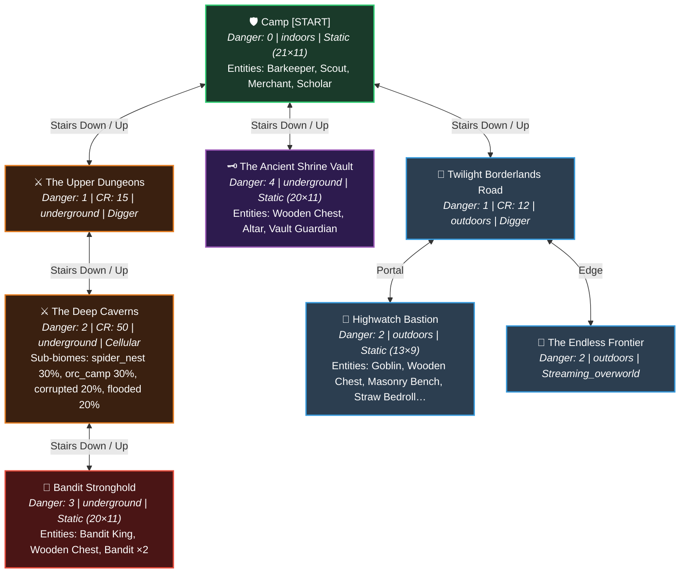
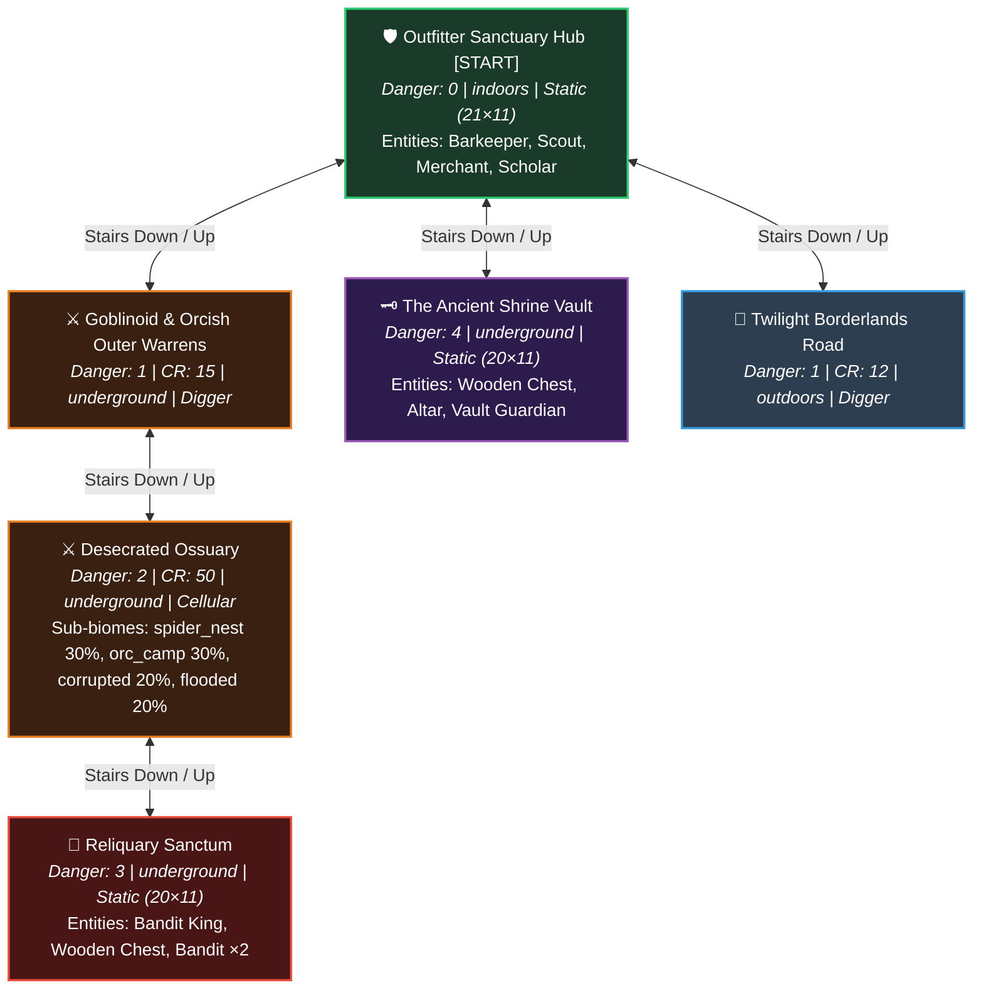

```mermaid
graph TD
    classDef safe fill:#1a3a2a,stroke:#2ecc71,stroke-width:2px,color:#fff;
    classDef outdoor fill:#2c3e50,stroke:#3498db,stroke-width:2px,color:#fff;
    classDef dungeon fill:#3a2010,stroke:#e67e22,stroke-width:2px,color:#fff;
    classDef boss fill:#4a1515,stroke:#e74c3c,stroke-width:2px,color:#fff;
    classDef vault fill:#2d1b4e,stroke:#9b59b6,stroke-width:2px,color:#fff;

    shroudgarde_courtyard["🛡️ Shroudgarde Town Square [START]<br><i>Danger: 0 | CR: 10 | outdoors | Digger</i><br>Entities: Silas the Gem Trader, Elena the Chronicler"]:::safe
    shroudgarde_gate["🛡️ Shroudgarde Southern Gate<br><i>Danger: 0 | CR: 15 | outdoors | Digger</i><br>Entities: Constable Derek"]:::safe
    shroudgarde_inner_keep["⚔️ Shroudgarde Keep Bastion<br><i>Danger: 1 | CR: 25 | indoors | Digger</i><br>Entities: Aasimar Isabelle, Gold Dwarf Laurent"]:::dungeon
    golden_grain_inn["🛡️ Golden Grain Tavern<br><i>Danger: 0 | CR: 10 | indoors | Digger</i><br>Entities: Barkeep Bertram"]:::safe
    shroudgarde_inn_cellar["⚔️ Shroudgarde Inn Cellar<br><i>Danger: 2 | CR: 35 | underground | Digger</i>"]:::dungeon
    outer_crossroads["🌲 Borderlands Crossroads<br><i>Danger: 1 | CR: 25 | outdoors | Cellular</i>"]:::outdoor
    forest_haunted["🌲 La Forêt Hantée<br><i>Danger: 2 | CR: 35 | outdoors | Cellular</i>"]:::outdoor
    orlane_east["🌲 Eastern Village of Orlane<br><i>Danger: 1 | CR: 20 | outdoors | Digger</i><br>Entities: Wood Elf Luc"]:::outdoor
    marsh_mirrored["🌲 The Mirrored Marsh<br><i>Danger: 3 | CR: 50 | outdoors | Cellular</i>"]:::outdoor
    ravine_chaos["🌲 Ravine of Chaos<br><i>Danger: 2 | CR: 40 | outdoors | Cellular</i>"]:::outdoor
    road_to_nulb["🌲 Road to Nulb<br><i>Danger: 2 | CR: 35 | outdoors | Cellular</i>"]:::outdoor
    cave_kobolds["⚔️ Cavern of Kobold Trappers<br><i>Danger: 2 | CR: 30 | underground | Cellular</i>"]:::dungeon
    cave_norkers["⚔️ Cavern of the Norkers<br><i>Danger: 2 | CR: 35 | underground | Cellular</i>"]:::dungeon
    cave_bugbears["⚔️ Lair of the Bugbears<br><i>Danger: 3 | CR: 45 | underground | Digger</i>"]:::dungeon
    cave_scro["⚔️ Outpost of the Scro Orcs<br><i>Danger: 3 | CR: 50 | underground | Digger</i>"]:::dungeon
    cave_ogre["⚔️ Den of the Ogre Chieftain<br><i>Danger: 4 | CR: 65 | underground | Cellular</i><br>Entities: Korag the Ogre Chieftain"]:::dungeon
    watchtower_f1["⚔️ High Watchtower: Ground Entry<br><i>Danger: 1 | CR: 25 | indoors | Digger</i>"]:::dungeon
    watchtower_f2["⚔️ High Watchtower: Guard Barracks<br><i>Danger: 2 | CR: 35 | indoors | Digger</i>"]:::dungeon
    watchtower_f3["🌲 High Watchtower: Beacon Peak<br><i>Danger: 3 | CR: 45 | outdoors | Digger</i>"]:::outdoor
    spire_level_air["⚔️ Spire of Elements: Tier of Air<br><i>Danger: 4 | CR: 60 | indoors | Cellular</i>"]:::dungeon
    spire_level_earth["⚔️ Spire of Elements: Tier of Earth<br><i>Danger: 4 | CR: 65 | indoors | Cellular</i>"]:::dungeon
    spire_level_fire["⚔️ Spire of Elements: Tier of Fire<br><i>Danger: 5 | CR: 75 | indoors | Digger</i>"]:::dungeon
    spire_level_water["⚔️ Spire of Elements: Tier of Water<br><i>Danger: 5 | CR: 80 | indoors | Cellular</i>"]:::dungeon
    spire_gem_chamber["⚔️ Spire Apex: Chamber of Elemental Gems<br><i>Danger: 6 | CR: 100 | indoors | Digger</i>"]:::dungeon
    wizard_tower_f1["⚔️ Arcane Tower: Great Library<br><i>Danger: 2 | CR: 30 | indoors | Digger</i><br>Entities: Archmage Alden"]:::dungeon
    wizard_tower_f2["⚔️ Arcane Tower: Alchemical Laboratory<br><i>Danger: 3 | CR: 45 | indoors | Digger</i>"]:::dungeon
    wizard_tower_f3["🌲 Arcane Tower: Celestial Observatory<br><i>Danger: 4 | CR: 60 | outdoors | Digger</i>"]:::outdoor
    wizard_tower_f4["⚔️ Arcane Tower: Sanctum Sanctorum<br><i>Danger: 5 | CR: 80 | indoors | Digger</i>"]:::dungeon
    safe_hub["⚔️ Sunless Crypt Encampment<br><i>Danger: 1 | CR: 20 | underground | Digger</i>"]:::dungeon
    dungeon_1["⚔️ Sunless Reliquary: Upper Crypts<br><i>Danger: 2 | CR: 35 | underground | Digger</i>"]:::dungeon
    dungeon_2["⚔️ Sunless Reliquary: Tomb of the Arch-Curate<br><i>Danger: 3 | CR: 50 | underground | Digger</i><br>Entities: The Sunless Arch-Curate"]:::dungeon
    bandit_stronghold["⚔️ Subterranean Bandit Stronghold<br><i>Danger: 2 | CR: 40 | underground | Digger</i>"]:::dungeon
    shrine_vault_hub["⚔️ Cathedral Vault Hub<br><i>Danger: 4 | CR: 70 | underground | Digger</i>"]:::dungeon
    moathouse_surface["🌲 Ruined Moathouse Courtyard<br><i>Danger: 2 | CR: 35 | outdoors | Digger</i>"]:::outdoor
    moathouse_dungeons["⚔️ Moathouse Sub-Level (Lareth)<br><i>Danger: 3 | CR: 55 | underground | Digger</i><br>Entities: Lareth the Beautiful"]:::dungeon
    wet_caverns["⚔️ Flooded Marsh Grotto<br><i>Danger: 3 | CR: 45 | underground | Cellular</i>"]:::dungeon
    reptile_temple["⚔️ Ancient Temple of the Reptile God<br><i>Danger: 4 | CR: 60 | underground | Digger</i>"]:::dungeon
    water_temple_upper["⚔️ Water Temple: Upper Terrace<br><i>Danger: 4 | CR: 65 | underground | Cellular</i>"]:::dungeon
    water_temple_lower["⚔️ Water Temple: Sunken Nave<br><i>Danger: 5 | CR: 75 | underground | Cellular</i>"]:::dungeon
    water_temple_core["⚔️ Water Temple: Core Reservoir<br><i>Danger: 5 | CR: 85 | underground | Cellular</i>"]:::dungeon
    water_temple_valve_room["⚔️ Water Temple: Drainage Valve Chamber<br><i>Danger: 6 | CR: 90 | underground | Digger</i>"]:::dungeon
    toee_level_1["⚔️ Temple of Elemental Evil: Level 1<br><i>Danger: 4 | CR: 70 | underground | Digger</i>"]:::dungeon
    toee_level_2["⚔️ Temple of Elemental Evil: Level 2<br><i>Danger: 5 | CR: 85 | underground | Digger</i>"]:::dungeon
    toee_level_3["⚔️ Temple of Elemental Evil: Level 3<br><i>Danger: 6 | CR: 100 | underground | Digger</i>"]:::dungeon
    toee_level_4["⚔️ Temple of Elemental Evil: Level 4<br><i>Danger: 7 | CR: 120 | underground | Digger</i>"]:::dungeon
    toee_zuggtmoy_fane["⚔️ Fane of Zuggtmoy, Demon Queen<br><i>Danger: 8 | CR: 150 | underground | Digger</i><br>Entities: Zuggtmoy, Demon Queen of Fungi"]:::dungeon
    megadungeon_hub["⚔️ The Subterranean Crossroads<br><i>Danger: 4 | CR: 60 | underground | Digger</i>"]:::dungeon
    nethack_doom_1["⚔️ Dungeons of Doom: Depth 1<br><i>Danger: 3 | CR: 50 | underground | Digger</i>"]:::dungeon
    nethack_doom_2["⚔️ Dungeons of Doom: Depth 2<br><i>Danger: 4 | CR: 60 | underground | Digger</i>"]:::dungeon
    nethack_doom_3["⚔️ Dungeons of Doom: Depth 3<br><i>Danger: 4 | CR: 70 | underground | Digger</i>"]:::dungeon
    nethack_doom_4["⚔️ Dungeons of Doom: Depth 4<br><i>Danger: 5 | CR: 80 | underground | Digger</i>"]:::dungeon
    nethack_doom_5["⚔️ Dungeons of Doom: Depth 5<br><i>Danger: 5 | CR: 90 | underground | Digger</i>"]:::dungeon
    nethack_doom_6["⚔️ Dungeons of Doom: Depth 6<br><i>Danger: 6 | CR: 100 | underground | Digger</i>"]:::dungeon
    nethack_doom_7["⚔️ Dungeons of Doom: Depth 7<br><i>Danger: 6 | CR: 110 | underground | Digger</i>"]:::dungeon
    nethack_doom_8["⚔️ Dungeons of Doom: Depth 8<br><i>Danger: 7 | CR: 120 | underground | Digger</i>"]:::dungeon
    nethack_doom_9["⚔️ Dungeons of Doom: Depth 9<br><i>Danger: 7 | CR: 130 | underground | Digger</i>"]:::dungeon
    nethack_doom_10["⚔️ Dungeons of Doom: Depth 10<br><i>Danger: 8 | CR: 140 | underground | Digger</i>"]:::dungeon
    incursion_goblin_1["⚔️ Goblin Warrens: Warren Level 1<br><i>Danger: 3 | CR: 55 | underground | Cellular</i>"]:::dungeon
    incursion_goblin_2["⚔️ Goblin Warrens: Warren Level 2<br><i>Danger: 4 | CR: 65 | underground | Cellular</i>"]:::dungeon
    incursion_goblin_3["⚔️ Goblin Warrens: Warren Level 3<br><i>Danger: 4 | CR: 75 | underground | Cellular</i>"]:::dungeon
    incursion_goblin_4["⚔️ Goblin Warrens: Warren Level 4<br><i>Danger: 5 | CR: 85 | underground | Cellular</i>"]:::dungeon
    incursion_goblin_5["⚔️ Goblin Warrens: Warren Level 5<br><i>Danger: 5 | CR: 95 | underground | Cellular</i>"]:::dungeon
    incursion_goblin_6["⚔️ Goblin Warrens: Warren Level 6<br><i>Danger: 6 | CR: 105 | underground | Cellular</i>"]:::dungeon
    incursion_goblin_7["⚔️ Goblin Warrens: Warren Level 7<br><i>Danger: 6 | CR: 115 | underground | Cellular</i>"]:::dungeon
    incursion_goblin_8["⚔️ Goblin Warrens: Warren Level 8<br><i>Danger: 7 | CR: 125 | underground | Cellular</i>"]:::dungeon
    incursion_goblin_9["⚔️ Goblin Warrens: Warren Level 9<br><i>Danger: 7 | CR: 135 | underground | Cellular</i>"]:::dungeon
    incursion_goblin_10["⚔️ Goblin Warrens: Warren Level 10<br><i>Danger: 8 | CR: 145 | underground | Cellular</i>"]:::dungeon
    incursion_the_goblin_encampment["⚔️ The Great Goblin Citadel<br><i>Danger: 7 | CR: 110 | underground | Digger</i>"]:::dungeon
    incursion_arena_chamber["⚔️ The Subterranean Arena<br><i>Danger: 7 | CR: 120 | underground | Digger</i>"]:::dungeon
    incursion_place_of_sanctuary["⚔️ Ancient Place of Sanctuary<br><i>Danger: 6 | CR: 90 | underground | Digger</i>"]:::dungeon
    incursion_parthenion["⚔️ The Holy Parthenion<br><i>Danger: 7 | CR: 100 | underground | Digger</i>"]:::dungeon
    incursion_unholy_sepulchre["⚔️ The Unholy Sepulchre<br><i>Danger: 8 | CR: 130 | underground | Digger</i>"]:::dungeon
    incursion_lesser_vault_1["⚔️ Subterranean Vault: Adamantine Hoard<br><i>Danger: 8 | CR: 140 | underground | Digger</i>"]:::dungeon
    incursion_lesser_vault_2["⚔️ Subterranean Vault: Wyrm Cavern<br><i>Danger: 9 | CR: 160 | underground | Cellular</i><br>Entities: Pyroclast the Red Wyrm"]:::dungeon
    incursion_hellish_rift["⚔️ The Hellish Abyssal Rift<br><i>Danger: 10 | CR: 200 | underground | Cellular</i>"]:::dungeon

    shroudgarde_courtyard <-->|Edge| shroudgarde_gate
    shroudgarde_courtyard <-->|Edge| shroudgarde_inner_keep
    shroudgarde_courtyard <-->|Edge| golden_grain_inn
    shroudgarde_courtyard <-->|Stairs Down / Up| shroudgarde_inn_cellar
    shroudgarde_courtyard <-->|Edge| forest_haunted
    shroudgarde_gate <-->|Edge| orlane_east
    shroudgarde_gate <-->|Edge| outer_crossroads
    shroudgarde_inn_cellar <-->|Stairs Down / Up| megadungeon_hub
    outer_crossroads <-->|Edge| safe_hub
    outer_crossroads <-->|Edge| road_to_nulb
    outer_crossroads <-->|Edge| watchtower_f1
    forest_haunted <-->|Edge| ravine_chaos
    forest_haunted <-->|Edge| wizard_tower_f1
    orlane_east <-->|Edge| marsh_mirrored
    marsh_mirrored <-->|Stairs Down / Up| wet_caverns
    marsh_mirrored <-->|Edge| spire_level_air
    ravine_chaos <-->|Edge| cave_kobolds
    ravine_chaos <-->|Edge| cave_norkers
    ravine_chaos <-->|Edge| cave_bugbears
    road_to_nulb <-->|Edge| moathouse_surface
    cave_kobolds <-->|Edge| cave_scro
    cave_norkers <-->|Edge| cave_ogre
    watchtower_f1 <-->|Stairs Down / Up| watchtower_f2
    watchtower_f2 <-->|Stairs Down / Up| watchtower_f3
    spire_level_air <-->|Stairs Down / Up| spire_level_earth
    spire_level_earth <-->|Stairs Down / Up| spire_level_fire
    spire_level_fire <-->|Stairs Down / Up| spire_level_water
    spire_level_water <-->|Stairs Down / Up| spire_gem_chamber
    wizard_tower_f1 <-->|Stairs Down / Up| wizard_tower_f2
    wizard_tower_f2 <-->|Stairs Down / Up| wizard_tower_f3
    wizard_tower_f3 <-->|Stairs Down / Up| wizard_tower_f4
    safe_hub <-->|Stairs Down / Up| dungeon_1
    dungeon_1 <-->|Stairs Down / Up| dungeon_2
    dungeon_1 <-->|Edge| bandit_stronghold
    dungeon_2 <-->|Stairs Down / Up| shrine_vault_hub
    shrine_vault_hub <-->|down / edge| megadungeon_hub
    moathouse_surface <-->|Stairs Down / Up| moathouse_dungeons
    moathouse_dungeons <-->|Stairs Down / Up| toee_level_1
    wet_caverns <-->|Edge| reptile_temple
    reptile_temple <-->|Edge| water_temple_upper
    water_temple_upper <-->|Stairs Down / Up| water_temple_lower
    water_temple_lower <-->|Edge| water_temple_core
    water_temple_core <-->|Stairs Down / Up| water_temple_valve_room
    toee_level_1 <-->|Stairs Down / Up| toee_level_2
    toee_level_2 <-->|Stairs Down / Up| toee_level_3
    toee_level_3 <-->|Stairs Down / Up| toee_level_4
    toee_level_4 <-->|Edge| toee_zuggtmoy_fane
    toee_level_4 <-->|down / edge| megadungeon_hub
    megadungeon_hub <-->|Edge| nethack_doom_1
    megadungeon_hub <-->|Edge| incursion_goblin_1
    nethack_doom_1 <-->|Stairs Down / Up| nethack_doom_2
    nethack_doom_2 <-->|Stairs Down / Up| nethack_doom_3
    nethack_doom_3 <-->|Stairs Down / Up| nethack_doom_4
    nethack_doom_4 <-->|Stairs Down / Up| nethack_doom_5
    nethack_doom_5 <-->|Stairs Down / Up| nethack_doom_6
    nethack_doom_6 <-->|Stairs Down / Up| nethack_doom_7
    nethack_doom_7 <-->|Stairs Down / Up| nethack_doom_8
    nethack_doom_8 <-->|Stairs Down / Up| nethack_doom_9
    nethack_doom_9 <-->|Stairs Down / Up| nethack_doom_10
    nethack_doom_10 <-->|Stairs Down / Up| incursion_hellish_rift
    incursion_goblin_1 <-->|Stairs Down / Up| incursion_goblin_2
    incursion_goblin_2 <-->|Stairs Down / Up| incursion_goblin_3
    incursion_goblin_3 <-->|Stairs Down / Up| incursion_goblin_4
    incursion_goblin_4 <-->|Stairs Down / Up| incursion_goblin_5
    incursion_goblin_5 <-->|Stairs Down / Up| incursion_goblin_6
    incursion_goblin_6 <-->|Stairs Down / Up| incursion_goblin_7
    incursion_goblin_7 <-->|Stairs Down / Up| incursion_goblin_8
    incursion_goblin_8 <-->|Stairs Down / Up| incursion_goblin_9
    incursion_goblin_9 <-->|Stairs Down / Up| incursion_goblin_10
    incursion_goblin_10 <-->|Edge| incursion_the_goblin_encampment
    incursion_the_goblin_encampment <-->|Edge| incursion_arena_chamber
    incursion_arena_chamber <-->|Stairs Down / Up| incursion_place_of_sanctuary
    incursion_place_of_sanctuary <-->|Edge| incursion_parthenion
    incursion_parthenion <-->|Edge| incursion_unholy_sepulchre
    incursion_unholy_sepulchre <-->|Edge| incursion_lesser_vault_1
    incursion_lesser_vault_1 <-->|Edge| incursion_lesser_vault_2
    incursion_lesser_vault_2 <-->|down / edge| incursion_hellish_rift
```

# 🗺️ Campaign Topology Maps

> Auto-generated by `bun run map:campaign --write` (`scripts/visualize-campaign.ts`).
> Interactive zero-dependency 3D multi-Z dungeon atlas: [`docs/campaign_atlas_3d.html`](./campaign_atlas_3d.html) (fixed preview seed `1337`).

## 🗺️ Many Worlds Rogues (`default`)

- **Ruleset**: `classic`
- **Starting Area**: `safe_hub` (Camp)
- **Total Areas**: **8** (4 Static, 4 Procedural)
- **3D Voxel Atlas (Seed 1337)**: **11057** voxels, **30** beacons, **14** portal splines (Z -9..4)
- **Description**: The base roguelike experience. Descend the dungeon and survive.

### Visual Topology Map (Mermaid)



### ASCII Traversal & Elevation Tree

```text
★ [START] 🛡️ Camp (safe_hub) — D:0 | indoors | Static (21×11)
    • Entities: Barkeeper, Scout, Merchant, Scholar
├── [DOWN] ⚔️ The Upper Dungeons (dungeon_1) — D:1, CR:15 | underground | Digger
│   ├── [UP] ↺ Camp (safe_hub)
│   └── [DOWN] ⚔️ The Deep Caverns (dungeon_2) — D:2, CR:50 | underground | Cellular
│       ├── [UP] ↺ The Upper Dungeons (dungeon_1)
│       └── [DOWN] 👑 Bandit Stronghold (bandit_stronghold) — D:3 | underground | Static (20×11)
│               • Entities: Bandit King, Wooden Chest, Bandit ×2
│           └── [UP] ↺ The Deep Caverns (dungeon_2)
├── [DOWN] 🗝️ The Ancient Shrine Vault (shrine_vault_hub) — D:4 | underground | Static (20×11)
│       • Entities: Wooden Chest, Altar, Vault Guardian
│   └── [UP] ↺ Camp (safe_hub)
└── [UP] 🌲 Twilight Borderlands Road (outer_crossroads) — D:1, CR:12 | outdoors | Digger
    ├── [DOWN] ↺ Camp (safe_hub)
    ├── [EDGE] 🌲 The Endless Frontier (endless_frontier) — D:2 | outdoors | Streaming_overworld
    │   └── [EDGE] ↺ Twilight Borderlands Road (outer_crossroads)
    └── [PORTAL] 🌲 Highwatch Bastion (watchtower_overlook) — D:2 | outdoors | Static (13×9)
            • Entities: Goblin, Wooden Chest, Masonry Bench, Straw Bedroll, Quarry Mason
        └── [PORTAL] ↺ Twilight Borderlands Road (outer_crossroads)
```

---

## 🗺️ The Sunless Reliquary (SRD 3.5e) (`dnd35e-crypt`)

- **Ruleset**: `dnd35e`
- **Starting Area**: `safe_hub` (Outfitter Sanctuary Hub)
- **Total Areas**: **6** (3 Static, 3 Procedural)
- **3D Voxel Atlas (Seed 1337)**: **7462** voxels, **16** beacons, **10** portal splines (Z -9..3)
- **Description**: Venture into an ancient reliquary governed by the Dungeons & Dragons 3.5e Open Gaming Ruleset—featuring 6 Ability Scores, 18-type bonus stacking, d20 vs AC, Damage Reduction, and Vancian magic.

### Visual Topology Map (Mermaid)



### ASCII Traversal & Elevation Tree

```text
★ [START] 🛡️ Outfitter Sanctuary Hub (safe_hub) — D:0 | indoors | Static (21×11)
    • Entities: Barkeeper, Scout, Merchant, Scholar
├── [DOWN] ⚔️ Goblinoid & Orcish Outer Warrens (dungeon_1) — D:1, CR:15 | underground | Digger
│   ├── [UP] ↺ Outfitter Sanctuary Hub (safe_hub)
│   └── [DOWN] ⚔️ Desecrated Ossuary (dungeon_2) — D:2, CR:50 | underground | Cellular
│       ├── [UP] ↺ Goblinoid & Orcish Outer Warrens (dungeon_1)
│       └── [DOWN] 👑 Reliquary Sanctum (bandit_stronghold) — D:3 | underground | Static (20×11)
│               • Entities: Bandit King, Wooden Chest, Bandit ×2
│           └── [UP] ↺ Desecrated Ossuary (dungeon_2)
├── [DOWN] 🗝️ The Ancient Shrine Vault (shrine_vault_hub) — D:4 | underground | Static (20×11)
│       • Entities: Wooden Chest, Altar, Vault Guardian
│   └── [UP] ↺ Outfitter Sanctuary Hub (safe_hub)
└── [UP] 🌲 Twilight Borderlands Road (outer_crossroads) — D:1, CR:12 | outdoors | Digger
    └── [DOWN] ↺ Outfitter Sanctuary Hub (safe_hub)
```

---

## 🗺️ The Megadungeon (`megacampaign`)

- **Ruleset**: `classic`
- **Starting Area**: `megadungeon_hub` (Megadungeon Hub)
- **Total Areas**: **32** (12 Static, 20 Procedural)
- **3D Voxel Atlas (Seed 1337)**: **58787** voxels, **85** beacons, **64** portal splines (Z -30..0)
- **Description**: A massive campaign merging content from NetHack and Incursion. Hundreds of monsters, items, and dungeon levels.

### Visual Topology Map (Mermaid)

```mermaid
graph TD
    classDef safe fill:#1a3a2a,stroke:#2ecc71,stroke-width:2px,color:#fff;
    classDef outdoor fill:#2c3e50,stroke:#3498db,stroke-width:2px,color:#fff;
    classDef dungeon fill:#3a2010,stroke:#e67e22,stroke-width:2px,color:#fff;
    classDef boss fill:#4a1515,stroke:#e74c3c,stroke-width:2px,color:#fff;
    classDef vault fill:#2d1b4e,stroke:#9b59b6,stroke-width:2px,color:#fff;

    megadungeon_hub["🛡️ Megadungeon Hub [START]<br><i>Danger: 0 | indoors | Static (15×5)</i>"]:::safe
    nethack_doom_1["⚔️ Dungeons of Doom 1<br><i>Danger: 1 | CR: 25 | underground | Digger</i>"]:::dungeon
    nethack_doom_2["⚔️ Dungeons of Doom 2<br><i>Danger: 1 | CR: 25 | underground | Digger</i>"]:::dungeon
    nethack_doom_3["⚔️ Dungeons of Doom 3<br><i>Danger: 1 | CR: 25 | underground | Digger</i>"]:::dungeon
    nethack_doom_4["⚔️ Dungeons of Doom 4<br><i>Danger: 2 | CR: 40 | underground | Digger</i>"]:::dungeon
    nethack_doom_5["⚔️ Dungeons of Doom 5<br><i>Danger: 2 | CR: 40 | underground | Digger</i>"]:::dungeon
    nethack_doom_6["⚔️ Dungeons of Doom 6<br><i>Danger: 2 | CR: 40 | underground | Digger</i>"]:::dungeon
    nethack_doom_7["⚔️ Dungeons of Doom 7<br><i>Danger: 3 | CR: 55 | underground | Digger</i>"]:::dungeon
    nethack_doom_8["⚔️ Dungeons of Doom 8<br><i>Danger: 3 | CR: 55 | underground | Digger</i>"]:::dungeon
    nethack_doom_9["⚔️ Dungeons of Doom 9<br><i>Danger: 3 | CR: 55 | underground | Digger</i>"]:::dungeon
    nethack_doom_10["⚔️ Dungeons of Doom 10<br><i>Danger: 4 | CR: 70 | underground | Digger</i>"]:::dungeon
    incursion_goblin_1["⚔️ Goblin Caves 1<br><i>Danger: 1 | CR: 25 | underground | Cellular</i>"]:::dungeon
    incursion_goblin_2["⚔️ Goblin Caves 2<br><i>Danger: 1 | CR: 25 | underground | Cellular</i>"]:::dungeon
    incursion_goblin_3["⚔️ Goblin Caves 3<br><i>Danger: 1 | CR: 25 | underground | Cellular</i>"]:::dungeon
    incursion_goblin_4["⚔️ Goblin Caves 4<br><i>Danger: 2 | CR: 40 | underground | Cellular</i>"]:::dungeon
    incursion_goblin_5["⚔️ Goblin Caves 5<br><i>Danger: 2 | CR: 40 | underground | Cellular</i>"]:::dungeon
    incursion_goblin_6["⚔️ Goblin Caves 6<br><i>Danger: 2 | CR: 40 | underground | Cellular</i>"]:::dungeon
    incursion_goblin_7["⚔️ Goblin Caves 7<br><i>Danger: 3 | CR: 55 | underground | Cellular</i>"]:::dungeon
    incursion_goblin_8["⚔️ Goblin Caves 8<br><i>Danger: 3 | CR: 55 | underground | Cellular</i>"]:::dungeon
    incursion_goblin_9["⚔️ Goblin Caves 9<br><i>Danger: 3 | CR: 55 | underground | Cellular</i>"]:::dungeon
    incursion_goblin_10["⚔️ Goblin Caves 10<br><i>Danger: 4 | CR: 70 | underground | Cellular</i>"]:::dungeon
    incursion_place_of_sanctuary["🗝️ Place of Sanctuary<br><i>Danger: 4 | indoors | Static (9×9)</i>"]:::vault
    incursion_lesser_vault_1["🗝️ Lesser Vault;1<br><i>Danger: 4 | underground | Static (23×23)</i><br>Entities: gnomish wizard ×5"]:::vault
    incursion_parthenion["🗝️ Parthenion<br><i>Danger: 4 | underground | Static (27×22)</i>"]:::vault
    incursion_lesser_vault_2["🗝️ Lesser Vault;2<br><i>Danger: 4 | underground | Static (23×23)</i><br>Entities: gnomish wizard ×5"]:::vault
    incursion_unholy_sepulchre["🗝️ Unholy Sepulchre<br><i>Danger: 4 | underground | Static (23×23)</i><br>Entities: gnomish wizard ×4"]:::vault
    incursion_hellish_rift["🗝️ Hellish Rift<br><i>Danger: 4 | underground | Static (17×21)</i>"]:::vault
    incursion_floating_rock_1["🗝️ Floating Rock;1<br><i>Danger: 4 | underground | Static (12×12)</i><br>Entities: gnomish wizard ×2"]:::vault
    incursion_entry_chamber_hells["🗝️ Entry Chamber;hells<br><i>Danger: 4 | underground | Static (7×7)</i>"]:::vault
    incursion_entry_chamber["🗝️ Entry Chamber<br><i>Danger: 4 | underground | Static (23×23)</i>"]:::vault
    incursion_the_goblin_encampment["🗝️ The Goblin Encampment<br><i>Danger: 4 | underground | Static (70×61)</i><br>Entities: stone giant ×34, ethereal filcher ×15, stalker ×17, giant bat ×3…"]:::vault
    incursion_arena_chamber["🗝️ Arena Chamber<br><i>Danger: 4 | underground | Static (35×23)</i>"]:::vault

    megadungeon_hub <-->|Stairs Down / Up| nethack_doom_1
    megadungeon_hub <-->|Stairs Down / Up| incursion_goblin_1
    megadungeon_hub <-->|Stairs Down / Up| incursion_place_of_sanctuary
    megadungeon_hub <-->|Stairs Down / Up| incursion_lesser_vault_1
    megadungeon_hub <-->|Stairs Down / Up| incursion_parthenion
    megadungeon_hub <-->|Stairs Down / Up| incursion_lesser_vault_2
    megadungeon_hub <-->|Stairs Down / Up| incursion_unholy_sepulchre
    megadungeon_hub <-->|Stairs Down / Up| incursion_hellish_rift
    megadungeon_hub <-->|Stairs Down / Up| incursion_floating_rock_1
    megadungeon_hub <-->|Stairs Down / Up| incursion_entry_chamber_hells
    megadungeon_hub <-->|Stairs Down / Up| incursion_entry_chamber
    megadungeon_hub <-->|Stairs Down / Up| incursion_the_goblin_encampment
    megadungeon_hub <-->|Stairs Down / Up| incursion_arena_chamber
    nethack_doom_1 <-->|Stairs Down / Up| nethack_doom_2
    nethack_doom_2 <-->|Stairs Down / Up| nethack_doom_3
    nethack_doom_3 <-->|Stairs Down / Up| nethack_doom_4
    nethack_doom_4 <-->|Stairs Down / Up| nethack_doom_5
    nethack_doom_5 <-->|Stairs Down / Up| nethack_doom_6
    nethack_doom_6 <-->|Stairs Down / Up| nethack_doom_7
    nethack_doom_7 <-->|Stairs Down / Up| nethack_doom_8
    nethack_doom_8 <-->|Stairs Down / Up| nethack_doom_9
    nethack_doom_9 <-->|Stairs Down / Up| nethack_doom_10
    nethack_doom_10 -->|One-Way (down)| megadungeon_hub
    incursion_goblin_1 <-->|Stairs Down / Up| incursion_goblin_2
    incursion_goblin_2 <-->|Stairs Down / Up| incursion_goblin_3
    incursion_goblin_3 <-->|Stairs Down / Up| incursion_goblin_4
    incursion_goblin_4 <-->|Stairs Down / Up| incursion_goblin_5
    incursion_goblin_5 <-->|Stairs Down / Up| incursion_goblin_6
    incursion_goblin_6 <-->|Stairs Down / Up| incursion_goblin_7
    incursion_goblin_7 <-->|Stairs Down / Up| incursion_goblin_8
    incursion_goblin_8 <-->|Stairs Down / Up| incursion_goblin_9
    incursion_goblin_9 <-->|Stairs Down / Up| incursion_goblin_10
    incursion_goblin_10 -->|One-Way (down)| megadungeon_hub
```

### ASCII Traversal & Elevation Tree

```text
★ [START] 🛡️ Megadungeon Hub (megadungeon_hub) — D:0 | indoors | Static (15×5)
├── [DOWN] ⚔️ Dungeons of Doom 1 (nethack_doom_1) — D:1, CR:25 | underground | Digger
│   ├── [UP] ↺ Megadungeon Hub (megadungeon_hub)
│   └── [DOWN] ⚔️ Dungeons of Doom 2 (nethack_doom_2) — D:1, CR:25 | underground | Digger
│       ├── [UP] ↺ Dungeons of Doom 1 (nethack_doom_1)
│       └── [DOWN] ⚔️ Dungeons of Doom 3 (nethack_doom_3) — D:1, CR:25 | underground | Digger
│           ├── [UP] ↺ Dungeons of Doom 2 (nethack_doom_2)
│           └── [DOWN] ⚔️ Dungeons of Doom 4 (nethack_doom_4) — D:2, CR:40 | underground | Digger
│               ├── [UP] ↺ Dungeons of Doom 3 (nethack_doom_3)
│               └── [DOWN] ⚔️ Dungeons of Doom 5 (nethack_doom_5) — D:2, CR:40 | underground | Digger
│                   ├── [UP] ↺ Dungeons of Doom 4 (nethack_doom_4)
│                   └── [DOWN] ⚔️ Dungeons of Doom 6 (nethack_doom_6) — D:2, CR:40 | underground | Digger
│                       ├── [UP] ↺ Dungeons of Doom 5 (nethack_doom_5)
│                       └── [DOWN] ⚔️ Dungeons of Doom 7 (nethack_doom_7) — D:3, CR:55 | underground | Digger
│                           ├── [UP] ↺ Dungeons of Doom 6 (nethack_doom_6)
│                           └── [DOWN] ⚔️ Dungeons of Doom 8 (nethack_doom_8) — D:3, CR:55 | underground | Digger
│                               ├── [UP] ↺ Dungeons of Doom 7 (nethack_doom_7)
│                               └── [DOWN] ⚔️ Dungeons of Doom 9 (nethack_doom_9) — D:3, CR:55 | underground | Digger
│                                   ├── [UP] ↺ Dungeons of Doom 8 (nethack_doom_8)
│                                   └── [DOWN] ⚔️ Dungeons of Doom 10 (nethack_doom_10) — D:4, CR:70 | underground | Digger
│                                       ├── [UP] ↺ Dungeons of Doom 9 (nethack_doom_9)
│                                       └── [DOWN] ↺ Megadungeon Hub (megadungeon_hub)
├── [DOWN] ⚔️ Goblin Caves 1 (incursion_goblin_1) — D:1, CR:25 | underground | Cellular
│   ├── [UP] ↺ Megadungeon Hub (megadungeon_hub)
│   └── [DOWN] ⚔️ Goblin Caves 2 (incursion_goblin_2) — D:1, CR:25 | underground | Cellular
│       ├── [UP] ↺ Goblin Caves 1 (incursion_goblin_1)
│       └── [DOWN] ⚔️ Goblin Caves 3 (incursion_goblin_3) — D:1, CR:25 | underground | Cellular
│           ├── [UP] ↺ Goblin Caves 2 (incursion_goblin_2)
│           └── [DOWN] ⚔️ Goblin Caves 4 (incursion_goblin_4) — D:2, CR:40 | underground | Cellular
│               ├── [UP] ↺ Goblin Caves 3 (incursion_goblin_3)
│               └── [DOWN] ⚔️ Goblin Caves 5 (incursion_goblin_5) — D:2, CR:40 | underground | Cellular
│                   ├── [UP] ↺ Goblin Caves 4 (incursion_goblin_4)
│                   └── [DOWN] ⚔️ Goblin Caves 6 (incursion_goblin_6) — D:2, CR:40 | underground | Cellular
│                       ├── [UP] ↺ Goblin Caves 5 (incursion_goblin_5)
│                       └── [DOWN] ⚔️ Goblin Caves 7 (incursion_goblin_7) — D:3, CR:55 | underground | Cellular
│                           ├── [UP] ↺ Goblin Caves 6 (incursion_goblin_6)
│                           └── [DOWN] ⚔️ Goblin Caves 8 (incursion_goblin_8) — D:3, CR:55 | underground | Cellular
│                               ├── [UP] ↺ Goblin Caves 7 (incursion_goblin_7)
│                               └── [DOWN] ⚔️ Goblin Caves 9 (incursion_goblin_9) — D:3, CR:55 | underground | Cellular
│                                   ├── [UP] ↺ Goblin Caves 8 (incursion_goblin_8)
│                                   └── [DOWN] ⚔️ Goblin Caves 10 (incursion_goblin_10) — D:4, CR:70 | underground | Cellular
│                                       ├── [UP] ↺ Goblin Caves 9 (incursion_goblin_9)
│                                       └── [DOWN] ↺ Megadungeon Hub (megadungeon_hub)
├── [DOWN] 🗝️ Place of Sanctuary (incursion_place_of_sanctuary) — D:4 | indoors | Static (9×9)
│   └── [UP] ↺ Megadungeon Hub (megadungeon_hub)
├── [DOWN] 🗝️ Lesser Vault;1 (incursion_lesser_vault_1) — D:4 | underground | Static (23×23)
│       • Entities: gnomish wizard ×5
│   └── [UP] ↺ Megadungeon Hub (megadungeon_hub)
├── [DOWN] 🗝️ Parthenion (incursion_parthenion) — D:4 | underground | Static (27×22)
│   └── [UP] ↺ Megadungeon Hub (megadungeon_hub)
├── [DOWN] 🗝️ Lesser Vault;2 (incursion_lesser_vault_2) — D:4 | underground | Static (23×23)
│       • Entities: gnomish wizard ×5
│   └── [UP] ↺ Megadungeon Hub (megadungeon_hub)
├── [DOWN] 🗝️ Unholy Sepulchre (incursion_unholy_sepulchre) — D:4 | underground | Static (23×23)
│       • Entities: gnomish wizard ×4
│   └── [UP] ↺ Megadungeon Hub (megadungeon_hub)
├── [DOWN] 🗝️ Hellish Rift (incursion_hellish_rift) — D:4 | underground | Static (17×21)
│   └── [UP] ↺ Megadungeon Hub (megadungeon_hub)
├── [DOWN] 🗝️ Floating Rock;1 (incursion_floating_rock_1) — D:4 | underground | Static (12×12)
│       • Entities: gnomish wizard ×2
│   └── [UP] ↺ Megadungeon Hub (megadungeon_hub)
├── [DOWN] 🗝️ Entry Chamber;hells (incursion_entry_chamber_hells) — D:4 | underground | Static (7×7)
│   └── [UP] ↺ Megadungeon Hub (megadungeon_hub)
├── [DOWN] 🗝️ Entry Chamber (incursion_entry_chamber) — D:4 | underground | Static (23×23)
│   └── [UP] ↺ Megadungeon Hub (megadungeon_hub)
├── [DOWN] 🗝️ The Goblin Encampment (incursion_the_goblin_encampment) — D:4 | underground | Static (70×61)
│       • Entities: stone giant ×34, ethereal filcher ×15, stalker ×17, giant bat ×3, ixitxachitl ×230, troll ×8, plains centaur ×6, werejackal ×5, garter snake ×4, mind flayer ×3, gnome mummy, wraith ×16, red naga hatchling ×8
│   └── [UP] ↺ Megadungeon Hub (megadungeon_hub)
└── [DOWN] 🗝️ Arena Chamber (incursion_arena_chamber) — D:4 | underground | Static (35×23)
    └── [UP] ↺ Megadungeon Hub (megadungeon_hub)
```

---

## 🗺️ The Realms of Shroudgarde (`realms-of-shroudgarde`)

- **Ruleset**: `dnd35e`
- **Starting Area**: `shroudgarde_courtyard` (Shroudgarde Town Square)
- **Total Areas**: **75** (0 Static, 75 Procedural)
- **3D Voxel Atlas (Seed 1337)**: **172985** voxels, **229** beacons, **154** portal splines (Z -36..12)
- **Description**: The definitive D&D 3.5e flagship campaign merging towns, wilderness roads, towers, shallow crypts, and deep subterranean vaults.

### Visual Topology Map (Mermaid)



### ASCII Traversal & Elevation Tree

```text
★ [START] 🛡️ Shroudgarde Town Square (shroudgarde_courtyard) — D:0, CR:10 | outdoors | Digger
    • Entities: Silas the Gem Trader, Elena the Chronicler
├── [EDGE] 🛡️ Shroudgarde Southern Gate (shroudgarde_gate) — D:0, CR:15 | outdoors | Digger
│       • Entities: Constable Derek
│   ├── [EDGE] ↺ Shroudgarde Town Square (shroudgarde_courtyard)
│   ├── [EDGE] 🌲 Eastern Village of Orlane (orlane_east) — D:1, CR:20 | outdoors | Digger
│   │       • Entities: Wood Elf Luc
│   │   ├── [EDGE] ↺ Shroudgarde Southern Gate (shroudgarde_gate)
│   │   └── [EDGE] 🌲 The Mirrored Marsh (marsh_mirrored) — D:3, CR:50 | outdoors | Cellular
│   │       ├── [EDGE] ↺ Eastern Village of Orlane (orlane_east)
│   │       ├── [DOWN] ⚔️ Flooded Marsh Grotto (wet_caverns) — D:3, CR:45 | underground | Cellular
│   │       │   ├── [UP] ↺ The Mirrored Marsh (marsh_mirrored)
│   │       │   └── [EDGE] ⚔️ Ancient Temple of the Reptile God (reptile_temple) — D:4, CR:60 | underground | Digger
│   │       │       ├── [EDGE] ↺ Flooded Marsh Grotto (wet_caverns)
│   │       │       └── [EDGE] ⚔️ Water Temple: Upper Terrace (water_temple_upper) — D:4, CR:65 | underground | Cellular
│   │       │           ├── [EDGE] ↺ Ancient Temple of the Reptile God (reptile_temple)
│   │       │           └── [DOWN] ⚔️ Water Temple: Sunken Nave (water_temple_lower) — D:5, CR:75 | underground | Cellular
│   │       │               ├── [UP] ↺ Water Temple: Upper Terrace (water_temple_upper)
│   │       │               └── [EDGE] ⚔️ Water Temple: Core Reservoir (water_temple_core) — D:5, CR:85 | underground | Cellular
│   │       │                   ├── [EDGE] ↺ Water Temple: Sunken Nave (water_temple_lower)
│   │       │                   └── [DOWN] ⚔️ Water Temple: Drainage Valve Chamber (water_temple_valve_room) — D:6, CR:90 | underground | Digger
│   │       │                       └── [UP] ↺ Water Temple: Core Reservoir (water_temple_core)
│   │       └── [EDGE] ⚔️ Spire of Elements: Tier of Air (spire_level_air) — D:4, CR:60 | indoors | Cellular
│   │           ├── [EDGE] ↺ The Mirrored Marsh (marsh_mirrored)
│   │           └── [UP] ⚔️ Spire of Elements: Tier of Earth (spire_level_earth) — D:4, CR:65 | indoors | Cellular
│   │               ├── [DOWN] ↺ Spire of Elements: Tier of Air (spire_level_air)
│   │               └── [UP] ⚔️ Spire of Elements: Tier of Fire (spire_level_fire) — D:5, CR:75 | indoors | Digger
│   │                   ├── [DOWN] ↺ Spire of Elements: Tier of Earth (spire_level_earth)
│   │                   └── [UP] ⚔️ Spire of Elements: Tier of Water (spire_level_water) — D:5, CR:80 | indoors | Cellular
│   │                       ├── [DOWN] ↺ Spire of Elements: Tier of Fire (spire_level_fire)
│   │                       └── [UP] ⚔️ Spire Apex: Chamber of Elemental Gems (spire_gem_chamber) — D:6, CR:100 | indoors | Digger
│   │                           └── [DOWN] ↺ Spire of Elements: Tier of Water (spire_level_water)
│   └── [EDGE] 🌲 Borderlands Crossroads (outer_crossroads) — D:1, CR:25 | outdoors | Cellular
│       ├── [EDGE] ↺ Shroudgarde Southern Gate (shroudgarde_gate)
│       ├── [EDGE] ⚔️ Sunless Crypt Encampment (safe_hub) — D:1, CR:20 | underground | Digger
│       │   ├── [EDGE] ↺ Borderlands Crossroads (outer_crossroads)
│       │   └── [DOWN] ⚔️ Sunless Reliquary: Upper Crypts (dungeon_1) — D:2, CR:35 | underground | Digger
│       │       ├── [UP] ↺ Sunless Crypt Encampment (safe_hub)
│       │       ├── [DOWN] ⚔️ Sunless Reliquary: Tomb of the Arch-Curate (dungeon_2) — D:3, CR:50 | underground | Digger
│       │       │       • Entities: The Sunless Arch-Curate
│       │       │   ├── [UP] ↺ Sunless Reliquary: Upper Crypts (dungeon_1)
│       │       │   └── [DOWN] ⚔️ Cathedral Vault Hub (shrine_vault_hub) — D:4, CR:70 | underground | Digger
│       │       │       ├── [UP] ↺ Sunless Reliquary: Tomb of the Arch-Curate (dungeon_2)
│       │       │       └── [DOWN] ⚔️ The Subterranean Crossroads (megadungeon_hub) — D:4, CR:60 | underground | Digger
│       │       │           ├── [UP] ⚔️ Shroudgarde Inn Cellar (shroudgarde_inn_cellar) — D:2, CR:35 | underground | Digger
│       │       │           │   ├── [UP] ↺ Shroudgarde Town Square (shroudgarde_courtyard)
│       │       │           │   └── [DOWN] ↺ The Subterranean Crossroads (megadungeon_hub)
│       │       │           ├── [EDGE] ↺ Cathedral Vault Hub (shrine_vault_hub)
│       │       │           ├── [EDGE] ⚔️ Temple of Elemental Evil: Level 4 (toee_level_4) — D:7, CR:120 | underground | Digger
│       │       │           │   ├── [UP] ⚔️ Temple of Elemental Evil: Level 3 (toee_level_3) — D:6, CR:100 | underground | Digger
│       │       │           │   │   ├── [UP] ⚔️ Temple of Elemental Evil: Level 2 (toee_level_2) — D:5, CR:85 | underground | Digger
│       │       │           │   │   │   ├── [UP] ⚔️ Temple of Elemental Evil: Level 1 (toee_level_1) — D:4, CR:70 | underground | Digger
│       │       │           │   │   │   │   ├── [UP] ⚔️ Moathouse Sub-Level (Lareth) (moathouse_dungeons) — D:3, CR:55 | underground | Digger
│       │       │           │   │   │   │   │       • Entities: Lareth the Beautiful
│       │       │           │   │   │   │   │   ├── [UP] 🌲 Ruined Moathouse Courtyard (moathouse_surface) — D:2, CR:35 | outdoors | Digger
│       │       │           │   │   │   │   │   │   ├── [EDGE] 🌲 Road to Nulb (road_to_nulb) — D:2, CR:35 | outdoors | Cellular
│       │       │           │   │   │   │   │   │   │   ├── [EDGE] ↺ Borderlands Crossroads (outer_crossroads)
│       │       │           │   │   │   │   │   │   │   └── [EDGE] ↺ Ruined Moathouse Courtyard (moathouse_surface)
│       │       │           │   │   │   │   │   │   └── [DOWN] ↺ Moathouse Sub-Level (Lareth) (moathouse_dungeons)
│       │       │           │   │   │   │   │   └── [DOWN] ↺ Temple of Elemental Evil: Level 1 (toee_level_1)
│       │       │           │   │   │   │   └── [DOWN] ↺ Temple of Elemental Evil: Level 2 (toee_level_2)
│       │       │           │   │   │   └── [DOWN] ↺ Temple of Elemental Evil: Level 3 (toee_level_3)
│       │       │           │   │   └── [DOWN] ↺ Temple of Elemental Evil: Level 4 (toee_level_4)
│       │       │           │   ├── [EDGE] ⚔️ Fane of Zuggtmoy, Demon Queen (toee_zuggtmoy_fane) — D:8, CR:150 | underground | Digger
│       │       │           │   │       • Entities: Zuggtmoy, Demon Queen of Fungi
│       │       │           │   │   └── [EDGE] ↺ Temple of Elemental Evil: Level 4 (toee_level_4)
│       │       │           │   └── [DOWN] ↺ The Subterranean Crossroads (megadungeon_hub)
│       │       │           ├── [EDGE] ⚔️ Dungeons of Doom: Depth 1 (nethack_doom_1) — D:3, CR:50 | underground | Digger
│       │       │           │   ├── [EDGE] ↺ The Subterranean Crossroads (megadungeon_hub)
│       │       │           │   └── [DOWN] ⚔️ Dungeons of Doom: Depth 2 (nethack_doom_2) — D:4, CR:60 | underground | Digger
│       │       │           │       ├── [UP] ↺ Dungeons of Doom: Depth 1 (nethack_doom_1)
│       │       │           │       └── [DOWN] ⚔️ Dungeons of Doom: Depth 3 (nethack_doom_3) — D:4, CR:70 | underground | Digger
│       │       │           │           ├── [UP] ↺ Dungeons of Doom: Depth 2 (nethack_doom_2)
│       │       │           │           └── [DOWN] ⚔️ Dungeons of Doom: Depth 4 (nethack_doom_4) — D:5, CR:80 | underground | Digger
│       │       │           │               ├── [UP] ↺ Dungeons of Doom: Depth 3 (nethack_doom_3)
│       │       │           │               └── [DOWN] ⚔️ Dungeons of Doom: Depth 5 (nethack_doom_5) — D:5, CR:90 | underground | Digger
│       │       │           │                   ├── [UP] ↺ Dungeons of Doom: Depth 4 (nethack_doom_4)
│       │       │           │                   └── [DOWN] ⚔️ Dungeons of Doom: Depth 6 (nethack_doom_6) — D:6, CR:100 | underground | Digger
│       │       │           │                       ├── [UP] ↺ Dungeons of Doom: Depth 5 (nethack_doom_5)
│       │       │           │                       └── [DOWN] ⚔️ Dungeons of Doom: Depth 7 (nethack_doom_7) — D:6, CR:110 | underground | Digger
│       │       │           │                           ├── [UP] ↺ Dungeons of Doom: Depth 6 (nethack_doom_6)
│       │       │           │                           └── [DOWN] ⚔️ Dungeons of Doom: Depth 8 (nethack_doom_8) — D:7, CR:120 | underground | Digger
│       │       │           │                               ├── [UP] ↺ Dungeons of Doom: Depth 7 (nethack_doom_7)
│       │       │           │                               └── [DOWN] ⚔️ Dungeons of Doom: Depth 9 (nethack_doom_9) — D:7, CR:130 | underground | Digger
│       │       │           │                                   ├── [UP] ↺ Dungeons of Doom: Depth 8 (nethack_doom_8)
│       │       │           │                                   └── [DOWN] ⚔️ Dungeons of Doom: Depth 10 (nethack_doom_10) — D:8, CR:140 | underground | Digger
│       │       │           │                                       ├── [UP] ↺ Dungeons of Doom: Depth 9 (nethack_doom_9)
│       │       │           │                                       └── [DOWN] ⚔️ The Hellish Abyssal Rift (incursion_hellish_rift) — D:10, CR:200 | underground | Cellular
│       │       │           │                                           ├── [UP] ↺ Dungeons of Doom: Depth 10 (nethack_doom_10)
│       │       │           │                                           └── [EDGE] ⚔️ Subterranean Vault: Wyrm Cavern (incursion_lesser_vault_2) — D:9, CR:160 | underground | Cellular
│       │       │           │                                                   • Entities: Pyroclast the Red Wyrm
│       │       │           │                                               ├── [EDGE] ⚔️ Subterranean Vault: Adamantine Hoard (incursion_lesser_vault_1) — D:8, CR:140 | underground | Digger
│       │       │           │                                               │   ├── [EDGE] ⚔️ The Unholy Sepulchre (incursion_unholy_sepulchre) — D:8, CR:130 | underground | Digger
│       │       │           │                                               │   │   ├── [EDGE] ⚔️ The Holy Parthenion (incursion_parthenion) — D:7, CR:100 | underground | Digger
│       │       │           │                                               │   │   │   ├── [EDGE] ⚔️ Ancient Place of Sanctuary (incursion_place_of_sanctuary) — D:6, CR:90 | underground | Digger
│       │       │           │                                               │   │   │   │   ├── [UP] ⚔️ The Subterranean Arena (incursion_arena_chamber) — D:7, CR:120 | underground | Digger
│       │       │           │                                               │   │   │   │   │   ├── [EDGE] ⚔️ The Great Goblin Citadel (incursion_the_goblin_encampment) — D:7, CR:110 | underground | Digger
│       │       │           │                                               │   │   │   │   │   │   ├── [EDGE] ⚔️ Goblin Warrens: Warren Level 10 (incursion_goblin_10) — D:8, CR:145 | underground | Cellular
│       │       │           │                                               │   │   │   │   │   │   │   ├── [UP] ⚔️ Goblin Warrens: Warren Level 9 (incursion_goblin_9) — D:7, CR:135 | underground | Cellular
│       │       │           │                                               │   │   │   │   │   │   │   │   ├── [UP] ⚔️ Goblin Warrens: Warren Level 8 (incursion_goblin_8) — D:7, CR:125 | underground | Cellular
│       │       │           │                                               │   │   │   │   │   │   │   │   │   ├── [UP] ⚔️ Goblin Warrens: Warren Level 7 (incursion_goblin_7) — D:6, CR:115 | underground | Cellular
│       │       │           │                                               │   │   │   │   │   │   │   │   │   │   ├── [UP] ⚔️ Goblin Warrens: Warren Level 6 (incursion_goblin_6) — D:6, CR:105 | underground | Cellular
│       │       │           │                                               │   │   │   │   │   │   │   │   │   │   │   ├── [UP] ⚔️ Goblin Warrens: Warren Level 5 (incursion_goblin_5) — D:5, CR:95 | underground | Cellular
│       │       │           │                                               │   │   │   │   │   │   │   │   │   │   │   │   ├── [UP] ⚔️ Goblin Warrens: Warren Level 4 (incursion_goblin_4) — D:5, CR:85 | underground | Cellular
│       │       │           │                                               │   │   │   │   │   │   │   │   │   │   │   │   │   ├── [UP] ⚔️ Goblin Warrens: Warren Level 3 (incursion_goblin_3) — D:4, CR:75 | underground | Cellular
│       │       │           │                                               │   │   │   │   │   │   │   │   │   │   │   │   │   │   ├── [UP] ⚔️ Goblin Warrens: Warren Level 2 (incursion_goblin_2) — D:4, CR:65 | underground | Cellular
│       │       │           │                                               │   │   │   │   │   │   │   │   │   │   │   │   │   │   │   ├── [UP] ⚔️ Goblin Warrens: Warren Level 1 (incursion_goblin_1) — D:3, CR:55 | underground | Cellular
│       │       │           │                                               │   │   │   │   │   │   │   │   │   │   │   │   │   │   │   │   ├── [EDGE] ↺ The Subterranean Crossroads (megadungeon_hub)
│       │       │           │                                               │   │   │   │   │   │   │   │   │   │   │   │   │   │   │   │   └── [DOWN] ↺ Goblin Warrens: Warren Level 2 (incursion_goblin_2)
│       │       │           │                                               │   │   │   │   │   │   │   │   │   │   │   │   │   │   │   └── [DOWN] ↺ Goblin Warrens: Warren Level 3 (incursion_goblin_3)
│       │       │           │                                               │   │   │   │   │   │   │   │   │   │   │   │   │   │   └── [DOWN] ↺ Goblin Warrens: Warren Level 4 (incursion_goblin_4)
│       │       │           │                                               │   │   │   │   │   │   │   │   │   │   │   │   │   └── [DOWN] ↺ Goblin Warrens: Warren Level 5 (incursion_goblin_5)
│       │       │           │                                               │   │   │   │   │   │   │   │   │   │   │   │   └── [DOWN] ↺ Goblin Warrens: Warren Level 6 (incursion_goblin_6)
│       │       │           │                                               │   │   │   │   │   │   │   │   │   │   │   └── [DOWN] ↺ Goblin Warrens: Warren Level 7 (incursion_goblin_7)
│       │       │           │                                               │   │   │   │   │   │   │   │   │   │   └── [DOWN] ↺ Goblin Warrens: Warren Level 8 (incursion_goblin_8)
│       │       │           │                                               │   │   │   │   │   │   │   │   │   └── [DOWN] ↺ Goblin Warrens: Warren Level 9 (incursion_goblin_9)
│       │       │           │                                               │   │   │   │   │   │   │   │   └── [DOWN] ↺ Goblin Warrens: Warren Level 10 (incursion_goblin_10)
│       │       │           │                                               │   │   │   │   │   │   │   └── [EDGE] ↺ The Great Goblin Citadel (incursion_the_goblin_encampment)
│       │       │           │                                               │   │   │   │   │   │   └── [EDGE] ↺ The Subterranean Arena (incursion_arena_chamber)
│       │       │           │                                               │   │   │   │   │   └── [DOWN] ↺ Ancient Place of Sanctuary (incursion_place_of_sanctuary)
│       │       │           │                                               │   │   │   │   └── [EDGE] ↺ The Holy Parthenion (incursion_parthenion)
│       │       │           │                                               │   │   │   └── [EDGE] ↺ The Unholy Sepulchre (incursion_unholy_sepulchre)
│       │       │           │                                               │   │   └── [EDGE] ↺ Subterranean Vault: Adamantine Hoard (incursion_lesser_vault_1)
│       │       │           │                                               │   └── [EDGE] ↺ Subterranean Vault: Wyrm Cavern (incursion_lesser_vault_2)
│       │       │           │                                               └── [DOWN] ↺ The Hellish Abyssal Rift (incursion_hellish_rift)
│       │       │           └── [EDGE] ↺ Goblin Warrens: Warren Level 1 (incursion_goblin_1)
│       │       └── [EDGE] ⚔️ Subterranean Bandit Stronghold (bandit_stronghold) — D:2, CR:40 | underground | Digger
│       │           └── [EDGE] ↺ Sunless Reliquary: Upper Crypts (dungeon_1)
│       ├── [EDGE] ↺ Road to Nulb (road_to_nulb)
│       └── [EDGE] ⚔️ High Watchtower: Ground Entry (watchtower_f1) — D:1, CR:25 | indoors | Digger
│           ├── [EDGE] ↺ Borderlands Crossroads (outer_crossroads)
│           └── [UP] ⚔️ High Watchtower: Guard Barracks (watchtower_f2) — D:2, CR:35 | indoors | Digger
│               ├── [DOWN] ↺ High Watchtower: Ground Entry (watchtower_f1)
│               └── [UP] 🌲 High Watchtower: Beacon Peak (watchtower_f3) — D:3, CR:45 | outdoors | Digger
│                   └── [DOWN] ↺ High Watchtower: Guard Barracks (watchtower_f2)
├── [EDGE] ⚔️ Shroudgarde Keep Bastion (shroudgarde_inner_keep) — D:1, CR:25 | indoors | Digger
│       • Entities: Aasimar Isabelle, Gold Dwarf Laurent
│   └── [EDGE] ↺ Shroudgarde Town Square (shroudgarde_courtyard)
├── [EDGE] 🛡️ Golden Grain Tavern (golden_grain_inn) — D:0, CR:10 | indoors | Digger
│       • Entities: Barkeep Bertram
│   └── [EDGE] ↺ Shroudgarde Town Square (shroudgarde_courtyard)
├── [DOWN] ↺ Shroudgarde Inn Cellar (shroudgarde_inn_cellar)
└── [EDGE] 🌲 La Forêt Hantée (forest_haunted) — D:2, CR:35 | outdoors | Cellular
    ├── [EDGE] ↺ Shroudgarde Town Square (shroudgarde_courtyard)
    ├── [EDGE] 🌲 Ravine of Chaos (ravine_chaos) — D:2, CR:40 | outdoors | Cellular
    │   ├── [EDGE] ↺ La Forêt Hantée (forest_haunted)
    │   ├── [EDGE] ⚔️ Cavern of Kobold Trappers (cave_kobolds) — D:2, CR:30 | underground | Cellular
    │   │   ├── [EDGE] ↺ Ravine of Chaos (ravine_chaos)
    │   │   └── [EDGE] ⚔️ Outpost of the Scro Orcs (cave_scro) — D:3, CR:50 | underground | Digger
    │   │       └── [EDGE] ↺ Cavern of Kobold Trappers (cave_kobolds)
    │   ├── [EDGE] ⚔️ Cavern of the Norkers (cave_norkers) — D:2, CR:35 | underground | Cellular
    │   │   ├── [EDGE] ↺ Ravine of Chaos (ravine_chaos)
    │   │   └── [EDGE] ⚔️ Den of the Ogre Chieftain (cave_ogre) — D:4, CR:65 | underground | Cellular
    │   │           • Entities: Korag the Ogre Chieftain
    │   │       └── [EDGE] ↺ Cavern of the Norkers (cave_norkers)
    │   └── [EDGE] ⚔️ Lair of the Bugbears (cave_bugbears) — D:3, CR:45 | underground | Digger
    │       └── [EDGE] ↺ Ravine of Chaos (ravine_chaos)
    └── [EDGE] ⚔️ Arcane Tower: Great Library (wizard_tower_f1) — D:2, CR:30 | indoors | Digger
            • Entities: Archmage Alden
        ├── [EDGE] ↺ La Forêt Hantée (forest_haunted)
        └── [UP] ⚔️ Arcane Tower: Alchemical Laboratory (wizard_tower_f2) — D:3, CR:45 | indoors | Digger
            ├── [DOWN] ↺ Arcane Tower: Great Library (wizard_tower_f1)
            └── [UP] 🌲 Arcane Tower: Celestial Observatory (wizard_tower_f3) — D:4, CR:60 | outdoors | Digger
                ├── [DOWN] ↺ Arcane Tower: Alchemical Laboratory (wizard_tower_f2)
                └── [UP] ⚔️ Arcane Tower: Sanctum Sanctorum (wizard_tower_f4) — D:5, CR:80 | indoors | Digger
                    └── [DOWN] ↺ Arcane Tower: Celestial Observatory (wizard_tower_f3)
```

---

## 🗺️ The Shroudgarde Borderlands (`shroudgarde`)

- **Ruleset**: `classic`
- **Starting Area**: `shroudgarde_courtyard` (Shroudgarde Outer Bailey)
- **Total Areas**: **33** (15 Static, 18 Procedural)
- **3D Voxel Atlas (Seed 1337)**: **43117** voxels, **100** beacons, **67** portal splines (Z -18..0)
- **Description**: A dark frontier sandbox. Investigate the sleeping plague of Shroudgarde, brave La Forêt Hantée and the Mirrored Marsh, and descend into le Gouffre Maudit.

### Visual Topology Map (Mermaid)

```mermaid
graph TD
    classDef safe fill:#1a3a2a,stroke:#2ecc71,stroke-width:2px,color:#fff;
    classDef outdoor fill:#2c3e50,stroke:#3498db,stroke-width:2px,color:#fff;
    classDef dungeon fill:#3a2010,stroke:#e67e22,stroke-width:2px,color:#fff;
    classDef boss fill:#4a1515,stroke:#e74c3c,stroke-width:2px,color:#fff;
    classDef vault fill:#2d1b4e,stroke:#9b59b6,stroke-width:2px,color:#fff;

    shroudgarde_gate["🛡️ Shroudgarde Gatehouse<br><i>Danger: 0 | outdoors | Static (21×10)</i>"]:::safe
    shroudgarde_courtyard["🛡️ Shroudgarde Outer Bailey [START]<br><i>Danger: 0 | outdoors | Static (21×11)</i><br>Entities: Wood Elf Luc, Aasimar Isabelle, Dazed Elan Villager, Fountain"]:::safe
    shroudgarde_inner_keep["🛡️ Shroudgarde Governor Keep<br><i>Danger: 0 | indoors | Static (21×9)</i><br>Entities: Gold Dwarf Laurent"]:::safe
    forest_haunted["🌲 La Forêt Hantée<br><i>Danger: 1 | CR: 20 | outdoors | Cellular</i>"]:::outdoor
    ravine_chaos["🌲 The Ravine of Chaos<br><i>Danger: 1 | outdoors | Static (21×8)</i>"]:::outdoor
    cave_kobolds["⚔️ The Kobold Warrens<br><i>Danger: 1 | CR: 15 | underground | Cellular</i>"]:::dungeon
    cave_norkers["⚔️ The Norker Lair<br><i>Danger: 2 | CR: 25 | underground | Digger</i>"]:::dungeon
    cave_bugbears["⚔️ The Bugbear Stronghold<br><i>Danger: 3 | CR: 30 | underground | Digger</i>"]:::dungeon
    cave_scro["⚔️ The Scro Outpost<br><i>Danger: 3 | CR: 35 | underground | Dla</i>"]:::dungeon
    cave_ogre["⚔️ The Ogre's Den<br><i>Danger: 3 | underground | Static (21×8)</i><br>Entities: Ogre Brute, Wooden Chest"]:::dungeon
    marsh_mirrored["🌲 The Mirrored Marsh<br><i>Danger: 2 | CR: 30 | outdoors | Cellular</i><br>Sub-biomes: flooded 40%"]:::outdoor
    golden_grain_inn["🌲 The Golden Grain Inn<br><i>Danger: 2 | indoors | Static (21×8)</i><br>Entities: Barkeep Bertram, Wooden Door"]:::outdoor
    wet_caverns["⚔️ The Wet Caverns<br><i>Danger: 3 | underground | Static (21×10)</i><br>Entities: Serpent Gate"]:::dungeon
    reptile_temple["👑 Temple of the Reptile God<br><i>Danger: 4 | underground | Static (21×10)</i><br>Entities: Altar, Duthka'gith High Priest, Umbragen Zealot ×2"]:::boss
    shroudgarde_inn_cellar["⚔️ The Inn Cellar<br><i>Danger: 2 | underground | Static (21×8)</i><br>Entities: Wooden Chest"]:::dungeon
    orlane_east["🛡️ Orlane East Farms<br><i>Danger: 0 | CR: 12 | outdoors | Digger</i>"]:::safe
    spire_level_air["⚔️ Ghost Tower: Level of Air<br><i>Danger: 2 | CR: 30 | indoors | Digger</i>"]:::dungeon
    spire_level_earth["⚔️ Ghost Tower: Level of Earth<br><i>Danger: 3 | CR: 35 | indoors | Digger</i>"]:::dungeon
    spire_level_fire["⚔️ Ghost Tower: Level of Fire<br><i>Danger: 3 | indoors | Static (21×11)</i><br>Entities: Fire Salamander ×2"]:::dungeon
    spire_level_water["⚔️ Ghost Tower: Level of Water<br><i>Danger: 3 | CR: 40 | indoors | Digger</i><br>Sub-biomes: flooded 60%"]:::dungeon
    spire_gem_chamber["👑 The Soul Gem Chamber<br><i>Danger: 4 | indoors | Static (21×10)</i><br>Entities: Altar, Sentinel of Imues, Golden Chest"]:::boss
    water_temple_upper["⚔️ Water Temple: Sluice Halls<br><i>Danger: 2 | CR: 30 | underground | Digger</i><br>Sub-biomes: flooded 50%"]:::dungeon
    water_temple_lower["⚔️ Water Temple: Submerged Caverns<br><i>Danger: 3 | CR: 35 | underground | Cellular</i><br>Sub-biomes: flooded 80%"]:::dungeon
    water_temple_core["⚔️ Water Temple: Hydro-Core<br><i>Danger: 3 | underground | Static (21×10)</i><br>Entities: Vodyanoi Lurker"]:::dungeon
    water_temple_valve_room["⚔️ Water Temple: Sluice Valve<br><i>Danger: 3 | underground | Static (21×6)</i><br>Entities: Leaking Drainage Valve, Golden Chest"]:::dungeon
    road_to_nulb["🌲 The Road to Nulb<br><i>Danger: 1 | CR: 20 | outdoors | Cellular</i>"]:::outdoor
    moathouse_surface["🌲 The Ruined Moathouse<br><i>Danger: 1 | outdoors | Static (21×8)</i>"]:::outdoor
    moathouse_dungeons["⚔️ The Moathouse Dungeons<br><i>Danger: 2 | CR: 25 | underground | Digger</i><br>Entities: Lareth the Beautiful"]:::dungeon
    toee_level_1["⚔️ ToEE: The Earth Temple<br><i>Danger: 2 | CR: 30 | underground | Digger</i>"]:::dungeon
    toee_level_2["⚔️ ToEE: The Air Temple<br><i>Danger: 3 | CR: 35 | underground | Digger</i>"]:::dungeon
    toee_level_3["⚔️ ToEE: The Fire Temple<br><i>Danger: 3 | CR: 40 | underground | Digger</i>"]:::dungeon
    toee_level_4["⚔️ ToEE: The Water Temple<br><i>Danger: 3 | CR: 45 | underground | Digger</i><br>Sub-biomes: flooded 50%"]:::dungeon
    toee_zuggtmoy_fane["👑 ToEE: Fane of Zuggtmoy<br><i>Danger: 4 | underground | Static (21×9)</i><br>Entities: Altar, Zuggtmoy, Demon Queen, Golden Chest"]:::boss

    shroudgarde_gate <-->|Portal| shroudgarde_courtyard
    shroudgarde_gate <-->|Portal| forest_haunted
    shroudgarde_gate <-->|Portal| marsh_mirrored
    shroudgarde_gate <-->|Portal| road_to_nulb
    shroudgarde_courtyard <-->|Portal| shroudgarde_inner_keep
    shroudgarde_courtyard <-->|Portal| orlane_east
    forest_haunted <-->|Portal| ravine_chaos
    ravine_chaos <-->|Stairs Down / Up| cave_kobolds
    ravine_chaos <-->|Stairs Down / Up| cave_norkers
    ravine_chaos <-->|Stairs Down / Up| cave_bugbears
    ravine_chaos <-->|Stairs Down / Up| cave_scro
    ravine_chaos <-->|Portal| cave_ogre
    cave_scro <-->|Portal| spire_level_earth
    marsh_mirrored <-->|Portal| golden_grain_inn
    marsh_mirrored <-->|Portal| spire_level_air
    marsh_mirrored <-->|Portal| water_temple_upper
    golden_grain_inn -->|One-Way (down)| wet_caverns
    golden_grain_inn <-->|Stairs Down / Up| shroudgarde_inn_cellar
    wet_caverns <-->|Stairs Down / Up| shroudgarde_inn_cellar
    wet_caverns <-->|Portal| reptile_temple
    spire_level_air <-->|Stairs Down / Up| spire_level_earth
    spire_level_earth <-->|Stairs Down / Up| spire_level_fire
    spire_level_fire <-->|Stairs Down / Up| spire_level_water
    spire_level_water <-->|Stairs Down / Up| spire_gem_chamber
    water_temple_upper <-->|Stairs Down / Up| water_temple_lower
    water_temple_lower <-->|Portal| water_temple_core
    water_temple_core <-->|Portal| water_temple_valve_room
    road_to_nulb <-->|Portal| moathouse_surface
    moathouse_surface <-->|Stairs Down / Up| moathouse_dungeons
    moathouse_dungeons <-->|Stairs Down / Up| toee_level_1
    toee_level_1 <-->|Stairs Down / Up| toee_level_2
    toee_level_2 <-->|Stairs Down / Up| toee_level_3
    toee_level_3 <-->|Stairs Down / Up| toee_level_4
    toee_level_4 <-->|Stairs Down / Up| toee_zuggtmoy_fane
```

### ASCII Traversal & Elevation Tree

```text
★ [START] 🛡️ Shroudgarde Outer Bailey (shroudgarde_courtyard) — D:0 | outdoors | Static (21×11)
    • Entities: Wood Elf Luc, Aasimar Isabelle, Dazed Elan Villager, Fountain
├── [PORTAL] 🛡️ Shroudgarde Gatehouse (shroudgarde_gate) — D:0 | outdoors | Static (21×10)
│   ├── [PORTAL] ↺ Shroudgarde Outer Bailey (shroudgarde_courtyard)
│   ├── [PORTAL] 🌲 La Forêt Hantée (forest_haunted) — D:1, CR:20 | outdoors | Cellular
│   │   ├── [PORTAL] ↺ Shroudgarde Gatehouse (shroudgarde_gate)
│   │   └── [PORTAL] 🌲 The Ravine of Chaos (ravine_chaos) — D:1 | outdoors | Static (21×8)
│   │       ├── [PORTAL] ↺ La Forêt Hantée (forest_haunted)
│   │       ├── [DOWN] ⚔️ The Kobold Warrens (cave_kobolds) — D:1, CR:15 | underground | Cellular
│   │       │   └── [UP] ↺ The Ravine of Chaos (ravine_chaos)
│   │       ├── [DOWN] ⚔️ The Norker Lair (cave_norkers) — D:2, CR:25 | underground | Digger
│   │       │   └── [UP] ↺ The Ravine of Chaos (ravine_chaos)
│   │       ├── [DOWN] ⚔️ The Bugbear Stronghold (cave_bugbears) — D:3, CR:30 | underground | Digger
│   │       │   └── [UP] ↺ The Ravine of Chaos (ravine_chaos)
│   │       ├── [DOWN] ⚔️ The Scro Outpost (cave_scro) — D:3, CR:35 | underground | Dla
│   │       │   ├── [UP] ↺ The Ravine of Chaos (ravine_chaos)
│   │       │   └── [PORTAL] ⚔️ Ghost Tower: Level of Earth (spire_level_earth) — D:3, CR:35 | indoors | Digger
│   │       │       ├── [UP] ⚔️ Ghost Tower: Level of Air (spire_level_air) — D:2, CR:30 | indoors | Digger
│   │       │       │   ├── [PORTAL] 🌲 The Mirrored Marsh (marsh_mirrored) — D:2, CR:30 | outdoors | Cellular
│   │       │       │   │   ├── [PORTAL] ↺ Shroudgarde Gatehouse (shroudgarde_gate)
│   │       │       │   │   ├── [PORTAL] 🌲 The Golden Grain Inn (golden_grain_inn) — D:2 | indoors | Static (21×8)
│   │       │       │   │   │       • Entities: Barkeep Bertram, Wooden Door
│   │       │       │   │   │   ├── [PORTAL] ↺ The Mirrored Marsh (marsh_mirrored)
│   │       │       │   │   │   ├── [DOWN] ⚔️ The Wet Caverns (wet_caverns) — D:3 | underground | Static (21×10)
│   │       │       │   │   │   │       • Entities: Serpent Gate
│   │       │       │   │   │   │   ├── [UP] ⚔️ The Inn Cellar (shroudgarde_inn_cellar) — D:2 | underground | Static (21×8)
│   │       │       │   │   │   │   │       • Entities: Wooden Chest
│   │       │       │   │   │   │   │   ├── [UP] ↺ The Golden Grain Inn (golden_grain_inn)
│   │       │       │   │   │   │   │   └── [DOWN] ↺ The Wet Caverns (wet_caverns)
│   │       │       │   │   │   │   └── [PORTAL] 👑 Temple of the Reptile God (reptile_temple) — D:4 | underground | Static (21×10)
│   │       │       │   │   │   │           • Entities: Altar, Duthka'gith High Priest, Umbragen Zealot ×2
│   │       │       │   │   │   │       └── [PORTAL] ↺ The Wet Caverns (wet_caverns)
│   │       │       │   │   │   └── [DOWN] ↺ The Inn Cellar (shroudgarde_inn_cellar)
│   │       │       │   │   ├── [PORTAL] ↺ Ghost Tower: Level of Air (spire_level_air)
│   │       │       │   │   └── [PORTAL] ⚔️ Water Temple: Sluice Halls (water_temple_upper) — D:2, CR:30 | underground | Digger
│   │       │       │   │       ├── [PORTAL] ↺ The Mirrored Marsh (marsh_mirrored)
│   │       │       │   │       └── [DOWN] ⚔️ Water Temple: Submerged Caverns (water_temple_lower) — D:3, CR:35 | underground | Cellular
│   │       │       │   │           ├── [UP] ↺ Water Temple: Sluice Halls (water_temple_upper)
│   │       │       │   │           └── [PORTAL] ⚔️ Water Temple: Hydro-Core (water_temple_core) — D:3 | underground | Static (21×10)
│   │       │       │   │                   • Entities: Vodyanoi Lurker
│   │       │       │   │               ├── [PORTAL] ↺ Water Temple: Submerged Caverns (water_temple_lower)
│   │       │       │   │               └── [PORTAL] ⚔️ Water Temple: Sluice Valve (water_temple_valve_room) — D:3 | underground | Static (21×6)
│   │       │       │   │                       • Entities: Leaking Drainage Valve, Golden Chest
│   │       │       │   │                   └── [PORTAL] ↺ Water Temple: Hydro-Core (water_temple_core)
│   │       │       │   └── [DOWN] ↺ Ghost Tower: Level of Earth (spire_level_earth)
│   │       │       ├── [DOWN] ⚔️ Ghost Tower: Level of Fire (spire_level_fire) — D:3 | indoors | Static (21×11)
│   │       │       │       • Entities: Fire Salamander ×2
│   │       │       │   ├── [UP] ↺ Ghost Tower: Level of Earth (spire_level_earth)
│   │       │       │   └── [DOWN] ⚔️ Ghost Tower: Level of Water (spire_level_water) — D:3, CR:40 | indoors | Digger
│   │       │       │       ├── [UP] ↺ Ghost Tower: Level of Fire (spire_level_fire)
│   │       │       │       └── [DOWN] 👑 The Soul Gem Chamber (spire_gem_chamber) — D:4 | indoors | Static (21×10)
│   │       │       │               • Entities: Altar, Sentinel of Imues, Golden Chest
│   │       │       │           └── [UP] ↺ Ghost Tower: Level of Water (spire_level_water)
│   │       │       └── [PORTAL] ↺ The Scro Outpost (cave_scro)
│   │       └── [PORTAL] ⚔️ The Ogre's Den (cave_ogre) — D:3 | underground | Static (21×8)
│   │               • Entities: Ogre Brute, Wooden Chest
│   │           └── [PORTAL] ↺ The Ravine of Chaos (ravine_chaos)
│   ├── [PORTAL] ↺ The Mirrored Marsh (marsh_mirrored)
│   └── [PORTAL] 🌲 The Road to Nulb (road_to_nulb) — D:1, CR:20 | outdoors | Cellular
│       ├── [PORTAL] ↺ Shroudgarde Gatehouse (shroudgarde_gate)
│       └── [PORTAL] 🌲 The Ruined Moathouse (moathouse_surface) — D:1 | outdoors | Static (21×8)
│           ├── [PORTAL] ↺ The Road to Nulb (road_to_nulb)
│           └── [DOWN] ⚔️ The Moathouse Dungeons (moathouse_dungeons) — D:2, CR:25 | underground | Digger
│                   • Entities: Lareth the Beautiful
│               ├── [UP] ↺ The Ruined Moathouse (moathouse_surface)
│               └── [DOWN] ⚔️ ToEE: The Earth Temple (toee_level_1) — D:2, CR:30 | underground | Digger
│                   ├── [UP] ↺ The Moathouse Dungeons (moathouse_dungeons)
│                   └── [DOWN] ⚔️ ToEE: The Air Temple (toee_level_2) — D:3, CR:35 | underground | Digger
│                       ├── [UP] ↺ ToEE: The Earth Temple (toee_level_1)
│                       └── [DOWN] ⚔️ ToEE: The Fire Temple (toee_level_3) — D:3, CR:40 | underground | Digger
│                           ├── [UP] ↺ ToEE: The Air Temple (toee_level_2)
│                           └── [DOWN] ⚔️ ToEE: The Water Temple (toee_level_4) — D:3, CR:45 | underground | Digger
│                               ├── [UP] ↺ ToEE: The Fire Temple (toee_level_3)
│                               └── [DOWN] 👑 ToEE: Fane of Zuggtmoy (toee_zuggtmoy_fane) — D:4 | underground | Static (21×9)
│                                       • Entities: Altar, Zuggtmoy, Demon Queen, Golden Chest
│                                   └── [UP] ↺ ToEE: The Water Temple (toee_level_4)
├── [PORTAL] 🛡️ Shroudgarde Governor Keep (shroudgarde_inner_keep) — D:0 | indoors | Static (21×9)
│       • Entities: Gold Dwarf Laurent
│   └── [PORTAL] ↺ Shroudgarde Outer Bailey (shroudgarde_courtyard)
└── [PORTAL] 🛡️ Orlane East Farms (orlane_east) — D:0, CR:12 | outdoors | Digger
    └── [PORTAL] ↺ Shroudgarde Outer Bailey (shroudgarde_courtyard)
```

---
