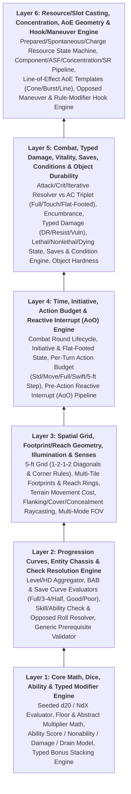
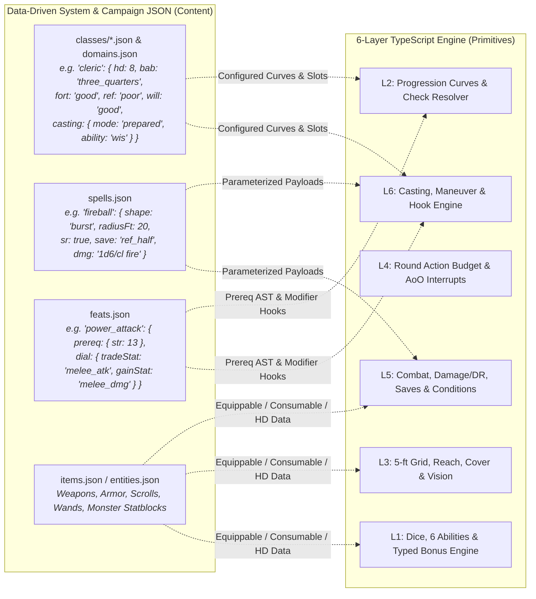

# D&D 3.5e Engine Architecture & Fundamental Systems Pyramid

*Research & Functional Architecture Document — Defining the Engine-Level Mechanical Building Blocks of D&D 3.5e (`/docs/rules/`) and Their Separation from Data-Driven Content.*

---

## 0. The Core Architectural Boundary: Rules Engine vs. System Content vs. Campaign Content

In accordance with `AGENTS.md` (§4 ECS Constraints & §5 Data-Driven JSON Rules), `docs/ARCHITECTURE.md` (§9 Pluggable Ruleset Cartridge Architecture), and `docs/DECISIONS.md`, our multi-ruleset architecture enforces a strict separation across three tiers:

1. **Tier 1 — Rules Engine (`src/core/`, `src/map/`, `src/systems/`, `src/rendering/`, and `src/rulesets/dnd35e/`)**:
   - **Shared Console Engine (`src/core/`, `src/map/`, `src/systems/`, `src/rendering/`)**: Ruleset-agnostic spatial geometry ($N\times N$ footprints, multi-entity tile occupancy, Bresenham cover/LOS raycasting), world simulation (factions, schemes, dialogue, fluids, weather, Encounter Director), and 60Hz presentation.
   - **`dnd35e` Ruleset Cartridge Engine (`src/rulesets/dnd35e/`)**: The 6-Layer D&D 3.5e mechanical engine (dice/stacking math, progression curves, skill/opposed check resolver, 5-tier action economy & AoO interrupt stack, attack/damage/DR/vitality/saves, and Vancian/spontaneous casting) plugged into the console via `RulesetContract`. Contains **zero** hardcoded classes, monsters, feats, skills, or items.
2. **Tier 2 — System Content ("Core Rulebooks" — `public/data/rulesets/dnd35e/`)**:
   - Pure declarative JSON registries (`archetypes.json`, `classes.json` + modular per-class `classes/<classId>.json`, `domains.json`, `skills.json`, `feats.json`, `spells.json`, plus optional base `items.json` / `entities.json`) assembled from Tier 1 Engine building blocks and automatically inherited by every campaign bound to `"rulesetId": "dnd35e"`.
3. **Tier 3 — Campaign Content ("Adventure Modules" — `public/data/campaigns/dnd35e-*/`)**:
   - Adventure-specific maps (`areas.json`, `tiles.json`), creature and loot placement (`spawn_pools.json`, `encounter_profiles.json`, `rules.json`), factions, villains, schemes, quests, dialogues, triggers, and campaign-specific entity/item overrides merged on top of Tier 2 System Content (`{ ...systemContent, ...campaignContent }`).

**This document defines the Tier 1 Engine-Level Fundamental Systems and Building Blocks of the `dnd35e` Cartridge (and its shared spatial substrate upgrades)**—and how Tier 2 System Content (`public/data/rulesets/dnd35e/`) and Tier 3 Campaign Content (`public/data/campaigns/dnd35e-*/`) parameterize them.

### Engine vs. System Content vs. Campaign Content Boundary Matrix

| Domain | Tier 1: Rules Engine Building Block (`src/rulesets/dnd35e/` & Shared `src/map/`) | Tier 2: System Content (`public/data/rulesets/dnd35e/*.json`) & Tier 3: Campaign Content (`public/data/campaigns/*/*.json`) |
| :--- | :--- | :--- |
| **Abilities & Stats** | The formula $\text{Mod} = \lfloor(\text{Score} - 10)/2\rfloor$; distinction between *Nonability (`null`)*, *Score `0`*, *Penalty*, *Ability Damage*, and *Ability Drain*; the **Typed Bonus Stacking Resolver** (`Math.max` per bonus type vs. stacking types). | System Content: SRD creature ability arrays (`skeleton` having `con: null, int: null`). Campaign Content: specific cursed shrines or custom bosses. |
| **Progression & Chassis** | The progression curve evaluators: `Full` ($L$), `ThreeQuarters` ($\lfloor 0.75L \rfloor$), and `Half` ($\lfloor 0.5L \rfloor$) BAB formulas; `Good` ($2 + \lfloor L/2 \rfloor$) and `Poor` ($\lfloor L/3 \rfloor$) Save formulas; Hit Die roll/average + ability mod math; multiclass level summing; generic Prerequisite Evaluator. | System Content (`classes.json` + `classes/<classId>.json`, `domains.json`): "Cleric" or "Fighter" as a class; the fact that a Cleric uses `three_quarters` BAB, `good` Fort/Will, `poor` Ref, `d8` HD, and keys spellcasting off `WIS`. |
| **Spatial & Senses** | `1-2-1-2` diagonal distance/movement math; hard-corner blocking; footprint occupancy ($N \times N$ tiles); threatened-ring geometry (`minReach` to `maxReach`); Bresenham cover/concealment raycasting; multi-spectrum FOV (`illumination` + vision mode rules). | System Content (`archetypes.json`): "Large Ogre" having $2\times 2$ size and $10\text{-ft}$ reach. Campaign Content (`areas.json`): dungeon layout, illumination, and monster placement. |
| **Action Economy & Interrupts** | The Round Action Budget state machine (`Standard`, `Move`, `Full-Round`, `Swift`, `Immediate`, `Free`, `5-Foot Step`); Initiative queue & `Flat-Footed` state flag; the **Reactive Interrupt / Attack of Opportunity (AoO) Pipeline** that pauses an action, resolves threatening reactions, and checks if the actor was disrupted. | System Content (`feats.json`, `spells.json`): Which specific actions or abilities cost a `Standard` vs. `Full-Round` action, or whether `combat_reflexes` unlocks DEX-bonus AoOs. |
| **Combat & Damage** | Attack roll ($d20 + \text{bonuses}$) vs. targeted AC (`Full`, `Touch`, `Flat-Footed`); critical threat & confirmation roll logic; iterative attack step-down generator; **Typed Damage & Mitigation Pipeline** (DR bypass tag matching, Energy Resistance subtraction, Immunity/Vulnerability multipliers, Nonlethal vs. Lethal HP state machine, Saving Throw resolver). | System Content (`archetypes.json`, `spells.json`): "Skeleton" having `DR 5/bludgeoning`; "Fireball" dealing `fire` damage with `Reflex half`. Campaign Content (`items.json`): dungeon loot tables and named relics. |
| **Checks, Maneuvers & Hooks** | Generic **Skill / Ability Check Resolver** ($d20 + \text{ranks} + \text{mod} - \text{ACP}$ vs. DC or Opposed Roll, `Take 10/20`); **Opposed Combat Maneuver Engine** (touch-then-opposed-check, displacement, size scaling); **Modifier & Trigger Hook Pipeline** (allowing passive, modal dial, or event-triggered rules to modify rolls). | System Content (`skills.json`, `feats.json`): The list of skills (`tumble`, `swim`, `use_magic_device`) and feats (`power_attack`, `blind_fight`). Campaign Content (`dialogues.json`, `triggers.json`): quest skill checks and traps. |
| **Spellcasting & Activation** | **Slot & Repertoire State Machine** (Prepared slot allocation vs. Spontaneous pool consumption vs. Charge/Cooldown tracking, plus Spontaneous Conversion rule); **Cast Resolution Pipeline** (Component validation $\rightarrow$ ASF % roll $\rightarrow$ Concentration/Defensive check $\rightarrow$ Geometry/Line-of-Effect $\rightarrow$ Spell Resistance check $\rightarrow$ Save $\rightarrow$ Effect dispatch). | System Content (`classes/<classId>.json`, `domains.json`, `spells.json`): "Wizard" using `prepared` mode keyed to `INT`; individual SRD spell definitions (`magic_missile`, `fireball`, `cure_light_wounds`). |

---

## 1. The 6-Layer Engine Pyramid (Fundamental Systems Only)

When we strip away content (classes, specific spells, specific feats, monster manuals) and look purely at **Engine-Level Systems**, the D&D 3.5e ruleset forms a strict **6-Layer Mechanical Pyramid**. Every upper engine system is composed from the mathematical and state primitives of the layers below it:

---

## 2. Detailed Breakdown of Engine Layers & Functional Mapping

### Layer 1: Core Math, Dice, Ability & Typed Modifier Engine
**Source Rules**: `/docs/rules/core_mechanics.md`, `/docs/rules/basics/ability-scores.md`, `/docs/rules/combat/multiplying.md`, `/docs/rules/combat/armor-class.md` (§2 Bonus Stacking), `/docs/rules/special-abilities/ability-score-loss.md`

#### 1.1 Engine-Level Building Blocks
1. **Deterministic Dice & d20 Roll Evaluator**:
   - Parses and evaluates standard dice expressions ($NdX + C$) using `src/core/rng.ts`.
   - Provides a unified `rollD20(options)` primitive supporting **Automatic 1 / 20 Bounds** (enabled for Attack Rolls and Saving Throws; disabled for Skill Checks, Ability Checks, Caster Level Checks, and Initiative Checks).
2. **Rounding & Abstract Multiplier Combinator**:
   - Enforces standard D&D floor rounding ($\lfloor x \rfloor$) with configurable minimum clamping (e.g., $\min 1$).
   - Implements the **Abstract Multiplier Rule**: when multiple multipliers apply to an abstract game roll (damage multipliers, critical multipliers), they combine via $M_{\text{total}} = 1 + \sum (M_i - 1)$ (so two $\times 2$ multipliers produce $\times 3$), whereas physical quantities (distance, weight, time) multiply normally.
3. **Ability Score & Loss State Model**:
   - Models an entity's attributes as a generic map of Ability IDs (`str`, `dex`, `con`, `int`, `wis`, `cha`), where each ability tracks:
     - `base: number | null` (`null` represents a **Nonability** `—`, distinct from `0`).
     - `drain: number` (permanent reduction to effective score).
     - `damage: number` (temporary reduction that reduces effective modifier by $\lfloor \text{damage}/2 \rfloor$ or reduces effective score).
   - Computes $\text{Modifier} = \lfloor (\text{EffectiveScore} - 10) / 2 \rfloor$ (returning `0` or routing to alternate attribute when `base === null`), and emits engine state flags when an active ability reaches `0` (e.g., physical immobilization vs. unconsciousness vs. death).
4. **The Typed Bonus & Stacking Engine ("Bonus at Query Time")**:
   - Every stat modifier in the engine is represented as `{ targetStat: StatKey, value: number, bonusType: BonusType, sourceId: string, condition?: Predicate }`.
   - **Engine Stacking Rule**:
     - For positive bonuses (`value > 0`): groups modifiers by `bonusType`. For non-stacking types (`armor`, `shield`, `natural_armor`, `enhancement`, `deflection`, `morale`, `luck`, `sacred`, `profane`, `insight`, `competence`, `resistance`, `size`, `racial`, `alchemical`), only `Math.max(...)` applies.
     - Note on **Compound Enhancement**: `enhancement` bonuses to `armor`, `shield`, or `natural_armor` increase the base value of that specific `armor`/`shield`/`natural_armor` modifier before comparing against other sources of that type.
     - For stacking types (`dodge`, `untyped`, and `circumstance` from distinct `sourceId`s) and all penalties (`value < 0`), values sum additively.
     - Supports **Contextual Stat Queries**: e.g., querying AC with `{ ignoreArmor: true, ignoreDex: false }` (Touch AC) or `{ ignoreArmor: false, ignorePositiveDexAndDodge: true }` (Flat-Footed AC).

#### 1.2 Functional Relationship to Our Game
- **Replaces/Upgrades**: `src/utils/stats.ts` (`getEffectiveStats()`).
- **Why It Is Layer 1**: Every single mechanic in D&D 3.5e—whether an AC calculation, a skill check, a saving throw, a spell DC, or a level-up stat gain—is a query against Ability Modifiers and Typed Bonuses resolved with a d20 or $NdX$ roll.

---

### Layer 2: Progression Curves, Entity Chassis & Check Resolution Engine
**Source Rules**: `/docs/rules/core_mechanics.md`, `/docs/rules/class_progression.md` (pure progression math), `/docs/rules/skills/skill-basics.md`, `/docs/rules/skills/using-skills.md`, `/docs/rules/actions/use-feat.md` (prerequisite engine)

#### 2.1 Engine-Level Building Blocks
1. **Hit Dice (HD) & Level Progression Curve Evaluators**:
   - Rather than hardcoding any class, the engine provides pure mathematical curve evaluators that accept a track identifier and a level count $L$:
     - **Base Attack Bonus (`BAB`) Curve Evaluator**:
       - `full`: $L$
       - `three_quarters`: $\lfloor \frac{3}{4} L \rfloor$
       - `half`: $\lfloor \frac{1}{2} L \rfloor$
     - **Base Saving Throw Curve Evaluator**:
       - `good`: $2 + \lfloor \frac{1}{2} L \rfloor$
       - `poor`: $\lfloor \frac{1}{3} L \rfloor$
   - **Multi-Source Level / HD Aggregator**: Sums BAB, Base Saves (`fort`, `ref`, `will`), Hit Dice, and Skill Rank caps across any combination of Racial Hit Dice tracks and Class Level tracks attached to an entity.
   - **Character-Level Milestone Calculator**: Computes total character level / Effective Character Level (`ECL`), XP threshold ($\frac{L(L-1)}{2} \times 1000$), general feat slot entitlement ($\lfloor L / 3 \rfloor + 1$), and ability score increase entitlement ($\lfloor L / 4 \rfloor$).
2. **Generic Skill & Ability Check Resolver**:
   - Evaluates $\text{d20 (or 10 / 20)} + \text{Skill Ranks} + \text{Key Ability Mod} + \text{Typed Bonuses} - (\text{ArmorCheckPenalty} \times \text{acpMultiplier})$.
   - Enforces engine-level check rules:
     - `trainedOnly`: blocks checks when `ranks < 1`.
     - `rankCap`: enforces $\text{TotalHD} + 3$ for in-track skills and $\frac{\text{TotalHD} + 3}{2}$ for cross-track skills.
     - `synergy`: evaluates declarative synergy rules (e.g., if `ranks[skillA] >= 5`, inject $+2$ untyped bonus to `skillB`).
     - `take10` / `take20`: validates that the actor is not threatened (`getVisibleHostileEntityIds().length === 0`), substitutes `10` or `20` for the d20 roll, and scales time cost ($20\times$ turns for `Take 20`).
     - **Opposed Check Primitive**: Resolves `Actor A Check` vs. `Actor B Check`, breaking ties by highest modifier, then deterministic `rng` coin flip.
3. **Generic Prerequisite Validator**:
   - A pure predicate evaluator (`checkPrerequisites(state, entityId, prereqAst)`) that checks if an entity satisfies declarative requirements (`minAbility`, `minBab`, `minSkillRanks`, `minCasterLevel`, `hasTraitOrFeat`, `hasTag`, `sizeCategory`)—used identically by Feat selection, Prestige Class unlocking, Item equipping/activation, and Dialogue/Trigger conditions.

#### 2.2 Functional Relationship to Our Game
- **Upgrades**: `FighterComponent` and entity spawning (`src/map/generator.ts`, `src/systems/nemesis.system.ts`), dialogue/shop social checks (`src/systems/dialogue.system.ts`, `src/systems/shop.system.ts`), and `inspect.system.ts`.
- **Why It Is Layer 2**: Before an entity can enter spatial combat or cast spells, the engine must know how to compute its Base Attack Bonus, Base Saving Throws, Hit Points, Skill Modifiers, and Prerequisite eligibility from its underlying Hit Dice / Level tracks.

---

### Layer 3: Spatial Grid, Footprint/Reach Geometry, Illumination & Senses
**Source Rules**: `/docs/rules/movement-and-exploration/*`, `/docs/rules/creatures/creature-size.md`, `/docs/rules/combat/flanking.md`, `/docs/rules/combat/cover.md`, `/docs/rules/combat/concealment.md`

#### 3.1 Engine-Level Building Blocks
1. **5-ft Grid & `1-2-1-2` Diagonal Metric**:
   - Standardizes 1 grid cell = $5\text{ ft}$.
   - Provides a universal `measureGridDistance(x1, y1, x2, y2)` and pathfinding step-cost evaluator where orthogonal steps cost $5\text{ ft}$ (1 unit) and diagonal steps alternate $5\text{ ft} \rightarrow 10\text{ ft} \rightarrow 5\text{ ft} \rightarrow 10\text{ ft}$ (`1-2-1-2`).
   - **Hard-Corner Rule**: Blocks diagonal movement and diagonal melee attacks across any tile corner adjacent to an impassable wall tile.
2. **Footprint Occupancy & Threatened-Ring Geometry**:
   - Supports parameterized entity `sizeCategory` (`Fine` through `Colossal`), mapping to:
     - Size modifier to Attack/AC, Grapple/Break, and Stealth.
     - Grid footprint ($1\times 1$ for Small/Medium, $2\times 2$ for Large, $3\times 3$ for Huge) in `GameState.spatialIndex`.
     - **Threatened Reach Ring (`[minReachFt, maxReachFt]`)**: Computes the exact set of grid squares an entity threatens or can strike in melee (e.g., `[0, 0]` for Tiny creatures requiring tile entry; `[5, 5]` for standard melee; `[10, 10]` for a Medium wielder with a reach weapon, automatically creating the $5\text{-ft}$ adjacent dead zone; `[5, 10]` for natural Large tall reach).
3. **Terrain Movement Cost & Occupancy Rules**:
   - Evaluates tile movement multipliers (`normal = 1x`, `difficult = 2x`, `impassable`) and flags whether a path crosses difficult terrain (which invalidates `5-Foot Steps`, `Charges`, and `Runs`).
   - Enforces occupancy rules: allied squares are passable (cannot end movement on an occupied square unless size differential allows sharing); hostile squares block movement unless resolved via a Tumble check, Overrun maneuver, or 3-step size differential.
4. **Tactical Geometry Queries (Flanking, Cover, Soft Cover & Line of Effect)**:
   - `isFlanking(state, attackerId, defenderId)`: Checks if any allied entity also threatens `defenderId` from the geometrically opposite border/corner of the defender's footprint.
   - `evaluateCoverAndLineOfEffect(state, origin, target)`: Traces tile/corner rays to return:
     - `Blocked` (Total Cover / no Line of Effect),
     - `ImprovedCover` ($+8$ AC, $+4$ Ref),
     - `StandardCover` ($+4$ AC, $+2$ Ref, blocks AoOs),
     - `SoftCover` ($+4$ AC vs ranged attacks when creatures stand along the ray),
     - `EngagedInMelee` (flags the $-4$ ranged penalty for shooting at a target adjacent to a threatening ally).
5. **Illumination & Multi-Spectrum Sense Engine**:
   - Separates **Tile Illumination State** (`Bright`, `Shadowy`, `Darkness` computed from ambient area light + light-source entities) from **Observer Sense Capabilities** (`normalVision`, `lowLightMultiplier`, `darkvisionRangeFt`, `blindsenseRangeFt`, `blindsightRangeFt`, `tremorsenseRangeFt`, `scentRangeFt`).
   - Outputs both visibility (`Visible`, `PinpointedUnseen`, `Unseen`) and **Concealment Miss Chance %** (`0%` in bright light, `20%` in shadowy light, `50%` in darkness/invisibility unless negated by Darkvision/Blindsight).

#### 3.2 Functional Relationship to Our Game
- **Upgrades**: `src/systems/movement.system.ts`, `src/systems/map.system.ts` (`computeFOV`), `src/systems/ai.system.ts` (A* / Dijkstra path costs), and `src/rendering/tactical_snapshot.ts` (`#tactical-overlay`).
- **Why It Is Layer 3**: Action interrupts (AoOs in Layer 4), melee/ranged combat modifiers (Layer 5), and spell Area-of-Effect templates (Layer 6) all depend on threatened-square geometry, `1-2-1-2` distance measurement, cover/concealment raycasting, and multi-mode vision.

---

### Layer 4: Time, Initiative, Action Budget & Reactive Interrupt (AoO) Engine
**Source Rules**: `/docs/rules/combat/the-combat-round.md`, `/docs/rules/combat/initiative.md`, `/docs/rules/combat/surprise.md`, `/docs/rules/actions/action-types.md`, `/docs/rules/combat/attacks-of-opportunity.md`

#### 4.1 Engine-Level Building Blocks
1. **Combat Round Lifecycle, Surprise & Flat-Footed State Machine**:
   - Tracks whether the simulation is in free **Exploration Cadence** (no active combat encounter) or **Tactical Round Cadence** (6-second combat rounds).
   - On combat initiation, evaluates awareness (Spot/Listen vs. Hide/Move Silently) to grant aware actors a single-action **Surprise Round**, rolls Initiative ($d20 + \text{DEX Mod} + \text{Initiative Bonuses}$), and flags all actors as `isFlatFooted = true` until they begin their first regular turn in the initiative cycle.
2. **Per-Turn Action Budget State Machine**:
   - Every actor's turn tracks an explicit `TurnActionBudget`:
     - `standardAvailable: boolean`
     - `moveAvailable: boolean`
     - `swiftAvailable: boolean` (consumed in advance if the actor used an `Immediate` action off-turn)
     - `remainingMovementFt: number` (initialized when a Move action is started, or set to `5` for a `5-Foot Step`)
     - `distanceMovedThisTurnFt: number`
     - `fiveFootStepAvailable: boolean` (automatically becomes `false` the moment `distanceMovedThisTurnFt > 0`, and consumes all movement for the turn if used)
   - Enforces legal action conversions:
     - A `Standard` action can be converted into a second `Move` action (Double Move).
     - A `Full-Round` action consumes both `standardAvailable` and `moveAvailable` (requiring `distanceMovedThisTurnFt === 0` or leaving only `fiveFootStepAvailable`).
3. **The Reactive Interrupt / Attack of Opportunity (AoO) Pipeline**:
   - Each actor tracks `aooRemainingThisRound: number` (reset to $1$, or $1 + \max(0, \text{DEX Mod})$ if the actor has the `uncapped_dex_aoo` mechanical flag, at the start of their turn) and `aooTargetsUsedPerOpportunity: Record<EntityId, boolean>`.
   - **Pre-Execution Interrupt Hook (`resolveActionInterrupts`)**:
     - Invoked *before* any tile step leaves a square or any action with `provokesAoO: true` executes.
     - Queries all hostile entities whose threatened reach ring (from Layer 3) covers the actor's square and lacks Cover (`StandardCover` blocks AoOs).
     - Resolves each threatening entity's AoO melee strike immediately.
     - Returns `{ interrupted: boolean, damageDealt: number, actorDied: boolean }` to the caller so that lethal hits cancel movement/actions and damage dealt during a spell/scroll action feeds directly into Layer 6's Concentration disruption check!

#### 4.2 Functional Relationship to Our Game
- **Upgrades**: `src/core/scheduler.ts`, `src/core/game-loop.ts`, `src/core/auto_pause.ts`, and `src/rendering/ui/hud.ui.ts` (Action Budget pips on the Gauge Plate).
- **Why It Is Layer 4**: You cannot resolve Full Attacks, 5-Foot Steps, Charges, Potions in Melee, or Defensive Spellcasting without the Action Budget state machine and the AoO pre-action interrupt hook.

---

### Layer 5: Combat, Typed Damage, Vitality, Saves, Conditions & Object Durability Engine
**Source Rules**: `/docs/rules/combat/*`, `/docs/rules/equipment/*`, `/docs/rules/injury-and-death/*`, `/docs/rules/conditions/*`, `/docs/rules/environment/objects.md`, `/docs/rules/special-abilities/damage-reduction.md`, `/docs/rules/special-abilities/resistance-to-energy.md`

#### 5.1 Engine-Level Building Blocks
1. **Attack Roll, Critical Confirmation & Multi-Attack Resolver**:
   - Resolves an attack against a parameterized target defense (`FullAC`, `TouchAC`, or `FlatFootedAC`):
     1. Rolls **Concealment Miss Chance %** (from Layer 3) first; if missed, aborts before damage.
     2. Rolls $d20 + \text{AttackBonus}$ vs. Target AC (Nat 1 = auto-miss, Nat 20 = auto-hit & threat).
     3. If the raw d20 roll is $\ge \text{threatRangeMin}$ and hits AC (and target lacks `critImmune`), rolls a **Critical Confirmation** ($d20 + \text{AttackBonus} + \text{CritConfirmBonuses} \ge \text{TargetAC}$).
     4. Computes base weapon damage + scaled ability modifier ($0\times, 0.5\times, 1.0\times, 1.5\times$), multiplying base dice and flat bonuses on a confirmed crit while adding unmultiplied bonus dice (e.g., elemental riders and **Precision Damage**, which the engine automatically strips if target has `>0%` concealment, is `>30 ft` away, or has `precisionImmune`).
   - **Full-Attack Sequence Generator**: Given an entity's effective BAB, equipped weapons (`Light`, `One-Handed`, `Two-Handed`), and natural weapons (`Primary`, `Secondary`), generates the ordered array of attack rolls and their step-down/two-weapon penalties for a `Full-Round Attack`.
2. **Equipment Constraints & Encumbrance Engine**:
   - Evaluates equipped load and total inventory weight against the entity's Strength and Size carrying capacity multiplier (`Light`, `Medium`, `Heavy`, `Overloaded`).
   - Computes the effective **Max Dex Bonus to AC**, **Armor Check Penalty (`ACP`)**, **Arcane Spell Failure (`ASF %`)**, and **Encumbered Tactical Speed** as query-time constraints fed back into Layers 1–3.
3. **Unified Typed Damage & Mitigation Pipeline (`damage.system.ts`)**:
   - Processes each `DamageInstance` (`{ amount, damageTypes, bypassTags, isNonlethal, sourceEntityId }`) through a strict deterministic sequence:
     1. **Immunity & Vulnerability**: `0x` if immune to `damageType`; `1.5x` ($\lfloor 1.5 \times \text{amount} \rfloor$) if vulnerable.
     2. **Damage Reduction (`DR X / bypassExpression`)**: For physical (`bludgeoning`, `piercing`, `slashing`) damage, evaluates the boolean bypass expression (`magic`, `silver`, `cold_iron`, `adamantine`, `alignment`, `damageType`, or `-` unbypassable) against the attack's `bypassTags`. Subtracts $X$ if not bypassed. **Engine Rule**: If DR reduces physical damage to `0`, any injury-dependent on-hit riders (e.g., injury poison) on that attack are automatically suppressed.
     3. **Energy Resistance**: Subtracts `resist[energyType]` from acid, cold, electricity, fire, or sonic damage.
     4. **Object Hardness (for Non-Creature Targets)**: Applies object energy/ranged divisors (Acid/Sonic $1\times$, Fire/Elec $0.5\times$, Cold $0.25\times$, Ranged $0.5\times$) and subtracts `hardness` before reducing Object HP (`environment/objects.md`).
4. **Vitality, Nonlethal Damage & Death Threshold State Machine**:
   - Deducts lethal damage from `tempHp` first, then `hp`.
   - Tracks `nonlethalDamage` separately: applies `Staggered` when `nonlethalDamage === hp`, and `Unconscious` when `nonlethalDamage > hp`.
   - Evaluates D&D 3.5e negative HP states:
     - `hp === 0`: **Disabled** (1 move or standard action; strenuous standard action deals 1 HP damage after completion).
     - `-9 <= hp <= -1`: **Dying** (unconscious; ticks a 10% stabilization roll each round or loses 1 HP; stabilized by any healing or DC 15 Heal check).
     - `hp <= -10` (or `hp <= 0` for `Construct` / `Undead` / `Object` types): **Dead / Destroyed** (`DeathComponent`).
   - **Regeneration vs. Fast Healing**: Fast Healing restores $N$ HP/round while alive; Regeneration converts all incoming lethal damage into `nonlethalDamage` unless the damage instance carries one of the entity's `regenerationBypassTypes` (e.g., `fire`, `acid`).
5. **Saving Throw & Canonical Condition Engine**:
   - Resolves `Fortitude`, `Reflex`, and `Will` saving throws ($d20 + \text{SaveTotal} \ge \text{DC}$), applying `Evasion` (0 damage on successful Reflex-for-half) and `Improved Evasion` (0 on success, $0.5\times$ on failure).
   - Evaluates the **Condition State Machine**: manages active condition flags, behavioral restrictions (loss of Dex to AC, action denial, forced fleeing, item dropping, movement halving), and **Escalation Rules** (e.g., applying a `fear_stage` effect advances `Shaken` $\rightarrow$ `Frightened` $\rightarrow$ `Panicked`; applying a `fatigue_stage` effect advances `Fatigued` $\rightarrow$ `Exhausted`).

#### 5.2 Functional Relationship to Our Game
- **Upgrades**: `src/systems/combat.system.ts`, `src/systems/projectile.system.ts`, `src/systems/damage.system.ts`, `src/systems/death.system.ts`, `src/systems/status-effect.system.ts`, and `src/rendering/ui/hud_paperdoll.ui.ts`.
- **Why It Is Layer 5**: Builds directly on Layer 1's typed stats/dice, Layer 2's BAB/Base Saves, Layer 3's reach/cover/concealment, and Layer 4's action budget/AoOs to resolve all physical combat, survival, and environmental destruction.

---

### Layer 6: Resource/Slot Casting, Concentration, AoE Geometry & Hook/Maneuver Engine
**Source Rules**: `/docs/rules/magic_systems.md`, `/docs/rules/magic/*`, `/docs/rules/equipment/activate-magic-item.md`, `/docs/rules/special-abilities/*`, `/docs/rules/actions/*`

#### 6.1 Engine-Level Building Blocks
1. **Spell / Ability Resource & Slot State Machine**:
   - A content-agnostic resource manager supporting the four D&D 3.5e activation/resource paradigms:
     - **Prepared Slots (`prepared`)**: Tracks daily slots per level (`0–9`), bonus slots derived from any configured `keyAbility` ($\lfloor (\text{Mod} - \text{Level} + 4)/4 \rfloor$ for $\text{Level} \ge 1$), prepared ability IDs per slot, and optional **Spontaneous Conversion Rules** (allowing any prepared slot of level $L$ to be converted on the fly into a designated conversion ability of level $\le L$).
     - **Spontaneous Pool (`spontaneous`)**: Tracks known ability IDs and remaining daily casts per level (`0–9`).
     - **Cooldown / Per-Encounter / Charges (`charges` / `cooldown_rounds` / `at_will`)**: Supports monster Breath Weapons ($1d4$ round recharge), Spell-Like Abilities ($N/\text{day}$ or at-will), and Magic Items (50-charge wands, single-use scrolls/potions).
2. **Unified Cast & Ability Resolution Pipeline (`Ex` / `Sp` / `Su` / `Spell` / `Item`)**:
   - Processes any activated ability or spell through a deterministic 7-step pipeline governed by its **Ability Classification (`Spell`, `Sp`, `Su`, `Ex`, `SpellCompletion`, `SpellTrigger`, `UseActivated`)**:
     1. **Suppression Check**: Checks if the caster or target tile is inside an `antimagic` or `silence` field (`Su`, `Sp`, and `Spell` are suppressed in Antimagic; `Ex` functions normally).
     2. **Component & Failure Check**: If the ability requires `Verbal` and caster is `Deafened`, rolls 20% failure. If the ability requires `Somatic` and uses arcane/completion rules, rolls the caster's **Arcane Spell Failure (`ASF %`)**. For `SpellCompletion` / `SpellTrigger` items when the user lacks native compatibility, routes to a **Use Magic Device** check (from Layer 2).
     3. **Defensive Toggle or AoO Interrupt**: If the classification provokes AoOs (`Spell`, `Sp`, `SpellCompletion`, `UseActivated` potion), the actor either rolls **Cast Defensively** ($\text{Concentration Check DC } 15 + \text{AbilityLevel}$) or triggers Layer 4's `resolveActionInterrupts()`. If an AoO deals $D$ damage, the actor must pass $\text{Concentration Check DC } 10 + D + \text{AbilityLevel}$ or the action fizzles and the slot/item is consumed.
     4. **Targeting & Area-of-Effect Geometry Generator**: Computes affected tiles/entities using Layer 3's Line-of-Effect raycaster across standard D&D geometric primitives: `SingleTarget`, `MultiTarget`, `Touch`, `Ray`, `RadiusBurst`, `Spread`, `Cone`, `Line`, or `Cylinder`.
     5. **Spell Resistance (`SR`) Check**: If the ability has `allowsSpellResistance: true` (`Spell` and `Sp`, never `Su` or `Ex`) and a target has `SR > 0`, rolls **Caster Level Check** ($d20 + \text{CasterLevel} + \text{PenetrationBonus} \ge \text{TargetSR}$).
     6. **Saving Throw Resolution**: If the ability specifies a save (`Fort`, `Ref`, `Will`) and effect (`Negates`, `Half`, `Partial`, `Disbelief`), computes $\text{DC} = 10 + \text{EffectiveLevel} + \text{KeyAbilityMod} + \text{DcBonuses}$ (or fixed item/monster DC) and invokes Layer 5's Save Resolver for each target.
     7. **Payload Dispatch**: Dispatches results to Layer 5 (`DamageComponent`, `StatusEffectsComponent`, Ability Damage/Drain, Negative Levels), `field.system.ts` (persistent zone creation with round duration), or entity spawning (summons).
3. **Tactical Maneuver & Rule-Hook Engine**:
   - **Opposed Combat Maneuver Primitives**: Reusable resolvers for `TouchThenOpposedCheck` (Trip, Grapple), `OpposedAttackRoll` (Disarm, Sunder), `OpposedStrengthPush` (Bull Rush, Overrun), and `SkillVsSenseMotive` (Feint, Demoralize) that any maneuver action, monster trait (e.g., Wolf's free Trip on bite), or feat can invoke.
   - **Declarative Rule-Hook & Dial Pipeline**: Allows passive traits/feats, active modal dials (trading up to $N$ Attack Bonus for $+M$ Damage or $+K$ Dodge AC), and event-driven combat hooks (e.g., "on dropping an adjacent target to $\le 0$ HP, grant 1 immediate melee attack") to register cleanly without hardcoding specific feat names into `combat.system.ts`.

#### 6.2 Functional Relationship to Our Game
- **Upgrades**: `src/systems/zap.system.ts`, `src/systems/effects.system.ts`, `src/systems/apply.system.ts`, `src/systems/targeting.system.ts`, and `src/systems/field.system.ts`.
- **Why It Is Layer 6 (The Engine Apex)**: Spellcasting, special abilities, magic item activation, and tactical combat maneuvers sit at the top of the engine pyramid because they orchestrate *every* lower layer in a single action: Layer 1 (Ability Mods, Typed Bonuses, Dice), Layer 2 (Caster Level, Skill/Concentration/UMD checks), Layer 3 (Range, Cone/Burst Line-of-Effect, Touch/Ray cover), Layer 4 (Action cost, AoO provocation & disruption), and Layer 5 (Touch AC rolls, Saving Throws, Evasion, Typed Damage/DR, and Condition application).

---

## 3. How Campaign Content Plugs Into the 6-Layer Engine

Once these 6 Engine Layers exist in TypeScript (`src/`), **100% of D&D 3.5e's classes, domains, races, spells, feats, skills, items, and monsters become pure JSON data** in `public/data/rulesets/dnd35e/` and `public/data/campaigns/*/`:

---

## 4. Cascading Effects Matrix Across the Engine Layers (Rule 15)

| Engine Layer | Upstream (Callers / Intents / Schema Loaders) | Downstream (Systems / Renderers / Save State) | Lateral (Editor Forms / Fuzzer / Campaign Validation) |
| :--- | :--- | :--- | :--- |
| **L1: Math, Dice, Abilities & Typed Bonuses** | Entity/Item/Status schemas (`src/types/campaign/`), `src/core/rng.ts` | `src/utils/stats.ts` (`getEffectiveStats`), `inspect_view.ui.ts` (stat breakdown tooltips), `hud.ui.ts`, `save.ts` | Campaign Validator (`validate-campaign.ts`), `zod_form_renderer.ts` |
| **L2: Progression Curves, Chassis & Check Resolver** | Entity templates, Nemesis promotion (`nemesis.system.ts`), `ApplyIntent` / `DialogueIntent` | `dialogue.system.ts`, `shop.system.ts`, `inspect.system.ts`, `investigation.system.ts`, `pacing.system.ts` (CR/HD) | Editor condition builders (`editor_config.ts`), Narrative Fuzzer (`narrative_fuzzer_async.ts`) |
| **L3: Spatial Grid, Footprint/Reach, Cover & Senses** | `MoveIntent`, `FireAimedIntent`, `tiles.json`, `areas.json` | `movement.system.ts`, `map.system.ts` (`computeFOV`), `ai.system.ts` (pathfinding), `tactical_snapshot.ts`, `tactical_overlay.ui.ts` | Procedural map generator (`generator_stages.ts` corridor clearance for $2\times 2$ footprints) |
| **L4: Round Lifecycle, Action Budget & AoO Pipeline** | `game-loop.ts`, `scheduler.ts`, `input_handler.ts`, `mouse_input.ts`, AI behaviors | `movement.system.ts`, `combat.system.ts`, `apply.system.ts`, `zap.system.ts`, `auto_pause.ts`, `hud.ui.ts` (Action Pips) | Headless fuzzer turn loops; RTwP frame drain (`scheduler.ts`) |
| **L5: Combat, Typed Damage/DR, Vitality, Saves & Conditions** | `MeleeAttackIntent`, `FireAimedIntent`, `DamageComponent` emitters (traps, fields, abilities) | `combat.system.ts`, `projectile.system.ts`, `damage.system.ts`, `death.system.ts`, `status-effect.system.ts`, `vfx_overlay.ui.ts` | `items.json`, `status.json`, `entities.json` across `default`, `megacampaign`, `shroudgarde` |
| **L6: Casting State Machine, AoE Geometry & Maneuver/Hook Engine** | `ZapIntent` / `ApplyIntent` (`verb_menu.ui.ts`), `abilities.json` / `spells.json` | `zap.system.ts`, `effects.system.ts`, `targeting.system.ts` (Cone/Burst/Line preview), `field.system.ts` | Campaign Editor registries & `ReferenceIndex` ("Where Used" drawer) |

---

## 5. Reference Precedent & Pitfall Mitigation: Lessons from *Incursion* (`rmtew/incursion-roguelike`)

[**Incursion: Halls of the Goblin King**](https://github.com/rmtew/incursion-roguelike) (by Julian Mensch, maintained on GitHub by `rmtew`) is the gold-standard historical precedent for adapting the **D&D 3.5e / d20 SRD** into a single-player grid roguelike. While Incursion's C++ / custom bytecode (`ACCENT`) architecture differs fundamentally from our **TypeScript + Immutable ECS + Data-Driven JSON/Zod** engine, studying its design surfaces four critical pitfalls and their engine-level solutions:

1. **The "Rule of Exceptions" & Combinatorial Explosion (`EventInfo` Interception $\rightarrow$ Declarative Hook Pipeline)**:
   - *Pitfall*: Tabletop D&D 3.5e operates on "Specific Overrides General" (a feat, item, or creature trait changes which ability score governs an attack roll, suppresses AoOs on a specific maneuver, or ignores a specific type of Concealment). Naive implementations litter combat and movement systems with brittle `if (hasFeat('weapon_finesse'))` branches.
   - *Incursion's Solution*: Every mechanical resolution routes through a structured `EventInfo` packet (`EV_ATTACK`, `EV_DAMAGE`, `EV_MOVE`, `EV_CAST`, `EV_SAVE`) that content definitions intercept (`PRE` / `POST` / `OVERRIDE`) without touching core C++ handlers.
   - *Our ECS Equivalent*: Reinforces **Layer 1 (Typed Modifier Resolver with Contextual Queries)**, **Layer 4 (Pre-Action Reactive Interrupt Pipeline)**, and **Layer 6 (Declarative Rule-Hook & Dial Pipeline)** so JSON-defined traits, feats, statuses, and items attach declarative modifier/interception rules rather than engine-hardcoded branches.
2. **Reconciling 6-Second Tabletop Rounds with Single-Step Grid Movement**:
   - *Pitfall*: In tabletop D&D, an actor moves up to 30 ft (6 tiles) as a single `Move Action`. In a roguelike, the player inputs **one tile step at a time** so they can react to newly revealed corridors, traps, or monsters mid-stride. If 1 tile step consumes an entire `Move Action`, movement speed (`20 ft` vs. `30 ft` vs. `40 ft`) and `1-2-1-2` diagonals become meaningless; if 1 tile step is a full turn, `Full-Round Attacks` (`+11/+6/+1`) and `5-Foot Steps` break down.
   - *Incursion's Solution*: Slices the 6-second round into fine-grained segments/movement points while maintaining explicit **Round Boundaries** for per-round budgets (AoO counts, Swift actions, 5-foot step eligibility, and round-based spell/condition durations).
   - *Our ECS Equivalent*: In **Layer 4**, `ActionBudgetComponent` tracks both remaining **Movement Points (`movementRemainingFt`)** within the current `Move Action` and discrete **Action Slots (`Standard`, `Move`, `Swift`, `Free`, `FiveFootStepUsed`)** across the 6-second round, integrating seamlessly with both Turn-Based and RTwP modes.
3. **Preventing Infinite 8-Hour Rest Abuse in a DM-less Roguelike**:
   - *Pitfall*: Vancian spellcasting (`Prepared` and `Spontaneous` daily slots) and natural healing assume a human DM prevents players from sleeping 8 hours after every single room.
   - *Incursion's Solution*: Enforces strict roguelike rest constraints—resting consumes Satiation/provisions, advances the dungeon clock, requires safe/unthreatened surroundings, and rolls encounter/rest-interruption checks before daily slots refresh.
   - *Our ECS Equivalent*: Connects **Layer 6's Daily Slot Recovery** directly with our existing **Satiation (`HungerComponent`)**, **Macro-Simulation Cadence (`simulation_cadence.ts`)**, and **Encounter Director (`encounter_director.ts`)** so 8-hour rest is a meaningful strategic resource decision.
4. **Standing Tactical Doctrines vs. Modal Prompt Fatigue**:
   - *Pitfall*: Tabletop 3.5e asks players for constant micro-decisions (*"Do you take the AoO?"*, *"How many points of Power Attack?"*, *"Cast Defensively?"*). Prompting a modal popup on every step destroys roguelike flow (and halts RTwP).
   - *Incursion's Solution*: Provides persistent **Tactical Switches / Standing Doctrines** (e.g., active Power Attack / Combat Expertise dial value, auto-defensive casting threshold, AoO policy) toggled via the HUD or quick keys.
   - *Our ECS Equivalent*: Exposes **Layer 6's Modal Dials & Interrupt Policies** as persistent state on the actor (`TacticalDoctrineComponent`), controllable from our edge-folded HUD without interrupting turn execution.

