# Emergent Systems Interaction & Coupling Architecture

*Architectural reference tracing how gameplay, narrative, psychology, cellular physics, and macro-world subsystems couple both directly and indirectly across the Core Console Engine and Ruleset Cartridges.*

---

## 1. The Three Coupling Backbones

Rather than wiring subsystems together with tight point-to-point function imports, the engine achieves emergence through **three shared communication substrates** executed across deterministic cadence boundaries:

1. **The Event Ledger (`GameState.events` & `GameEventType`)**: Pure serializable events (`EntityDied`, `EntityDamaged`, `NemesisPromoted`, `NemesisVacancy`, `NemesisScarred`, `RivalryResolved`, `SchemeAdvanced`, `SchemeMutatedArea`, `SchemeNodeDisrupted`, `AreaRespawned`, `ClueDiscovered`, `WorldEventFired`, `CoreValueViolated`, `SiteMaterialized`) drained per action by `resolveStateStabilization`, `processInvestigationEvents`, `processTier2LocalCadence`, and `telemetry.ts`.
2. **Per-Entity Social & Psychological State (`MemoryComponent`, `ChronicleComponent`, `AttitudeComponent`, `NeedsComponent`)**: Shared ECS records storing `factionStandings`, `grudges`, `relationshipAxes` (`loyalty`, `fear`, `respect`, `debt`, `resentment`), personality `facets`/`values`, `knowledge`, `thoughts`, `mood`/`moodTier`, `pis`, and `scars`.
3. **Physical Environment Substrate (`TagsComponent`, `FieldComponent`, `WorldChunk` / `MapAccessor`)**: Spatial tags, anchored/stationary fields (`fire`, `smoke`, `silence`, etc.), and voxel temperature/fluid/tile state mutated by spells, combat, cellular physics, and Ring 2 site materialization.

### Cadence Execution Order

```text
Action Intent (src/core/loop/intent_cost_resolver.ts)
  ├─ dispatchAction()  ─────────────────────────────▶ Combat / Move / Apply / Magic / Labor
  ├─ resolveStateStabilization() (up to N loops)  ─▶ Damage ─▶ Death ─▶ Global Triggers (Pacing-governed)
  ├─ if energyCost > 0:
  │    ├─ processFieldsTick()
  │    ├─ processDirtyFluidChunks()
  │    └─ processDirtyTemperatureChunks()  ◀────── Outdoor weather front modulation (Ring 2)
  ├─ processInvestigationEvents()  ─────────────────▶ ClueDiscovered / SchemeMutatedArea ─▶ Board & Stall
  ├─ updateStreamingWorldWindow()  ─────────────────▶ Chunk Evict / Wake ─▶ Site Materialization + Catch-Up
  └─ processTier2LocalCadence()
       ├─ Every action: Knowledge + Gossip queuing from GameState.events
       └─ Every 10 turns: Pending decay ─▶ processPersonalitySystem ─▶ processActorPsychologyTick

Player Turn Start / Global Turn Advance (src/core/simulation_cadence.ts)
  └─ processTier3GlobalCadence()
       ├─ Every 25 turns: processNemesisSystem() (PIS scoring, limbo returns, vacancy fill)
       ├─ Every 50 turns: processRivalries() + processSchemeTurn()
       ├─ Every 100 turns: processWorldEvents()
       └─ Every turn: syncMacroWorldAtTurnBoundary() (WorldSim worker delta batch + macro rumors)
```

---

## 2. Systems Interaction Graph

```mermaid
flowchart LR
    classDef core fill:#0984e3,stroke:#0984e3,color:#fff;
    classDef social fill:#6c5ce7,stroke:#6c5ce7,color:#fff;
    classDef macro fill:#00b894,stroke:#00b894,color:#fff;
    classDef phys fill:#e17055,stroke:#e17055,color:#fff;
    classDef store fill:#2d3436,stroke:#74b9ff,color:#dfe6e9;

    %% Shared Substrates
    Events[["GameState.events Ledger"]]:::store
    Memory[["MemoryComponent and ChronicleComponent"]]:::store
    Env[["Voxel Grid, Temperature and Fields"]]:::store

    %% Tactical / Physical Layer
    Combat["Combat and Death Systems"]:::core
    Physics["Fluid, Heat and Fire Physics"]:::phys
    Weather["Macro Weather Fronts"]:::macro

    %% Macro / World Layer
    Schemes["Villain Schemes and Director"]:::macro
    Macro["Ring 2 Macro Worker and Legends"]:::macro
    Mat["Site Materializer (Chunk/Area Wake)"]:::macro

    %% Narrative / Social / Psychological Layer
    Nemesis["Nemesis Tracker and Hierarchy"]:::social
    Rivalry["Rivalry Duel / Betrayal System"]:::social
    Gossip["Gossip and Knowledge Propagation"]:::social
    Invest["Investigation Board and Foreshadowing"]:::social
    Psych["Needs, Thoughts, Mood and Stress"]:::social
    Trade["Shop Pricing and Trade"]:::social
    Faction["getFactionRelation Hostility"]:::social
    AI["AI Behaviors and Mental Breaks"]:::core
    Triggers["Global Triggers and Pacing Governor"]:::core

    %% Combat & Death -> Substrates
    Combat -->|EntityDamaged and EntityDied| Events
    Combat -->|Minion or Mastermind death| Schemes
    Combat -->|Witnessed crime standing and witness grudges| Memory

    %% Physics & Weather -> Env -> Psych
    Weather -->|Outdoor tempDeltaC| Physics
    Physics -->|Ignition, burnedTileId and smoke| Env
    Env -->|Extreme temp and shelter needs| Psych

    %% Macro & Legends -> Turn 1 & Chunk Wake
    Macro -->|Turn 1 Figures, Scars and Grudges| Memory
    Macro -->|Macro rumors| Gossip
    Macro -->|Pending site deltas| Mat
    Mat -->|Burnt terrain and smoke| Env
    Mat -->|Trauma thought and scars| Memory
    Mat -->|Caravan Shop and stock| Trade

    %% Nemesis, Rivalry, Hierarchy & Schemes
    Events -->|PIS score from hits and kills| Nemesis
    Events -->|Area or Faction chronicles| Macro
    Nemesis -->|Vacancies and Limbo returns| Events
    Nemesis -->|Hierarchy promotions| Rivalry
    Rivalry -->|Duels, scars and promotions| Events
    Schemes -->|Area tags and budgetModifier| Env
    Schemes -->|Compromise score +10| Memory
    Schemes -->|SchemeAdvanced and MutatedArea| Events

    %% Events -> Gossip, Knowledge, Triggers, Psych, Investigation
    Events -->|EntityDied, Scheme, Rivalry, Respawn| Gossip
    Gossip -->|Delivers rumors on area entry| Memory
    Events -->|ClueDiscovered and SchemeMutatedArea| Invest
    Invest -->|clue and rumor knowledge| Memory
    Memory -->|Foreshadowing knowledge tags| Triggers
    Events -->|Paced by dramaCost and cooldowns| Triggers
    Triggers -->|standings, axes, facts, spawns| Memory
    Events -->|Damage and defeat stress| Psych

    %% Memory / Hierarchy -> Downstream Gameplay Consumers
    Nemesis -->|Top-tier supplier vacancy markup| Trade
    Memory -->|Standing, axes, facets and markup| Trade
    Memory -->|Grudges, facets and morale DAG| AI
    Memory -->|Mental break intercept| AI
    Memory -->|Grudges and IdentityMask| Faction
    Faction -->|Hostility check| AI
    Faction -->|Target resolution| Combat
```



---

## 3. Direct Coupling Matrix

Verified direct callers and shared-state contracts across `src/`:

| Source System | Target / Channel | Exact Mechanism & Symbol(s) |
| :--- | :--- | :--- |
| **`death.system.ts`** | Quests, Schemes, Nemesis, Reputation, Events | Emits `EntityDied`, `NemesisVacancy`, and `SchemeNodeDisrupted`; transfers `SchemeComponent` on mastermind death; triggers `evaluateCheatDeath`, `processReputationOnKill`, and `processQuestEvent(state, 'kill', ...)` |
| **`reputation.system.ts`** | `MemoryComponent.factionStandings`, Witness `grudges`, `IdentityMaskComponent`, Events | Subscribes to non-lethal `EntityDamaged` (post-damage in `state_stabilizer.ts`) and lethal kills (`death.system.ts`), checking non-hostile status, 3D LoS witnesses, disguise suspicion, attacker standing, and allied faction ripple across both `classic` and `dnd35e` |
| **`nemesis_tracker.ts`** | `ChronicleComponent`, `InteractionScore`, Nemesis Hierarchy | Scans `EntityDamaged` (`+1`) and `EntityDied` (`+2` player kill, `+5` entity killed player) to increment `pis` on entities, `factionEntityIds`, and `areaEntityIds`; ticks `returnDelay` in limbo to emit `NemesisReturned`; calls `fillVacancy` when `VACANCY_FILL_DELAY` elapses |
| **`simulation_cadence.ts`** | Tier 3 Ordering | Executes strictly in sequence per turn boundary: `processNemesisSystem` (`% 25`) $\rightarrow$ `processRivalries` (`% 50`) $\rightarrow$ `processWorldEvents` (`% 100`) $\rightarrow$ `syncMacroWorldAtTurnBoundary` (and `flushMacroWorldSyncForBulkTurns` in `world_time_skip.ts`) |
| **`rivalry.system.ts` & `rivalry/resolve.ts`** | Nemesis Hierarchy & Events | Resolves pending duels/betrayals; emits `RivalryResolved`, `RivalryFailed`, `NemesisPromoted`, `NemesisScarred`, and `NemesisVacancy` |
| **`scheme.system.ts`** | Encounter Director & Minion `MemoryComponent` | Applies `PhaseBlock` mutations (`addedTags`, `budgetModifier` on `DirectorBudgetComponent`), adds `+10` `compromiseScore` to active minions, and emits `SchemeMutatedArea` + `SchemeAdvanced` |
| **`gossip.system.ts` & `knowledge.system.ts`** | Pending Rumors $\rightarrow$ NPC `MemoryComponent` | Subscribes to `EntityDied`, `SchemeAdvanced`, `RivalryScheduled`, `RivalryResolved`, `AreaRespawned`, plus Ring 2 `MACRO_WORLD_RUMOR_RULE_ID`; delivers pending rumors/knowledge into NPC `MemoryComponent.knowledge` upon area entry |
| **`investigation.system.ts`** | Player `MemoryComponent` & `GameState.investigation` | Consumes `ClueDiscovered` and `SchemeMutatedArea` to populate `knowledge`, suspect `knownActors`, and `InvestigationStalled` detector |
| **`pacing.system.ts` & `trigger.system.ts`** | `GameState.dramaTracker`, `MemoryComponent` | Gates global `TriggerDefinition`s by `dramaCost`, `activeCooldowns`, and `evaluateForeshadowing` (checking tags in player `MemoryComponent.knowledge`); applies `socialConsequences` (`modify_standing`, `modify_relationship_axis`, `set_social_state`, etc.) |
| **`utils/trade.ts`** | `ShopComponent`, Hierarchy, `MemoryComponent` | Computes `TradePriceBreakdown` from `hasTopTierVacancy(state, shop.supplierHierarchyId)` (`+HIERARCHY_VACANCY_MARKUP_PENALTY`), `sessionMarkupModifier`, `annoyedDuration`/`gratefulDuration`, bilateral `getEffectiveStandingBetween(state, shop, buyer)`, personality `greedy`/`generous`, and `relationshipAxes` (`loyalty`/`fear`/`debt`/`resentment`) |
| **`utils/faction.ts` (`getFactionRelation`)** | AI, Combat, UI | Evaluates 5-step precedence: `subject` intrinsic state $\rightarrow$ `subjectMemory.grudges` (EntityId, faction, or templateId) $\rightarrow$ standing-adjusted `'friendly'` allies (`>= +50`) $\rightarrow$ unblown `target` `IdentityMaskComponent` $\rightarrow$ standing-adjusted hostility (`<= -50`) / `campaign.factions` matrix / `AttitudeComponent` |
| **`personality.system.ts` & `psychology/{needs,thoughts}.system.ts`** | `MemoryComponent`, `NeedsComponent`, `ai.system.ts`, D&D 3.5e DAG | `personality.system.ts` turns `EntityDamaged`, `EntityDied`, and `'kick'` `ApplyResolved` into `thoughts`/`stress`, decays `annoyed`/`grateful`, promotes core memories (`stress >= 100`), mutates a facet, and emits `CoreValueViolated`; `needs.system.ts` evaluates temperature, beds, threats, and shelters into mood tiers, Inspirations, and Mental Breaks (`ai.system.ts` intercepts `activeMentalBreak`; D&D 3.5e DAG injects Layer B `+1`/`-2` morale modifiers) |
| **`temperature_physics.ts` & `macro_world.system.ts`** | Weather $\rightarrow$ Thermal Cells $\rightarrow$ Fire | `processDirtyTemperatureChunks` queries `getActiveOutdoorWeatherAt` to shift regional outdoor ambient temperature, triggering tile `ignitionTempC` $\rightarrow$ `burnedTileId` + fire field spawn |
| **`site_materializer.ts` & `legends_simulator.ts`** | Macro World $\rightarrow$ ECS Entities, Terrain & Merchants | Turn-1 `seedGameStateFromLegends` converts surviving Legends figures into `persistentEntities` (with `rivalFigureIds` copied into `grudges`, scars, PIS); `materializeMacroSitesForChunk`/`Area` stamp ruins/burns, `smoke` fields, ember heat, scarred traumatized survivors (`addTimedThought`), custom-named relic items, and `ShopComponent` caravans |

---

## 4. Emergent Multi-Hop Indirect Chains

1. **The Decapitation Ripple**: Slaying an enemy captain in combat triggers `NemesisVacancy`, immediately raising merchant prices linked via `supplierHierarchyId` (`trade.ts`). In Tier 2/3, the death generates gossip rumors (`gossip.system.ts`), schedules or resolves successor promotions/rivalries (`nemesis_tracker.ts`, `rivalry.system.ts`), and — if the target held a scheme `AgreementComponent` — emits `SchemeNodeDisrupted`, leaving the conspiracy damaged or leaderless while dropping clues for the Investigation Board.
2. **Conspiracy to Encounter to Nemesis**: A mastermind's `Scheme` phase adds hazard tags and increases `DirectorBudgetComponent.budgetModifier` in a target area. On area entry or respawn, the Encounter Director spends that extra CR budget on harder encounters; prolonged fighting feeds `nemesis_tracker.ts` PIS scores, promoting surviving enemies into scarred nemeses who enter faction hierarchies and background rivalries.
3. **Ring 2 Macro Raid to Personal Breakdown & Early Gossip**: A Ring 2 faction raid burns a settlement in `world_sim.worker.ts`, queuing both a `site_burned` `MacroSiteDelta` and a `MacroRumorPayload`. Distant townsfolk can learn of the disaster via gossip before the player arrives; when the player enters the chunk or bound area, `site_materializer.ts` stamps charred ground, embers, and `smoke`, and spawns survivors bearing chronicle scars plus negative mood thoughts that can cascade into Mental Breaks (`ai.system.ts`) and `-2` D&D 3.5e combat/skill morale penalties.
4. **Meteorology to Thermodynamics to Colony Survival**: A Ring 2 `heatwave` or `blizzard` front shifts outdoor cellular ambient temperature (`temperature_physics.ts` via `markOutdoorRegionsTempDirtyForWeather`). Extreme heat can ignite flammable tiles into fire fields and `burnedTileId` tiles, while freezing or scorching cells drain actors' `comfort`/`shelter` meters (`needs.system.ts`), emit negative thoughts, and alter colonists' `laborBehavior` / survival priorities.
5. **Pre-Play Legends to Turn-1 Active Conflict**: Centuries simulated off-thread in `legends_worldgen.worker.ts` leave surviving heroes/raiders with mutual `rivalFigureIds` copied directly into `MemoryComponent.grudges`. Because `getFactionRelation` checks `grudges` before baseline faction alignment, historical rivals seeded onto Turn 1 already treat one another as `'hostile'` and carry authentic PIS/scars/ledger history into the live simulation.
6. **Pacing Governor Cross-System Coupling**: All global scripted consequences share `dramaTracker.globalBudget` and `activeCooldowns` (`pacing.system.ts`), meaning a major side-quest trigger can temporarily throttle unrelated scheme/world triggers via `fallbackConsequences` until budget regenerates or required foreshadowing knowledge tags are discovered.

---

## 5. Observed Architectural Gaps & Remaining Considerations

Audit of the cross-system links above resolved the unified reputation loop and declarative thought catalog (`reputation.system.ts`, `getEffectiveStandingBetween`, standing-aware `getFactionRelation`, and `resolveConfiguredThought`), leaving two deliberate architectural boundaries:

1. **One-Way Decoupling Between Ring 2 Macro Events and Schemes/Rivalries**: Ring 2 raids/conquests do not spawn `PendingRivalry` duels or weaken `SchemeComponent` strength directly; coupling runs strictly via gossip rumors and site materialization.
2. **Implicit Same-Tick Cadence Ordering**: `processTier3GlobalCadence` executes `Nemesis -> Rivalry -> WorldEvents -> MacroSync` sequentially, meaning same-tick macro deltas land after `gossip.system.ts` has queued events for that turn boundary (caught on the next turn/delivery cycle).
