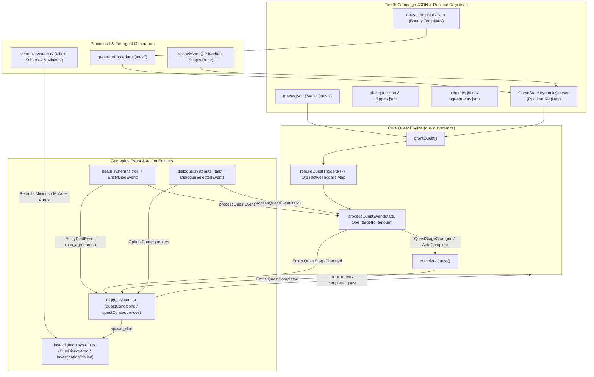

# Quest, Objective & Emergent Narrative Architecture

This document is the canonical architectural reference for the **Quest System**, **Declarative Trigger & Dialogue Engines**, **Procedural Quest Generation**, and **Emergent Narrative Subsystems** (Villain Schemes, Investigation Board, Knowledge/Gossip Brokering, and Nemesis Rivalries).

It maps how authored CRPG quests and systemic procedural quests operate, how they intersect across ECS components and event loops, and documents current wiring gaps and roadmap milestones.

---

## 1. Architectural Philosophy & Tier Placement

In accordance with the **Three-Tier Placement Heuristic** (`AGENTS.md` Rule 16) and **Core Design Philosophy** (`docs/ARCHITECTURE.md` Section 2):

1. **Tier 1 — Core Console Engine (`src/systems/`, `src/types/`, `src/actions/`)**:
   - Owns the ruleset-agnostic quest state machine (`quest.system.ts`), O(1) objective event routing (`QuestLogComponent.activeTriggers`), declarative trigger evaluation (`trigger.system.ts`), dialogue tree traversal (`dialogue.system.ts`), villain scheme simulation (`scheme.system.ts`), clue/investigation tracking (`investigation.system.ts`), and social rumor propagation (`gossip.system.ts`, `knowledge.system.ts`).
2. **Tier 2 — Ruleset Cartridge (`src/rulesets/<id>/`)**:
   - Provides mathematical resolvers for XP progression, level-up thresholds, and (planned) skill/ability check evaluation (`Diplomacy`, `Bluff`, `Intimidate`, `Sense Motive`, `Search`, `Knowledge`) invoked by Console triggers and dialogue nodes.
3. **Tier 3 — Campaign & System Content (`public/data/campaigns/<id>/*.json`)**:
   - Expresses all authored quests (`quests.json`), procedural quest templates (`quest_templates.json`), dialogue trees (`dialogues.json`), reactive world triggers (`triggers.json`, `trigger_templates.json`), villain schemes (`schemes.json`, `agreements.json`), and rumor rules (`rumors.json`) purely as Zod-validated JSON data.

---

## 2. Canonical File & SSOT Ownership Map

| Subsystem | Canonical Files | Responsibility |
| :--- | :--- | :--- |
| **Quest Schema & Types** | `src/types/quests.types.ts`<br>`src/types/campaign.types.ts` | Zod schemas (`QuestSchema`, `QuestObjectiveSchema`, `QuestRewardSchema`, `QuestTemplateSchema`) and TypeScript types. |
| **Quest State & ECS** | `src/types/components.types.ts`<br>`src/types/game-state.types.ts` | `QuestLogComponent` (per-actor quest states + `activeTriggers` index) and `GameState.dynamicQuests` registry. |
| **Core Quest Engine** | `src/systems/quest.system.ts` | `getQuestDef`, `grantQuest`, `completeQuest`, `rebuildQuestTriggers`, and `processQuestEvent`. |
| **Procedural Quests** | `src/systems/procedural-quest.system.ts`<br>`src/systems/shop.system.ts` | `generateProceduralQuest` (from `quest_templates.json`) and merchant `restockShop` supply-run generation. |
| **Trigger Integration** | `src/systems/trigger.system.ts`<br>`src/systems/trigger/quest.ts`<br>`src/systems/pacing.system.ts` | Evaluates `quest_status` / `has_agreement` conditions and applies `grant_quest`, `complete_quest`, and `spawn_clue` consequences under `DramaTracker` pacing constraints. |
| **Dialogue & Social** | `src/systems/dialogue.system.ts`<br>`src/actions/dialogue.actions.ts`<br>`src/systems/knowledge.system.ts`<br>`src/systems/gossip.system.ts` | Dialogue tree traversal, `talk` objective firing, option consequence execution, and `ask_about` / `gossip` / `inject_rumor` dynamic knowledge nodes. |
| **Schemes & Clues** | `src/systems/scheme.system.ts`<br>`src/systems/scheme_compiler.ts`<br>`src/systems/investigation.system.ts` | Autonomous villain scheme phases, minion `AgreementComponent` recruitment, clue drops on minion death, suspect linking, and `InvestigationStalled` detection. |
| **UI & Presentation** | `src/rendering/ui/quest.ui.ts`<br>`src/rendering/ui/investigation.ui.ts`<br>`src/rendering/ui/dialogue.ui.ts` | Quest Journal modal (`UIMode.Quests`) with wiki-link tooltip parsing, Investigation Board UI, and Dialogue overlay. |
| **Authoring & Validation** | `src/editor/validator/quest.validator.ts`<br>`src/rendering/ui/dialogue_editor.ts`<br>`src/rendering/ui/trigger_composer.ui.ts`<br>`src/rendering/ui/narrative_fuzzer.ui.ts` | Static cross-reference validation (`validateQuests`), visual node/trigger editors, and Monte Carlo narrative walk simulation (`narrative_fuzzer`). |

---

## 3. End-to-End Narrative & Quest Architecture Diagram



---

## 4. Manual (Authored) Quest-Making Capabilities

### 4.1 Schema & Data Model (`src/types/quests.types.ts`)
Authored quests live in `public/data/campaigns/<campaign_id>/quests.json` and conform to `QuestSchema`:

- **`id`**: Unique string identifier (e.g., `"tutorial_quest"`, `"main_quest_bandit_king"`).
- **`title` & `description`**: Display strings supporting **Wiki-Link Hypertext** syntax (`[Goblins](entity:goblin)`), parsed by `parseWikiSegments()` in `src/rendering/ui/quest.ui.ts` into interactive tooltip spans.
- **`logicalOperator?: 'AND' | 'OR'`** (defaults to `'AND'`):
  - `'AND'`: Every objective in `objectives[]` must reach its `requiredAmount` for the quest to be satisfied.
  - `'OR'`: Reaching `requiredAmount` on **any single** objective satisfies the entire quest, enabling classic CRPG multi-solution quests (e.g., slay the target, steal the sigil, or persuade the lieutenant).
- **`objectives: ReadonlyArray<QuestObjective>`**:
  - `id`: Objective key scoped to the quest (e.g., `"kill_goblins"`).
  - `description`: Player-facing tracker text (also supports wiki links).
  - `type`: `'kill' | 'gather' | 'explore' | 'interact' | 'talk'`.
  - `targetId`: Canonical ID of the entity template, item, area, or prop.
  - `requiredAmount`: Positive integer threshold.
- **`rewards: ReadonlyArray<QuestReward>`**:
  - Discriminated union supporting 4 reward payloads:
    1. `{ type: 'xp', amount: number }`
    2. `{ type: 'item', itemId: string, amount: number }`
    3. `{ type: 'standing', factionId: string, amount: number }`
    4. `{ type: 'event', eventId: string }`
- **`isHidden?: boolean`**: Allows silent tracker quests that do not clutter the player's Quest Journal UI.
- **`autoComplete?: boolean`** (defaults to `true`):
  - When `true`, satisfying the objectives immediately invokes `completeQuest()`.
  - When `false`, satisfying the objectives marks all objective lines complete in the journal (`progress >= requiredAmount`), but waits for an explicit `complete_quest` consequence (typically fired when returning to an NPC in dialogue).

### 4.2 O(1) Trigger Indexing (`QuestLogComponent.activeTriggers`)
To avoid iterating over all quests and objectives on every combat death or interaction, `QuestLogComponent` maintains a derived lookup table:
- **Key**: `"${objective.type}:${objective.targetId}"` (for example, `"kill:goblin"` or `"talk:scout"`).
- **Value**: `ReadonlyArray<{ questId: string; objectiveId: string }>`.
- `rebuildQuestTriggers(state, questLog)` recalculates this index whenever a quest is granted (`grantQuest`) or completed (`completeQuest`).
- During gameplay, `processQuestEvent(state, eventType, targetId, amount)` performs a direct dictionary lookup on `questLog.activeTriggers["${eventType}:${targetId}"]`, increments `objectiveProgress[objectiveId]`, emits `GameEventType.QuestStageChanged`, and checks `AND`/`OR` completion predicates.

### 4.3 Declarative Trigger & Dialogue Integration
Quests intersect with the **Trigger System** (`src/systems/trigger/quest.ts`) and **Dialogue System** (`src/systems/dialogue.system.ts`, `src/actions/dialogue.actions.ts`):

- **Trigger & Dialogue Conditions (`questConditions`)**:
  - `quest_status`: Compares a quest's current state against a numeric code (`-1` = unstarted, `0` = `'active'`, `1` = `'completed'`, `2` = `'failed'`) using `'==' | '>=' | '<='`. Used both in world triggers and to gate dialogue options based on quest progress.
  - `has_agreement`: Evaluates `true` on `EntityDiedEvent` if the slain entity carries an `AgreementComponent` (linking them to a Villain Scheme).
- **Trigger & Dialogue Consequences (`questConsequences`)**:
  - `grant_quest`: Adds the quest to the player's `QuestLogComponent`, initializes all objective progress counters to `0`, rebuilds `activeTriggers`, and logs `"New Quest: <title>"`.
  - `complete_quest`: Marks the quest `'completed'`, removes its hooks from `activeTriggers`, distributes rewards, and emits `GameEventType.QuestCompleted`.
  - `spawn_clue`: Spawns a physical clue scroll item (`ClueComponent`) at a slain minion's position implicating the scheme's `mastermindId`.

### 4.4 Campaign Validator & Narrative Fuzzer
- **Static Validation (`src/editor/validator/quest.validator.ts`)**:
  - Executed during Stage 8 of `./verify.sh` (`bun run scripts/run-validator.ts`) and live in the Campaign Editor's Validation Dock.
  - Verifies that every `'kill'` objective references an existing template in `campaign.entities` and every `'gather'` objective references a valid item in `campaign.items` that is reachable via `campaign.rules.spawning.lootTable`.
- **Narrative Fuzzer (`src/rendering/ui/narrative_fuzzer.ui.ts`)**:
  - Simulates randomized playthroughs across dialogue trees and triggers to detect unreachable nodes or soft-locked quest chains.

---

## 5. Procedural & Emergent Quest-Making Capabilities

### 5.1 Unified Dual Registry (`campaign.quests` + `state.dynamicQuests`)
`getQuestDef(state, questId)` in `src/systems/quest.system.ts` transparently resolves quest definitions from two sources:
```ts
export function getQuestDef(state: Readonly<GameState>, questId: string): Quest | undefined {
  return state.campaign.quests[questId] ?? state.dynamicQuests[questId];
}
```
Because `GameState.dynamicQuests` is part of the serializable root state, procedurally generated quests persist cleanly across save/load boundaries and use the exact same `QuestLogComponent`, `activeTriggers`, and `quest.ui.ts` journal renderer as hand-authored quests.

### 5.2 Template-Driven Procedural Bounties (`src/systems/procedural-quest.system.ts`)
- Driven by `public/data/campaigns/<id>/quest_templates.json` (`QuestTemplateSchema`).
- Each template defines:
  - `titleTemplate` & `descriptionTemplate` with `{targetName}` and `{amount}` placeholders.
  - `objectiveType`: `'kill' | 'gather' | 'explore' | 'interact' | 'talk'`.
  - `targetTags` / `targetFactions`: Filters candidate targets from `state.campaign.entities`.
  - `amountRange`: `[min, max]` rolled via the deterministic `rng`.
  - `rewardXpMultiplier`: Scales XP reward proportionally to the rolled `amount`.
- `generateProceduralQuest(state, templateId)` constructs a unique `dyn_${templateId}_${state.nextQuestId}` `Quest` object with wiki-linked target names and registers it into `state.dynamicQuests`.

### 5.3 Economy-Driven Merchant Supply Runs (`src/systems/shop.system.ts`)
- When a merchant entity with a `ShopComponent` runs out of stock (`shop.inventory.length === 0`), `restockShop(state, shopEntityId)` filters `state.campaign.items` by the merchant's `buyTags`.
- With a 50% deterministic roll, instead of magically restocking, the merchant generates a dynamic `'gather'` quest (`dyn_restock_${shopEntityId}_${nextQuestId}`: *"Supply Run for <Merchant>"*) requesting `1–3x` of a needed item and registers it in `state.dynamicQuests`.

### 5.4 Emergent Villain Schemes, Clues & Stall Recovery
- **Villain Schemes (`src/systems/scheme.system.ts` & `scheme_compiler.ts`)**:
  - Masterminds execute multi-phase `SchemeRecipe`s compiled from `PhaseBlock`s.
  - Schemes recruit NPC minions via MICE personality profiling (`AgreementComponent`) and mutate dungeon areas (`GameEventType.SchemeMutatedArea`).
- **Investigation & Rumor Loop (`src/systems/investigation.system.ts`)**:
  - Discovering a `ClueComponent` (`GameEventType.ClueDiscovered`) records `'secret'` entries in the player's `MemoryComponent.knowledge` and adds `implicatesEntityId` to `state.investigation.knownActors` on the **Investigation Board UI**.
  - `SchemeMutatedArea` events automatically generate `'rumor'` entries alerting the player that a dungeon area's tags and fortification budget have shifted.
- **Defensive Stall Detector (`INVESTIGATION_STALL_THRESHOLD`)**:
  - If `state.globalTurn - lastClueTurn >= INVESTIGATION_STALL_THRESHOLD`, `processInvestigationEvents()` emits `GameEventType.InvestigationStalled`, enabling campaign triggers and the `DramaTracker` pacing governor to inject a fresh lead or ambush so the investigation never dead-ends.

---

## 6. Resolved Wiring Gaps (Milestone 122: End-to-End Quest & Narrative Lifecycle Wiring)

In **Milestone 122**, all five foundational gaps between declarative schemas and runtime execution were resolved:

### ✅ Gap 1: Universal Objective Emitters (`'gather'`, `'explore'`, `'interact'`) & Retroactive Progress
- **Wiring Resolved**:
  - `'gather'` is emitted on pickup in `src/systems/inventory.system.ts` (`processPickUpIntent`). In addition, `grantQuest()` inspects the player's current `InventoryComponent` so existing items retroactively satisfy `'gather'` objectives upon receiving the quest.
  - `'explore'` is emitted on area transition in `src/systems/map.system.ts` (`processChangeAreaIntent`), and `grantQuest()` checks if the player is currently in the target area.
  - `'interact'` is emitted when applying verbs to world props/entities in `src/systems/apply.system.ts` (`processApplyIntent`).

### ✅ Gap 2: Inversion of Responsibility & Exhaustive Reward Payouts (`QuestRewardApplierMap`)
- **Wiring Resolved**:
  - Replaced the open-ended `for-if` in `completeQuest()` with an exhaustive `QUEST_REWARD_APPLIERS` dictionary (`QuestRewardApplierMap`) in `src/systems/quest.system.ts`.
  - Supports all 4 reward variants: `'xp'` (`grantXp`), `'item'` (spawns into `InventoryComponent` or drops at player's feet if full), `'standing'` (mutates `MemoryComponent.factionStandings`), and `'event'` (`WorldEventFired`).
  - Added exhaustive reward validation to `src/editor/validator/quest.validator.ts`.

### ✅ Gap 3: Procedural Bounties & Dynamic Shop Restock Contracts
- **Wiring Resolved**:
  - Fixed the `targetTags` filter bug in `src/systems/procedural-quest.system.ts` so monster templates matching `targetTags: ["monster"]` generate valid bounties.
  - Added `generate_procedural_quest` consequence action to `ConsequenceActionSchema` and `src/systems/trigger/quest.ts`.
  - Connected `restockShop()` in `src/systems/shop.system.ts` to automatically `grantQuest()` dynamic restock supply contracts directly to the player's `QuestLogComponent`.

### ✅ Gap 4: Quest Failure Lifecycle (`failQuest`) & Journal UI Polish
- **Wiring Resolved**:
  - Implemented `failQuest(state, playerId, questId)` in `src/systems/quest.system.ts`, transitioning status to `'failed'`, evicting triggers from the O(1) bucket, logging the failure, and emitting `GameEventType.QuestFailed` (`QuestFailedEvent`).
  - Added `fail_quest` consequence action in `src/systems/trigger/quest.ts`.
  - Updated `src/rendering/ui/quest.ui.ts` to filter out hidden quests (`isHidden`), render failed quests with distinct red styling (`#e74c3c`) and status badges, and display a Rewards Preview on active quests.

### ✅ Gap 5: Multi-Stage Quest Chaining (`nextQuestId`)
- **Wiring Resolved**:
  - Added `nextQuestId: z.string().optional()` to `QuestSchema` in `src/types/quests.types.ts`.
  - When `completeQuest()` finishes, if `questDef.nextQuestId` is defined, it automatically grants the follow-up quest in the narrative chain via `grantQuest()`.
  - Added validation for `nextQuestId` in `src/editor/validator/quest.validator.ts`.
