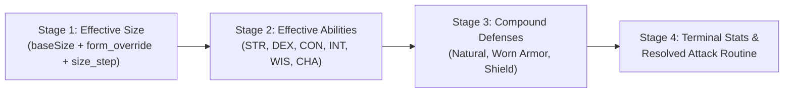

# Milestone 112.7 Research Notes: Stage 4 DAG Attack Routine, Inappropriately Sized Weapon Effort Ladder, Two-Handed Grip & Double-Weapon Toggles, Multi-Limb / Natural Demotion & Per-Strike Power Attack Handedness

---

## 1. Reiteration of Rules & Standards (`AGENTS.md` & `docs/ARCHITECTURE.md`)

1. **Three-Tier Placement Heuristic (`AGENTS.md` Rule 16)**:
   - **Tier 1 (Core Console Engine — `src/types/components.types.ts`)**: `EquipmentSlotInstance` (`limbGroupId`, `occupiedBySlotId`, `suppressed`) and `TacticalDoctrineComponent` (`gripMode?: 'one_handed' | 'two_handed' | 'double_weapon_twf'`).
   - **Tier 2 (Ruleset Cartridge — `src/rulesets/dnd35e/`)**:
     - `equipment_physics.ts`: Pure SRD weapon size vs. wielder size effort ladder (`evaluateWeaponWieldingProfile`), grip mode resolution, double-weapon splitting, and multi-hand `resolveEquippedWeaponProfile` / `resolveAllEquippedWeaponProfiles`.
     - `combat/attack_resolver.ts`: `buildFullAttackSequence` across $1..N$ manufactured hands + limb-filtered natural weapons, per-strike Power Attack handedness damage calculation (`computeStrikeDoctrineDamageBonus`), and the Stage 4 DAG Attack Routine synthesizer (`resolveActorAttackRoutine`).
     - `dnd35e_ruleset.ts`: Evaluates `attackRoutine` as part of **Stage 4 of `evaluateDnD35eEntityDAG`** (consuming Stage 1 `effectiveSize` and Stage 2 `effectiveAbilityModifiers`), and makes `resolveDnD35eMeleeAttack` a thin consumer of `attackerEval.attackRoutine.strikes`.
   - **Tier 3 (System & Campaign Content — `public/data/`)**: Weapon tags (`double_weapon`, `cannot_two_hand_str`, `exotic_1h_martial_2h`, `weaponSize:<size>`) and natural weapon `limbGroupId` mappings.
2. **Baseline Rules + Declarative Overrides (`AGENTS.md` Rule 17)**:
   - Special weapon behaviors (Rapier's inability to gain $1.5\times \text{STR}$ when two-handed, Bastard Sword / Dwarven Waraxe 1H-exotic vs. 2H-martial proficiency, Double Weapons fighting as `one_handed + light`) are driven by semantic item tags (`cannot_two_hand_str`, `double_weapon`, `exotic_1h_martial_2h`) rather than hardcoded item ID branches.
3. **Universal Actor Symmetry (`AGENTS.md` Rule 18)**:
   - Every actor—whether a 2-armed Human Fighter, a Small Halfling wielding a Medium Short Sword, an enlarged barbarian, an armed Minotaur with a Greataxe + Gore, or a 6-armed Marilith—uses the exact same Stage 4 DAG `attackRoutine` pipeline.
4. **TypeScript Strictness & Zero Magic Values (`AGENTS.md` Rules 10–14)**:
   - Zero `any`, explicit return types on all functions, `exactOptionalPropertyTypes: true` compliance, and named constants for all gameplay numbers (`SIZE_STEP_ATTACK_PENALTY = -2`, effort indices `0..2`, etc.).

---

## 2. Architectural Core: Stage 4 DAG Attack Routine Resolution

Rather than resolving weapon handedness, size penalties, limb occupation, and per-strike Power Attack damage ad-hoc inside `resolveDnD35eMeleeAttack`, the actor's complete **`attackRoutine: DnD35ResolvedAttackRoutine`** is computed at **Stage 4 of `evaluateDnD35eEntityDAG`**:

### Why Stage 4 DAG Evaluation is Canonical
1. **Automatic Reactivity to Size Changes (`Stage 1 -> Stage 4`)**:
   - Consumes `dagResult.effectiveSize` rather than pre-Stage-1 `dndData.sizeCategory`.
   - If an actor changes size via *Enlarge Person* (where worn gear resizes with the wearer), both `wielderSize` and `weaponSize` step up (`1d8` $\to$ `2d6`).
   - If an actor changes size or picks up a fixed-size weapon (`weaponSize: 'medium'`) while `effectiveSize === 'large'`, `evaluateWeaponWieldingProfile` automatically shifts a Medium Greatsword (`two_handed`) down 1 effort step to `'one_handed'` at `-2` attack penalty, or flags a Medium Dagger (`light`) as unwieldable ($\text{Index}_{\text{eff}} = -1$).
2. **Automatic Reactivity to Ability Buffs/Drains (`Stage 2 -> Stage 4`)**:
   - Consumes `dagResult.effectiveAbilityModifiers.str` and `dex`.
   - Any buff (*Bull's Strength*, *Rage*) or penalty (*Ray of Enfeeblement*) immediately recalculates per-strike $1.5\times$, $1.0\times$, and $0.5\times \text{STR}$ damage across all strikes in the routine.
3. **Automatic Reactivity to Extra Limbs, Polymorph Overlays & Natural Weapons**:
   - Inspects live `EquipmentComponent.slots` and `dndData.naturalWeapons` on every DAG pass.
   - Growing extra arms/claws or equipping/unequipping an off-hand item immediately updates `occupiedLimbGroupIds`, suppresses natural weapons on occupied hands, and demotes unblocked primary natural weapons (`Bite`, `Gore`) to `natural_secondary` when armed.
4. **Unified Consumer Surface**:
   - Out-of-combat consumers (Character Sheet UI, HUD, Paper Doll, AoO reach checks) read `evaluated.attackRoutine` directly.
   - In-combat `resolveDnD35eMeleeAttack` evaluates `evaluateDnD35eEntityDAG(state, attackerId, { targetTags: defenderSelfTags })` and iterates `attackerEval.attackRoutine.strikes` (all strikes for a Full Attack when `distanceMovedThisRoundFt <= 5`, or `strikes.slice(0, 1)` for a Standard Attack).

---

## 3. Detailed Task Breakdown & Gap Analysis

### Task 1: Inappropriately Sized Weapon Effort Ladder & Attack Penalties (`src/rulesets/dnd35e/equipment_physics.ts`)
- **Current Gap**:
  - `evaluateWeaponWieldingProfile(weaponSize, weaponHandedness, wielderSize)` in `equipment_physics.ts` (lines 298–357) has two bugs against the SRD (*Inappropriately Sized Weapons*, PHB p. 113):
    1. When `stepDiff === -1` and `weaponHandedness === 'light'`, $\text{Index}_{\text{eff}} = 0 - 1 = -1$ (falls below `'light'`), which per SRD is **unwieldable**. Currently line 356 returns `wieldable: true, effectiveHandedness: 'light'`.
    2. Line 323 rejects `Math.abs(stepDiff) > 1` unconditionally, blocking legal 2-step shifts that stay within `[0, 2]` (such as a Large creature wielding a Small Two-Handed weapon as `'light'` at `-4` penalty, or a Small creature wielding a Large Light weapon as `'two_handed'` at `-4` penalty).
- **Solution**:
  - Define `EFFORT_LADDER = ['light', 'one_handed', 'two_handed'] as const`.
  - Compute `effectiveIndex = baseIndex + (SIZE_METRICS[weaponSize].rankIndex - SIZE_METRICS[wielderSize].rankIndex)`.
  - Wieldable iff `effectiveIndex >= 0 && effectiveIndex < EFFORT_LADDER.length`, with `attackPenalty = -Math.abs(stepDiff) * 2`.
  - Scale weapon damage dice from `'medium'` to `weaponSize` (where `weaponSize` is read from `weaponSize:<size>` tag if present, or defaults to `wielderSize` so standard equipment scales with its wearer).

### Task 2: Two-Handed Grip Toggle, Double-Weapon Mode & Weapon Exceptions (`components.types.ts`, `equipment_physics.ts`)
- **Current Gap**:
  - `TacticalDoctrineComponent` has no `gripMode` field.
  - Effective `'one_handed'` weapons cannot be toggled into a two-handed grip when a free hand is available.
  - Double weapons (*Quarterstaff*, *Orc Double Axe*, etc.) cannot toggle between single-end two-handed mode and double-weapon TWF (`one_handed + light`).
  - SRD exceptions for **Rapier** (`cannot_two_hand_str`), **Light weapons** in two hands, and **Bastard Sword / Dwarven Waraxe** (`exotic_1h_martial_2h`) are not enforced.
- **Solution**:
  - Add `readonly gripMode?: 'one_handed' | 'two_handed' | 'double_weapon_twf' | undefined` to `TacticalDoctrineComponent`.
  - In `resolveAllEquippedWeaponProfiles(state, entityId, effectiveWielderSize)`:
    - If `effectiveEffort === 'one_handed'` and `gripMode === 'two_handed'` and the actor has at least 1 unoccupied `held`/`hand` slot:
      - Occupies the free hand's `limbGroupId`.
      - Upgrades `effectiveHandedness` to `'two_handed'` **unless** the weapon has tag `'cannot_two_hand_str'` (Rapier).
    - If `effectiveEffort === 'two_handed'` and the weapon has tag `'double_weapon'` (or is `quarterstaff`) and `gripMode === 'double_weapon_twf'`:
      - Primary head is wielded as `'one_handed'` and a synthetic off-hand strike is emitted for the secondary head as `'light'`.
    - If `effectiveEffort === 'light'`, `effectiveHandedness` remains `'light'` regardless of `gripMode`.

### Task 3: Limb Occupation Filtering, Primary-to-Secondary Natural Demotion & Multi-Armed (`3+` Hands) Sequencing (`equipment_physics.ts`, `attack_resolver.ts`, `dnd35e_ruleset.ts`)
- **Current Gap**:
  - `resolveDnD35eMeleeAttack` did not pass `naturalWeaponLimbs` or `occupiedLimbGroupIds` to `buildFullAttackSequence`, and only resolved 1 off-hand slot.
- **Solution**:
  - `resolveAllEquippedWeaponProfiles` inspects all non-suppressed `held`/`hand` slots across $1..N$ limbs, returning `primaryWeapon`, `offHandWeapons: ReadonlyArray<EquippedWeaponProfile>`, and `occupiedLimbGroupIds: ReadonlyArray<string>` (including hands holding weapons, shields, or the second hand of a two-handed weapon/grip).
  - `buildFullAttackSequence` accepts `offHandWeapons` (supporting $1..N-1$ off-hand weapons for multi-armed creatures) and `naturalWeaponLimbs` + `occupiedLimbGroupIds` (suppressing natural weapons on occupied hands and demoting all remaining natural weapons—including primary ones like `Bite` or `Gore`—to `natural_secondary` at `-5` / `-2` with *Multiattack* and $0.5\times \text{STR}$ when armed).

### Task 4: Per-Strike Power Attack Handedness Resolution (`attack_resolver.ts`, `dnd35e_ruleset.ts`)
- **Current Gap**:
  - Power Attack damage was computed once using the main hand's handedness and added to all strikes, causing light off-hand weapons to erroneously receive Power Attack damage.
- **Solution**:
  - Compute `computeStrikeDoctrineDamageBonus(doctrine, totalBab, strikeHandedness, isNaturalOrUnarmed, customDials)` per strike inside `resolveActorAttackRoutine`:
    - `'two_handed'` strike $\to$ $2\times$ Power Attack dial.
    - `'one_handed'`, `'primary_natural_sole'`, unarmed strike, or natural weapon $\to$ $1\times$ Power Attack dial (per PHB p. 98, unarmed strikes and natural weapons receive $1:1$ Power Attack damage).
    - Manufactured `'light'` weapon (in main hand or off-hand) $\to$ $0\times$ Power Attack dial.

---

## 4. Cascading Effects Matrix (`AGENTS.md` Rule 15)

| Change | Upstream (Callers / Emitters / Data Authors) | Downstream (Consumers / Renderers / Validators / Saves) | Lateral (Sibling Campaigns / Docs / Tests) |
| :--- | :--- | :--- | :--- |
| **1. Stage 4 DAG `attackRoutine` (`DnD35EntityDAGResult.attackRoutine`)** | `evaluateDnD35eEntityDAG` consuming Stage 1 `effectiveSize` and Stage 2 `effectiveAbilityModifiers`. | `resolveDnD35eMeleeAttack`, Character Sheet UI, HUD, AoO reach/threat queries. | Centralizes all attack sequence and handedness math in one DAG pass. |
| **2. `evaluateWeaponWieldingProfile` Effort Ladder (`[0..2]`) & `weaponSize`** | `resolveAllEquippedWeaponProfiles`, item definitions with `weaponSize:<size>` tags. | Attack roll bonuses (`-2` per size step diff), effective effort (`light`, `one_handed`, `two_handed`), damage dice scaling. | `tests/dnd35e_cartridge.test.ts` & `tests/dnd35e_combat_traversal_wiring.test.ts`. |
| **3. `TacticalDoctrineComponent.gripMode` (`one_handed` / `two_handed` / `double_weapon_twf`)** | Player stance toggles, character builder / equipment state. | `resolveAllEquippedWeaponProfiles`, `evaluateDnD35eEntityDAG`, `occupiedLimbGroupIds`. | Backward-compatible optional property on `TacticalDoctrineComponent`; `tag_registry.json` updated. |
| **4. Limb Occupation, Natural Demotion & Per-Strike Power Attack** | `EquipmentComponent.slots` (`limbGroupId`), `attackerData.naturalWeapons`, `TacticalDoctrineComponent`. | `buildFullAttackSequence` and per-strike `flatDamageBonus`. | Supports armed monsters (Minotaur Greataxe + Gore), double weapons (Quarterstaff), and multi-armed actors (Marilith). |
