# Implementation Plan: Phase 11 — Milestone 76

## Campaign Creator & Developer Tooling UX

**Phase:** 11 (V2 Engine Decoupling)
**Milestone:** 76 (Campaign Creator & Developer Tooling UX)
**Governance:** [AGENTS.md](AGENTS.md), [docs/ARCHITECTURE.md](docs/ARCHITECTURE.md), [docs/MILESTONES.md](docs/MILESTONES.md#L831-L836), [docs/DECISIONS.md](docs/DECISIONS.md), [docs/research_notes.md](docs/research_notes.md)
**Status:** ✅ Gate 1 (Research) RESOLVED — Decisions D1-D6 locked by User (Oct 30). Gate 2 (Plan) PENDING user approval before code writes.
**Target Completion Date:** October 30, 2026

---

## 0. Rules & Architectural Standards Reiteration

All Milestone 76 work strictly enforces:

1. **Never Commit or Push (Rule 2):** All work stays local; no `git commit` / `git push`.
2. **Implementation Gate (Rule 5):** No source file is created or modified before Gate 2 approval by the User.
3. **Zero `any` (Rule 11):** All new path normalizers, reference indices, and UI controllers use fully typed interfaces with explicit return types and JSDoc on every export.
4. **Zero Magic Values (Rule 12):** Path separators (`/`), accordion labels, chip filters, and menu strings live in `src/constants/` if they affect behavior.
5. **Cascading Effects (Rule 15):** This plan carries a full Cascading Effects Matrix (Section 2) covering upstream (validator emitters, editor controllers), downstream (form renderers, workspace DOM, toolbar state), and lateral (dialogue editor, area editor, trigger composer, `getReferenceOptions` twin) impact for every change.
6. **~250 LOC per module (Rule 13):** The six new modules (`validation_path.ts`, `validation_navigator.ts`, `reference_index.ts`, `validation_panel.ui.ts`, `where_used.ui.ts`, `area_playtest_menu.ui.ts`) are each budgeted ≤ ~250 LOC. `zod_form_renderer.ts` (536 LOC) must not grow; accordion work must extract section renderers rather than grow the file.
7. **Strict Touch Scope for DOM Security (Golden Rule 7 / Decision D6):** Only newly created or M76-touched components (`validation_panel.ui.ts`, `where_used.ui.ts`, `area_playtest_menu.ui.ts`, accordion sections in form renderer, `editor_toolbar.ts` cleanup) use strict `document.createElement()` / `textContent` patterns with zero `.innerHTML`. Untouched legacy canvas UI (`area_editor.ts` pre-existing canvas controls) is left intact to avoid regression blast.
8. **Downward Dependencies:** `core/edit/` imports `core/` or `types/`; `rendering/ui/` imports `rendering/` or `core/`. No upward imports (`systems/` importing `rendering/` is forbidden).
9. **No Map/Set in serialized components (Rule ECS):** `ReferenceIndex` is cached in a `WeakMap` (not serialized into `GameState`). `expandedPaths` is a module-level `Set<string>` in-memory only (not persisted to `localStorage`).

---

## 1. High-Level Architecture

```mermaid
flowchart TD
    subgraph Norm ["Path Dialect Normalization"]
        ValidatorEmit["Validators emit paths"] --> Normalizer["toFormPath()<br/>src/editor/validation_path.ts"]
        Normalizer --> Canonical["Canonical path: /section/index"]
    end

    subgraph Nav ["Navigation & Focus"]
        Click["Click error link / Where Used"] --> Navigator["revealField() / expandAncestors()<br/>src/editor/validation_navigator.ts"]
        Navigator --> AccordionState["expandedPaths: Set<string>"]
        Navigator --> DOMFocus["focus DOM input<br/>data-field-path"]
    end

    subgraph Ref ["Reverse Reference"]
        CampaignData["CampaignData"] --> Indexer["ReferenceIndex<br/>WeakMap&lt;CampaignData, ReferenceIndex&gt;<br/>src/editor/reference_index.ts"]
        Indexer --> WhereUsed["Where Used drawer<br/>src/rendering/ui/where_used.ui.ts"]
    end

    subgraph Diag ["Diagnostics Dock"]
        Errors["Validation errors"] --> Dock["validation_panel.ui.ts<br/>bottom dock"]
        Dock --> ClickNav["Single-click jump-to-error"]
    end

    subgraph Spawn ["Playtest Spawning"]
        ContextMenu["Right-click static tile"] --> MenuUI["area_playtest_menu.ui.ts"]
        MenuUI --> SessionStorage["sessionStorage['editor_playtest_spawn']"]
        SessionStorage --> SpawnOverride["startNewGame(spawnOverride?)"]
        SpawnOverride --> Bootstrap["bootstrap.ts: spawn at (areaId, x, y)"]
    end

    subgraph Accordion ["Accordion Forms"]
        ZodForm["zod_form_renderer.ts"] --> DetailsSummary["&lt;details&gt;/&lt;summary&gt;<br/>first open, nested collapsed"]
        DetailsSummary --> ExpandedPaths["expandedPaths Set"]
    end

    subgraph Security ["DOM Security (Rule 7 / D6)"]
        NewFiles["New M76 files"] --> StrictCreate["createElement + textContent"]
        TouchedFiles["Touched files (toolbar, form)"] --> StrictCreate
        UntouchedFiles["Untouched legacy"] --> LeftIntact["Left intact"]
    end
```



---

## 2. Cascading Effects Matrix (Rule 15)

| # | Change | Upstream (Callers / Emitters / Authors) | Downstream (Consumers / Renderers / Serializers) | Lateral (Siblings / Mirrors / Docs) |
|---|---|---|---|---|
| 1 | `toFormPath()` canonical path normalizer (`validation_path.ts`) | Every validator's `.path` output (`campaign_validator.ts`, sub-validators); `dialogue_editor.ts`, `trigger_composer.ui.ts` path contracts | Inline error rendering (`zod_form_renderer.ts`); `revealField()` navigator; `data-field-path` DOM matching; future validators | `dialogue_editor.ts`, `area_editor.ts`, `editor_forms.ts`, `faction_matrix_editor.ts` — all share the same path contract |
| 2 | `<details>`/`<summary>` accordion + `expandedPaths: Set<string>` (`zod_form_renderer.ts`) | `renderNestedObjectField()`, `renderArrayField()` — must emit structured sections instead of flat `div` stacks | `editor_workspace.ts` workspace re-renders survive; `updateToolbarState()` error counts must count descendants; drag-and-drop `dataset.index` contract preserved | `editor_forms.ts` factory signatures; `editor.css` accordion styles; `dialogue_editor.ts` node forms |
| 3 | Cached reverse-reference indexer (`reference_index.ts`, `WeakMap`) | All reference-bearing schema fields (`areas.*.placedEntities[].templateId`, `dialogues.*.nodes.*.nextNodeId`, etc.) | `where_used.ui.ts` drawer; navigator clicks (`revealField()`); `getReferenceOptions()` must not duplicate the same registry lookup logic | `getReferenceOptions()` (forward twin in `ui_utils.ts`); `dialogue_editor.ts`, `area_editor.ts`, `trigger_composer.ui.ts`; `docs/MODDING.md` |
| 4 | Persistent collapsible bottom diagnostics dock (`validation_panel.ui.ts`) | `editor_toolbar.ts` (removes `.innerHTML` popup); `zod_form_renderer.ts` (feeds error array); `editor_workspace.ts` (forwards validation state) | `updateToolbarState()` replaced; DOM click-to-focus; keyboard-accessible (`<details>` not required, native `<ul>` with `.focus()`); `editor.css` new `.dock` rules | `settings.ui.ts`; `dialogue_editor.ts`; `area_editor.ts`; `docs/ARCHITECTURE.md` UI layer |
| 5 | `startNewGame(spawnOverride?)` + `sessionStorage['editor_playtest_spawn']` (`session_controller.ts`, `bootstrap.ts`) | `editor_toolbar.ts` (existing reload path); `area_playtest_menu.ui.ts` (new right-click handler) | `bootstrap.ts` initial area/spawn selection; `deleteSave()` ordering unchanged; replay/seed determinism (`initRNG`) | `session_controller.ts` other call sites (`startNewGame('default')`, `continueGame`); `bootstrap_sandbox.ts`; `editor_workspace.ts` active document tracking |
| 6 | `data-field-path` DOM tagging + `revealField()` navigator (`validation_navigator.ts`) | `zod_form_renderer.ts` (tags fields); `dialogue_editor.ts` (node editor tags); `where_used.ui.ts` (reference links) | `editor_toolbar.ts` click handler; `validation_panel.ui.ts` click handler; workspace tab switch (`switchTab()`) | `editor_forms.ts`; `dialogue_editor.ts`; `area_editor.ts`; `zod_form_renderer.ts` basePath contract |

---

## 3. Step-by-Step Implementation Tasks

### Task 1 — `src/editor/validation_path.ts` (new, ~80 LOC)

Normalizes the three validator path dialects to canonical slash-leading form.

```typescript
/**
 * Canonical form: `/<segment>/<segment>[/<index>]`
 * Examples: `/areas/0/placedEntities/2/templateId`, `/dialogues/1/nodes/3/options/0/nextNodeId`
 */
export function toFormPath(raw: string[]): string {
  // Unify dot-notation (`areas.0.name`), bracket (`areas[0]`), and mixed.
  const segments: string[] = [];
  for (const seg of raw) {
    if (seg === '') continue;
    // Convert numeric array indices to integer segment markers
    if (/^\d+$/.test(seg)) segments.push(seg);
    else segments.push(seg);
  }
  return '/' + segments.join('/');
}

export function isPathPrefix(ancestor: string, descendant: string): boolean {
  return descendant === ancestor || descendant.startsWith(ancestor + '/');
}

export function splitPath(path: string): string[] {
  return path === '/' ? [] : path.slice(1).split('/');
}
```

**Verification:** All existing validator assertions untouched; `toFormPath()` produces identical output for already-canonical slash paths.

---

### Task 2 — `src/editor/validation_navigator.ts` (new, ~110 LOC)

Drives field reveal, ancestor expansion, tab switching, and DOM focus.

```typescript
export interface NavigatorState {
  expandedPaths: Set<string>;
}

const expandedPaths: Set<string> = new Set();

export function expandAncestors(targetPath: string): void {
  const parts = splitPath(targetPath);
  for (let i = 1; i <= parts.length; i++) {
    expandedPaths.add('/' + parts.slice(0, i).join('/'));
  }
}

export function revealField(basePath: string, fullPath: string): void {
  expandAncestors(fullPath);
  // Trigger workspace tab switch and DOM focus via controller callback
  // (wire in editor_workspace.ts / editor_toolbar.ts)
}
```

**Upstream call sites:** `editor_toolbar.ts`, `validation_panel.ui.ts`. **Downstream consumers:** `editor_workspace.ts` (calls `switchTab()` + `focusElement()`), `dialogue_editor.ts` (node navigation), `zod_form_renderer.ts` (accordion open state).

---

### Task 3 — Accordion Forms (`src/rendering/ui/zod_form_renderer.ts`, ~modification, keep ≤250 growth)

Convert nested sections to `<details>`/`<summary>` with `data-field-path`, descendant error badges.

```typescript
// Module-level persistence (survives DOM replacement)
const expandedPaths: Set<string> = new Set();

function renderAccordionSection(
  labelText: string,
  basePath: string,
  children: HTMLElement[],
  isFirstLevel: boolean
): HTMLElement {
  const details = document.createElement('details');
  details.open = isFirstLevel || expandedPaths.has(basePath);
  details.dataset.basePath = basePath;

  const summary = document.createElement('summary');
  summary.textContent = labelText;
  details.appendChild(summary);

  const content = document.createElement('div');
  content.className = 'accordion-content';
  children.forEach(c => content.appendChild(c));
  details.appendChild(content);

  // Sync module-level state on toggle
  details.addEventListener('toggle', () => {
    if (details.open) expandedPaths.add(basePath);
    else expandedPaths.delete(basePath);
  });

  return details;
}
```

**Critical:** Every field container must receive `data-field-path="${path}"` so `revealField()` can query/select it.

---

### Task 4 — `src/editor/reference_index.ts` (new, ~170 LOC)

Cached reverse-reference indexer over `CampaignData`.

```typescript
export interface ReferenceUsage {
  targetKind: string; // 'entity', 'item', 'dialogue', 'area', 'status', 'tile'
  targetId: string;
  sourcePath: string;  // canonical form
}

export interface ReferenceIndex {
  usages: Map<string, ReferenceUsage[]>; // key = canonical target id
}

const indexCache = new WeakMap<object, ReferenceIndex>();

export function buildReferenceIndex(data: CampaignData): ReferenceIndex {
  const existing = indexCache.get(data);
  if (existing) return existing;

  const index: ReferenceIndex = { usages: new Map() };
  // Walk all reference-bearing schema fields (see research_notes.md §10.3)
  // Index only known registry ids; ignore arbitrary prose.
  indexCache.set(data, index);
  return index;
}

export function queryUsages(index: ReferenceIndex, targetKind: string, targetId: string): ReferenceUsage[] {
  return index.usages.get(`${targetKind}:${targetId}`) ?? [];
}
```

**Lateral constraint:** Must not duplicate the registry lookup logic in `getReferenceOptions()` (`ui_utils.ts`). `getReferenceOptions()` returns dropdown options; `ReferenceIndex` returns reverse usages. They share the same key-set awareness but perform opposite operations.

---

### Task 5 — `src/rendering/ui/where_used.ui.ts` (new, ~100 LOC)

Global collapsible drawer driven by `ReferenceIndex`.

```typescript
export function renderWhereUsed(
  container: HTMLElement,
  index: ReferenceIndex,
  selectedKind: string,
  selectedId: string
): void {
  // Clear previous content
  container.replaceChildren();

  const usages = queryUsages(index, selectedKind, selectedId);
  if (usages.length === 0) {
    container.textContent = 'No usages found.';
    return;
  }

  usages.forEach(u => {
    const row = document.createElement('button');
    row.className = 'where-used-row';
    row.textContent = `${u.sourcePath} (${u.targetKind}:${u.targetId})`;
    row.addEventListener('click', () => revealField('', u.sourcePath));
    container.appendChild(row);
  });
}
```

**Zero `.innerHTML`.** Each row uses `createElement('button')` and `textContent`.

---

### Task 6 — `src/rendering/ui/validation_panel.ui.ts` (new, ~110 LOC)

Persistent collapsible bottom diagnostics dock (replaces `editor_toolbar.ts` hover popup).

```typescript
export interface ValidationPanelProps {
  errors: Array<{ path: string; message: string }>; // paths are canonical
  onNavigate: (path: string) => void;
}

export function renderValidationPanel(
  container: HTMLElement,
  props: ValidationPanelProps
): void {
  container.replaceChildren();

  const header = document.createElement('div');
  header.className = 'dock-header';
  header.textContent = `Errors: ${props.errors.length}`;
  container.appendChild(header);

  const list = document.createElement('ul');
  list.className = 'dock-list';
  props.errors.forEach(e => {
    const li = document.createElement('li');
    const btn = document.createElement('button');
    btn.className = 'dock-row';
    btn.textContent = `${e.path}: ${e.message}`;
    btn.addEventListener('click', () => props.onNavigate(e.path));
    li.appendChild(btn);
    list.appendChild(li);
  });
  container.appendChild(list);
}
```

---

### Task 7 — `editor_toolbar.ts` Cleanup (modification, eliminate `.innerHTML`)

Remove the hover-only validation popup. Wire `updateToolbarState()` to feed errors into the new `validation_panel.ui.ts` dock mounted in the workspace bottom area.

```typescript
// Old (to be removed):
// const tooltip = document.createElement('div'); tooltip.innerHTML = ...

// New:
import { renderValidationPanel } from '../ui/validation_panel.ui.ts';

export function updateToolbarState(errors: Array<{ path: string; message: string }>) {
  const dock = document.getElementById('validation-dock');
  if (!dock) return;
  renderValidationPanel(dock, {
    errors,
    onNavigate: (path) => {
      revealField('', path); // from validation_navigator.ts
    },
  });
}
```

**Verification:** Zero `.innerHTML` remains in this file; no `innerHTML` references added.

---

### Task 8 — `area_playtest_menu.ui.ts` (new, ~90 LOC)

Static map right-click context menu.

```typescript
export interface PlaytestMenuProps {
  areaId: string;
  x: number;
  y: number;
  onSelectPlaytest: (areaId: string, x: number, y: number) => void;
}

export function renderPlaytestMenu(
  container: HTMLElement,
  props: PlaytestMenuProps
): void {
  container.replaceChildren();

  const btn = document.createElement('button');
  btn.className = 'context-menu-item';
  btn.textContent = '▶ Playtest from Here';
  btn.addEventListener('click', () => props.onSelectPlaytest(props.areaId, props.x, props.y));
  container.appendChild(btn);
}
```

---

### Task 9 — `area_editor.ts` Context Menu Integration (modification)

Attach `contextmenu` listener to the static map canvas (`L426-444` area). Resolve tile coordinates via `display.eventToPosition(e)`.

```typescript
canvas.addEventListener('contextmenu', (e: MouseEvent) => {
  e.preventDefault();
  const [mapX, mapY] = display.eventToPosition(e) || [0, 0];

  // Walkability check against staticMap.layout + legend
  const tileDef = resolveTileAtStaticMap(mapX, mapY);
  if (!tileDef || !tileDef.walkable) {
    // Refuse or snap to nearest walkable — per decision, refuse for simplicity
    return;
  }

  const menu = document.createElement('div');
  menu.className = 'tile-context-menu';
  document.body.appendChild(menu);
  renderPlaytestMenu(menu, {
    areaId: activeAreaId,
    x: mapX,
    y: mapY,
    onSelectPlaytest: (aId, x, y) => {
      sessionStorage['editor_playtest_spawn'] = JSON.stringify({ areaId: aId, x, y });
      sessionStorage['editor_active_document'] = JSON.stringify(activeDoc);
      sessionStorage['editor_playtest'] = 'true';
      window.location.reload();
    },
  });

  const closeMenu = () => { menu.remove(); document.removeEventListener('click', closeMenu); };
  document.addEventListener('click', closeMenu, { once: true });
});
```

---

### Task 10 — `session_controller.ts` & `bootstrap.ts` Spawn Override (modification)

Extend `startNewGame()` and `bootstrap.ts` spawn path.

```typescript
// session_controller.ts (around L296-309)
export function startNewGame(
  campaignId: string,
  spawnOverride?: { areaId: string; x: number; y: number }
): void {
  // ... existing load path ...
  const initialAreaId = spawnOverride?.areaId ?? campaign.rules.map.startingAreaId;
  // Pass to bootstrap
  startNewGameInternal(campaign, initialAreaId, spawnOverride);
}

// bootstrap.ts
export function generateAreaWithSpawn(
  campaign: CampaignData,
  areaId: string,
  spawnOverride?: { x: number; y: number }
) {
  const area = generateArea(campaign, areaId);
  const spawnPos = spawnOverride
    ? { x: spawnOverride.x, y: spawnOverride.y }
    : area.startPos;
  return { area, spawnPos };
}
```

**Upstream call sites untouched:** `startNewGame('default', …)` (without override) continues to work identically.

---

### Task 11 — `editor_workspace.ts` Validation Error Forwarding (modification)

Forward validation errors to area and dialogue editor views.

```typescript
export function setWorkspaceErrors(
  errors: Array<{ path: string; message: string }>
): void {
  // Forward to active sub-editor
  if (currentTab === 'dialogue') {
    dialogueEditorInstance?.setErrors(errors.filter(e => e.path.startsWith('dialogues/')));
  }
  if (currentTab === 'area') {
    areaEditorInstance?.setErrors(errors.filter(e => e.path.startsWith('areas/')));
  }
  // Update global dock
  updateToolbarState(errors);
}
```

---

### Task 12 — `dialogue_editor.ts` `data-field-path` Integration (modification)

Attach `data-field-path` on node editor inputs so `revealField()` can focus them.

```typescript
// For each node input container
nodeInputContainer.dataset.fieldPath = `dialogues/${dialogueId}/nodes/${nodeId}/${fieldKey}`;
```

---

### Task 13 — DOM Security Audit & `data-field-path` Tagging (cross-file)

Audit all touched files (`zod_form_renderer.ts`, `editor_toolbar.ts`, `dialogue_editor.ts`, `area_playtest_menu.ui.ts`, `where_used.ui.ts`, `validation_panel.ui.ts`) to confirm:

- Zero `.innerHTML` usage.
- Zero `innerHTML` assignments.
- All text insertion uses `textContent` or `createTextNode()`.
- All `data-field-path` attributes set via `.dataset.fieldPath = ...`.

---

## 4. Cascading Effects Summary (Post-Plan Audit)

Before writing any code, every change above has been audited across all three axes:

- **Upstream:** Validators (`campaign_validator.ts`, sub-validators) emit paths; `editor_toolbar.ts` feeds errors; `area_editor.ts` provides context; `dialogue_editor.ts` provides node paths; `bootstrap.ts` provides area/spawn.
- **Downstream:** `zod_form_renderer.ts` consumes canonical paths and renders accordions; `validation_navigator.ts` consumes them for navigation; `editor_workspace.ts` forwards them; `where_used.ui.ts` consumes the `ReferenceIndex`.
- **Lateral:** `dialogue_editor.ts`, `area_editor.ts`, `trigger_composer.ui.ts`, `editor_forms.ts` share the same `data-field-path` and path-normalization contracts. `getReferenceOptions()` (forward lookup) must not be duplicated by `ReferenceIndex` (reverse lookup) — same registry awareness, opposite direction.

---

## 5. Module Size Budget (~250 LOC per file)

| File | Target LOC | Notes |
|---|---|---|
| `src/editor/validation_path.ts` | ~80 | Path normalizer, split/prefix helpers |
| `src/editor/validation_navigator.ts` | ~110 | Expanded paths set, reveal/focus/navigation |
| `src/editor/reference_index.ts` | ~170 | Cached WeakMap indexer, usage queries |
| `src/rendering/ui/validation_panel.ui.ts` | ~110 | Dock rendering, click-to-focus |
| `src/rendering/ui/where_used.ui.ts` | ~100 | Drawer, usage list, click handlers |
| `src/rendering/ui/area_playtest_menu.ui.ts` | ~90 | Context menu button, spawn handoff |
| `zod_form_renderer.ts` (modified) | ≤536 (growth 0) | Accordion extraction; no file growth |
| `editor_toolbar.ts` (modified) | Reduced | `.innerHTML` removed; dock wired |
| `editor_workspace.ts` (modified) | Small addition | Validation forwarding |
| `dialogue_editor.ts` (modified) | Small addition | `data-field-path` on nodes |
| `area_editor.ts` (modified) | Small addition | `contextmenu` listener |
| `session_controller.ts` (modified) | Small addition | Optional `spawnOverride` param |
| `bootstrap.ts` (modified) | Small addition | Spawn override in area generation |

---

## 6. Verification & Manual Play-Test Scenarios

1. **Path Normalization:** Create a validator emitting `dialogues.0.nodes.1.options.0.nextNodeId` and verify `toFormPath()` converts it to `/dialogues/0/nodes/1/options/0/nextNodeId`. Confirm `revealField()` expands all ancestor sections and focuses the input.
2. **Accordion Persistence:** Open a nested dialogue node section, edit a field (triggering workspace re-render), confirm the section stays open (`expandedPaths` survives).
3. **Reverse Reference:** Select an item template used in `default` campaign. Click the Where Used drawer; confirm it lists every area and entity that references it via `ReferenceIndex`.
4. **Validation Dock:** Introduce a schema error in a campaign JSON. Confirm the bottom dock appears with the error, is keyboard-accessible, and clicking it jumps focus to the offending input. Confirm zero `.innerHTML` usage via grep.
5. **Playtest Spawn (Static):** In the area editor, right-click a walkable static tile. Confirm the context menu shows "Playtest from Here"; clicking reloads the page and spawns at `(areaId, x, y)` in `startNewGame()`.
6. **Playtest Spawn (Blocked):** Right-click on a non-walkable wall tile. Confirm the menu either refuses or snaps (per D5: refuse for simplicity) — no spawn override written.
7. **No `.innerHTML`:** Run `grep -r "\.innerHTML" src/rendering/ui/where_used.ui.ts src/rendering/ui/validation_panel.ui.ts src/rendering/ui/area_playtest_menu.ui.ts src/rendering/ui/zod_form_renderer.ts src/rendering/editor/editor_toolbar.ts` — must return zero matches.

---

## 7. Post-Implementation Checklist (Before Gate 3 / After Code)

- [ ] All 6 new modules created with ≤ ~250 LOC.
- [ ] `zod_form_renderer.ts` accordion sections extracted; file size unchanged or reduced.
- [ ] `expandedPaths` module-level `Set<string>` survives `renderWorkspace()` DOM replacements.
- [ ] `data-field-path` attributes present on all form fields (dialogue nodes, area entities, items, status effects).
- [ ] `reference_index.ts` cached with `WeakMap`; does not duplicate `getReferenceOptions()` logic.
- [ ] `validation_panel.ui.ts` replaces hover popup; `editor_toolbar.ts` has zero `.innerHTML`.
- [ ] `area_playtest_menu.ui.ts` handles static maps only; `sessionStorage['editor_playtest_spawn']` passed to `startNewGame()`.
- [ ] `toFormPath()` handles all three dialects; `isPathPrefix()` and `splitPath()` tested.
- [ ] All new functions have explicit `: Type` return annotations and JSDoc (`@param`, `@returns`).
- [ ] `docs/DECISIONS.md` updated with M76 architectural rationale (already present at §10.8 / lines 125-132).
- [ ] `docs/MILESTONES.md` checklist items marked completed.
- [ ] `docs/scratchpad.md` §7.6 finalized with implementation record.
- [ ] `docs/implementation_plan.md` archived to `docs/plans/` after verification.
