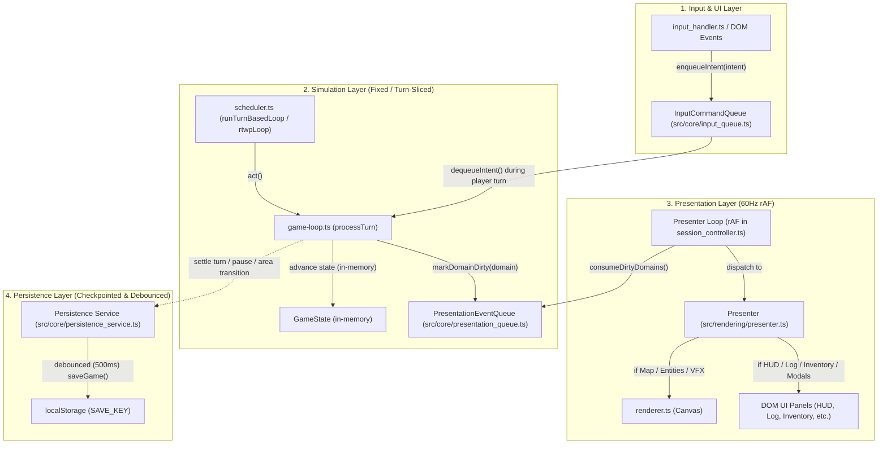

# Implementation Plan: Phase 11 — V2 Engine Decoupling

## Milestone 72: Decoupled Frame Loop, Message-Queue Glue & Debounced Persistence

**Phase:** 11 (V2 Engine Decoupling)  
**Milestone:** 72 (Decoupled Frame Loop, Message-Queue Glue & Debounced Persistence)  
**Governance:** [AGENTS.md](<AGENTS.md>), [docs/ARCHITECTURE.md](<docs/ARCHITECTURE.md>), [docs/MILESTONES.md](<docs/MILESTONES.md#L804-L836>), [docs/DECISIONS.md](<docs/DECISIONS.md#L49-L67>), [docs/research_notes.md](<docs/research_notes.md#L83-L177>)  
**Status:** Step 4 & 5 (Drafted & Enhanced with Concrete Code Snippets) — Awaiting User Approval (Gate 2)

---

## 0. Rules & Architectural Standards Reiteration

In accordance with [AGENTS.md](<AGENTS.md>) and [docs/ARCHITECTURE.md](<docs/ARCHITECTURE.md>), all Milestone 72 work enforces:
1. **Zero `any` Violations:** No `any` casts or untyped parameters; all queue items, domain bitmasks/sets, and persistence payloads use explicit interfaces, generics, or Discriminated Unions.
2. **Strict Seeded Determinism:** Never call `Math.random()` or `Date.now()` inside simulation logic. Queue processing and turn stepping rely exclusively on `rng` from [src/core/rng.ts](<src/core/rng.ts>) and deterministic turn counters (`globalTurn`). Performance timers (`performance.now()`) are restricted strictly to presentation/frame-rate metrics and debounce delays in UI/presentation adapters.
3. **Pure Serializable ECS State:** `GameState` remains 100% JSON-serializable. Transient message queues (`InputCommandQueue`, `PresentationEventQueue`) live in clean engine glue modules, avoiding un-serializable closures or callback references inside `GameState`.
4. **Strict Downward Dependency Hierarchy:**
   `session_controller / presenter → scheduler / game-loop → systems → rendering → core glue (input_queue, presentation_queue, persistence_service) → types / utils`.
   No circular dependencies or upward imports.
5. **Single Responsibility & ~250-Line Module Guideline:**
   - [src/core/input_queue.ts](<src/core/input_queue.ts>) (~70 LOC)
   - [src/core/presentation_queue.ts](<src/core/presentation_queue.ts>) (~120 LOC)
   - [src/core/persistence_service.ts](<src/core/persistence_service.ts>) (~95 LOC)
   - [src/rendering/presenter.ts](<src/rendering/presenter.ts>) (~150 LOC)
   - Decomposition of [src/core/session_controller.ts](<src/core/session_controller.ts>) from 631 LOC down to ~450 LOC.

---

## 1. High-Level Architecture & Seam Overview

Milestone 72 eliminates the root performance bottleneck where actor sub-steps (`processTurn` $\rightarrow$ `updateState`) synchronously trigger `saveGame()` (`JSON.stringify` + synchronous `localStorage.setItem`) and all 18 DOM panel and Canvas renders 50–100 times per turn or frame.



---

## 2. Detailed Task Breakdown & Code Snippets

### Task 0: Automated Standards Enforcement in ESLint & Tooling (`.eslintrc.cjs`)

**Goal:** Formally configure ESLint and static analysis tooling so the build and lint steps (`verify.bat`, `bun run lint`) automatically enforce the architectural standards established in [AGENTS.md](<AGENTS.md>) (zero `any`, seeded determinism, ~250 LOC guideline, and explicit function return types) rather than relying solely on manual discipline.

**Target File:** [`.eslintrc.cjs`](<.eslintrc.cjs>)

```javascript
module.exports = {
  root: true,
  env: { browser: true, es2020: true },
  extends: [
    'eslint:recommended',
    'plugin:@typescript-eslint/recommended'
  ],
  ignorePatterns: ['dist', '.eslintrc.cjs', 'vite.config.ts'],
  parser: '@typescript-eslint/parser',
  plugins: ['@typescript-eslint'],
  rules: {
    // 1. Zero 'any' policy (AGENTS.md Golden Rule 11)
    '@typescript-eslint/no-explicit-any': 'error',

    // 2. Unused variables & parameters hygiene
    '@typescript-eslint/no-unused-vars': [
      'warn',
      { argsIgnorePattern: '^_', varsIgnorePattern: '^_', destructuredArrayIgnorePattern: '^_' }
    ],

    // 3. Strict Seed Determinism (AGENTS.md Section 6): Ban Math.random() in favor of src/core/rng.ts
    'no-restricted-properties': [
      'error',
      {
        object: 'Math',
        property: 'random',
        message: 'Math.random() is banned for gameplay determinism. Use seeded rng from src/core/rng.ts.'
      }
    ],

    // 4. File Size Guideline (AGENTS.md Section 8): Warn when files exceed ~250-300 lines
    'max-lines': [
      'warn',
      { max: 300, skipBlankLines: true, skipComments: true }
    ],

    // 5. Explicit Return Types (AGENTS.md Section 3): Warn across codebase / error on core modules
    '@typescript-eslint/explicit-function-return-type': [
      'warn',
      { allowExpressions: true, allowTypedFunctionExpressions: true }
    ]
  },
  overrides: [
    {
      // Enforce strict explicit return types on engine core and systems
      files: ['src/core/**/*.ts', 'src/systems/**/*.ts'],
      rules: {
        '@typescript-eslint/explicit-function-return-type': [
          'error',
          { allowExpressions: true, allowTypedFunctionExpressions: true }
        ]
      }
    }
  ]
};
```

---

### Task 1: Input Command Queue (`src/core/input_queue.ts`)

**Goal:** Decouple DOM keyboard listeners and UI action buttons from immediate simulation stepping. Buffer player input intents in a FIFO queue that `game-loop.ts` consumes during scheduled player turns.

**New File:** `src/core/input_queue.ts` (~70 LOC)
```typescript
import type { Intent } from '../types/intent.types.ts';

/**
 * Asynchronous FIFO queue for player inputs, decoupling UI and keypress
 * capture from simulation stepping and turn execution.
 */
class InputCommandQueue {
  private queue: Intent[] = [];

  /**
   * Enqueues an intent into the FIFO buffer.
   */
  enqueue(intent: Intent): void {
    this.queue.push(intent);
  }

  /**
   * Dequeues the next intent to be processed by the player turn.
   */
  dequeue(): Intent | undefined {
    return this.queue.shift();
  }

  /**
   * Peeks at the next intent without removing it.
   */
  peek(): Intent | undefined {
    return this.queue[0];
  }

  /**
   * Checks whether the queue has pending intents.
   */
  hasPending(): boolean {
    return this.queue.length > 0;
  }

  /**
   * Returns the number of pending intents.
   */
  size(): number {
    return this.queue.length;
  }

  /**
   * Clears all pending intents (e.g. on game over, area change, or RTwP unpaused override).
   */
  clear(): void {
    this.queue = [];
  }

  /**
   * Replaces the current queue with a batch of intents (used by Replays).
   */
  loadIntents(intents: ReadonlyArray<Intent>): void {
    this.queue = [...intents];
  }
}

export const inputQueue = new InputCommandQueue();

export function enqueueIntent(intent: Intent): void {
  inputQueue.enqueue(intent);
}

export function dequeueIntent(): Intent | undefined {
  return inputQueue.dequeue();
}

export function peekIntent(): Intent | undefined {
  return inputQueue.peek();
}

export function hasPendingIntents(): boolean {
  return inputQueue.hasPending();
}

export function clearInputQueue(): void {
  inputQueue.clear();
}

export function loadInputQueue(intents: ReadonlyArray<Intent>): void {
  inputQueue.loadIntents(intents);
}

export function getInputQueueSize(): number {
  return inputQueue.size();
}
```

---

### Task 2: Presentation Event Queue & Selective Domain Dirty Tracking (`src/core/presentation_queue.ts`)

**Goal:** Decouple simulation state updates from UI/Canvas rendering. Categorize visual updates into granular dirty domains so that actor sub-steps flag dirty domains instead of triggering 18 DOM panel rebuilds.

**New File:** `src/core/presentation_queue.ts` (~120 LOC)
```typescript
import type { GameState } from '../types/game-state.types.ts';

/**
 * Granular UI & rendering domains tracked for selective frame presentation.
 */
export enum PresentationDomain {
  Map = 'Map',             // Canvas map tiles, fog of war, camera scrolling
  Entities = 'Entities',   // Canvas visible entities, animations
  HUD = 'HUD',             // Player stats, HP, energy, turns, RTwP controls
  Log = 'Log',             // Message log panel
  Inventory = 'Inventory', // Inventory, equipment panel
  Modals = 'Modals',       // Dialogues, verb menu, targeting, inspect, dossiers, factions, quests
  Editor = 'Editor',       // Campaign creator and area editor views
  Debug = 'Debug',         // Debug overlay, historical ledger UI
  VFX = 'VFX'              // Ephemeral visual effects, floating text
}

export interface PresentationEvent {
  readonly type: 'floating_text' | 'screen_shake' | 'sound_cue';
  readonly payload: unknown;
}

class PresentationEventQueue {
  private dirtyDomains = new Set<PresentationDomain>();
  private events: PresentationEvent[] = [];

  /**
   * Flags a specific domain for redraw on the next presentation frame.
   */
  markDirty(domain: PresentationDomain): void {
    this.dirtyDomains.add(domain);
  }

  /**
   * Flags all domains for redraw (e.g. initial load, area transitions, UI mode switches).
   */
  markAllDirty(): void {
    for (const domain of Object.values(PresentationDomain)) {
      this.dirtyDomains.add(domain);
    }
  }

  /**
   * Returns whether a given domain is currently marked dirty.
   */
  isDirty(domain: PresentationDomain): boolean {
    return this.dirtyDomains.has(domain);
  }

  /**
   * Returns the set of dirty domains and clears the internal tracking set.
   */
  consumeDirtyDomains(): ReadonlySet<PresentationDomain> {
    const current = new Set(this.dirtyDomains);
    this.dirtyDomains.clear();
    return current;
  }

  /**
   * Pushes a transient visual event to be presented on the next frame.
   */
  pushEvent(event: PresentationEvent): void {
    this.events.push(event);
  }

  /**
   * Consumes all pending presentation events.
   */
  consumeEvents(): ReadonlyArray<PresentationEvent> {
    const list = this.events;
    this.events = [];
    return list;
  }

  /**
   * Computes dirty domains based on reference equality between previous and next GameState.
   */
  markDirtyFromStateDiff(prev: GameState | null, next: GameState): void {
    if (!prev) {
      this.markAllDirty();
      return;
    }

    if (
      prev.map !== next.map ||
      prev.cachedFov !== next.cachedFov ||
      prev.isRotated !== next.isRotated ||
      prev.is3D !== next.is3D ||
      prev.zoomLevel !== next.zoomLevel ||
      prev.currentAreaId !== next.currentAreaId
    ) {
      this.markDirty(PresentationDomain.Map);
    }

    if (
      prev.components !== next.components ||
      prev.entities !== next.entities ||
      prev.spatialIndex !== next.spatialIndex
    ) {
      this.markDirty(PresentationDomain.Entities);
      this.markDirty(PresentationDomain.HUD);
    }

    if (prev.messages !== next.messages) {
      this.markDirty(PresentationDomain.Log);
    }

    if (prev.uiMode !== next.uiMode) {
      this.markDirty(PresentationDomain.Modals);
      this.markDirty(PresentationDomain.HUD);
      this.markDirty(PresentationDomain.Editor);
    }

    if (
      prev.activeDialogue !== next.activeDialogue ||
      prev.verbMenu !== next.verbMenu ||
      prev.targetingMode !== next.targetingMode ||
      prev.inspectMode !== next.inspectMode ||
      prev.activeTrade !== next.activeTrade ||
      prev.activeService !== next.activeService
    ) {
      this.markDirty(PresentationDomain.Modals);
    }

    if (prev.rtwpState !== next.rtwpState || prev.globalTurn !== next.globalTurn) {
      this.markDirty(PresentationDomain.HUD);
    }

    if (prev.visualEffects !== next.visualEffects) {
      this.markDirty(PresentationDomain.VFX);
    }
  }
}

export const presentationQueue = new PresentationEventQueue();

export function markDomainDirty(domain: PresentationDomain): void {
  presentationQueue.markDirty(domain);
}

export function markAllDomainsDirty(): void {
  presentationQueue.markAllDirty();
}

export function isDomainDirty(domain: PresentationDomain): boolean {
  return presentationQueue.isDirty(domain);
}

export function consumeDirtyDomains(): ReadonlySet<PresentationDomain> {
  return presentationQueue.consumeDirtyDomains();
}

export function markDirtyFromStateDiff(prev: GameState | null, next: GameState): void {
  presentationQueue.markDirtyFromStateDiff(prev, next);
}

export function pushPresentationEvent(event: PresentationEvent): void {
  presentationQueue.pushEvent(event);
}

export function consumePresentationEvents(): ReadonlyArray<PresentationEvent> {
  return presentationQueue.consumeEvents();
}
```

---

### Task 3: Debounced & Checkpointed Persistence Service (`src/core/persistence_service.ts`)

**Goal:** Eliminate synchronous `saveGame()` and `saveCurrentReplay()` calls from hot actor sub-steps in `updateState()`. Provide safe debounced saves and transactional checkpointing on turn settlement, RTwP pause, area transitions, and window exit.

**New File:** `src/core/persistence_service.ts` (~95 LOC)
```typescript
import type { GameState } from '../types/game-state.types.ts';
import { UIMode } from '../types/game-state.types.ts';
import { saveGame } from './save.ts';
import { saveCurrentReplay } from './replay.ts';

class PersistenceService {
  private pendingState: GameState | null = null;
  private debounceTimer: ReturnType<typeof setTimeout> | null = null;
  private readonly defaultDebounceMs = 500;

  /**
   * Schedules a debounced save of the GameState. Cancels any previously pending timer.
   */
  scheduleDebouncedSave(state: GameState, delayMs: number = this.defaultDebounceMs): void {
    if (state.isSandbox || state.uiMode !== UIMode.Game) return;
    this.pendingState = state;

    if (this.debounceTimer !== null) {
      clearTimeout(this.debounceTimer);
    }

    this.debounceTimer = setTimeout(() => {
      this.flushPendingSave();
    }, delayMs);
  }

  /**
   * Immediately saves the GameState as a transactional checkpoint (e.g. turn settle, pause, area change).
   */
  saveCheckpoint(state: GameState): void {
    if (state.isSandbox) return;
    this.cancelPendingSave();
    saveGame(state);
  }

  /**
   * Flushes any pending debounced save immediately to localStorage.
   */
  flushPendingSave(): void {
    if (this.debounceTimer !== null) {
      clearTimeout(this.debounceTimer);
      this.debounceTimer = null;
    }
    if (this.pendingState !== null) {
      const stateToSave = this.pendingState;
      this.pendingState = null;
      saveGame(stateToSave);
    }
  }

  /**
   * Cancels any pending scheduled save without writing.
   */
  cancelPendingSave(): void {
    if (this.debounceTimer !== null) {
      clearTimeout(this.debounceTimer);
      this.debounceTimer = null;
    }
    this.pendingState = null;
  }

  /**
   * Checkpoints game over and flushes replay buffer.
   */
  checkpointGameOver(state: GameState): void {
    this.cancelPendingSave();
    saveCurrentReplay();
    saveGame(state);
  }

  /**
   * Whether a debounced save is currently pending in the timer queue.
   */
  hasPendingSave(): boolean {
    return this.pendingState !== null;
  }
}

export const persistenceService = new PersistenceService();

export function scheduleDebouncedSave(state: GameState, delayMs?: number): void {
  persistenceService.scheduleDebouncedSave(state, delayMs);
}

export function saveCheckpoint(state: GameState): void {
  persistenceService.saveCheckpoint(state);
}

export function flushPendingSave(): void {
  persistenceService.flushPendingSave();
}

export function cancelPendingSave(): void {
  persistenceService.cancelPendingSave();
}

export function checkpointGameOver(state: GameState): void {
  persistenceService.checkpointGameOver(state);
}
```

---

### Task 4: Presenter Module & Domain Dispatch (`src/rendering/presenter.ts`)

**Goal:** Extract the 18-panel DOM and Canvas rendering dispatch out of `session_controller.ts` into a cohesive presenter module. Executes only the DOM renderers whose domains are marked dirty.

**New File:** `src/rendering/presenter.ts` (~150 LOC)
```typescript
import type * as ROT from 'rot-js';
import type { GameState } from '../types/game-state.types.ts';
import { UIMode } from '../types/game-state.types.ts';
import { PresentationDomain } from '../core/presentation_queue.ts';
import { render } from './renderer.ts';
import { renderMessageLog } from './ui/message_log.ui.ts';
import { renderPlayerStats } from './ui/player_stats.ui.ts';
import { renderInventoryPanel } from './ui/inventory.ui.ts';
import { renderMenus } from './ui/menus.ui.ts';
import { updateHUD } from './ui/hud.ui.ts';
import { renderRTwPControls } from './ui/rtwp_controls.ui.ts';
import { renderViewControls } from './ui/view_controls.ui.ts';
import { renderSettingsMenu } from './ui/settings.ui.ts';
import { renderFactionsPanel } from './ui/factions.ui.ts';
import { renderDialoguePanel } from './ui/dialogue.ui.ts';
import { renderQuestJournal } from './ui/quests.ui.ts';
import { renderInvestigationBoard } from './ui/investigation.ui.ts';
import { renderDebugOverlay } from './ui/debug.ui.ts';
import { renderVerbMenu } from './ui/verb_menu.ui.ts';
import { renderDossierUI } from './ui/dossier.ui.ts';
import { renderDebugLedgerUI } from './ui/debug_ledger.ui.ts';
import { renderEditorUI } from './editor_ui.ts';
import type { CampaignEditor } from '../editor/campaign_editor.ts';
import { hasSaveGame } from '../core/save.ts';

/**
 * Selectively renders only the visual and DOM domains that have been marked dirty.
 */
export function renderPresenterFrame(
  display: ROT.Display,
  state: GameState,
  globalCampaignEditor: CampaignEditor,
  dirtyDomains: ReadonlySet<PresentationDomain>
): void {
  if (dirtyDomains.size === 0) return;

  const gameLayout = document.getElementById('game-layout');
  const editorLayout = document.getElementById('editor-layout');

  if (state.uiMode === UIMode.Editor) {
    if (gameLayout) gameLayout.classList.add('hidden');
    if (editorLayout) editorLayout.classList.remove('hidden');
    if (dirtyDomains.has(PresentationDomain.Editor) || dirtyDomains.has(PresentationDomain.Modals)) {
      renderEditorUI(state, globalCampaignEditor);
    }
    return;
  }

  if (gameLayout) gameLayout.classList.remove('hidden');
  if (editorLayout) editorLayout.classList.add('hidden');

  // Canvas Viewport Redraw (Map / Entities / Visual Effects)
  if (
    dirtyDomains.has(PresentationDomain.Map) ||
    dirtyDomains.has(PresentationDomain.Entities) ||
    dirtyDomains.has(PresentationDomain.VFX)
  ) {
    render(display, state);
  }

  // HUD & Stats Panels
  if (dirtyDomains.has(PresentationDomain.HUD)) {
    renderPlayerStats(state);
    updateHUD(state);
    renderRTwPControls(state);
    renderViewControls(state);
    renderMenus(state, hasSaveGame());
  }

  // Message Log
  if (dirtyDomains.has(PresentationDomain.Log)) {
    renderMessageLog(state);
  }

  // Inventory & Equipment
  if (dirtyDomains.has(PresentationDomain.Inventory)) {
    renderInventoryPanel(state);
  }

  // Modals & Overlays
  if (dirtyDomains.has(PresentationDomain.Modals)) {
    renderDialoguePanel(state);
    renderVerbMenu(state);
    renderSettingsMenu(state);
    renderFactionsPanel(state);
    renderQuestJournal(state);
    renderInvestigationBoard(state);
    renderDossierUI(state);
  }

  // Debug Overlays
  if (dirtyDomains.has(PresentationDomain.Debug)) {
    renderDebugOverlay(state);
    renderDebugLedgerUI(state);
  }
}
```

---

### Task 5: Game Loop Refactoring (`src/core/game-loop.ts`)

**Goal:** 
1. Remove direct `saveGame()` from `updateState()`.
2. Connect `queuePlayerIntent()` and `processTurn()` to `input_queue.ts`.
3. Mark dirty domains via `markDirtyFromStateDiff()` on state transitions.
4. Save checkpoints on player turn settle, area transitions, and game over.

**Diff in `src/core/game-loop.ts`:**
```typescript
import {
  enqueueIntent,
  dequeueIntent,
  hasPendingIntents,
  clearInputQueue
} from './input_queue.ts';
import {
  markDirtyFromStateDiff,
  markDomainDirty,
  PresentationDomain
} from './presentation_queue.ts';
import {
  scheduleDebouncedSave,
  saveCheckpoint,
  checkpointGameOver
} from './persistence_service.ts';

// In updateState():
function updateState(newState: GameState): void {
  const prevState = currentState;
  currentState = newState;

  // Mark dirty domains for the 60Hz presenter pass
  markDirtyFromStateDiff(prevState, newState);

  // Checkpoint on Game Over
  if (newState.isGameOver && prevState && !prevState.isGameOver) {
    checkpointGameOver(newState);
  } else if (newState.uiMode === UIMode.Game) {
    // Debounce save for continuous gameplay mutations
    scheduleDebouncedSave(newState);
  }

  if (stateChangeCallback) {
    stateChangeCallback(newState);
  }
}

// In queuePlayerIntent():
export function queuePlayerIntent(intent: Intent): void {
  const state = getGameState();
  if (state.isGameOver) return;

  recordIntent(intent);

  const isImmediate = 'isImmediate' in intent && intent.isImmediate;
  if (isImmediate) {
    const result = applyIntentWithCost(state, intent);
    updateState(result.state);
    return;
  }

  if (state.engineMode === EngineMode.RTwP && !state.rtwpState.paused) {
    clearInputQueue();
    enqueueIntent(intent);
  } else {
    enqueueIntent(intent);
  }

  if (state.engineMode === EngineMode.TurnBased) {
    unlockEngine();
  }
}

// In processTurn(entityId: EntityId):
// When entity is the Player:
if (isPlayer) {
  if (hasPendingIntents()) {
    const intent = dequeueIntent();
    if (intent) {
      try {
        const result = applyIntentWithCost(state, intent);
        let nextState = result.state;

        if (result.energyCost > 0) {
          nextState = processHungerTick(nextState, entityId, result.energyCost);
          setTurnDuration(result.energyCost);
        } else {
          setTurnDuration(0);
        }

        if (nextState !== state) {
          nextState = updateExploredTiles(nextState);
          updateState(nextState);
          // Checkpoint persistence at player turn settlement
          saveCheckpoint(nextState);
        }
      } catch (e) {
        console.error('Error applying player intent:', e);
        setTurnDuration(0);
      }
    }
  } else {
    if (state.engineMode === EngineMode.TurnBased) {
      lockEngine();
    }
  }
}
```

---

### Task 6: Session Controller & 60Hz Presenter Loop Integration (`src/core/session_controller.ts`)

**Goal:**
1. Replace synchronous 18-panel execution in `bindStateSubscription()` with lightweight focus and campaign layout synchronization.
2. Replace `startGlobalUILoop()` with a unified 60Hz presenter loop that checks `consumeDirtyDomains()` and purges expired VFX without triggering state/save cascades.
3. Attach `beforeunload` listener to flush pending saves.
4. Reduce `session_controller.ts` LOC from 631 down to ~450.

**Diff in `src/core/session_controller.ts`:**
```typescript
import {
  consumeDirtyDomains,
  markAllDomainsDirty,
  markDomainDirty,
  PresentationDomain
} from './presentation_queue.ts';
import { renderPresenterFrame } from '../rendering/presenter.ts';
import { flushPendingSave } from './persistence_service.ts';

// In bindStateSubscription:
export function bindStateSubscription(display: ROT.Display, globalCampaignEditor: CampaignEditor): void {
  onStateChange((newState: GameState) => {
    if (lastKnownState && newState.campaignId !== lastKnownState.campaignId) {
      const basePath = `${import.meta.env.BASE_URL}data/campaigns/${newState.campaignId}`;
      configureDisplayForCampaign(display, newState.campaign, basePath)
        .then(() => {
          syncFogOverlayCanvas(newState.campaign);
          syncDisplayLayout(display, newState);
          markAllDomainsDirty();
        })
        .catch(console.error);
    }

    if (lastKnownState && newState.zoomLevel !== lastKnownState.zoomLevel) {
      syncDisplayLayout(display, newState);
      markDomainDirty(PresentationDomain.Map);
    }
    lastKnownState = newState;

    if (newState.uiMode !== currentFocusMode) {
      if (activeFocusCleanup) {
        activeFocusCleanup();
        activeFocusCleanup = null;
      }
      currentFocusMode = newState.uiMode;
      // Focus trapping logic...
    }
  });
}

// Consolidated 60Hz Presenter Loop:
export function startGlobalPresenterLoop(display: ROT.Display, globalCampaignEditor: CampaignEditor): void {
  function presenterLoop(): void {
    requestAnimationFrame(presenterLoop);
    const currentState = getGameState();
    if (!currentState) return;

    // Check transient visual effect expiration without triggering setGameState / saveGame
    const now = performance.now();
    if (currentState.visualEffects.some((e) => now > e.expiresAt)) {
      const nextEffects = currentState.visualEffects.filter((e) => now <= e.expiresAt);
      setGameState({ ...currentState, visualEffects: nextEffects });
      markDomainDirty(PresentationDomain.VFX);
    }

    const dirtyDomains = consumeDirtyDomains();
    if (dirtyDomains.size === 0) return;

    const renderTime0 = performance.now();
    renderPresenterFrame(display, currentState, globalCampaignEditor, dirtyDomains);
    perfTracker.lastRenderTimeMs = performance.now() - renderTime0;
  }

  requestAnimationFrame(presenterLoop);
}

// In initSession:
// Hook window beforeunload to flush saves
window.addEventListener('beforeunload', () => {
  flushPendingSave();
});
// Start unified 60Hz presenter loop
startGlobalPresenterLoop(display, globalCampaignEditor);
```

---

### Task 7: Scheduler & Replay Integration (`src/core/scheduler.ts`, `src/core/replay.ts`)

**Goal:**
1. In `src/core/scheduler.ts`: When `switchEngineMode()` or pause occurs, trigger `saveCheckpoint(getGameState())` to guarantee immediate persistence upon pause.
2. In `src/core/replay.ts`: Load replay intents directly into `loadInputQueue(replay.intents)`.

---

## 3. Verification Strategy & Acceptance Criteria

### Automated Verification:
1. `bun x tsc --noEmit --ignoreDeprecations 6.0`: Strict compiler pass with 0 errors across all 130+ modules.
2. `bun run validate:campaigns`: Complete Zod schema and cross-reference validation passing for `default`, `megacampaign`, and `shroudgarde` (3/3 passed, 0 errors, 0 warnings).

### Manual Playtest Scenarios:
1. **Turn-Based Input Responsiveness:**
   - Launch `default` campaign. Move with arrow/numpad keys. Observe that exploration, combat, and message logging update cleanly at 60 FPS without UI stutter.
   - Inspect browser console: verify zero `localStorage.setItem` calls during rapid movement until player turns settle or debounced timer expires.
2. **RTwP Mode & Pause Checkpoint:**
   - Press `Tab` to switch to RTwP. Observe uninterrupted continuous simulation.
   - Press `Space` to pause: verify state immediately checkpoints to `localStorage`.
   - Reload the browser tab: verify resume from exact paused position with complete inventory, stats, and area state.
3. **Replay Determinism:**
   - Execute a sequence of moves and save replay. Play back replay: verify `loadInputQueue()` seamlessly drives playback without desync.

---

## 4. Gate 2 Approval Request

This implementation plan conforms strictly to [AGENTS.md](<AGENTS.md>), [docs/ARCHITECTURE.md](<docs/ARCHITECTURE.md>), and [docs/DECISIONS.md](<docs/DECISIONS.md>).
**Awaiting User Approval (Gate 2)** to begin code implementation.
