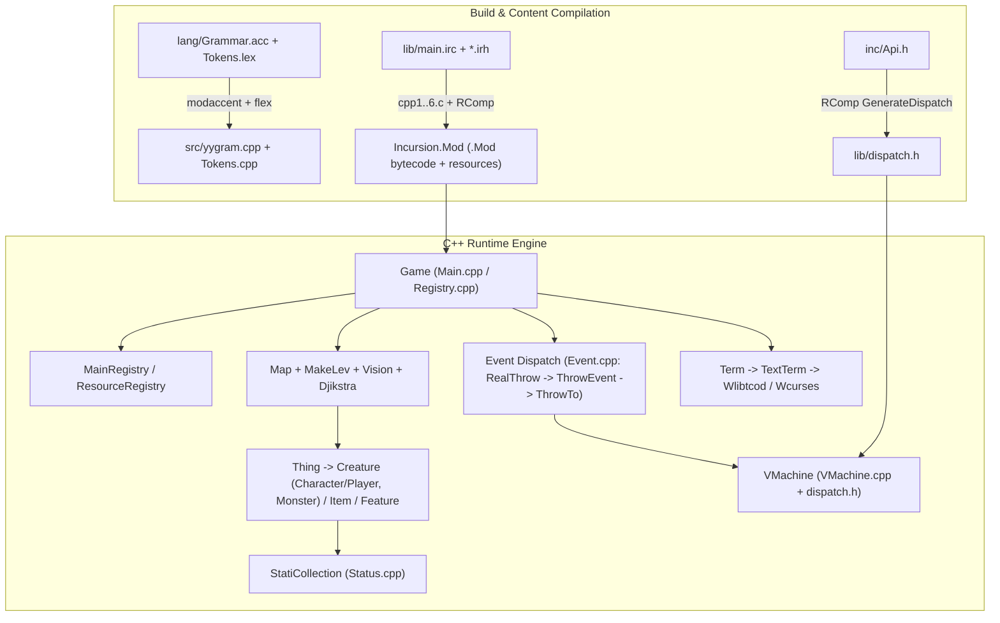

# Incursion Roguelike — Single Source of Truth (SSOT) Architecture & Module Map

*Analyzed from cloned repository [`temp/incursion-roguelike`](file:///export/DownloadsSSD/Projects/Game%20Dev/rogue-like/temp/incursion-roguelike) (`VERSION_STRING "0.6.9Y19"`, originally authored by Julian Mensch, maintained by Richard Tew).*

> [!NOTE]
> Every file path, symbol name, constant, class hierarchy, and subsystem boundary in this document is verified directly from the C/C++ headers (`inc/`, 23 files), source files (`src/`, 56 files), compiler grammar (`lang/`), and IncursionScript libraries (`lib/`, 29 files).

---

## 1. High-Level Architecture Overview

Incursion is a C++17 (historically Win32/C++98-era) d20/D&D-inspired roguelike built around three tightly integrated architectural pillars:

1. **Unified Handle-Based Object & Serialization Model (`Object` + `Registry` + `hObj` / `rID`)** — All runtime entities (`Map`, `Thing`, `Creature`, `Player`, `Monster`, `Item`, `Feature`, `Annotation`) inherit from `Object` and are tracked via 32-bit `hObj` handles in `Registry::ObjTable[65536]`, enabling deterministic save/load archives via `CFile` (RLE/LZ compressed).
2. **Stati-Driven Modifier & Component Architecture (`StatiCollection` + `TargetSystem`)** — Instead of per-feature subclassing, temporary/permanent buffs, maladies, templates, polymorph forms, feat exceptions, and item qualities live as sorted `Status` entries in `Thing::__Stati`, indexed in $O(1)$ by nature (`Idx[LAST_STATI]`) with cross-entity provenance (`backRefs`).
3. **IncursionScript Bytecode VM & Event-Hook Dispatch (`RComp` + `VMachine` + `EventInfo`)** — Game content (races, classes, prestige classes, spells, deities, monsters, templates, rooms, encounters, traps) is compiled from `.irc`/`.irh` scripts into binary `.Mod` modules containing bytecode executed by `VMachine` and invoked across a 3-phase (`PRE` / Base / `POST`) + observer (`META` / `GODWATCH` / `EVICTIM` / `EITEM`) event pipeline.



---

## 2. Repository Layout & Build Pipeline

| Directory / File | Role |
| :--- | :--- |
| `inc/` (23 files) | Master headers, shared C++/IncursionScript constants (`Defines.h`), class declarations, inline helpers (`Inline.h`), and script API surface (`Api.h`). |
| `src/` (56 files) | 48 `.cpp` files (4 of which are 0-byte stubs: `CalcVal.cpp`, `OverGen.cpp`, `Overland.cpp`, `Quest.cpp`) + 8 `.c` files (`cpp1.c`–`cpp6.c`, `lz.c`, `rle.c`). |
| `lang/` (2 files) | IncursionScript lexer (`Tokens.lex`) and ACCENT grammar (`Grammar.acc`). |
| `lib/` (29 files) | Core module script (`main.irc`), 26 `.irh` content libraries (`new.irh` is 0 bytes), `module-example.irc`, and code-generated `dispatch.h`. |
| `modaccent/` | Modified ACCENT compiler-compiler C source used to generate `src/yygram.cpp` and `inc/yygram.h`. |
| `docs/` | `incursionscript.md`, `modules.md`, `reference.md`, `Notes.txt`. |
| `build.sh` | Linux g++ (`-std=c++17 -O2 -DLIBTCOD_TERM`) build compiling `src/*.cpp` + `libtcod/src/*.{c,cpp}` against SDL2. |
| `build.bat` | Windows MSVC build (`Win32`/`x64`, `Debug`/`Release`). Debug builds `modaccent.exe`, regenerates lexer/parser, and includes `cpp*.c`, `RComp.cpp`, and `Art.cpp`. Release excludes the compiler/preprocessor (`findstr /v /i "cpp.*\.c yygram.cpp tokens.cpp"`). Produces `IncursionLibtcod.exe` (`Wlibtcod.cpp`) and optionally `IncursionCurses.exe` (`Wcurses.cpp`). |

---

## 3. Complete File-by-File Module Inventory & Ownership Boundaries

### 3.1 Header Files (`inc/`, 23 files)

| File | Canonical Responsibility & Key Symbols |
| :--- | :--- |
| `inc/Incursion.h` | Master include hub enforcing header dependency order (`Defines.h` -> `Globals.h` -> `Base.h` -> `Target.h` -> `RComp.h` -> `Events.h` -> `Magic.h` -> `Res.h` -> `Map.h` -> `Creature.h` -> `Item.h` -> `Feature.h` -> `Term.h` -> `Inline.h`). Defines `VISION`, `BYTECODE_TRACER`, and POSIX aliases. |
| `inc/Defines.h` | 4,705 lines of shared C++ & IncursionScript constants (`#ifndef ICOMP` guards C++-only definitions): `VERSION_STRING` (`"0.6.9Y19"`), `OBJ_TABLE_SIZE` (`65536`), `EVENT_STACK_SIZE` (`128`), `MAX_CHAR_LEVEL` (`11`), `T_*` object/resource IDs, `EV_*`/`MSG_*`, `PRE`/`POST`/`EVICTIM`/`EITEM`/`META`/`GODWATCH`, `A_*` attributes/derived stats, `BONUS_*` stacking buckets, `SK_*` skills, `FT_*` feats, `MM_*` metamagic flags, `SP_*` spell sources, `AD_*` damage types, `MA_*` monster types, `OPT_*` options, `TC_*` text codes, and VM opcodes (`JUMP`..`LAST`). |
| `inc/Globals.h` | External table & global function declarations: MT19937 PRNG (`init_genrand`, `genrand_int32`), math (`random`, `dist`, `DirTo`), `Throw*` dispatchers, tables (`SkillInfo`, `FeatInfo`, `ExperienceChart`, `SpellTable`, `BonusSpells`, `EncumbranceTable`, `WealthByLevel`, `FaceRadius`, `NeededSwings`, `SpecialistTable`, `OptionList`, `YuseCommands`, `__SAL`), `RInf`, `GodIDList`, `T1`. |
| `inc/Base.h` | Foundation containers (`Array`, `NArray`, `OArray`, `Dictionary`), value types (`Dice`, `String`, `MVal`, `Rect`, `Fraction`), `Object` root class (`Type`, `myHandle`, RTTI `isType`, placement-`new` vptr reinit, `ARCHIVE_CLASS`/`END_ARCHIVE`), and `Registry` (`ObjTable`, `DataTable`, `Groups`, `SaveGroup`, `LoadGroup`). |
| `inc/Target.h` | AI targeting & hostility provenance: `HostilityWhy`, `TargetWhy`, `Target`, `TargetType`, and `TargetSystem` (`Retarget`, `Consider`, `Wanderlust`, `HearNoise`, `ItHitMe`, `Liberate`, `TurnHostileTo`, `TurnNeutralTo`, `Pacify`, `ForgetOrders`). |
| `inc/RComp.h` | IncursionScript compiler IR & bytecode layout: `btype`, `DT_*`, `RT_*`, `sys_*`, packed 32-bit `VCode` (`Opcode:6`, `Param1:10`, `P1Type:3`, `Param2:10`, `P2Type:3`), `Binding` subclasses (`BSysFunc`, `BMemFunc`, `BResFunc`, `BMemVar`, `BResMem`), `SymbolTable`, `VBlock`, `PExp`, `LExp`. |
| `inc/Events.h` | `EvParam` union, `EMatch`/`EVerify`, event helper macros (`PEVENT`, `DAMAGE`, `THROW`), and `EventInfo` (15 name-assembly `String`s, 24 total managed `String`s, `p[5]` aliases `EActor`/`EVictim`/`EItem`/`EWeapon`, `EMap`, `EField`, `EMagic`, encounter/generation context). |
| `inc/Magic.h` | `Magic` mixin class (inherited by `Creature` and `Item`): targeting/AoE delivery (`ABallBeamBolt`, `PredictVictimsOfBallBeamBolt`, `ATouch`, `AGlobe`, `AField`, `ABarrier`), strike pipeline (`isTarget`, `CalcEffect`, `MagicEvent`, `MagicStrike`, `MagicHit`, `MagicXY`), and `EA_*` archetype handlers (`Blast` through `Shield`). |
| `inc/Res.h` | Resource lookup macros (`RES`, `TMON`, `TITEM`, `TEFF`, ..., `NAME`, `DESC`, `FIND`), `VMachine`, `Breakpoint`, `DebugInfo`, `TAttack`, `EffectValues`, `Annotation`, `Resource` + 21 resource subclasses (`TMonster`, `TItem`, `TFeature`, `TEffect`, `TArtifact`, `TQuest`, `TDungeon`, `TRoutine`, `TNPC`, `TClass`, `TRace`, `TDomain`, `TGod`, `TRegion`, `TTerrain`, `TText`, `TVariable`, `TTemplate`, `TFlavor`, `TBehaviour`, `TEncounter`), `Module`, `Game`, and player knowledge structs (`MonMem`, `ItemMem`, `EffMem`, `RegMem`). |
| `inc/Map.h` | Spatial & entity primitives: `LocationInfo` bitfield tile, `VI_*` flags, `Field`, `Overlay`, `MTerrain`, `TerraRecord`, `EncMember`, `Map : public Object`, `Status` & `StatiCollection` (+ `StatiIter*` / `Stati_RemoveInline*` / `backRefs` helpers), and `Thing : public Object`. |
| `inc/Creature.h` | `Creature : public Thing, public Magic`, `Character : public Creature`, `Player : public Character`, `Monster : public Creature`, plus `ActionInfo`, `EffectInfo`, `YuseCommand`, `SkillInfoStruct`, `AbilityInfoStruct`, `AlignmentInfoStruct`, `LearnableSpell`, `History`, `JournalInfoType`, `LevelTimeInfo`/`GameTimeInfoType`, `Perk*`, `Response`, `ReincarnationInfo`. |
| `inc/Item.h` | Material helpers (`MaterialHardness`, `MaterialIsMetallic/Wooden/Organic/Corporeal`), `Item : public Thing, public Magic`, `QItem`, `Food`, `Corpse`, `Container`, `Weapon`, `Coin`, `Armour`, `ItemGen`, and extern item-gen tables (`DungeonItems`, `MonsterItems`, `IllusionItems`, `ChestItems`, `MageItems`, `StapleItems`). |
| `inc/Feature.h` | `Feature : public Thing`, `Door : public Feature`, `Trap : public Feature`, `Portal : public Feature`. |
| `inc/Term.h` | `Term` abstract UI/IO contract, `TextWin`, `TextTerm : public Term`, `CFile` compressed archive wrapper, and `KY_*` / `BOX_*` constants. |
| `inc/Inline.h` | Inline methods for `String`, `random`, `LevelAdjust`, `Lookup*`, `dist`, `Thing::HasStati`/`HasEffStati`, `Creature::SavingThrow`, `Map::FieldAt`/`FieldGlyph`, `Resource::Annot`, `Object`, `Game::StopTime`, `XCR`/`XCRtoCR`. |
| `inc/Api.h` | Script-exposed C-like API declarations (`system T_*` classes, methods, properties, globals) parsed by `Grammar.acc` to codegen `lib/dispatch.h`. |
| `inc/ArmourTab.h` | Static 2D lookup tables `ArmourTable[33][16]` (percentage DR) and `AbsorbTable[17][16]` (complete blow negation chance). |
| `inc/ConstNam.h` | Stringified constant name tables (`EV_CONSTNAMES`, `GLYPH_CONSTNAMES`, `MTypeNames`, `FileErrors`, etc.) for diagnostics and reflection. |
| `inc/yygram.h` | ACCENT-generated parser token definitions & `YYSTYPE`. |
| `inc/cpp.h`, `inc/cppdef.h` | Decus C preprocessor headers for IncursionScript compilation. |
| `inc/lz.h`, `inc/rle.h` | Compression function declarations for `CFile`. |

---

### 3.2 Source Modules (`src/`, 56 files)

| Domain | Files | Canonical Responsibility & Key Entry Points |
| :--- | :--- | :--- |
| **Core, Memory, Save/Load, Resources** | `Main.cpp`, `Base.cpp`, `Registry.cpp`, `Res.cpp`, `Annot.cpp`, `Debug.cpp`, `Tables.cpp`, `lz.c`, `rle.c` | `Game::NewGame`/`Play`/`StartMenu` & balance suites (`Main.cpp`); `Array`/`String`/`Dice`/MT19937 (`Base.cpp`); `MainRegistry`/`ResourceRegistry`, `SaveGame`/`LoadGame`, `SaveModule`/`LoadModules` (`Registry.cpp`); `Module::GetResource`, `RandomResource`, `GetMemory` (`Res.cpp`); `Annotation` queries, `GrantGear`, `Resource::Event` (`Annot.cpp`); `DEBUG_MEMORY_CORRUPTION`, `TestEncounterGen`, `WizardOptions` (`Debug.cpp`); static D&D lookup tables (`Tables.cpp`); LZ77 & RLE codecs (`lz.c`, `rle.c`). |
| **Events & Stati/Fields** | `Event.cpp`, `Status.cpp` | `RealThrow` (`PRE` -> base -> `POST`), `ThrowEvent`, `ThrowTo`, `ReThrow`, `RedirectEff`, `Throw*` family, `InitGodArrays` (`Event.cpp`); `StatiCollection` (`UpdateStati`, `GainTempStati`, `GainPermStati`, `_FixupStati`, `CleanupRefedStati`), `Creature`/`Item` `StatiOn`/`Off`, and spatial `Map::UpdateFields`/`NewField`/`MoveField` (`Status.cpp`). |
| **World, Map Gen, FOV, Pathfinding** | `MakeLev.cpp`, `Display.cpp`, `Vision.cpp`, `Djikstra.cpp`, `Encounter.cpp` | 7-step procedural dungeon generator (`Map::Generate`, `LoadFixedMap`, 32-mode `DrawPanel`, `WriteStreamer`, `FurnishArea`, `FloodConnectA/B`, `calcLight` in `MakeLev.cpp`); grid placement & turn tick loop (`PlaceAt`, `Thing::Move`, `DoTurn`, `DestroyQueue` in `Display.cpp`); LOS/LOF/perception (`LineOfSight`, `LineOfFire`, `Player::CalcVision`, `Creature::Perceives` in `Vision.cpp`); `PQueue`, `ShortestPath`, `RunOver` (`Djikstra.cpp`); weighted XCR encounter director (`enGenerate`, `thEnGen*`, `enAddTemp`, `enAddMountTemp` in `Encounter.cpp`). |
| **Actors, Stats, Movement, Combat** | `Creature.cpp`, `Values.cpp`, `Move.cpp`, `Fight.cpp`, `Monster.cpp`, `Target.cpp`, `Player.cpp`, `Create.cpp` | `Creature` lifecycle, `Exercise`/`Abuse`, `isFlanking`, `Encumbrance`, `SavingThrow` (`Creature.cpp`); `StackBonus` (39 bonus buckets), `CalcValues`, `CalcHP`, `CalcSP`, `GetBAB`, `isMType` (`Values.cpp`); `Creature::Walk`, `TerrainEffects`, climbing/jumping (`Move.cpp`); `WAttack`, `NAttack`, maneuvers, AoOs, crits/fumbles, armour DR/coverage, incorporeal/illusion damage (`Fight.cpp`); priority-scored monster AI (`Monster::ChooseAction`, `Inventory`, `betterFor` in `Monster.cpp`); `TargetSystem` (`Retarget`, `ItHitMe`, `Consider` in `Target.cpp`); `Player::ChooseAction` & `Options.Dat` (`Player.cpp`); chargen, rolling/point-buy/perks, multiclassing, `AdvanceLevel`, reincarnation (`Create.cpp`). |
| **Magic, Items, Features, Skills, Religion, Social** | `Magic.cpp`, `Effects.cpp`, `Item.cpp`, `Inv.cpp`, `Feature.cpp`, `Skills.cpp`, `Prayer.cpp`, `Social.cpp` | Mana casting, concentration, counterspell, scrolls/potions/wands (`Magic.cpp`); `EA_*` spell effect archetypes, dispel, polymorph/shapeshift, summoning (`Effects.cpp`); `Item`/`Weapon`/`Armour`/`Container`/`Food`/`Corpse` (`Item.cpp`); 24 equipment slots, wielding/size/handedness (`Inv.cpp`); `Door`, `Trap`, `Portal`, `MoveDepth`, `Limbo` (`Feature.cpp`); 48 skills, `SkillCheck`, `UseMenu`, feats, mining, alchemy/crafting (`Skills.cpp`); `Pray`, `Sacrifice`, `Convert`, `Retribution`, `worstTrouble` (`Prayer.cpp`); 12 social verbs, `getSocialMod`, 5-pool cubic companion PHD caps (`Social.cpp`). |
| **UI, Terminal & Formatting** | `Term.cpp`, `TextTerm.cpp`, `Managers.cpp`, `Sheet.cpp`, `Help.cpp`, `Message.cpp`, `Wlibtcod.cpp`, `Wcurses.cpp` | `TextTerm` map/HUD/overlays & `CFile` (`Term.cpp`); `TextTerm` windowing, scroll buffer & menus (`TextTerm.cpp`); Spell/Inventory/Barter/Skill/Option managers (`Managers.cpp`); Character sheet & dump (`Sheet.cpp`); In-game help & HTML manual export (`Help.cpp`); `__XPrint` rich text engine, message queues, polymorphic `Name()`, `BuildText` (`Message.cpp`); libtcod+SDL2 backend + Breakpad (`Wlibtcod.cpp`); PDCurses backend (`Wcurses.cpp`). |
| **Compiler & VM** | `VMachine.cpp`, `RComp.cpp`, `Tokens.cpp`, `yygram.cpp`, `Art.cpp`, `cpp1.c`–`cpp6.c` | Bytecode VM interpreter (`VMachine.cpp`); `#ifdef DEBUG` IncursionScript compiler & `lib/dispatch.h` generator (`RComp.cpp`); Flex lexer (`Tokens.cpp`); ACCENT generated parser (`yygram.cpp`, `Art.cpp`); Decus C preprocessor (`cpp1.c`–`cpp6.c`). |
| **0-Byte Stubs** | `CalcVal.cpp`, `OverGen.cpp`, `Overland.cpp`, `Quest.cpp` | Empty files; stat calculation is implemented in `Values.cpp`, while overland generation and quest subsystems are unimplemented. |

---

## 4. Core Object, Registry & Stati Architecture

### 4.1 Class Hierarchy (`inc/Base.h`, `inc/Map.h`, `inc/Creature.h`, `inc/Item.h`, `inc/Feature.h`, `inc/Magic.h`)

```
Object (Type, myHandle, Serialize, isType)
 ├── Map (Grid: LocationInfo*, Things, Fields, Overlay, dID, Depth)
 └── Thing (m, Next, hm, x, y, Image, Timeout, Flags, Named, __Stati, backRefs)
      ├── Feature (cHP, mHP, fID, MoveMod)
      │    ├── Door (DoorFlags, SecretSavedGlyph)
      │    ├── Trap (TrapFlags, tID)
      │    └── Portal
      ├── Creature (+ Magic mixin) (TargetSystem ts, Attr[], AttrAdj[][], cHP/mHP, uMana/mMana/hMana)
      │    ├── Monster (linked-list Inv, AI scratch Acts[64]/Effs[1024])
      │    └── Character (Inv[NUM_SLOTS], ClassID[6]/Level[3], SkillRanks, Feats, Spells, GodID, SacVals)
      │         └── Player (Options[OPT_LAST], MyTerm, AutoBuffs, MMArray, Journal, MaxDepths)
      └── Item (+ Magic mixin) (Known, Plus, Charges, DmgType, Parent, Flavor, Quantity, iID, eID, IFlags)
           ├── QItem
           ├── Food ──▶ Corpse
           ├── Container
           ├── Weapon
           ├── Coin
           └── Armour
```

### 4.2 Handles & Resource Resolution
- **`hObj`:** Runtime instance handle masked against `OBJ_TABLE_SIZE` (`65536`). Handles `1..127` are reserved for VM system singletons (`SOBJ_E`, `SOBJ_EACTOR`, `SOBJ_ETARGET`, `SOBJ_EITEM`, `SOBJ_EMAP`, `SOBJ_GAME`, etc.).
- **`rID`:** Packed `(0x01000000 * (Slot + 1)) + offset`, dereferenced via `theGame->Get(rID)` (`RES()`, `TMON()`, `TITEM()`, `TEFF()`, `TCLASS()`, `TRACE()`, `TTEM()`, etc.).
- **`Annotation` Lists:** Variable-length metadata on `Resource`s (e.g., `AN_EVENT` script bytecode handlers, `AN_DUNSPEC` special rooms, `AN_SPELLS`, `AN_GEAR`) are stored as linked lists in `Module::Annotations`.

### 4.3 `StatiCollection` & Provenance (`inc/Map.h`, `src/Status.cpp`)
- Every `Thing` owns `__Stati` (`Status *S`, `uint16 *Idx[LAST_STATI]`).
- Each `Status` stores `{ Nature, Val, Mag, Duration, eID, h, Source, CLev, Dis }`, kept sorted by `Nature` via `qsort` (`_FixupStati`).
- **Re-entrancy Guard:** Iterating via `StatiIter*` increments `Nested`; concurrent additions queue into `Added[128]` and removals mark `Nature = 0`, reconciled cleanly when `Nested` returns to `0`.
- **15 Provenance Causes (`SS_*`):** `SS_ITEM`, `SS_ENCH` (matching `(Val, Mag, h, eID)` stack duration), `SS_RACE`, `SS_CLAS`, `SS_PERM`, `SS_ATTK`, `SS_MISC`, `SS_ONCE`, `SS_MONI`, `SS_DOMA`, `SS_SONG`, `SS_CURS`, `SS_BLES`, `SS_BODY`, `SS_TMPL`.
- **`backRefs` Integrity:** Linking `S->h = target` registers `myHandle` in `target->backRefs`; when `target` is destroyed, `CleanupRefedStati()` cleanly detaches non-grapple `SS_ATTK` afflictions (`h = 0`) and deletes dependent `SUMMONED`/`CHARMED` stati.

---

## 5. Event Dispatch Pipeline (`inc/Events.h`, `src/Event.cpp`)

`EventInfo` frames are pushed onto a fixed stack `EventStack[128]` (`UserDefinedCopy` manages its 24 `String` members safely across `memcpy`/`memset`). Base event IDs `< 500` are modified via numeric offsets:
- `PRE(e)` (`+500`), `POST(e)` (`+1000`), `EVICTIM(e)`/`ETARGET(e)` (`+2000`), `EITEM(e)` (`+4000`), `META(e)` (`+10000`), `GODWATCH(e)` (`+20000`).

**`RealThrow` Execution Flow:**
1. Throws `PRE(Ev)` via `ThrowEvent`.
2. If return $\notin \{\text{ABORT}, \text{DONE}\}$, throws base `Ev` via `ThrowEvent`.
3. If return $\neq \text{ABORT}$, throws `POST(Ev)` via `ThrowEvent`.

**`ThrowEvent` Precedence Order:**
1. Active tile's `TRegion` -> tile's `TTerrain` (if `TF_SPECIAL`) -> illusionary terrain (`FI_ITERRAIN`) -> map's `TDungeon` -> `EField->eID` or `e.eID` resource.
2. `GODWATCH(Ev)` and `GODWATCH(EVICTIM(Ev))` broadcast to all `TGod`s when `EActor`/`EVictim` is a `Character`.
3. `ThrowTo(e, e.EMap)`.
4. Parameter objects `p[3]` down to `p[0]` (`EMisc` -> `EItem` -> `EVictim` -> `EActor`), firing matching `TRAP_EVENT` stati first, then walking C++ `HIER` class inheritance via `ThrowTo` (`Player -> Character -> Creature -> Thing`, etc.) and `EITEM` / script `AN_EVENT` handlers.

---

## 6. IncursionScript Compiler & VM (`lang/`, `src/RComp.cpp`, `src/VMachine.cpp`)

- **Compilation Chain (`#ifdef DEBUG`):** `cpp1.c..cpp6.c` (Decus C preprocessor over `lib/main.irc`) -> `Tokens.cpp` (Flex lexer from `lang/Tokens.lex`, supporting dice literals `2d6` and `{:...:}` ASCII maps) -> `yygram.cpp` (ACCENT parser from `lang/Grammar.acc`) -> `RComp.cpp` (`VBlock` bytecode emission into `.Mod` files + `GenerateDispatch()` generating `lib/dispatch.h`).
- **VM Execution (`VMachine`):**
  - 32-bit packed `VCode` instructions (`Opcode:6`, `Param1:10`, `P1Type:3`, `Param2:10`, `P2Type:3`) supporting 7 addressing modes (`RT_CONSTANT`, `RT_REGISTER`, `RT_MEMORY`, `RT_REGMEM`, `RT_EXTENDED`, `RT_STACK`, `RT_MEMBER`).
  - `Stack[8192]`, `Regs[64]`, `SRegs[64]`/`VStr[256]`, `BreakStack[16]`, dynamic script `Memory[]`, and native C++ interop via `CMEM` (`CallMemberFunc`), `GVAR` (`GetMemberVar`), and `SVAR` (`SetMemberVar`) in generated `lib/dispatch.h`.
  - Every native member access enforces runtime RTTI type safety via `VERIFY` (`oObject(h)->isType(ty)`).

---

## 7. Map Generation, Vision, Pathfinding & Terminal UI

- **Dungeon Generator (`src/MakeLev.cpp`):** `Map::Generate` seeds borders/rock, carves river/chasm streamers (inheriting chasms from `Above`), places fixed `AN_DUNSPEC` submaps, populates a up-to-`32x32` panel grid via `DrawPanel` (32 `RM_*` modes, cellular automata caves, castles, mazes, vaults), guarantees full connectivity via `Tunnel` + up to 26 `FloodConnectA` passes, places stairs aligned with `Above`, upgrades shallow/deep liquids, seeds mineral veins & bottleneck traps, computes `calcLight`, and enforces depth CR caps (`capCR`).
- **Vision & Perception (`src/Vision.cpp`):** Tile raycasting (`LineOfVisualSight`, `LineOfFire`, `VisionPath`, `BlindsightVisionPath`) updates `VI_*` flags and `LocationInfo::Memory`; `Creature::Perceives` integrates sight, infravision, blindsight, tremorsense, telepathy, scent, shadow-sense, hiding, and illusion disbelief.
- **Pathfinding (`src/Djikstra.cpp`):** Min-heap `PQueue` powers `Map::ShortestPath` (with trap/terrain avoidance flags) and `Map::RunOver`.
- **UI & Platform Layer (`inc/Term.h`, `src/Term.cpp`, `src/TextTerm.cpp`, `src/Managers.cpp`, `src/Wlibtcod.cpp`, `src/Wcurses.cpp`):** `Term` defines the virtual console & file-I/O boundary; `TextTerm` implements 80x50+ IBM-CP437 windows, color/glyph escapes, scrollback, menus, targeting, and the `SpellManager`/`InventoryManager`/`BarterManager`/`SkillManager`/`OptionManager`; `libtcodTerm` (SDL2 + Google Breakpad) and `cursesTerm` (PDCurses) provide concrete OS backends.
