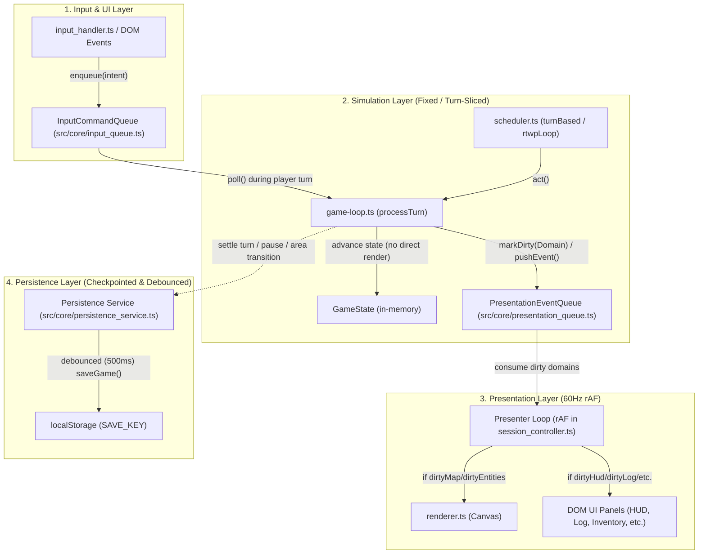

# Research Notes: Codebase Audit & Refinement Roadmap

**Date:** October 2026  
**Context:** Comprehensive audit across engine, gameplay systems, content pipeline, and Campaign Creator tooling (34,314 LOC across 134 TypeScript modules).  
**Governance:** [AGENTS.md](AGENTS.md), [ARCHITECTURE.md](docs/ARCHITECTURE.md), [HANDOFF_SOCIAL_AND_V2_ENGINE.md](docs/HANDOFF_SOCIAL_AND_V2_ENGINE.md).

---

## 1. Codebase Architecture & AGENTS.md Compliance

### 1.1 Large File Decomposition Targets (~250-Line Guideline)
35+ modules exceed the ~250-line target, with 23 exceeding 400 lines:
- `src/systems/nemesis.system.ts` (833 lines) → Candidate for split into `nemesis_tracker.ts`, `nemesis_adaptation.ts`, `nemesis_presentation.ts`.
- `src/rendering/ui/director_sandbox.ui.ts` (826 lines) → Candidate for split into `director_telemetry_view.ts`, `director_controls.ts`.
- `src/main.ts` (745 lines) → Candidate for extracting session lifecycle into `src/core/session_controller.ts`.
- `src/editor/simulation/narrative_fuzzer.ts` (663 lines) → Candidate for split into `fuzzer_invariants.ts`, `fuzzer_telemetry.ts`.
- `src/core/bootstrap.ts` (622 lines) → Candidate for extracting sandbox / demo setups into `bootstrap_sandbox.ts`.
- `src/systems/trigger/systemic.ts` (621 lines) & `src/systems/trigger/social.ts` (525 lines) → Candidate for isolating handler dispatch tables.
- `src/types/components.types.ts` (617 lines) → Candidate for domain component schema groupings (`combat.components.ts`, `social.components.ts`, etc.).
- `src/map/generator.ts` (523 lines) → Candidate for isolating vault rotation and placement into `src/map/vault_stamper.ts`.

### 1.2 Rule Compliance Checks
- **Zero `any` Violations:** Exactly 2 occurrences found in `src/rendering/ui/ui_utils.ts:87-88` (`as any`). Replace with `<T extends HTMLElement>`.
- **Seeded Determinism:** 7 calls to `Math.random()` in telemetry visualizers (`narrative_fuzzer.ts`, `director_sandbox.ui.ts`, `knowledge_simulator.ui.ts`, `world_graph.ts`). No gameplay calculations use `Math.random()`, but visualizers should still use `rng` from `src/core/rng.ts`.
- **DOM Clearing Hygiene:** 109 `element.innerHTML = ''` occurrences. Replace with modern `element.replaceChildren()` to follow security guidelines.
- **Dependency Hierarchy Inversions:**
  - `src/types/game-state.types.ts` imports runtime types from `src/map/encounter_director.ts`. Extract to `src/types/encounter.types.ts`.
  - `src/systems/ai.system.ts` and `src/systems/trigger/social.ts` import upward from `src/actions/`.

---

## 2. Core Engine & State Flow Refinements

1. **State Stabilization Pipeline:**
   - Formalize turn step resolution into a bounded `resolveStateStabilization(state: GameState): GameState` pipeline with a 16-iteration guard to cleanly handle cascading damage, traps, status effects, and reactive triggers.
2. **Entity Packaging in Cold Storage:**
   - Ensure nested inventory/equipment entity hierarchies are recursively packaged during area sleep/wake in `src/core/ecs.ts`.
   - Add orphan entity pruning sweeps in `src/core/save.ts`.
3. **Session Lifecycle Orchestration:**
   - Decouple `src/main.ts` into a lightweight bootstrap entry point and an explicit `SessionController`.

---

## 3. Gameplay HUD & RTwP Controls Refinements

1. **RTwP Auto-Pause Triggers:**
   - Configurable pause triggers in `src/core/game-loop.ts`:
     - Hostile or Nemesis spotted in FOV
     - Player HP < 25% threshold
     - Hazard, trap, or harmful status effect applied
     - Dialogue or narrative trigger activated
2. **Unified Modal Stack Controller:**
   - Centralize modal ESC-key stack management (LIFO) and auto-pause synchronization across all overlays.
3. **Contextual Verb Badges:**
   - Dynamic illumination in `renderVerbMenu` indicating applicable verbs (Talk, Trade, Inspect, Steal, Ignite, Disarm) for adjacent entities/tiles.
4. **Investigation Board Filtering:**
   - Add filter chips (**Scheme**, **Faction**, **Nemesis**, **Area**) to `src/rendering/ui/investigation.ui.ts`.

---

## 4. Campaign Creator & Developer Tooling Refinements

1. **Interactive Validation Diagnostics:**
   - Clickable diagnostic items in `src/editor/campaign_validator.ts` and `src/rendering/editor_ui.ts` that immediately focus offending form inputs.
2. **Collapsible Schema Groups:**
   - `<details>` / `<summary>` accordion rendering in `src/rendering/ui/zod_form_renderer.ts` for deep schema navigation.
3. **Reverse-Reference ("Where Used") Inspector:**
   - Cross-reference indexer in `src/rendering/ui/area_editor.ts` allowing creators to see where actors, items, or dialogues are referenced.
4. **"Playtest from Here":**
   - Contextual right-click action in area editor to spawn the player directly onto any floor tile in sandbox mode.

---

## 5. Roadmap & Documentation Hygiene

1. **`docs/MILESTONES.md`:**
   - Mark Milestone 63 as completed `[x]`.
   - Remove obsolete `(Active)` tags from M1:5, M6:53, and M32:378.
   - Normalize heading levels (M5, M6, M18, M19, M21 to H2 `##`).
   - Replace absolute Windows file links (`file:///d:/Projects/...`) with repo-relative markdown links.

---

## 6. Milestone 72 Architecture Research: Decoupled Frame Loop, Message Queues & Debounced Persistence

### 6.1 Problem Statement & Root Cause Bottleneck Audit

An exhaustive audit of `src/core/game-loop.ts`, `src/core/scheduler.ts`, `src/core/session_controller.ts`, and `src/core/save.ts` identified three cascading bottlenecks that degrade performance and prevent smooth 60 FPS in Real-Time with Pause (RTwP) mode and large-scale living-world turns:

1. **Synchronous Render & DOM Panel Rebuild Cascade in Actor Sub-Steps:**
   - In `src/core/game-loop.ts`, `updateState(newState)` is invoked repeatedly during a single actor's turn (status effect ticks via `processStatusEffectsTick`, state stabilization via `resolveStateStabilization`, energy/hunger deductions via `processHungerTick`, exploration updates via `updateExploredTiles`, and AI intent execution via `applyIntentWithCost`).
   - In `src/core/session_controller.ts` (`bindStateSubscription`), `onStateChange` subscribes directly to `updateState()` and executes 18 DOM and Canvas rendering routines unconditionally on *every single mutation*:
     - `render(display, state)` (full Canvas clear + tile-by-tile ECS queries + camera calculation)
     - DOM panels: `renderPlayerStatus`, `renderInventory`, `renderEquipment`, `renderHotbar`, `renderTargetingHUD`, `renderInspectHUD`, `renderDialogueOverlay`, `renderTradeOverlay`, `renderServiceOverlay`, `renderInvestigationHUD`, `renderHistoricalLedgerHUD`, `renderDramaHUD`, `renderVerbMenu`, `renderMessageLog`, `renderEditorUI`, etc.
   - In an area with 50 NPCs acting in a single turn or during RTwP execution, `scheduler.ts` loops through actors, triggering 50–100 full DOM panel rebuilds and Canvas redraws inside a single 16.6ms frame.

2. **Synchronous JSON Serialization & LocalStorage Persistence in Sub-Steps:**
   - Inside `src/core/game-loop.ts:65-67`:
     ```ts
     if (newState.uiMode === UIMode.Game) {
       saveGame(newState);
     }
     ```
   - On every sub-step mutation, `saveGame()` runs `pruneOrphanEntities(state)`, iterates all active and dormant areas (`state.areas`), serializes entities and components into tuple arrays, and invokes `localStorage.setItem(SAVE_KEY, JSON.stringify(serializedState))`. This introduces massive garbage collection pressure and synchronous browser disk I/O blocking during active gameplay.

3. **60 FPS VFX Animation Loop Triggering State Mutation Cascades:**
   - In `src/core/session_controller.ts` (`startGlobalUILoop`), a 60 FPS `requestAnimationFrame` loop checks for expired floating text visual effects:
     ```ts
     if (nextEffects.length !== currentState.visualEffects.length) {
       setGameState({ ...currentState, visualEffects: nextEffects });
     }
     ```
   - When floating text or visual effects expire, calling `setGameState` triggers the entire 18-panel re-render pipeline and `saveGame()` through `updateState()`, even if no gameplay action occurred.

---

### 6.2 Architectural Solution & Component Contracts

To resolve these bottlenecks while strictly upholding AGENTS.md rules (ECS purity, seeded determinism, ~250 LOC per module, downward dependency hierarchy), Milestone 72 establishes three decoupled subsystems:



#### 1. Input Command Queue (`src/core/input_queue.ts`)
- **Purpose:** Decouples user input capture (keyboard listeners, UI clicks) from immediate simulation stepping.
- **Contract:**
  - `enqueueIntent(intent: Intent): void`: Enqueues an intent into a FIFO buffer.
  - `dequeueIntent(): Intent | undefined`: Retrieves next intent during player turn.
  - `peekIntent(): Intent | undefined`: Inspects next intent without popping.
  - `clearInputQueue(): void`: Clears pending inputs (e.g. on game over or state transition).
  - `hasPendingIntents(): boolean`: Checks if player has queued actions.
- **Immediate vs Simulation Actions:** UI navigation (mode changes, tab switches, closing dialogs) does not require actor turn consumption and is processed directly, whereas gameplay actions (movement, combat, waiting, using items) are queued for the player's scheduled actor turn.

#### 2. Presentation Event Queue & Selective Domain Dirty Tracking (`src/core/presentation_queue.ts`)
- **Purpose:** Decouples simulation state updates from UI/Canvas rendering. Prevents passive NPC sub-steps from redrawing untouched DOM panels.
- **Dirty Domains:**
  - `Domain.Map`: Tile exploration, map change, FOV recalculation, camera scrolling.
  - `Domain.Entities`: Entity movement, spawns, deaths, combat animations.
  - `Domain.HUD`: Player HP/energy, status effects, turn counter, equipped quick-slots.
  - `Domain.Log`: New messages added to `state.messages`.
  - `Domain.Inventory`: Items added, removed, equipped, dropped.
  - `Domain.Modals`: Targeting, Inspect, Dialogue, Trade, Service, Verb Menu.
  - `Domain.VFX`: Active floating text and particle effects.
- **Contract:**
  - `markDomainDirty(domain: PresentationDomain): void`: Flags a specific domain for redraw.
  - `markAllDomainsDirty(): void`: Flags all domains (used on game load, area change, UI mode switch).
  - `isDomainDirty(domain: PresentationDomain): boolean`: Checks if domain requires redraw.
  - `consumeDirtyDomains(): ReadonlySet<PresentationDomain>`: Returns currently dirty domains and resets flags for the next frame.
  - `pushPresentationEvent(event: PresentationEvent): void`: Buffers ephemeral visual events (e.g., hit sparks, damage numbers) without mutating `GameState`.
- **Presenter Loop (`src/core/session_controller.ts`):**
  - Runs inside `requestAnimationFrame` at 60Hz.
  - If no domains are dirty and no VFX are active, the frame presenter skips rendering entirely.
  - Only DOM panels whose corresponding domain is marked dirty are re-rendered.

#### 3. Debounced & Checkpointed Persistence (`src/core/persistence_service.ts`)
- **Purpose:** Eliminates `saveGame()` and `saveCurrentReplay()` from hot actor sub-steps in `updateState()`.
- **Safe Transactional Checkpoints:**
  - **Player Turn Settle:** After player turn and all cascading reactive triggers/stabilization complete.
  - **RTwP Pause:** Triggered immediately when player toggles pause or auto-pause triggers.
  - **Area Transitions:** When leaving or entering an area.
  - **Debounced Continuous Saver:** A 500ms trailing debounce timer for continuous gameplay saves, ensuring `JSON.stringify` and `localStorage.setItem` never run more than once every 500ms.
- **Contract:**
  - `requestSave(state: GameState, immediate?: boolean): void`: Requests a debounced or immediate save.
  - `flushPendingSave(): void`: Immediately writes any queued state before unload/transition.
  - `cancelPendingSave(): void`: Cancels pending save (e.g., sandbox encounters or game over).

---

### 6.3 Alignment with Upcoming Phase 11 Milestones

1. **Seam to Milestone 73 (Pure Dumb Canvas Renderer & ViewportSnapshot):**
   - The decoupled 60Hz presenter loop created in M72 will directly feed the `ViewportSnapshot` projector in M73 (`buildViewportSnapshot(state, w, h) -> ViewportSnapshot`), which will then be passed to the dumb renderer (`render(display, snapshot)`).
2. **Seam to Milestone 74 (Frame-Budgeted Cooperative Scheduler):**
   - Decoupling `updateState()` from rendering enables `scheduler.ts` to execute turns under a strict `FRAME_BUDGET_MS = 4` cooperative budget without causing UI stuttering or locking the browser thread.

---

### 6.4 Invariant Safeguards & Rule Checklist

- [x] **Zero `any`:** Strict TypeScript typing across all queue structures, payloads, and domain enums.
- [x] **Seeded PRNG Determinism:** Queue processing and time tracking do not introduce `Math.random()` or non-deterministic state mutations into simulation logic.
- [x] **File Size Budget:** `src/core/input_queue.ts`, `src/core/presentation_queue.ts`, and `src/core/persistence_service.ts` will each be modular, isolated, and well under the ~250 LOC threshold.
- [x] **Downward Hierarchy:** `session_controller.ts` (wiring/presentation) -> `game-loop.ts` / `scheduler.ts` (simulation) -> `presentation_queue.ts` / `input_queue.ts` (core glue). No circular dependencies.

