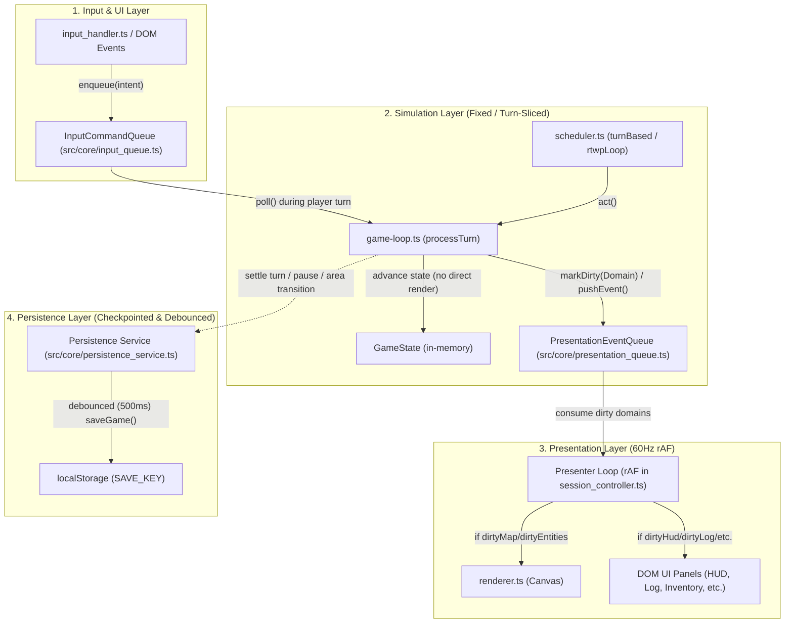

# Research Notes: Codebase Audit & Refinement Roadmap

**Date:** October 2026  
**Context:** Comprehensive audit across engine, gameplay systems, content pipeline, and Campaign Creator tooling (34,314 LOC across 134 TypeScript modules).  
**Governance:** [AGENTS.md](AGENTS.md), [ARCHITECTURE.md](docs/ARCHITECTURE.md), [HANDOFF_SOCIAL_AND_V2_ENGINE.md](docs/HANDOFF_SOCIAL_AND_V2_ENGINE.md).

---

## 1. Codebase Architecture & AGENTS.md Compliance

### 1.1 Large File Decomposition Targets (~250-Line Guideline)
35+ modules exceed the ~250-line target, with 23 exceeding 400 lines:
- `src/systems/nemesis.system.ts` (833 lines) → Candidate for split into `nemesis_tracker.ts`, `nemesis_adaptation.ts`, `nemesis_presentation.ts`.
- `src/rendering/ui/director_sandbox.ui.ts` (826 lines) → Candidate for split into `director_telemetry_view.ts`, `director_controls.ts`.
- `src/main.ts` (745 lines) → Candidate for extracting session lifecycle into `src/core/session_controller.ts`.
- `src/editor/simulation/narrative_fuzzer.ts` (663 lines) → Candidate for split into `fuzzer_invariants.ts`, `fuzzer_telemetry.ts`.
- `src/core/bootstrap.ts` (622 lines) → Candidate for extracting sandbox / demo setups into `bootstrap_sandbox.ts`.
- `src/systems/trigger/systemic.ts` (621 lines) & `src/systems/trigger/social.ts` (525 lines) → Candidate for isolating handler dispatch tables.
- `src/types/components.types.ts` (617 lines) → Candidate for domain component schema groupings (`combat.components.ts`, `social.components.ts`, etc.).
- `src/map/generator.ts` (523 lines) → Candidate for isolating vault rotation and placement into `src/map/vault_stamper.ts`.

### 1.2 Rule Compliance Checks
- **Zero `any` Violations:** Exactly 2 occurrences found in `src/rendering/ui/ui_utils.ts:87-88` (`as any`). Replace with `<T extends HTMLElement>`.
- **Seeded Determinism:** 7 calls to `Math.random()` in telemetry visualizers (`narrative_fuzzer.ts`, `director_sandbox.ui.ts`, `knowledge_simulator.ui.ts`, `world_graph.ts`). No gameplay calculations use `Math.random()`, but visualizers should still use `rng` from `src/core/rng.ts`.
- **DOM Clearing Hygiene:** 109 `element.innerHTML = ''` occurrences. Replace with modern `element.replaceChildren()` to follow security guidelines.
- **Dependency Hierarchy Inversions:**
  - `src/types/game-state.types.ts` imports runtime types from `src/map/encounter_director.ts`. Extract to `src/types/encounter.types.ts`.
  - `src/systems/ai.system.ts` and `src/systems/trigger/social.ts` import upward from `src/actions/`.

---

## 2. Core Engine & State Flow Refinements

1. **State Stabilization Pipeline:**
   - Formalize turn step resolution into a bounded `resolveStateStabilization(state: GameState): GameState` pipeline with a 16-iteration guard to cleanly handle cascading damage, traps, status effects, and reactive triggers.
2. **Entity Packaging in Cold Storage:**
   - Ensure nested inventory/equipment entity hierarchies are recursively packaged during area sleep/wake in `src/core/ecs.ts`.
   - Add orphan entity pruning sweeps in `src/core/save.ts`.
3. **Session Lifecycle Orchestration:**
   - Decouple `src/main.ts` into a lightweight bootstrap entry point and an explicit `SessionController`.

---

## 3. Gameplay HUD & RTwP Controls Refinements

1. **RTwP Auto-Pause Triggers:**
   - Configurable pause triggers in `src/core/game-loop.ts`:
     - Hostile or Nemesis spotted in FOV
     - Player HP < 25% threshold
     - Hazard, trap, or harmful status effect applied
     - Dialogue or narrative trigger activated
2. **Unified Modal Stack Controller:**
   - Centralize modal ESC-key stack management (LIFO) and auto-pause synchronization across all overlays.
3. **Contextual Verb Badges:**
   - Dynamic illumination in `renderVerbMenu` indicating applicable verbs (Talk, Trade, Inspect, Steal, Ignite, Disarm) for adjacent entities/tiles.
4. **Investigation Board Filtering:**
   - Add filter chips (**Scheme**, **Faction**, **Nemesis**, **Area**) to `src/rendering/ui/investigation.ui.ts`.

---

## 4. Campaign Creator & Developer Tooling Refinements

1. **Interactive Validation Diagnostics:**
   - Clickable diagnostic items in `src/editor/campaign_validator.ts` and `src/rendering/editor_ui.ts` that immediately focus offending form inputs.
2. **Collapsible Schema Groups:**
   - `<details>` / `<summary>` accordion rendering in `src/rendering/ui/zod_form_renderer.ts` for deep schema navigation.
3. **Reverse-Reference ("Where Used") Inspector:**
   - Cross-reference indexer in `src/rendering/ui/area_editor.ts` allowing creators to see where actors, items, or dialogues are referenced.
4. **"Playtest from Here":**
   - Contextual right-click action in area editor to spawn the player directly onto any floor tile in sandbox mode.

---

## 5. Roadmap & Documentation Hygiene

1. **`docs/MILESTONES.md`:**
   - Mark Milestone 63 as completed `[x]`.
   - Remove obsolete `(Active)` tags from M1:5, M6:53, and M32:378.
   - Normalize heading levels (M5, M6, M18, M19, M21 to H2 `##`).
   - Replace absolute Windows file links (`file:///d:/Projects/...`) with repo-relative markdown links.

---

## 6. Milestone 72 Architecture Research: Decoupled Frame Loop, Message Queues & Debounced Persistence

### 6.1 Problem Statement & Root Cause Bottleneck Audit

An exhaustive audit of `src/core/game-loop.ts`, `src/core/scheduler.ts`, `src/core/session_controller.ts`, and `src/core/save.ts` identified three cascading bottlenecks that degrade performance and prevent smooth 60 FPS in Real-Time with Pause (RTwP) mode and large-scale living-world turns:

1. **Synchronous Render & DOM Panel Rebuild Cascade in Actor Sub-Steps:**
   - In `src/core/game-loop.ts`, `updateState(newState)` is invoked repeatedly during a single actor's turn (status effect ticks via `processStatusEffectsTick`, state stabilization via `resolveStateStabilization`, energy/hunger deductions via `processHungerTick`, exploration updates via `updateExploredTiles`, and AI intent execution via `applyIntentWithCost`).
   - In `src/core/session_controller.ts` (`bindStateSubscription`), `onStateChange` subscribes directly to `updateState()` and executes 18 DOM and Canvas rendering routines unconditionally on *every single mutation*:
     - `render(display, state)` (full Canvas clear + tile-by-tile ECS queries + camera calculation)
     - DOM panels: `renderPlayerStatus`, `renderInventory`, `renderEquipment`, `renderHotbar`, `renderTargetingHUD`, `renderInspectHUD`, `renderDialogueOverlay`, `renderTradeOverlay`, `renderServiceOverlay`, `renderInvestigationHUD`, `renderHistoricalLedgerHUD`, `renderDramaHUD`, `renderVerbMenu`, `renderMessageLog`, `renderEditorUI`, etc.
   - In an area with 50 NPCs acting in a single turn or during RTwP execution, `scheduler.ts` loops through actors, triggering 50–100 full DOM panel rebuilds and Canvas redraws inside a single 16.6ms frame.

2. **Synchronous JSON Serialization & LocalStorage Persistence in Sub-Steps:**
   - Inside `src/core/game-loop.ts:65-67`:
     ```ts
     if (newState.uiMode === UIMode.Game) {
       saveGame(newState);
     }
     ```
   - On every sub-step mutation, `saveGame()` runs `pruneOrphanEntities(state)`, iterates all active and dormant areas (`state.areas`), serializes entities and components into tuple arrays, and invokes `localStorage.setItem(SAVE_KEY, JSON.stringify(serializedState))`. This introduces massive garbage collection pressure and synchronous browser disk I/O blocking during active gameplay.

3. **60 FPS VFX Animation Loop Triggering State Mutation Cascades:**
   - In `src/core/session_controller.ts` (`startGlobalUILoop`), a 60 FPS `requestAnimationFrame` loop checks for expired floating text visual effects:
     ```ts
     if (nextEffects.length !== currentState.visualEffects.length) {
       setGameState({ ...currentState, visualEffects: nextEffects });
     }
     ```
   - When floating text or visual effects expire, calling `setGameState` triggers the entire 18-panel re-render pipeline and `saveGame()` through `updateState()`, even if no gameplay action occurred.

---

### 6.2 Architectural Solution & Component Contracts

To resolve these bottlenecks while strictly upholding AGENTS.md rules (ECS purity, seeded determinism, ~250 LOC per module, downward dependency hierarchy), Milestone 72 establishes three decoupled subsystems:



#### 1. Input Command Queue (`src/core/input_queue.ts`)
- **Purpose:** Decouples user input capture (keyboard listeners, UI clicks) from immediate simulation stepping.
- **Contract:**
  - `enqueueIntent(intent: Intent): void`: Enqueues an intent into a FIFO buffer.
  - `dequeueIntent(): Intent | undefined`: Retrieves next intent during player turn.
  - `peekIntent(): Intent | undefined`: Inspects next intent without popping.
  - `clearInputQueue(): void`: Clears pending inputs (e.g. on game over or state transition).
  - `hasPendingIntents(): boolean`: Checks if player has queued actions.
- **Immediate vs Simulation Actions:** UI navigation (mode changes, tab switches, closing dialogs) does not require actor turn consumption and is processed directly, whereas gameplay actions (movement, combat, waiting, using items) are queued for the player's scheduled actor turn.

#### 2. Presentation Event Queue & Selective Domain Dirty Tracking (`src/core/presentation_queue.ts`)
- **Purpose:** Decouples simulation state updates from UI/Canvas rendering. Prevents passive NPC sub-steps from redrawing untouched DOM panels.
- **Dirty Domains:**
  - `Domain.Map`: Tile exploration, map change, FOV recalculation, camera scrolling.
  - `Domain.Entities`: Entity movement, spawns, deaths, combat animations.
  - `Domain.HUD`: Player HP/energy, status effects, turn counter, equipped quick-slots.
  - `Domain.Log`: New messages added to `state.messages`.
  - `Domain.Inventory`: Items added, removed, equipped, dropped.
  - `Domain.Modals`: Targeting, Inspect, Dialogue, Trade, Service, Verb Menu.
  - `Domain.VFX`: Active floating text and particle effects.
- **Contract:**
  - `markDomainDirty(domain: PresentationDomain): void`: Flags a specific domain for redraw.
  - `markAllDomainsDirty(): void`: Flags all domains (used on game load, area change, UI mode switch).
  - `isDomainDirty(domain: PresentationDomain): boolean`: Checks if domain requires redraw.
  - `consumeDirtyDomains(): ReadonlySet<PresentationDomain>`: Returns currently dirty domains and resets flags for the next frame.
  - `pushPresentationEvent(event: PresentationEvent): void`: Buffers ephemeral visual events (e.g., hit sparks, damage numbers) without mutating `GameState`.
- **Presenter Loop (`src/core/session_controller.ts`):**
  - Runs inside `requestAnimationFrame` at 60Hz.
  - If no domains are dirty and no VFX are active, the frame presenter skips rendering entirely.
  - Only DOM panels whose corresponding domain is marked dirty are re-rendered.

#### 3. Debounced & Checkpointed Persistence (`src/core/persistence_service.ts`)
- **Purpose:** Eliminates `saveGame()` and `saveCurrentReplay()` from hot actor sub-steps in `updateState()`.
- **Safe Transactional Checkpoints:**
  - **Player Turn Settle:** After player turn and all cascading reactive triggers/stabilization complete.
  - **RTwP Pause:** Triggered immediately when player toggles pause or auto-pause triggers.
  - **Area Transitions:** When leaving or entering an area.
  - **Debounced Continuous Saver:** A 500ms trailing debounce timer for continuous gameplay saves, ensuring `JSON.stringify` and `localStorage.setItem` never run more than once every 500ms.
- **Contract:**
  - `requestSave(state: GameState, immediate?: boolean): void`: Requests a debounced or immediate save.
  - `flushPendingSave(): void`: Immediately writes any queued state before unload/transition.
  - `cancelPendingSave(): void`: Cancels pending save (e.g., sandbox encounters or game over).

---

### 6.3 Alignment with Upcoming Phase 11 Milestones

1. **Seam to Milestone 73 (Pure Dumb Canvas Renderer & ViewportSnapshot):**
   - The decoupled 60Hz presenter loop created in M72 will directly feed the `ViewportSnapshot` projector in M73 (`buildViewportSnapshot(state, w, h) -> ViewportSnapshot`), which will then be passed to the dumb renderer (`render(display, snapshot)`).
2. **Seam to Milestone 74 (Frame-Budgeted Cooperative Scheduler):**
   - Decoupling `updateState()` from rendering enables `scheduler.ts` to execute turns under a strict `FRAME_BUDGET_MS = 4` cooperative budget without causing UI stuttering or locking the browser thread.

---

### 6.4 Invariant Safeguards & Rule Checklist

- [x] **Zero `any`:** Strict TypeScript typing across all queue structures, payloads, and domain enums.
- [x] **Seeded PRNG Determinism:** Queue processing and time tracking do not introduce `Math.random()` or non-deterministic state mutations into simulation logic.
- [x] **File Size Budget:** `src/core/input_queue.ts`, `src/core/presentation_queue.ts`, and `src/core/persistence_service.ts` will each be modular, isolated, and well under the ~250 LOC threshold.
- [x] **Downward Hierarchy:** `session_controller.ts` (wiring/presentation) -> `game-loop.ts` / `scheduler.ts` (simulation) -> `presentation_queue.ts` / `input_queue.ts` (core glue). No circular dependencies.

---

## 7. Milestone 73 Research: Pure Dumb Canvas Renderer & Presentational ViewportSnapshot

### 7.1 Objective & Architectural Governance
- **Governance:** `AGENTS.md` (ECS purity, single responsibility <250 LOC, zero `any`), `docs/ARCHITECTURE.md`, `docs/MILESTONES.md`.
- **Primary Goal:** Enforce strict model-view separation by decoupling canvas rendering from ECS state queries. Transform `renderer.ts` into a pure dumb display adapter accepting only `(display, snapshot, prevSnapshot)` with zero imports from `ecs.ts`, `ComponentType`, or `GameState`.
- **Secondary Goal:** Implement dirty-cell canvas diffing against `prevSnapshot` to avoid costly full-frame `display.clear()` and full-viewport re-drawing on every frame.

### 7.2 Monolith Audit & Decomposition Target (`src/rendering/renderer.ts` - 573 LOC)
The current `renderer.ts` handles 5 distinct responsibilities:
1. **ECS Querying & View Projection:** Queries `GameState.spatialIndex`, unpacks components (`Player`, `Actor`, `Field`, `Renderable`, `Identity`), resolves theme glyph/fg/bg overrides, and computes FOV and camera offsets.
2. **Business Logic Evaluation:** Computes `getEffectiveStats(state, entityId)`, scans `historicalLedger`, reads memory facets/patience/stress, and builds text formatting for the inspect panel.
3. **Canvas Drawing:** Invokes `display.clear()`, `display.draw()`, and `drawCell()` on the ROT.js canvas.
4. **DOM Inspect Tooltip/Panel Management:** Directly mutates `#inspect-tooltip` and `#inspect-panel` DOM elements.
5. **DOM Visual Effects & Secondary Fog Canvas Overlay:** Manages `#effects-overlay` floating divs and draws to `#fog-overlay` 2D context.

### 7.3 Target Modular Architecture (~250-Line Guideline)
1. **`src/rendering/viewport_snapshot.types.ts` (~80 LOC):**
   - Pure presentational DTOs: `ViewportCellDTO`, `EntityRenderDTO`, `InspectTooltipDTO`, `VisualEffectDTO`, `FogOverlayDTO`, `ViewportSnapshot`.
2. **`src/rendering/viewport_snapshot.ts` (~200 LOC):**
   - Pure projection function `buildViewportSnapshot(state: GameState, viewportW: number, viewportH: number): ViewportSnapshot`.
   - Pre-computes camera offsets, tile definitions, z-ordered entity stacks, inspect data, and active VFX.
3. **`src/rendering/renderer.ts` (~150 LOC):**
   - Pure dumb canvas renderer `render(display: ROT.Display, snapshot: ViewportSnapshot, prevSnapshot?: ViewportSnapshot): void`.
   - Cell-level diffing against `prevSnapshot`. Only modified coordinates trigger `drawCell()`.
4. **`src/rendering/ui/inspect_view.ui.ts` (~120 LOC):**
   - Dedicated DOM view for `#inspect-tooltip` and `#inspect-panel`, consuming `InspectTooltipDTO`.
5. **`src/rendering/ui/vfx_overlay.ui.ts` (~80 LOC):**
   - Dedicated overlay manager for DOM floating text and canvas `#fog-overlay`.

---

## 8. Milestone 74 Research: Cooperative Frame-Budgeted Scheduler, Tiered World Simulation & Worker Offload

### 8.1 Objective & Architectural Governance
- **Governance:** `AGENTS.md` (Golden Rules: ECS purity, zero `any`, zero magic literals, modularity <250 LOC per file, determinism), `docs/ARCHITECTURE.md`, `docs/MILESTONES.md`.
- **Primary Goal:** Eliminate main-thread browser freezes and UI stuttering during heavy turns (actor storms, cascading reactions), long-horizon off-screen simulation ticks, multi-stage procedural dungeon generation, and headless simulation fuzzer runs.
- **Architectural Tenets:**
  1. *4ms Cooperative Frame Budgeting:* Yield to the browser frame scheduler (`requestAnimationFrame` / `setTimeout(..., 0)`) when turn simulation exceeds `FRAME_BUDGET_MS = 4`, guaranteeing 60 FPS rendering without dropping inputs or corrupting state.
  2. *Tiered Simulation Cadence (*Caves of Qud* / *Dwarf Fortress*):* Decouple the player's immediate active-zone micro-simulation (FOV, pathfinding, direct combat, spatial indexing, reactive triggers) from dormant off-screen macro-simulation (nemesis progression, rivalries, world events, rumor/gossip propagation) run on coarse global turn cadences with delta catch-up upon entering dormant zones.
  3. *Stage-Sliced Generators with PRNG Determinism Guard:* Wrap procedural level generation and narrative fuzzer batches into cooperative `function*` generator pipelines yielding `{ stage, progress }` checkpoints, with strict snapshot/restore of `ROT.RNG.getState()` / `ROT.RNG.setState()` across every yield boundary to guarantee seeded bit-for-bit reproducibility.
  4. *Typed Worker Bridge:* Establish a robust, decoupled Web Worker bridge (`src/worker/`) communicating strictly via serializable plain DTOs (no `Map`, `Set`, or DOM references) for multi-seed fuzzer execution and background chunk generation, featuring automatic main-thread fallback when workers are unavailable.

---

### 8.2 Sub-Deliverable 1: Cooperative Frame-Budgeted Scheduler (`src/core/scheduler.ts`)

#### Current Bottlenecks & Turn Storm Audit
- In `src/core/scheduler.ts`, `runTurnBasedLoop()` executes a synchronous `while (!isEngineLocked)` loop that continuously drains the `ROT.Scheduler` until the player needs to act. When many AI actors are awake, or during cascading actions, this loop can take 15–50ms+ in a single JavaScript frame, blocking input processing and dropping browser frames.
- In `rtwpLoop()`, time is accumulated into `accumulatedTime` and drained via `while (accumulatedTime >= 0 && !isEngineLocked)`. If delta time surges or many entities act, frames drop severely.

#### Slicing Architecture
- **Time Slice Constant:** Define `FRAME_BUDGET_MS = 4` in `src/constants/scheduler.constants.ts`. (4ms leaves 12ms of a 16.6ms 60Hz frame for DOM/canvas presentation and input handling).
- **Yield Mechanism:**
  - In `runTurnBasedLoop()`: Measure `const sliceStart = performance.now()`. At each actor step, if `performance.now() - sliceStart >= FRAME_BUDGET_MS`, schedule the remainder via `setTimeout(runTurnBasedLoop, 0)` (or `requestAnimationFrame`) and yield control back to the event loop.
  - **Lock Guard Invariant:** When yielding mid-loop, `isEngineLocked` must remain `true` (or an explicit `isTurnProcessing = true` flag set in `input_queue.ts` / `scheduler.ts`) so player input cannot interleave or mutate state while the current turn's actor actions are unresolved.
- **RTwP Slicing:** Cap `accumulatedTime` drain iterations per frame so RTwP cannot spiral into the "spiral of death" during heavy CPU frames.

---

### 8.3 Sub-Deliverable 2: Tiered World Simulation Cadence & Delta Catch-Up

#### Cadence Decoupling Audit (`src/core/game-loop.ts`, `src/systems/map.system.ts`)
- Currently in `applyIntentWithCost()`, whenever `didGlobalTurnAdvance` is true, the following run immediately:
  - `processNemesisSystem(nextState)`
  - `processRivalries(nextState)`
  - `processWorldEvents(nextState)`
  - Plus `processKnowledgePropagationEvents`, `tickPendingKnowledge`, `processRumorPropagationEvents`, `tickPendingRumors`, and `processPersonalitySystem` run on every intent tick.
- This creates uniform CPU spikes on every player turn, even though narrative schemes, rivalries, and faction movements represent macro-historical time.

#### 3-Tier Simulation Architecture
1. **Tier 1 (Active Zone Micro-Simulation):**
   - *Frequency:* Every turn / intent step.
   - *Scope:* Current area entities only. Local FOV calculation, spatial indexing, direct melee/ranged combat, traps, fields tick, and immediate reactive triggers.
2. **Tier 2 (Local Narrative Cadence):**
   - *Frequency:* Coarse interval (`LOCAL_NARRATIVE_TICK_INTERVAL = 10` or player turn settle).
   - *Scope:* Local knowledge/rumor propagation, personality stress/thought evaluation.
3. **Tier 3 (Off-Screen Macro-Simulation & World Cadence):**
   - *Frequency:* Coarse cadence (`WORLD_EVENT_TICK_INTERVAL = 100`, `RIVALRY_EVALUATION_INTERVAL = 25`, `SCHEME_TICK_INTERVAL = 50`).
   - *Scope:* Dormant areas, nemesis hierarchies, faction relations, global world events.
4. **Delta Catch-Up on Area Wake (`src/systems/map.system.ts`):**
   - When the player transitions into a dormant area (`targetAreaId`), compute `deltaTurns = state.globalTurn - targetArea.lastVisitedTurn`.
   - Run batch catch-up: evaluate respawn timers, resolve scheduled minion agreements/tokens, advance dormant area resource/hazard recovery, and log chronicle entries for any major events occurring in that region during the player's absence.

---

### 8.4 Sub-Deliverable 3: Stage-Sliced Generators & PRNG State Guard

#### Procedural Generation Audit (`src/map/generator.ts` - 504 LOC)
- `generateArea()` currently executes 5 monolithic stages synchronously:
  1. Base geometry carving (cellular automata, cave, bsp, or maze).
  2. Voronoi biomes, DLA corridors, and wall culling.
  3. Dijkstra hot path computation (`ROT.Path.Dijkstra`).
  4. Room and portal placement.
  5. Encounter Director distribution (`runEncounterDirector()`).
- On large maps (e.g. 80x50), this blocks the thread for 30–100ms during area transitions.
- Narrative Fuzzer (`src/editor/simulation/narrative_fuzzer.ts` - 203 LOC) runs 100 seeds in a blocking `for` loop that can lock the browser for seconds.

#### Stage-Sliced Generator Pipelines
- Extract discrete stages into `function* generateAreaAsync(campaign, areaId, context): Generator<GenerationProgress, GeneratedArea, void>`.
  - Yields `{ stage: 'carving' | 'biomes' | 'dijkstra' | 'portals' | 'encounters', progress: number }` checkpoints.
- Extract `function* runNarrativeFuzzerAsync(options, campaign): Generator<FuzzerProgress, FuzzerReport, void>`.
  - Yields `{ completedSeeds: number, totalSeeds: number, currentTurn: number, currentSeed: number }` progress tokens.

#### PRNG Determinism Guard Invariant
- ROT.js RNG maintains internal 32-bit seed state (`_seed, _s0, _s1, _s2, _c`).
- **Critical Invariant:** Any asynchronous yield (e.g., `await new Promise(r => setTimeout(r, 0))` or `requestAnimationFrame`) between generator stages exposes execution to interleaving events.
- **Protocol:**
  ```typescript
  // Before yielding:
  const rngState = ROT.RNG.getState();
  yield { stage, progress };
  // Immediately upon resumption:
  ROT.RNG.setState(rngState);
  ```
- **Rule:** Never yield inside third-party synchronous `ROT.Map.*` C-style callbacks (e.g., `cellular.create(callback)`), because ROT.js expects synchronous completion. Only yield at defined macroscopic stage boundaries.

---

### 8.5 Sub-Deliverable 4: Smooth Non-Blocking Loading & Background Worker Offload

#### UI Loading Overlay (`src/rendering/ui/loading_overlay.ui.ts`)
- Connect generator checkpoints to a smooth DOM overlay `#loading-overlay`:
  - Visual progress bar (`0%` to `100%`) with animated transition.
  - Informative stage readout: `"Sculpting cavern chambers..."`, `"Evaluating tactical hot-paths..."`, `"Directing encounter ecologies..."`.
  - Smooth fade-out upon completion, eliminating jarring freezes during floor descent.

#### Web Worker Bridge (`src/worker/`)
- Modern Vite worker support via `new Worker(new URL('./fuzzer.worker.ts', import.meta.url), { type: 'module' })`.
- **Worker Separation:**
  1. `src/worker/fuzzer.worker.ts`: Headless multi-seed narrative fuzzing. Receives campaign data and simulation parameters; runs deterministic turns headless without DOM; posts progress and final `FuzzerReport`.
  2. `src/worker/map.worker.ts`: Off-thread procedural chunk / level pre-generation.
  3. `src/worker/worker_bridge.ts`: Unified typed dispatcher with feature detection. If `typeof Worker === 'undefined'`, transparently falls back to cooperative main-thread `generateAreaAsync` / `runNarrativeFuzzerAsync`.
- **Pure DTO Boundary:**
  - Messages passed via `postMessage` must be strictly serializable plain JavaScript objects/arrays.
  - ECS components inside workers are stored as plain `Record<string, unknown>` and arrays—never `Map` or `Set` objects, adhering to AGENTS.md Section 4 ECS rules.

---

### 8.6 Target File Layout & LOC Budget Compliance (<250 LOC per file)

1. **`src/constants/scheduler.constants.ts` (~40 LOC):**
   - `FRAME_BUDGET_MS = 4`, cadence intervals (`WORLD_EVENT_TICK_INTERVAL`, `SCHEME_CADENCE_INTERVAL`), generator stage enum/labels.
2. **`src/core/scheduler.ts` (~200 LOC):**
   - Refactored with 4ms time-sliced `runTurnBasedLoop()` and bounded `rtwpLoop()`, preserving input locks.
3. **`src/core/simulation_cadence.ts` (~160 LOC):**
   - Decoupled Tier 2 and Tier 3 cadence dispatchers extracted from `game-loop.ts`, keeping `game-loop.ts` lean.
4. **`src/map/generator_stages.ts` (~220 LOC):**
   - Modular discrete carving, biomes, Dijkstra, and portal placement functions extracted from `generator.ts` (reducing `generator.ts` to ~180 LOC).
5. **`src/map/generator_async.ts` (~160 LOC):**
   - Stage-sliced async generator pipeline `generateAreaAsync` with PRNG state preservation.
6. **`src/editor/simulation/narrative_fuzzer_async.ts` (~150 LOC):**
   - Async generator pipeline `runNarrativeFuzzerAsync` yielding progress per seed/batch.
7. **`src/rendering/ui/loading_overlay.ui.ts` (~90 LOC):**
   - Dedicated DOM loading overlay for area transitions and generation progress.
8. **`src/types/worker.types.ts` (~80 LOC):**
   - Type-safe request/response/progress union contracts for worker messages.
9. **`src/worker/worker_bridge.ts` (~160 LOC):**
   - Typed worker client with automated fallback to main-thread async generators.
10. **`src/worker/fuzzer.worker.ts` (~80 LOC):**
    - Headless worker script for narrative fuzzer.
11. **`src/worker/map.worker.ts` (~90 LOC):**
    - Headless worker script for background map generation.

---

### 8.7 Invariant Safeguards & Rule Checklist

- [x] **Zero `any`:** Strict TypeScript typing across all scheduler interfaces, worker DTOs, generator yields, and cadence definitions.
- [x] **Zero Magic Literals:** All frame budgets, tick intervals, and progress weights defined in `scheduler.constants.ts` and `pacing.constants.ts`.
- [x] **PRNG Determinism:** Snapshotting/restoring `ROT.RNG.getState()` across every yield point ensures async slicing never deviates from synchronous seed outputs.
- [x] **ECS Purity & Serialization:** No `Map`/`Set` across worker boundaries or inside ECS components.
- [x] **Downward Hierarchy:** `session_controller.ts` / UI -> `scheduler.ts` -> `game-loop.ts` -> `simulation_cadence.ts` -> systems. No circular dependencies.
- [x] **File Modularity:** All new modules and refactored generators strictly within ~250 LOC threshold.

---

## 9. Milestone 75 Research: Gameplay HUD & RTwP Controls Refinements

**Date:** October 2026  
**Scope:** The 4 checklist items of `docs/MILESTONES.md` § Milestone 75.  
**Status:** Gate 1 — awaiting User confirmation before Step 4 (Implementation Plan).

### 9.1 Baseline Verification State

| Check | Command | Result |
| --- | --- | --- |
| Types | `bun x tsc --noEmit` | 0 errors |
| Campaigns | `bun run validate:campaigns` | 0 errors, 0 warnings |
| Bundle | `bun x vite build` | clean |

---

### 9.2 Item 1 — Configurable RTwP Auto-Pause Triggers

#### Task text
> Add configurable RTwP auto-pause triggers in `src/core/game-loop.ts` driven by the simulation event queue (hostile/nemesis spotted in FOV, player HP < 25%, hazards applied, narrative triggers).

#### What exists today
- **The single event-drain seam is `applyIntentWithCost()`** in `src/core/game-loop.ts:287-359`. It:
  1. dispatches the intent (`applyIntent`, line 289),
  2. resolves move cost + `processTraps` (lines 296-305),
  3. appends `result.events` into `state.events` (lines 320-322),
  4. runs `resolveStateStabilization` (line 325) — cascading damage/death/reactive triggers append more events,
  5. runs `processFieldsTick`, `processInvestigationEvents`, Tier-2/Tier-3 cadence, `processLedgerSystem`,
  6. **drains** events into `eventsToReturn` and resets `state.events = []` (lines 348-350).
- **Every listed trigger is observable *before* that drain (line 348).** This is the correct injection point: after all stabilisation and cadence systems have appended their events, but before the ledger is flushed.
- `state.rtwpState.paused` is the authoritative pause flag (`src/types/game-state.types.ts:248`). `src/core/scheduler.ts:172` refuses to accumulate time while it is `true`, so setting the flag from the simulation layer is sufficient — **no scheduler change is required**.
- `src/rendering/ui/controls.ui.ts:24-32` already renders a `⏸ Playing` / `▶ Paused` button that will reflect auto-pause for free.

#### Event availability audit (`src/types/events.types.ts`, 35 members)
| Required trigger | Existing event | Status |
| --- | --- | --- |
| Hazard / trap applied | `GameEventType.TrapTriggered` (line 20) | ✅ usable |
| Damage taken (for HP check) | `GameEventType.EntityDamaged` (line 8) | ✅ usable |
| Narrative / drama trigger | `ClueDiscovered`, `DialogueSelected`, `WorldEventFired`, `InvestigationStalled`, `NemesisPromoted`, `SchemeEscalated` | ✅ usable |
| Negative status effect applied | — | ❌ **no event exists** |
| Hostile / nemesis spotted in FOV | — | ❌ **`GameEventType.EntitySpotted` does not exist** |

#### ⚠️ Finding A — `EntitySpotted` is hypothetical
`grep` across `src/` returns **zero** occurrences of `EntitySpotted`. The milestone text names an event that was never implemented. Two options:

- **Option A (recommended) — derive, don't emit.** Evaluate "spotted" inside `applyIntentWithCost` by intersecting `state.cachedFov` (recomputed FOV index set, `src/systems/map.system.ts:64`) with entities carrying `ComponentType.Attitude { attitude: 'hostile' }` (`components.types.ts:476`) or `ComponentType.Nemesis` (`components.types.ts:546`). Dedupe against a **transient module-level `Set<EntityId>`** inside `src/core/auto_pause.ts` so a hostile that stays in view pauses only once. No new event type, no `GameEvent` union change, no `SerializedGameState` change — consistent with the approved *transient* lifecycle policy.
- **Option B — add a real `EntitySpotted` event.** Requires a new enum member, a new event interface, a new `GameEvent` union member, and an emitter. The only correct emitter is `updateExploredTiles()` (`map.system.ts:40-67`) because it is the sole place `cachedFov` is refreshed. **Blocker:** `updateExploredTiles` is called from `processTurn` (`game-loop.ts:182`) *after* `applyIntentWithCost` has already drained events — so emitted `EntitySpotted` events would surface one turn late unless `updateExploredTiles` is relocated into `applyIntentWithCost` (a wider refactor with replay/`bootstrap.ts` side effects).

#### ⚠️ Finding B — no "negative status applied" event
`src/systems/status-effect.system.ts` applies effects without emitting a dedicated event. Options: (a) treat `TrapTriggered` + `EntityDamaged` as the hazard proxy (no new event), or (b) diff the player's `StatusEffectsComponent.activeEffects` length before/after within `applyIntentWithCost` and inspect each `ActiveStatusEffect` against the campaign `status` registry's detrimental flag.

#### Configuration & persistence (already decided by the User)
Preferences live in `PlayerSettings` (`src/core/settings.ts:48`), persisted to `localStorage` under `roguelike_settings` (line 92), **not** in `GameState`. The current load/merge path (`initSettings` lines 111-127) and `updateSettings` (lines 139-146) **hard-code the three known sub-objects** (`keybinds`, `visualFeedback`, `accessibility`) and will silently *drop* a new `autoPause` object unless both functions are extended. `resetSettings` (line 180) copies `DEFAULT_SETTINGS` and is safe automatically.

#### Integration constraints
- `applyIntentWithCost` is invoked for **both** player and AI intents. Auto-pause must be gated on `state.engineMode === EngineMode.RTwP` and on the intent belonging to the player (`getComponent(state, intent.entityId, ComponentType.Player)`), otherwise a hostile AI turn would pause the game.
- `src/core/replay.ts` records intents only; auto-pause mutates `rtwpState` which is presentation-for-replay purposes. Must confirm auto-pause does not corrupt replay determinism (it should not — it never changes simulation outcomes).

---

### 9.3 Item 2 — Centralized Modal ESC-Key Stack Management (LIFO)

#### What exists today
`src/core/input_handler.ts` is **491 LOC** and handles modals with nine ad-hoc, mutually exclusive `if (event.key === 'Escape')` blocks:

| Mode | Lines | Current behaviour |
| --- | --- | --- |
| Rebinding overlay | 99-116 | local `setRebindingAction(null)` |
| `VerbMenu` | 131-165 | inline `setGameState({...state, uiMode: Game})` |
| `Debug` | 184-190 | toggle intent |
| `Settings` | 192-198 | toggle intent |
| `Factions` | 200-206 | toggle or key |
| `Quests` | 208-214 | toggle or key |
| `Investigation` | 216-222 | toggle or key |
| `Dossier` | 224-230 | toggle or key |
| `Ledger` | 232-238 | toggle or key |
| `Inventory` | 241-247 | toggle intent |

#### Root problems found
1. **No nesting.** Every toggle intent in `src/actions/action.registry.ts:104-171` uses the pattern `state.uiMode === UIMode.Game ? Target : UIMode.Game`. Opening Dossier while Investigation is open therefore **discards** the Investigation context instead of stacking on it.
2. **Pause recovery is approximated, not tracked.** Each toggle recomputes `paused` as `nextUiMode !== UIMode.Game` (lines 106, 115, 126, 134, 142, 150, 158, 166). Opening a modal always forces `paused = true`; closing always forces `paused = false`. If the player had **manually paused** before opening Settings, `Escape` will **unpause and resume the game** — a real bug.
3. **`input_handler.ts` duplicates the intent dispatch** that `action.registry.ts` already owns, so there are two sources of truth for modal exit.

#### Recommended architecture (matches Open Thread 2 recommendation)
New `src/core/modal_manager.ts`, transient module state only (no `GameState`, no serialization):

```ts
/** A single frame on the transient modal stack. */
interface ModalFrame {
  readonly mode: UIMode;
}

export function pushModal(mode: UIMode): void;
export function popModal(): UIMode | undefined;
export function getCurrentModal(): UIMode | undefined;
export function hasModalsOpen(): boolean;
export function clearModals(): void;
/** Records the pause state that existed before the first modal opened. */
export function captureModalBaseline(paused: boolean): void;
export function getModalBaselinePaused(): boolean | undefined;
```

Plus two state helpers so `action.registry.ts` stops re-implementing pause math:
```ts
export function openModal(state: GameState, mode: UIMode): GameState;
export function closeTopModal(state: GameState): GameState;   // restores baseline pause
```

#### Constraints & risks
- `src/actions/action.registry.ts` importing from `src/core/modal_manager.ts` is a legal **downward** dependency (`actions → core`).
- `state.uiMode` is serialized (`save.ts:145`) but the stack is not. On load, `save.ts:253` already normalises `UIMode.VerbMenu → UIMode.Game`; the stack must therefore be reset (`clearModals()`) on load/new-game, otherwise a stale stack desynchronises from `uiMode`. Identified call sites: `src/core/save.ts` load path and `src/core/session_controller.ts` new-game path.
- **LOC outcome:** extracting the ten modal blocks (≈140 LOC) plus the inventory branch (≈64 LOC, lines 241-304) into `src/core/input/` modules should bring `input_handler.ts` from 491 → **≈250 LOC**, satisfying Rule 13.

---

### 9.4 Item 3 — Dynamic Contextual Verb Illumination

#### What exists today
- `handleSmartInteraction()` (`input_handler.ts:54-83`) calls `getValidVerbsForTarget()` and opens the menu with **`availableVerbs` already filtered to only *valid* verbs**. If exactly one verb is valid it executes immediately without opening the menu.
- `getValidVerbsForTarget()` (`src/systems/apply.system.ts:78-109`) already performs full validity evaluation: hardcoded tool mechanics (`throwable`/`zappable` from the item definition, lines 87-96) plus a full sweep of `VERBS` against data-driven reactions via `getValidReactionsForTarget` (lines 99-106).
- `renderVerbMenu()` (`src/rendering/ui/verb_menu.ui.ts:7-69`) renders only `availableVerbs`, using `document.createElement` and already attaching `data-tooltip-verb` (lines 53-54).

#### ⚠️ Finding C — "illumination" is a no-op as literally specified
Because the menu already lists **only valid verbs**, adding a "valid" highlight class would style 100% of entries — zero information gain.

Three interpretations, needs a User decision:
- **Interpretation 1 (recommended) — show everything, illuminate what works.** Render the full `VERBS` set (or a context-relevant subset), with valid verbs illuminated and invalid verbs dimmed/non-selectable. This delivers the real UX win the milestone describes ("removing trial-and-error guesswork") and makes the `data-tooltipType="reaction"` hook meaningful.
- **Interpretation 2 — reason badges.** Keep the filtered list but annotate *why* each verb is valid (`tool` vs `reaction` vs `social`).
- **Interpretation 3 — keep as-is, style only.** Lowest value; not recommended.

#### Serialization safety for Interpretation 1
`GameState.verbMenu` (`game-state.types.ts:266-272`) is **not** part of `SerializedGameState` (only `uiMode` is saved, `save.ts:145`; and `save.ts:253` forces `VerbMenu → Game` on load). Extending the shape to e.g. `verbOptions: ReadonlyArray<{ verb: Verb; valid: boolean }>` is therefore **save-safe and migration-free**.

#### Architectural constraint (Open Thread 3 — already resolved)
- `src/rendering/renderer.ts` must stay pure/dumb. Illumination is computed **before** the view: `getValidVerbsForTarget` stays the single source of truth in `src/systems/`, and the richer DTO is built in `handleSmartInteraction()` (controller layer). `renderVerbMenu` remains a dumb renderer that only reads `state.verbMenu`.
- No new validity logic may be duplicated into the UI layer (AGENTS.md §5 "Never Duplicate Reference-Resolution Logic").

---

### 9.5 Item 4 — Investigation Filter Chips

#### What exists today
`renderInvestigationBoard()` (`src/rendering/ui/investigation.ui.ts:10-99`, 99 LOC) renders two panes into `#investigation-suspects` and `#investigation-clues`:
- **Suspects** — from `state.investigation.knownActors` (`game-state.types.ts:128-133`). Names/glyphs resolved from live components or `state.persistentEntities` (lines 49-73).
- **Clues** — from the player's `MemoryComponent.knowledge` keys (line 36).

The overlay markup lives in `index.html:350-381` and has **no chip container** — index.html requires a new toolbar node.

#### Available classification data
| Chip | Source of truth | Notes |
| --- | --- | --- |
| **Nemesis** | `ComponentType.Nemesis` (`components.types.ts:546`) on the suspect/implicated entity | already resolvable in the existing loop |
| **Faction** | `ComponentType.Faction.factionId` (`components.types.ts:228`) | gives a concrete faction key to group by |
| **Scheme** | `KnowledgeItem.tags` (`components.types.ts:324-329`) — tag `'scheme'` | tag-based per AGENTS.md §5 |
| **Area** | `KnowledgeItem.type === 'location'` or an area-id tag | `state.currentAreaId` available for "here" scoping |

`KnowledgeItem` already exposes `type: 'rumor' | 'location' | 'weakness' | 'secret'` **and** `tags: ReadonlyArray<string>`, so filtering can be implemented purely as tag/type predicates — no schema change, no new registries, no `GameState` mutation.

#### Constraints
- **"Without layout reflows"** (milestone wording) ⇒ chips must live in a **fixed-height** toolbar (`#investigation-filters`) with `flex-wrap: nowrap; overflow-x: auto;` and the panes must not be re-mounted, only re-populated.
- **Filter state must be transient.** `renderInvestigationBoard` is re-invoked on every `PresentationDomain.Modals` dirty frame (`src/rendering/presenter.ts:116-124`). The active chip must therefore persist in **module-level view state** inside the UI module (not `GameState`), or every re-render would reset the filter.
- **DOM hygiene:** the file currently uses `.innerHTML` template strings at lines 75-78 and 92-95. AGENTS.md §7 forbids `.innerHTML` for rich text; refactoring to `createElement` is required to stay compliant while adding chips.
- **Empty-state handling:** "no results after filtering" must be distinguished from "no clues discovered yet" — two distinct empty messages.
- **Chip definitions belong in `src/constants/`** (Rule 12, no magic strings duplicated in the view).

---

### 9.6 Cross-Cutting Audit

#### New files proposed
| File | Purpose | Est. LOC |
| --- | --- | --- |
| `src/core/auto_pause.ts` | Trigger evaluation + transient dedupe set | ~120 |
| `src/constants/autopause.constants.ts` | `AutoPauseSettings` type, `DEFAULT_AUTO_PAUSE_SETTINGS`, `CRITICAL_HP_PERCENT`, detrimental-status tag list | ~45 |
| `src/core/modal_manager.ts` | Transient LIFO modal stack + pause baseline | ~110 |
| `src/core/input/modal_input.ts` | Extracted per-mode Escape dispatch | ~90 |
| `src/core/input/inventory_input.ts` | Extracted inventory slot handling (lines 241-304) | ~80 |
| `src/constants/investigation_filter.constants.ts` | Chip ids/labels + tag predicates | ~40 |

#### Files to modify
`src/core/game-loop.ts` (auto-pause call), `src/core/settings.ts` (`autoPause` load/merge/persist), `src/actions/action.registry.ts` (use `openModal`/`closeTopModal`), `src/core/input_handler.ts` (delegate to extracted modules), `src/systems/apply.system.ts` (full-verb DTO if Interpretation 1), `src/types/game-state.types.ts` (`verbMenu.verbOptions`), `src/rendering/ui/verb_menu.ui.ts` (illumination classes), `src/rendering/ui/investigation.ui.ts` (chips + `createElement` refactor), `index.html` (chip container), `src/styles.css` (chip + illuminated/dimmed verb styles), `src/rendering/ui/settings.ui.ts` (auto-pause toggles), `docs/ARCHITECTURE.md`, `docs/DECISIONS.md`, `docs/MILESTONES.md`, `docs/scratchpad.md`.

#### Rule compliance notes
- **No `any`:** the auto-pause settings interface is fully typed; all new functions get explicit return types.
- **No magic values:** `25%` HP threshold, chip ids, dedupe behaviour all move to `src/constants/`.
- **Transient lifecycle:** modal stack and auto-pause dedupe set are in-memory only — **no `SerializedGameState` change, no save migration** (per User directive).
- **Downward layering:** `core → systems/types/constants`; UI views stay dumb.
- **No circular imports:** `auto_pause.ts` must not import from `game-loop.ts`; it receives `GameState` and returns a decision.

---

### 9.7 Open Questions Requiring User Decision (Gate 1)

1. **`EntitySpotted` strategy** — accept **Option A** (derive hostiles from `cachedFov` + transient dedupe, no new event type) or **Option B** (add the event and relocate `updateExploredTiles`)?
2. **"Negative status applied" trigger** — use the `TrapTriggered`/`EntityDamaged` proxy (simpler) or diff `StatusEffectsComponent.activeEffects` and consult the campaign `status` registry (precise)?
3. **Verb illumination semantics** — Interpretation 1 (show all verbs, illuminate valid) / 2 (reason badges) / 3 (style only)?
4. **Auto-pause configurability surface** — expose toggles in the Settings modal (`settings.ui.ts`) now, or ship defaults-only and defer UI to a later milestone?
5. **Modal nesting depth** — should modals genuinely stack (Dossier opened over Investigation returns to Investigation on `Esc`), or is "restore correct pause state only" sufficient scope?
6. **Chip filter state** — module-level transient view state (recommended) vs. persisting the active chip in `PlayerSettings` so it survives reload?

---

### 9.8 Locked Decisions (Gate 1 resolved) & Revised Blast Radius

All six open questions above were answered by the User. The revised scope is larger than the initial §9.2/§9.3 estimates and is recorded here.

#### Decision log

| # | Question | Decision |
| --- | --- | --- |
| D1 | Plan-file lifecycle | Archive M74's approved plan, then reuse `docs/implementation_plan.md` for M75. **Done** — moved to `docs/plans/implementation_plan_m74.md` and its stale Gate 2 status corrected. |
| D2 | `EntitySpotted` strategy | **Option B — add a real `GameEventType.EntitySpotted`** event. |
| D3 | Negative-status detection | **Option 2a — add a `detrimental` flag to the status schema.** Rationale given by User: inferring from damage alone is wrong, because detrimental effects need not deal damage (e.g. `weakness`, `confusion`, `stun`). |
| D4 | Verb illumination | **Interpretation 1** — show all verbs, illuminate the valid ones. |
| D5 | Auto-pause UI | **Yes** — expose toggles in `settings.ui.ts` this milestone. |
| D6 | Modal nesting | **Full LIFO nesting + pause restore.** |
| D7 | Chip filter state | **Module-level transient** view state. |

#### D2 blast radius — adding `GameEventType.EntitySpotted`

**Good news — the risk this decision carried is lower than feared.** An audit of every `switch` on `event.type` found **zero exhaustive switches with `assertNever(event.type)`**. `assertNever` is only used on `Direction`, `IntentType`, `effectDef.type`, `interactionType`, and quest `obj.type`. The five sites that branch on event type all tolerate an unknown member:

| File | Lines | Handling |
| --- | --- | --- |
| `src/core/telemetry.ts` | 76-102 | partial `case`s, no `default`, no `assertNever` |
| `src/editor/simulation/fuzzer_telemetry.ts` | 28-… | partial `case`s, falls through to generic handling |
| `src/systems/knowledge.system.ts` | 65-86, 95-105 | explicit `default:` on both switches |
| `src/systems/gossip.system.ts` | 47, 75 | explicit `default:` |
| `src/rendering/ui/debug.ui.ts` | 169 | partial `case`s |

So no cascading `TS` narrowing failures are expected — the concern flagged in §9.2 was overstated.

**Required changes:**
1. `src/types/events.types.ts` — add `EntitySpotted = 'EntitySpotted'` to the `GameEventType` enum (after `TileEntered`, L20-21 area) and a new `EntitySpottedEvent` interface (`type`, `entityId`, `x`, `y`, `isNemesis: boolean`, `tags: ReadonlyArray<string>`), then add it to the `GameEvent` union (L354-379).
2. `src/systems/map.system.ts` — emit `EntitySpotted` from `updateExploredTiles()` (L40-67), which is the only place `cachedFov` is refreshed. Hostility resolved from `ComponentType.Attitude { attitude: 'hostile' }` (L476-479); nemesis flag from `ComponentType.Nemesis` presence (L546). Emit with `importance: 'low'` so `processLedgerSystem` (`src/systems/ledger.system.ts:22`) does not bloat `historicalLedger` with routine spottings — or `'high'` for nemesis spottings, which is a narrative-worthy event.
3. **Event-ordering fix (the real cost of Option B):** relocate the `updateExploredTiles` call so it runs *before* the event drain at `src/core/game-loop.ts:348`. Current call sites to reconcile:
   - `src/core/game-loop.ts:182` (player-turn path inside `processTurn`)
   - `src/systems/map.system.ts:561` (`processChangeAreaIntent`)
   - `src/core/bootstrap.ts:386`
   - `src/core/bootstrap_sandbox.ts:143`
   Without this, `EntitySpotted` events surface one turn late and auto-pause fires late.
4. Dedupe is **still required** — an entity that remains in FOV must not re-emit or re-pause every turn. The transient `Set<EntityId>` in `auto_pause.ts` remains part of the design, so Option B *adds* emitter-side suppression rather than removing complexity.

#### D3 blast radius — adding `detrimental` to the status schema

`StatusEffectDefinitionSchema` (`src/types/campaign/entity.ts:117-138`) currently exposes `id`, `name`, `description`, `color`, `statModifiers`, `perTurnDamage`, `perTurnHeal`, `flags.skipTurn`, `flags.confused`.

**Schema change:** `detrimental: z.boolean().default(false)`.

**Why `.default(false)` is the right shape:**
- Existing JSON that omits the field still validates — no migration, no breaking change.
- The inferred output type becomes a required `boolean`, so consumers never deal with `undefined`.
- `zod_form_renderer.ts:32-33` unwraps `ZodDefault` via `removeDefault()` and then hits `innerSchema instanceof z.ZodBoolean` (L107), so the Campaign Creator gets an automatic checkbox with zero renderer work.

**Every file that must be updated for D3:**

| File | Kind | Detail |
| --- | --- | --- |
| `src/types/campaign/entity.ts` | Schema | Add `detrimental: z.boolean().default(false)` to `StatusEffectDefinitionSchema` |
| `public/data/campaigns/default/status.json` | Data | 5 definitions: `poison`, `haste`, `weakness`, `stun`, `confusion` |
| `public/data/campaigns/megacampaign/status.json` | Data | 5 definitions |
| `public/data/campaigns/shroudgarde/status.json` | Data | 6 definitions |
| `ai-prompt-kit/default-campaign/status.json` | Data (kit copy) | Must stay in sync so AI-generated campaigns emit the field |
| `src/core/loader.ts` | Pipeline | No change needed — `status.json` already fetched/parsed (L99, L172, L275) and validated by Zod, so the default applies automatically |
| `src/editor/campaign_validator.ts` | Validator | No change needed — checked L135-160; it only validates `apply_status`/`apply_coating` references exist, not field presence |

**Suggested classifications for the 16 existing definitions** (to be confirmed during implementation):
- detrimental: `poison`, `weakness`, `stun`, `confusion` (+ megacampaign/shroudgarde equivalents such as burn/bleed/chill/stun variants)
- non-detrimental: `haste`, and any heal-over-time or positive buffs

**Consumers that should read the flag once it exists** (the actual payoff of D3):
- `src/core/auto_pause.ts` (new) — the primary consumer: pause when the player gains a detrimental effect.
- `src/systems/status-effect.system.ts:39,132,176` — could use it for cleanse/resist logic.
- `src/utils/stats.ts:71` and `src/systems/ai.system.ts:37` — currently key off `flags.confused` specifically; the flag generalises this.
- `src/rendering/ui/hud.ui.ts:137` and `src/rendering/ui/tooltips.ui.ts:68` — could tint detrimental effects distinctly.

**Docs to update:** `docs/MODDING.md` (the status.json section around L133-155 shows a `poisoned` definition example and should document `detrimental`), plus `docs/ARCHITECTURE.md`/`docs/DECISIONS.md` for the auto-pause and modal-stack systems.

#### Revised LOC estimates (supersedes §9.6)

| File | Purpose | Est. LOC | Δ vs §9.6 |
| --- | --- | --- | --- |
| `src/core/auto_pause.ts` | Trigger evaluation, status diff, FOV dedupe | ~165 | +45 (Option B + status diff) |
| `src/constants/autopause.constants.ts` | `AutoPauseSettings`, defaults, thresholds | ~50 | +5 |
| `src/core/modal_manager.ts` | Transient LIFO stack + pause baseline | ~110 | — |
| `src/core/input/modal_input.ts` | Extracted per-mode Escape dispatch | ~90 | — |
| `src/core/input/inventory_input.ts` | Extracted inventory slot handling | ~80 | — |
| `src/constants/investigation_filter.constants.ts` | Chip ids/labels + tag predicates | ~40 | — |
| `src/types/events.types.ts` | **(modified)** +1 enum member, +1 interface, +1 union member | +30 | new entry |
| `src/systems/map.system.ts` | **(modified)** emit `EntitySpotted` | +30 | new entry |
| `src/core/game-loop.ts` | **(modified)** relocate FOV update, call auto-pause | +25 / relocated | new entry |

#### Additional invariant confirmed
- `state.verbMenu` is absent from `SerializedGameState` and `save.ts:253` forces `VerbMenu → Game` on load, so the D4 richer DTO (`verbOptions`) is **save-safe and migration-free** (re-confirms §9.4).
- The modal stack and auto-pause dedupe set stay **transient** — no `SerializedGameState` change, no save migration (per the User's earlier transient-lifecycle directive).

---

### 9.9 Governance Amendment: Golden Rule 15 (Cascading Effects)

During this milestone's research the User identified a genuine governance gap: the only impact-analysis clause in `AGENTS.md` was Step 8 ("Identify downstream effects"), which is **post-implementation**, **downstream-only**, and **gated on interface/enum changes**. It would not have caught the FOV call-site ordering issue (a behavioural/ordering change, discovered at planning time, affecting *callers*).

`AGENTS.md` was therefore amended (User-approved) with three-direction impact analysis wired into the workflow:

| Location | Change |
| --- | --- |
| `AGENTS.md` § 0 Coding Rules | **New Rule 15** "Map cascading effects in all three directions" (upstream / downstream / lateral), triggering on any change to **behaviour, ordering, or data shape** — not just types. |
| Step 2 (Research) | Now requires explicit upstream/downstream/lateral mapping, "including call-site ordering and data-shape changes, not just type changes". |
| Step 4 (Plan Draft) | Now requires a **Cascading Effects Matrix** (`Change | Upstream | Downstream | Lateral`) covering every task. |
| Step 8 (After Code) | Renamed to "Re-verify cascading effects" — updates the plan's matrix rather than discovering effects for the first time. |
| Workflow mermaid map | `S4` and `S7` node labels updated to match. |

#### Cascading Effects Matrix — Milestone 75

| # | Change | Upstream | Downstream | Lateral |
| --- | --- | --- | --- | --- |
| 1 | New `GameEventType.EntitySpotted` + `EntitySpottedEvent` + `GameEvent` union member | `updateExploredTiles` becomes an emitter (`map.system.ts`) | 5 event `switch` sites (none `assertNever` — verified safe); `processLedgerSystem` importance filter; `historicalLedger` growth | `debug.ui.ts` event rendering, `fuzzer_telemetry.ts` narrative classification, worker DTO purity |
| 2 | Relocate `updateExploredTiles` into `applyIntentWithCost` (ordering change) | Call sites: `game-loop.ts:182`, `map.system.ts:561`, `bootstrap.ts:386`, `bootstrap_sandbox.ts:143` | `processTurn` player-turn flow; event drain ordering at `game-loop.ts:348`; `fovNeedsUpdate` consumption timing | Replay determinism; `fuzzer_mock_state.ts`, `ai_arena.ts`, `balance_simulator.ts` GameState literals |
| 3 | `detrimental` on `StatusEffectDefinitionSchema` | 16 status definitions across `default`(5)/`megacampaign`(5)/`shroudgarde`(6) | 6 status readers: `utils/stats.ts:71`, `status-effect.system.ts:39,132,176`, `ai.system.ts:37`, `hud.ui.ts:137`, `tooltips.ui.ts:68` | `ai-prompt-kit/default-campaign/status.json`, editor checkbox via `ZodDefault` unwrap, `docs/MODDING.md` |
| 4 | `AutoPauseSettings` on `PlayerSettings` | `DEFAULT_SETTINGS` literal | `initSettings` merge (L111-127) and `updateSettings` merge (L139-146) must both list it or it is silently dropped | Settings modal UI, `localStorage` schema, `resetSettings` (auto-safe) |
| 5 | New `src/core/modal_manager.ts` (transient LIFO + pause baseline) | `action.registry.ts` toggle intents (L104-171), `input_handler.ts` ten Escape blocks | `rtwpState.paused` restoration; `scheduler.ts:172` accumulation gate | `state.uiMode` serialization (`save.ts:145`), load normalization (`save.ts:253`), new-game reset in `session_controller.ts` |
| 6 | `GameState.verbMenu.verbOptions` (richer DTO) | `handleSmartInteraction` (`input_handler.ts:54-83`) constructs it | `renderVerbMenu` (`verb_menu.ui.ts`) | `save.ts` — **no impact**: `verbMenu` is not in `SerializedGameState`; load forces `VerbMenu → Game` |
| 7 | Investigation filter chips | `index.html:350-381` needs a chip toolbar node | `investigation.ui.ts` render + `presenter.ts:116-124` re-render cadence | `styles.css`, `investigation.constants.ts`, `.innerHTML` → `createElement` refactor (AGENTS §7) |
| 8 | Auto-pause toggles in Settings | `settings.ui.ts` render | `index.html` settings modal markup, `styles.css` | `applySettingsToDOM` (no change), keybind container layout |


---

## 10. Milestone 76 Research: Campaign Creator & Developer Tooling UX

**Date:** October 2026
**Scope:** The 4 checklist items of `docs/MILESTONES.md` § Milestone 76.
**Status:** Gate 1 — awaiting User confirmation before Step 4 (Implementation Plan).

### 10.1 Baseline Verification State

`bun x tsc --noEmit` 0 errors · `bun run validate:campaigns` 3/3 clean · `bun x vite build` clean · `bun run lint` 0 errors / 69 pre-existing warnings.

Editor surface is large and mostly above the ~250 LOC guideline already: `campaign_editor.ts` (549), `zod_form_renderer.ts` (536), `area_editor.ts` (447), `dialogue_editor.ts` (381), `editor_forms.ts` (331), `campaign_validator.ts` (261).

---

### 10.2 Item 1 — Interactive Validation Diagnostics

#### Task text
> Implement interactive validation diagnostics in `src/editor/campaign_validator.ts` and `src/rendering/editor_ui.ts` that immediately focus offending form inputs on click.

#### ⚠️ Finding A — Three incompatible path dialects (the core blocker)

Validation error `path` strings are produced in **three different notations** across validators, while form fields are keyed in a fourth relationship to them:

| Dialect | Produced by | Example |
| --- | --- | --- |
| Slash-leading | `area.validator.ts`, `dialogue.validator.ts` | `/areas/${areaId}/connections/${cIdx}/portalTemplateId` |
| Dotted | `encounter.validator.ts`, `item.validator.ts` | `items.${item.id}.throwable.destroyOnImpact` |
| Dotted + bracket index | `entity.validator.ts` | `entities.${entityId}.shop.inventory[${idx}]` |
| **Form basePath** (`/`-joined, no brackets) | `zod_form_renderer.ts` / `editor_workspace.ts` | `/items/venom_dagger/throwable/destroyOnImpact` |

`editor_workspace.ts:174` roots dictionary forms at `` `/${tab.id}/${editorState.activeItemId}` `` and `:288` roots singletons at `` `/${tab.id}` ``; `zod_form_renderer.ts` appends `/${key}` for object members and `/${index}` for array items.

**Consequence — a real pre-existing bug:** inline error rendering at `zod_form_renderer.ts:146` uses strict equality (`errors.filter((e) => e.path === basePath)`). That only ever matches the *slash-leading* dialect, so inline errors appear for areas/dialogues but **never** for items, entities, encounter profiles, or spawn pools. Any click-to-focus feature depends on fixing this first.

#### ⚠️ Finding B — inline errors never reach the views that need them most

`renderWorkspace()` forwards `report?.errors` only at the two generic form call sites (`editor_workspace.ts:176` and `:288`). `renderAreaEditor()` (`area_editor.ts:31`) and the dialogue tree editor (`dialogue_editor.ts:209`) pass **no** errors — yet those are exactly where reachability, connection, and `nextNodeId` errors occur.

#### ⚠️ Finding C — no field is addressable in the DOM

Grep for `data-path` / `dataset.path` in `zod_form_renderer.ts` and `editor_forms.ts` returns nothing. `editor_forms.ts` field factories take `basePath` but never expose it. Without a `data-field-path` attribute there is no way to `scrollIntoView()` or `focus()` a specific field.

#### Existing diagnostics UI — `updateToolbarState()` in `src/rendering/editor/editor_toolbar.ts`
- Builds `#editor-validation-popup` once and mutates it with `.innerHTML` (violates AGENTS §7 "avoid `.innerHTML` for rich text parsing").
- Popup is **hover-only**: `statusEl.onmouseenter` shows, `onmouseleave` hides. Moving the pointer into the popup to click a row would hide it, so it is not interactable at all today.
- Rows already render `[SEVERITY] path` + message + optional 💡 fix suggestion — good information, no affordance.
- Also duplicated as two `alert()` blocks in the Export ZIP and Play Test handlers of `bindToolbarEvents()`.

#### Required shape
1. `src/editor/validation_path.ts` — a single canonical normalizer (`toFormPath`) handling all three dialects → `/<seg>/<seg>/<index>/...`, plus `splitPath` and `isPathPrefix`.
2. `data-field-path` on every rendered field wrapper (string, number, boolean, select, raw-json, array item, nested object).
3. A shared navigator (`revealField`): resolve `path` → `{ tabId, itemId }`, set `editorState` (+ correct `activeGroupId`), `notifyEditorStateChanged()`, then locate `[data-field-path="..."]`, expand every collapsed ancestor (depends on Item 2), `scrollIntoView`, focus the first focusable descendant.
4. Clickable, non-hover-only diagnostics list using `document.createElement` (no `innerHTML`).

---

### 10.3 Item 2 — `<details>` / `<summary>` Accordion Rendering

#### Task text
> Introduce `<details>` / `<summary>` accordion rendering in `src/rendering/ui/zod_form_renderer.ts` for deep schema navigation.

#### Current structure
- `renderNestedObjectField()` (~L310-380) emits a `<fieldset>` + `<legend>` per object member and recurses via `renderFormForZodSchema` with `` `${basePath}/${key}` ``.
- `renderArrayField()` (~L393-535) emits a `<fieldset>` + legend with count, per-item containers carrying `dataset.index`, drag-and-drop reordering (`dragstart`/`dragover`/`drop`), add/remove buttons, and recursion at `` `${basePath}/${index}` ``.
- `renderFormForZodSchema` already unwraps `ZodOptional` / `ZodNullable` / `ZodDefault` (L29-34) — worth preserving verbatim.

#### Constraints & risks
- **Drag-and-drop must survive.** The array drop handler reads `dataset.index` from item containers; converting the wrapper to `<details>` must keep that attribute on the draggable element, not the `<summary>`.
- **Open/closed state resets on every re-render.** `renderWorkspace` calls `workspaceEl.replaceChildren()` and re-renders on non-coalesced changes (`editor_ui.ts:130-131`), so accordion state must live in module-scope view state keyed by `basePath` (same pattern as the investigation filter chip from M75), not on the element.
- **Focus depends on expansion.** Item 1's navigator must force-open the ancestor chain of the target path, which argues for a shared `expandedPaths: Set<string>` with explicit `expandAncestors(path)`.
- **Aggregate error counts per section.** With normalized paths, a section can show `errors.filter(e => isPathPrefix(basePath, e.path)).length` — nice affordance and cheap.
- `<details>`/`<summary>` are natively keyboard accessible; no ARIA shimming needed.

---

### 10.4 Item 3 — Reverse-Reference ("Where Used") Inspector

#### Task text
> Build a reverse-reference ("Where Used") inspector in `src/rendering/ui/area_editor.ts` for actors, items, and dialogue nodes.

#### Finding — no existing reverse-reference utility
Grep for `whereUsed` / `usages` / `findReferences` / `reverseRef` across `src/` returns **zero** hits. The only reference helper is *forward*-looking: `getReferenceOptions(key, doc)` in `src/rendering/ui/ui_utils.ts:29`, which maps a field key (e.g. `templateId`, `statusId`, `dialogueId`) to dropdown options. Per AGENTS §5 ("Never Duplicate Reference-Resolution Logic") the reverse index should be a separate, single utility that **inverts** the same registry keys, not a second copy of that key→options table.

#### Reference sites an indexer must cover (from the Zod schemas)
| Source path | Target registry |
| --- | --- |
| `areas.*.placedEntities[].templateId` | `entities`, `items` |
| `areas.*.placedEntities[].inventory[]` | `items` |
| `areas.*.connections[].portalTemplateId` | portal/entity templates |
| `areas.*.proceduralPalette.{floor,wall,door,water}` | `tiles`, `entities` |
| `areas.*.staticMap.legend.*` | `tiles` |
| `areas.*.encounterProfileId` | `encounterProfiles` |
| `entities.*.dialogueId` (`campaign/entity.ts:72`) | `dialogues` |
| `items.*.equippable.onHit.statusId` (`campaign/item.ts:44`) | `status` |
| `dialogues.*.nodes.*.options[].nextNodeId` (`dialogue.types.ts:19`) | dialogue **nodes** (intra-tree) |
| `dialogues.*.nodes.*.onKnown/onUnknownNodeId` / `startNodeId` | dialogue nodes |
| `quests.*`, `triggers.*` consequences | entities, items, status, areas |
| `agreements.*`, `nemesisHierarchies.*` | factions, entities |

#### Design constraints
- **Cost.** A deep walk of the whole document per keystroke is unacceptable. Index must be cached by document object identity (`WeakMap<CampaignData, ReferenceIndex>`) and rebuilt only when `controller.getDocument()` returns a new object.
- **Only index known ids** so arbitrary strings (descriptions, prose) don't create noise; resolve candidate ids against the registry key sets already exposed by `CampaignData`.
- **Dialogue nodes** need a composite key (`dialogueId` + `nodeId`), since node ids are only unique within a tree.
- **Output shape** should be navigation-ready: `{ targetKind, targetId, sourcePath }` so clicking a usage reuses Item 1's `revealField()` navigator instead of a second navigation mechanism.
- **Surface** must be decided (see open questions): third pane in `area_editor` vs. a dedicated workspace tab vs. a popover.

---

### 10.5 Item 4 — "Playtest from Here" Contextual Tile Spawning

#### Task text
> Implement "Playtest from Here" contextual tile spawning in the area editor.

#### Current playtest flow (fully traced)
1. `editor_toolbar.ts:166-174` — stores the edited doc in `sessionStorage['editor_active_document']`, remembers the active category/item, sets `editor_playtest='true'`, then `window.location.reload()`.
2. `loader.ts:16-30` — `loadCampaign()` **intercepts** `editor_active_document` and validates it through `CampaignDataSchema`, so playtest already runs the in-memory edited document rather than the on-disk campaign.
3. `session_controller.ts:296-309` — sees `editor_playtest`, optionally restores the seed, then calls `startNewGame('default', …)`.
4. `bootstrap.ts:225-231` — `generateArea(campaign, campaign.rules.map.startingAreaId)`; `:287` spawns the player at the generator's `startPos`.

#### Finding — no spawn control exists
There is no override path for either the starting area or the spawn tile; `startPos` is a hard `const` destructured from `generateArea`. "Playtest from Here" therefore needs a small, explicit override seam.

#### Recommended seam
- `area_editor.ts` canvas currently has only `mousedown`, `mousemove`, `mouseleave` listeners (L426-444) — **no `contextmenu` handler**, so right-click is free.
- Add a `contextmenu` listener → resolve `display.eventToPosition(e)` → show a small context menu → "▶ Playtest from Here" writes `sessionStorage['editor_playtest_spawn'] = JSON.stringify({ areaId, x, y })` and triggers the same reload path as the toolbar button.
- Extend `startNewGame()` with an **optional** `spawnOverride?: { areaId, x, y }`: `initialAreaId = override?.areaId ?? campaign.rules.map.startingAreaId`, and spawn coordinates `override ?? startPos`. Optional param keeps the other call sites (`session_controller.ts:217`, `:305`) untouched.
- **Walkability.** For static maps the tile comes from `staticMap.layout` + `legend`; a painted wall must not become a spawn point. Validate against `doc.tiles[tileId].walkable` and either refuse or snap to the nearest walkable tile.
- **Non-static areas** render a *generator sandbox* pane instead of the painter (L34-149) — there is no definitive tile grid to right-click, so "Playtest from Here" has no meaning there; the existing "▶ Play Test" button remains the path.

---

### 10.6 Cross-Cutting Audit (Rule 15)

#### New files proposed
| File | Purpose | Est. LOC |
| --- | --- | --- |
| `src/editor/validation_path.ts` | Canonical path normalizer + prefix/ancestor helpers | ~80 |
| `src/editor/validation_navigator.ts` | Resolve path → tab/item, drive `editorState`, focus DOM field | ~110 |
| `src/editor/reference_index.ts` | Cached reverse-reference indexer over `CampaignData` | ~170 |
| `src/rendering/ui/validation_panel.ui.ts` | Clickable diagnostics list (replaces `innerHTML` popup) | ~110 |
| `src/rendering/ui/area_playtest_menu.ui.ts` | Tile context menu + override handoff | ~90 |
| `src/rendering/ui/where_used.ui.ts` | "Where Used" panel rendering | ~100 |

#### Files to modify
`src/rendering/ui/zod_form_renderer.ts` (accordions + `data-field-path` + descendant error matching), `src/rendering/editor/editor_toolbar.ts` (use the new panel; drop `innerHTML`), `src/rendering/editor/editor_workspace.ts` (forward errors to area/dialogue editors), `src/rendering/ui/area_editor.ts` (contextmenu + Where Used mount), `src/rendering/ui/dialogue_editor.ts` (accept errors, `data-field-path` on node editors), `src/core/bootstrap.ts` (`spawnOverride`), `src/core/session_controller.ts` (read the spawn override), `src/styles/editor.css`, and `docs/{MILESTONES,ARCHITECTURE,DECISIONS,scratchpad}.md`.

#### Cascading Effects Matrix (preliminary)
| # | Change | Upstream | Downstream | Lateral |
| --- | --- | --- | --- | --- |
| 1 | Canonical path normalizer + `data-field-path` | Every validator's `path` output; `zod_form_renderer` basePath contract | Inline error matching at L146; `updateToolbarState`; future validators | `dialogue_editor`, `area_editor`, `trigger_composer.ui.ts`, `faction_matrix_editor.ts` |
| 2 | `<details>`/`<summary>` accordions | `renderNestedObjectField`, `renderArrayField` | Drag-and-drop `dataset.index` contract; navigator expansion; per-section error counts | `editor_forms.ts` factory signatures; `editor.css` |
| 3 | Reverse-reference index | All reference-bearing schema fields | Where Used panel; navigator clicks | `getReferenceOptions` (forward twin) — must not duplicate its table |
| 4 | `startNewGame(spawnOverride?)` | `session_controller.ts:217`, `:305` call sites | Bootstrap area/pos selection; `deleteSave()` ordering | Replay/seed determinism (`initRNG` path), `bootstrap_sandbox.ts` (separate entry) |

#### Rule compliance notes
- Zero `any`; explicit returns; JSDoc on exports.
- No magic values — chip/section labels, menu labels, and path separators into `src/constants/` where they affect behaviour.
- `.innerHTML` must be *removed* where touched (AGENTS §7), not added.
- `zod_form_renderer.ts` is already 536 LOC; accordion work should extract section renderers rather than grow it.
- New editor modules must stay ≤ ~250 LOC.

---

### 10.7 Open Questions Requiring User Decision (Gate 1)

1. **Where should "Where Used" surface?** (a) third pane inside `area_editor.ts` as the milestone literally says, (b) a dedicated workspace tab usable from any item, or (c) a popover triggered per-field. It affects discoverability and how much UI is built.
2. **Diagnostics affordance:** replace the hover-only popup with a persistent clickable panel (recommended), or keep hover and make rows clickable by pinning the popup on click?
3. **Accordion defaults:** all collapsed, first level open, all open except deep arrays, or remember per session?
4. **Should the validator path dialects be unified at the source** (rewrite `encounter`/`entity`/`item` validators to slash-leading form) or **normalized at read time** in a shared util? Read-time normalization is a smaller change and keeps validators untouched.
5. **"Playtest from Here" scope:** static maps only (recommended, since only they have a definitive tile grid), or also generate-and-place for non-static areas?
6. **Scope check:** `updateToolbarState`'s `innerHTML` popup and `area_editor`'s several `innerHTML` templates are pre-existing AGENTS §7 violations. Fix only the ones this milestone touches, or clean them all up in this milestone?


---

### 10.8 Locked Decisions (Gate 1 resolved) & Final Milestone 76 Scope

All six architectural decisions were approved by the User on October 30, 2026:

| # | Question | Decision & Architecture |
|---|---|---|
| **D1** | Where Used surface | **Option B — Workspace-level inspector drawer/dock** (`src/rendering/ui/where_used.ui.ts`) driven by cached `ReferenceIndex` (`src/editor/reference_index.ts`). Usable across all campaign assets (items, entities, dialogues, areas) without duplicating resolution logic (Rule 12). |
| **D2** | Diagnostics affordance | **Option A — Persistent collapsible bottom dock** (`src/rendering/ui/validation_panel.ui.ts`). Replaces hover popup in `editor_toolbar.ts`; eliminates `innerHTML` (Rule 7). Stays open during form edits, live-updating counts and highlighting active field on click. |
| **D3** | Accordion defaults | **Option B — First level open, nested levels collapsed** + module-level `expandedPaths: Set<string>` so toggle state survives `renderWorkspace` replacements. Supports programmatic `expandAncestors(targetPath)` for click-to-focus jump. |
| **D4** | Path normalization | **Option B — Read-time canonical normalizer** (`src/editor/validation_path.ts`: `toFormPath()`). Unifies dot/bracket/slash dialects into canonical form paths (`/<seg>/<seg>/<index>`), fixing broken inline error rendering in `zod_form_renderer.ts` without risking validator test regressions. |
| **D5** | Playtest spawning | **Option A — Static maps only with walkability check**. Right-click on static canvas pops up `area_playtest_menu.ui.ts`; writes `sessionStorage['editor_playtest_spawn']` and boots via `spawnOverride` in `session_controller.ts` / `bootstrap.ts`. |
| **D6** | Rule 7 scope | **Option A — Strict touch scope**. Replace all `innerHTML` in newly created or touched components (toolbar validation dock, accordions, context menu, where-used panel). Untouched legacy canvas UI left intact to avoid regressions. |
